# Object Oriented Programming (OOP)

Object Oriented Programming (OOP) is a programming paradigm that organizes software design around data, or objects, rather than functions and logic. An object can be defined as a data field that has unique attributes and behavior. OOP focuses on the creation of reusable code and the ability to model real-world entities.

## Pillar of OOP

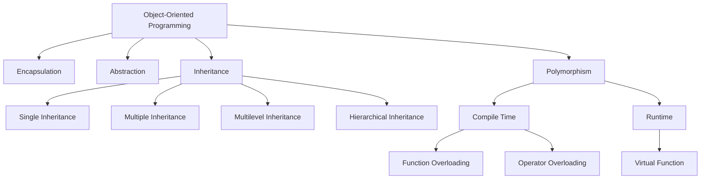

## Without OOP

### Example: Storing a Student

```cpp
#include <iostream>
#include <string>

int main() {
    std::string studentName = "John Doe";
    int studentAge = 20;
    std::string studentMajor = "Computer Science";

    std::cout << "Student Name: " << studentName << std::endl;
    std::cout << "Student Age: " << studentAge << std::endl;
    std::cout << "Student Major: " << studentMajor << std::endl;

    return 0;
}
```

```text
Student Name: John Doe
Student Age: 20
Student Major: Computer Science
```

### Problems

- **Not reusable**: If you need to store information for another student, you must create new variables for each attribute.
- **Poor real-world modeling**: Managing multiple independent variables for related data leads to confusion and errors.

## With OOP

### Example: Storing a Student

```cpp
#include <iostream>
#include <string>

class Student {
public:
    std::string name;
    int age;
    std::string major;

    void displayInfo() {
        std::cout << "Student Name: " << name << std::endl;
        std::cout << "Student Age: " << age << std::endl;
        std::cout << "Student Major: " << major << std::endl;
    }
};

int main() {
    Student student1;
    student1.name = "John Doe";
    student1.age = 20;
    student1.major = "Computer Science";

    student1.displayInfo();

    return 0;
}
```

```text
Student Name: John Doe
Student Age: 20
Student Major: Computer Science
```

### Benefits

- **Reusable**: Create multiple instances of the `Student` class to store information for different students without creating new variables for each attribute.
- **Effective modeling**: The `Student` class encapsulates the attributes and behaviors of a student, making it easier to manage and understand the data.

## Important Concepts in OOP

OOP allows you to create classes that represent real-world entities, making your code more organized, reusable, and easier to maintain. It promotes key principles:

- **Encapsulation**: Bundle data and methods together
- **Inheritance**: Build new classes from existing ones
- **Polymorphism**: Use objects in flexible ways

These principles are fundamental to creating robust and scalable software applications.

## Declaration of a Class and Object

In OOP, a class is a blueprint for creating objects. It defines the properties (attributes) and behaviors (methods) that the objects created from the class will have. An object is an instance of a class, meaning it is a specific realization of the class with actual values for its attributes.

### Example: Class and Object

```cpp

#include <iostream>
#include <string>

class Student {
public:
    std::string name;
    int age;
    std::string major;

    void displayInfo() {
        std::cout << "Student Name: " << name << std::endl;
        std::cout << "Student Age: " << age << std::endl;
        std::cout << "Student Major: " << major << std::endl;
    }
};

int main() {
    // Creating an object of the Student class
    Student student1;

    // methods and attributes are accessed using the dot operator (.)
    student1.name = "John Doe";
    student1.age = 20;
    student1.major = "Computer Science";

    // Displaying the information of the student
    student1.displayInfo();

    return 0;
}
```

```text
Student Name: John Doe
Student Age: 20
Student Major: Computer Science
```

Class Diagram:

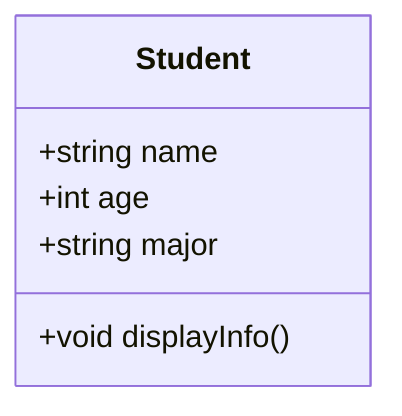

In this example, we define a class `Student` with three attributes: `name`, `age`, and `major`. We also define a method `displayInfo()` that prints the student's information. In the `main()` function, we create an object `student1` of the `Student` class, set its attributes, and call the `displayInfo()` method to display the student's information.

## Access Modifiers

Access modifiers are keywords used in OOP to set the accessibility of classes, methods, and other members. They control how the members of a class can be accessed from outside the class. The most common access modifiers are:

- **Public**: Members declared as public can be accessed from anywhere in the program. They are accessible to all other classes and functions.
- **Private**: Members declared as private can only be accessed within the class itself. They are not accessible from outside the class, including derived classes.
- **Protected**: Members declared as protected can be accessed within the class and by derived classes, but not from outside the class.
- **Default (Package-Private)**: If no access modifier is specified, the member is accessible only within its own package (in languages like Java). In C++, the default access level for class members is private.

### Example: Access Modifiers

```cpp

#include <iostream>
#include <string>

class Student {
private:
    std::string name;
    int age;
    std::string major;

public:
    void setInfo(std::string n, int a, std::string m) {
        name = n;
        age = a;
        major = m;
    }

    void displayInfo() {
        std::cout << "Student Name: " << name << std::endl;
        std::cout << "Student Age: " << age << std::endl;
        std::cout << "Student Major: " << major << std::endl;
    }
};

int main() {
    Student student1;
    student1.setInfo("John Doe", 20, "Computer Science");
    student1.displayInfo();

    return 0;
}
```

```text
Student Name: John Doe
Student Age: 20
Student Major: Computer Science
```

Class Diagram:

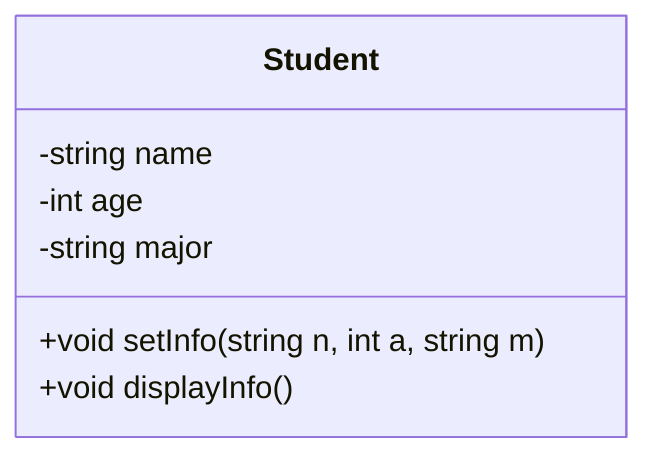

In this example, the attributes `name`, `age`, and `major` are declared as private, meaning they cannot be accessed directly from outside the class. Instead, we provide a public method `setInfo()` to set the values of these attributes and a public method `displayInfo()` to display them. This encapsulation helps to protect the integrity of the data and allows for better control over how the data is accessed and modified.

Why we need setters and getters?

setters ensure that the data is being set in a valid way. For example, if we want to set the age of a student, we can add a check in the setter method to ensure that the age is a positive number. This helps to prevent invalid data from being assigned to the attributes of the class.

getters allow us to retrieve the values of private attributes from outside the class. This is important because it allows us to access the data while still maintaining encapsulation and protecting the integrity of the data.

## Size of an Object

The size of an object in OOP depends on the attributes and methods defined in the class. The size of an object is determined by the amount of memory allocated for its attributes and the overhead of the class structure itself.

### Example 1

```cpp
#include <iostream>
#include <string>

class className {
public:
    int a;
};

int main()
{
    className obj;
    std::cout << "Size of object: " << sizeof(obj) << " bytes" << std::endl;
    // output: 4 bytes (size of int)
    return 0;
}
```

```text
Size of object: 4 bytes
```

### Example 2

```cpp
#include <iostream>

class className{};

int main()
{
    className obj;
    std::cout << "Size of object: " << sizeof(obj) << " bytes" << std::endl;
    return 0;
}
```

```text
Size of object: 1 bytes
```

### Example 3

```cpp

#include <iostream>

class className {
public:
    char b ;
    int a;
};
int main()
{
    className obj;
    std::cout << "Size of object: " << sizeof(obj) << " bytes" << std::endl;
    // output: 8 bytes (size of int + size of char + padding)
    return 0;
}
```

```text
Size of object: 8 bytes
```

In the first example, the class `className` has one integer attribute `a`, which typically takes 4 bytes of memory. Therefore, the size of the object `obj` is 4 bytes.

In the second example, the class `className` is empty and does not have any attributes. However, even an empty class has a size of at least 1 byte to ensure that each object has a unique address in memory. Therefore, the size of the object `obj` is 1 byte.

In the third example, the class `className` has two attributes: an integer `a` and a character `b`. The size of an integer is typically 4 bytes, and the size of a character is 1 byte. However, due to padding for memory alignment, the total size of the object `obj` may be 8 bytes instead of 5 bytes (4 bytes for the integer + 1 byte for the character + 3 bytes of padding). The exact size can vary based on the compiler and architecture.

### Padding

- **Padding** is the extra space added by the compiler to ensure that data is aligned in memory according to the architecture's requirements. This can lead to an increase in the size of an object, as seen in the third example where the total size is 8 bytes instead of 5 bytes due to padding.
- The compiler may add padding between attributes to ensure that each attribute is aligned on a memory boundary that is optimal for the architecture, which can improve performance when accessing the attributes.
- The OS reads 32 bits (4 bytes) or 64 bits (8 bytes) at a time, so it adds padding to ensure that data is aligned to these boundaries for efficient access.

In the third example, if the arrangement was sequential without padding:

| 1   | 2   | 3   | 4   | 5   | 6   | 7   | 8   |
| --- | --- | --- | --- | --- | --- | --- | --- |
| b   | a   | a   | a   | a   | x   | x   | x   |

It would take **2 cycles** to read the data stored in variable `a` because it spans across the 4-byte boundary.

But with padding, the arrangement becomes:

| 1   | 2   | 3   | 4   | 5   | 6   | 7   | 8   |
| --- | --- | --- | --- | --- | --- | --- | --- |
| b   | x   | x   | x   | a   | a   | a   | a   |

It takes **1 cycle** to read the data stored in variable `a`, because it is aligned to the memory boundary.

### Example 4

```cpp
#include <iostream>

class className {
public:
    char b;
    char c;
    int a;
};

int main()
{
    className obj;
    std::cout << "Size of object: " << sizeof(obj) << " bytes" << std::endl;
    // output: 8 bytes (size of int + size of char + size of char + padding)
    return 0;
}
```

```text
Size of object: 8 bytes
```

#### Memory Arrangement

| 1   | 2   | 3   | 4   | 5   | 6   | 7   | 8   |
| --- | --- | --- | --- | --- | --- | --- | --- |
| b   | c   | x   | x   | a   | a   | a   | a   |

### Example 5

```cpp
#include <iostream>

class className {
public:
    char b;
    int a;
    char c;
};

int main()
{
    className obj;
    std::cout << "Size of object: " << sizeof(obj) << " bytes" << std::endl;
    // output: 12 bytes (size of char + padding + size of int +
    // size of char + padding)
    return 0;
}
```

```text
Size of object: 12 bytes
```

#### Memory Arrangement

| 1   | 2   | 3   | 4   | 5   | 6   | 7   | 8   | 9   | 10  | 11  | 12  |
| --- | --- | --- | --- | --- | --- | --- | --- | --- | --- | --- | --- |
| b   | x   | x   | x   | a   | a   | a   | a   | c   | x   | x   | x   |

### Rule for Padding

- The final object size should be divisible by the size of the largest attribute in the class.
- In **Example 4**, the largest attribute is an integer (4 bytes), so the total size of the object is padded to 8 bytes to ensure it is divisible by 4.
- In **Example 5**, the largest attribute is still an integer (4 bytes), but due to the arrangement of attributes, the total size of the object is padded to 12 bytes to ensure it is divisible by 4.

### Greedy Alignment

- Start by declaring the largest attribute first, followed by smaller attributes. This can help to minimize the amount of padding needed and reduce the overall size of the object.

### Example 6

```cpp
#include <iostream>

class className {
public:
    char a;
    int c;
    char b;
    double d;
};

class className2 {
public:
    double d;
    int c;
    char a;
    char b;
};

int main()
{
    className obj1;
    className2 obj2;
    std::cout << "Size of object 1: "
              << sizeof(obj1) << " bytes" << std::endl;
    std::cout << "Size of object 2: "
              << sizeof(obj2) << " bytes" << std::endl;
    // output: Size of object 1: 24 bytes, Size of object 2: 16 bytes
    return 0;
}
```

```text
Size of object 1: 24 bytes
Size of object 2: 16 bytes
```

#### Memory Arrangement of `className`

| 1..4               | 5..8          | 9..12              | 13..16             | 17..24        |
| ------------------ | ------------- | ------------------ | ------------------ | ------------- |
| `a`, `x`, `x`, `x` | `c` (4 bytes) | `b`, `x`, `x`, `x` | `x`, `x`, `x`, `x` | `d` (8 bytes) |

#### Memory Arrangement of `className2` (Optimized)

| 1..8          | 9..12         | 13..16             |
| ------------- | ------------- | ------------------ |
| `d` (8 bytes) | `c` (4 bytes) | `a`, `b`, `x`, `x` |

## `new` Keyword & Dynamic Memory Allocation

In C++, the `new` keyword is used for dynamic memory allocation. It allows you to allocate memory on the heap for an object or an array of objects at runtime. When you use `new`, it returns a pointer to the allocated memory, which you can then use to access the object.

```cpp
#include <iostream>

class Student {
public:
    std::string name;
    int age;
    std::string major;
};

int main()
{
    // Dynamically allocating memory for a Student object
    Student* studentPtr = new Student;

    // Setting the attributes of the Student object
    // accessed using the arrow operator (->) since studentPtr is a pointer
    studentPtr->name = "John Doe";
    studentPtr->age = 20;
    studentPtr->major = "Computer Science";

    // similarly: (*studentPtr).name = "John Doe"; //
    // using dereference operator

    // Displaying the information of the student
    std::cout << "Student Name: " << studentPtr->name << std::endl;
    std::cout << "Student Age: " << studentPtr->age << std::endl;
    std::cout << "Student Major: " << studentPtr->major << std::endl;

    // Deallocating the memory for the Student object
    delete studentPtr;

    return 0;
}
```

```text
Student Name: John Doe
Student Age: 20
Student Major: Computer Science
```

In this example, we use the `new` keyword to dynamically allocate memory for a `Student` object. We then set the attributes of the student and display the information. Finally, we use the `delete` keyword to deallocate the memory that was allocated for the `Student` object to prevent memory leaks.

## Constructors

A constructor is a special member function of a class that is automatically called when an object of the class is created. It is used to initialize the attributes of the object and can also perform any setup required for the object. Constructors have the same name as the class and do not have a return type.

```cpp
#include <iostream>
#include <string>

class Student {
public:
    std::string name;
    int age;
    std::string major;

    // Constructor to initialize the attributes of the Student class
    Student()
    {
        std::cout << "Constructor called!" << std::endl;
    }

};

int main()
{
    // Creating an object of the Student class,
    // which will call the constructor
    Student student1;
    return 0;
}
```

```text
Constructor called!
```

### Uses

- **Initialization**: Constructors are used to initialize the attributes of an object when it is created. This ensures that the object starts in a valid state.
- **Overloading**: Constructors can be overloaded, meaning you can have multiple constructors with different parameters to allow for different ways of initializing an object.
- **Default Values**: Constructors can provide default values for attributes, making it easier to create objects without needing to specify all attributes every time.

```cpp
#include <iostream>
#include <string>

class Student {
public:
    std::string name;
    int age;
    std::string major;

    // Default constructor
    Student() {
        name = "Unknown";
        age = 0;
        major = "Undeclared";
    }

    // Parameterized constructor
    Student(std::string n, int a, std::string m) {
        name = n;
        age = a;
        major = m;
    }
};

int main()
{
    // Using the default constructor
    Student student1;
    std::cout << "Student 1: " << student1.name
              << ", " << student1.age << ", " << student1.major
              << std::endl;

    // Using the parameterized constructor
    Student student2("John Doe", 20, "Computer Science");
    std::cout << "Student 2: " << student2.name
              << ", " << student2.age << ", " << student2.major
              << std::endl;

    // output:
    // Student 1: Unknown, 0, Undeclared
    // Student 2: John Doe, 20, Computer Science
    return 0;
}
```

```text
Student 1: Unknown, 0, Undeclared
Student 2: John Doe, 20, Computer Science
```

**Constructor overloading**: In the above example, we have two constructors: a default constructor that initializes the attributes with default values, and a parameterized constructor that allows us to initialize the attributes with specific values when creating an object. This is an example of constructor overloading, where multiple constructors are defined with different parameter lists to provide flexibility in object creation.

### Types of Constructors

- **Default Constructor**: A constructor that takes no parameters and initializes the object with default values.
- **Parameterized Constructor**: A constructor that takes parameters to initialize the object with specific values.
- **Copy Constructor**: A constructor that creates a new object as a copy of an existing.

### `this` Pointer

The `this` pointer is a special pointer available in C++ that points to the current object. It is used within a class's member functions to refer to the object that is invoking the function. The `this` pointer allows you to access the attributes and methods of the current object, especially when there is a naming conflict between member variables and parameters.

```cpp
#include <iostream>
#include <string>

class Student {
public:
    std::string name;
    int age;
    std::string major;

    // Parameterized constructor using this to resolve naming conflict
    Student(std::string name, int age, std::string major) {
        this->name = name; // this->name refers to the member variable,
                           // name refers to the parameter
        this->age = age;   // this->age refers to the member variable,
                           // age refers to the parameter
        this->major = major; // this->major refers to the member variable,
                             // major refers to the parameter
    }
};

int main()
{
    Student student1("John Doe", 20, "Computer Science");
    std::cout << "Student Name: " << student1.name << std::endl;
    std::cout << "Student Age: " << student1.age << std::endl;
    std::cout << "Student Major: " << student1.major << std::endl;

    return 0;
}
```

```text
Student Name: John Doe
Student Age: 20
Student Major: Computer Science
```

In this example, the constructor takes parameters with the same names as the member variables. To resolve this naming conflict, we use the `this` pointer to refer to the member variables of the class. This allows us to correctly initialize the attributes of the `Student` object with the values passed as parameters.

### Inline Constructors

```cpp
#include <iostream>
#include <string>

class Student {
public:
    std::string name;
    int age;
    std::string major;

    // Inline constructor defined within the class definition
    Student(std::string n, int a, std::string m) :
        name(n), age(a), major(m) {}
};
```

In this example, the constructor is defined inline within the class definition. The member initializer list is used to initialize the attributes of the `Student` class directly with the values passed as parameters. This approach can improve readability and performance by avoiding the need for separate assignment statements within the constructor body.

### Copy Constructor

#### Default Copy Constructor

```cpp
#include <iostream>
#include <string>

class Student {
public:
    std::string name;
    int age;
    std::string major;
};

int main()
{
    Student student1;
    student1.name = "John Doe";
    student1.age = 20;
    student1.major = "Computer Science";

    // Using the default copy constructor to create a copy of student1
    Student student2 = student1;

    std::cout << "Student 2 Name: " << student2.name << std::endl;
    std::cout << "Student 2 Age: " << student2.age << std::endl;
    std::cout << "Student 2 Major: " << student2.major << std::endl;

    Student student3(student1); // Another way to use
    // the default copy constructor

    std::cout << "Student 3 Name: " << student3.name << std::endl;
    std::cout << "Student 3 Age: " << student3.age << std::endl;
    std::cout << "Student 3 Major: " << student3.major << std::endl;

    return 0;
}
```

```text
Student 2 Name: John Doe
Student 2 Age: 20
Student 2 Major: Computer Science
Student 3 Name: John Doe
Student 3 Age: 20
Student 3 Major: Computer Science
```

In this example, we create a `Student` object `student1` and initialize its attributes. We then use the default copy constructor to create a new object `student2` that is a copy of `student1`. The attributes of `student2` are the same as those of `student1`. We also demonstrate another way to use the default copy constructor by creating `student3` using the copy constructor syntax. Both `student2` and `student3` have the same attribute values as `student1`.

#### User-Defined Copy Constructor

```cpp
#include <iostream>
#include <string>

class Student {
public:
    std::string name;
    int age;
    std::string major;

    // Default constructor required since copy constructor is defined
    Student() {}

    // User-defined copy constructor
    Student(const Student& other) {
        name = other.name;
        age = other.age;
        major = other.major;
    }
};

int main()
{
    Student student1;
    student1.name = "John Doe";
    student1.age = 20;
    student1.major = "Computer Science";

    // Using the user-defined copy constructor to create a copy of student1
    Student student2(student1);

    std::cout << "Student 2 Name: " << student2.name << std::endl;
    std::cout << "Student 2 Age: " << student2.age << std::endl;
    std::cout << "Student 2 Major: " << student2.major << std::endl;

    return 0;
}
```

```text
Student 2 Name: John Doe
Student 2 Age: 20
Student 2 Major: Computer Science
```

In a user-defined copy constructor, the parameter is taken as a reference (using &) to another Student object. This allows direct access to the attributes of the existing object without creating an additional copy. If the object were passed by value instead, it would trigger the copy constructor again, leading to infinite recursion.

## Destructor

A destructor is a special member function of a class that is automatically called when an object of the class goes out of scope or is explicitly deleted. It is used to perform any necessary cleanup, such as releasing resources or memory that the object may have acquired during its lifetime. Destructors have the same name as the class but are preceded by a tilde (~) and do not have a return type.

```cpp
#include <iostream>
#include <string>

class Student {
public:
    std::string name;
    int age;
    std::string major;

    Student(std::string n, int a, std::string m) : name(n), age(a), major(m) {
        std::cout << "Constructor called for " << name << std::endl;
    }

    ~Student() {
        std::cout << "Destructor called for " << name << std::endl;
    }
};

int main()
{
    Student student1("John Doe", 20, "Computer Science");
    std::cout << "Student Name: " << student1.name << std::endl;
    std::cout << "Student Age: " << student1.age << std::endl;
    std::cout << "Student Major: " << student1.major << std::endl;

    return 0;

    // output:
    // Constructor called for John Doe
    // Destructor called for John Doe
}
```

```text
Constructor called for John Doe
Student Name: John Doe
Student Age: 20
Student Major: Computer Science
Destructor called for John Doe
```

### Properties of Destructors

- A class can have only one destructor.
- Destructors cannot be overloaded, meaning you cannot have multiple destructors with different parameters.
- Destructors do not take any parameters and do not return any value.
- The destructor is automatically called when an object goes out of scope or is explicitly deleted using the `delete` keyword.
- Destructors are typically used to release resources such as memory, file handles, or network connections that the object may have acquired during its lifetime.

> `Note`: constructors & destructors must be public.

### Order of Constructor and Destructor Calls

```cpp
#include <iostream>

class className{
    int a ;
public:

    className(int a)
    {
        this -> a = a ;
        std::cout << a << std::endl;
    }

    ~className()
    {
        std::cout << a << std::endl;
    }
};

int main()
{
    className obj1(1) , obj2(2) , obj3(3);
    return 0;
}
```

```text
1
2
3
3
2
1
```

- The constructors are called in the order of object creation (obj1, obj2, obj3), while the destructors are called in the reverse order of object creation (obj3, obj2, obj1) because when an object goes out of scope, its destructor is called to clean up resources. Since obj3 is the last object created, it is the first one to go out of scope and thus its destructor is called first.
- This is due of dependency between objects. If obj3 depends on obj2 and obj1, then obj3 must be destroyed before obj2 and obj1 to ensure that the resources used by obj3 are released properly before obj2 and obj1 are destroyed.

## `static` Keyword

**Problem**: If we want to keep track of the total number of students created, we would need to use a global variable to count the number of student objects. This can lead to issues with encapsulation and can make the code less modular.

**Solution**: We can use a static member variable in the `Student` class to keep track of the total number of students created. A static member variable is shared among all instances of the class, meaning that it retains its value across all objects of the class.

### Static Member Variables

```cpp
#include <iostream>
#include <string>

class Student {
public:
    std::string name;
    int age;
    std::string major;

    // Static member variable to keep track of the total number of students
    static int studentCount;

    // Constructor to initialize the attributes of the Student class
    // and increment the student count
    Student(std::string n, int a, std::string m) : name(n), age(a), major(m) {
        studentCount++;
    }
};

// Initialize the static member variable
int Student::studentCount = 0;

int main()
{
    Student student1("John Doe", 20, "Computer Science");
    Student student2("Jane Smith", 22, "Mathematics");

    // Way 1
    std::cout << "Total number of students: "
              << Student::studentCount << std::endl;

    // Way 2
    std::cout << "Total number of students: "
              << student1.studentCount << std::endl;

    return 0;
}
```

```text
Total number of students: 2
Total number of students: 2
```

The static member varibles is declared inside the class definition and is a shared variable among all instances of the class. It is initialized outside the class definition using the scope resolution operator `::`.

In this example, the static member variable `studentCount` is incremented each time a new `Student` object is created, allowing us to keep track of the total number of students without needing a global variable.

```cpp
#include <iostream>
#include <string>

class Student {
public:
    std::string name;
    int age;
    std::string major;

    // Static member variable to keep track of the total number of students
    static int studentCount;

    // Constructor to initialize the attributes of the Student class
    // and increment the student count
    Student(std::string n, int a, std::string m) : name(n), age(a), major(m) {
        studentCount++;
    }
};


// int Student::studentCount = 0;
// without initialization, it will give an error:
// undefined reference to `Student::studentCount'

int main()
{
    Student student1("John Doe", 20, "Computer Science");
    Student student2("Jane Smith", 22, "Mathematics");
    return 0;
}
```

### Static Member Functions

```cpp
#include <iostream>
#include <string>

class Student {
private:
    std::string name;
    int age;
    std::string major;

    static int studentCount;

public:
    Student(std::string n, int a, std::string m) : name(n), age(a), major(m) {
        studentCount++;
    }

    ~Student() {
        studentCount--;
    }

    static int getStudentCount() {
        return studentCount;
    }
};

int Student::studentCount = 0;
// only directly accessible once during initialization

int main()
{
    Student student1("John Doe", 20, "Computer Science");
    Student student2("Jane Smith", 22, "Mathematics");

    std::cout << "Total number of students: "
              << Student::getStudentCount() << std::endl;
    // Student::studentCount = 150 ; => throw an error because
    // studentCount is private and cannot be accessed directly outside
    // the class
    std::cout << "Total number of students: "
              << Student::getStudentCount() << std::endl;

    return 0;
}
```

```text
Total number of students: 2
Total number of students: 2
```

### Properties of Static Variables

- **If public**: can be accessed and modify directly without needing an object of the class
- **if private**: can only be accessed once during the initialization of the static member variable, and then it can only be accessed through static member functions (getters and setters) to ensure encapsulation and control over how the static member variable is accessed and modified.

### Properties of Static Functions

- can only access static member variables and other static member functions of the class. They cannot access non-static member variables or non-static member functions because they do not have access to the `this` pointer, which is used to refer to the current object instance. Static member functions are associated with the class itself rather than any particular object, so they can only operate on static members that are shared among all instances of the class.

## `const` Keyword

The `const` keyword in C++ is used to declare variables, pointers, member functions, and objects as constant, meaning their value cannot be changed after initialization. It is a way to enforce immutability and protect data from unintended modifications.

### `const` Variables

When a variable is declared as `const`, its value cannot be modified after it is initialized.

```cpp
#include <iostream>

int main() {
    const int maxStudents = 50;
    // maxStudents = 60; // Error: assignment of read-only variable
    std::cout << "Max students: " << maxStudents << std::endl;
    return 0;
}
```

```text
Max students: 50
```

### `const` Pointers

Pointers can be combined with `const` in different ways:

1. **Pointer to a `const` variable**: The data pointed to cannot be changed, but the pointer itself can point to another address. `const int* ptr;` or `int const* ptr;`
2. **`const` Pointer**: The pointer cannot change the address it points to, but the data at that address can be modified. `int* const ptr = &var;`
3. **`const` Pointer to a `const` variable**: Neither the pointer's address nor the data it points to can be changed. `const int* const ptr = &var;`
4. **Pointer to variable**: (simplest setting) Both the pointer's address and the data it points to can be changed. `int* ptr;`

### `const` Member Variables

A `const` member variable in a class must be initialized using a **member initializer list** in the constructor, because `const` variables cannot be assigned a value after they are created.

```cpp
#include <iostream>
#include <string>

class Student {
public:
    const int studentId;
    std::string name;

    // Initialization list must be used for const member variables
    Student(int id, std::string n) : studentId(id), name(n) {
        // studentId = id; // Error: cannot assign to const
    // variable inside constructor body
    }
};

int main() {
    Student s1(101, "John Doe");
    std::cout << "Student ID: " << s1.studentId << std::endl;
    // s1.studentId = 102; // Error: studentId is const
    return 0;
}
```

```text
Student ID: 101
```

### `const` Member Functions

A `const` member function guarantees that it will not modify any member variables of the object (except those marked as `mutable`). It is declared by placing the `const` keyword at the end of the function signature.

```cpp
#include <iostream>
#include <string>

class Student {
private:
    std::string name;
    int age;

public:
    Student(std::string n, int a) : name(n), age(a) {}

    // const member function
    void displayInfo() const {
        std::cout << "Student Name: " << name << std::endl;
        std::cout << "Student Age: " << age << std::endl;
        // age = age + 1; // Error: cannot modify member variables
    // inside a const function
    }
};

int main() {
    Student s("Alice", 20);
    s.displayInfo();
    return 0;
}
```

```text
Student Name: Alice
Student Age: 20
```

### `const` Objects

When an object is declared as `const`, it cannot be modified after initialization. A `const` object can **only** call `const` member functions. Calling a non-`const` member function on a `const` object will result in a compilation error.

```cpp
#include <iostream>
#include <string>

class Student {
private:
    std::string name;

public:
    Student(std::string n) : name(n) {}

    void setName(std::string n) {
        name = n;
    }

    std::string getName() const {
        return name;
    }
};

int main() {
    const Student s1("John Doe");

    std::cout << s1.getName() << std::endl;
// OK: getName() is a const member function
    // s1.setName("Jane Doe"); // Error: cannot call a non-const
    // member function on a const object

    return 0;
}
```

```text
John Doe
```

## Encapsulation

Encapsulation is one of the fundamental principles of Object-Oriented Programming (OOP) that refers to the bundling of data (attributes) and methods (functions) that operate on that data into a single unit, called a class. It also involves restricting direct access to some of the object's components, which is typically achieved through access modifiers (like `private`, `protected`, and `public`).

**Data hiding**: Encapsulation allows us to hide the internal state of an object and only expose a controlled interface to the outside world. This means that the internal representation of an object can be changed without affecting the code that uses the object, as long as the interface remains consistent.

```cpp
#include <iostream>
#include <string>

class Student {
private:
    std::string name;
    int age;
    std::string major;

public:
    void setInfo(std::string n, int a, std::string m) {

        if(a < 0) {
            std::cout << "Age cannot be negative." << std::endl;
            return;
        }

        if(m != "Computer Science" && m != "Mathematics" && m != "Physics") {
            std::cout << "Invalid major." << std::endl;
            return;
        }

        if(n.empty()) {
            std::cout << "Name cannot be empty." << std::endl;
            return;
        }

        name = n;
        age = a;
        major = m;
    }

    void displayInfo() {
        std::cout << "Student Name: " << name << std::endl;
        std::cout << "Student Age: " << age << std::endl;
        std::cout << "Student Major: " << major << std::endl;
    }
};

int main() {
    Student student1;
    student1.setInfo("John Doe", 20, "Computer Science");
    student1.displayInfo();

    // Attempting to set invalid information
    student1.setInfo("", -5, "History"); // Will trigger validation checks

    return 0;
}
```

```text
Student Name: John Doe
Student Age: 20
Student Major: Computer Science
Age cannot be negative.
```

## Abstraction

Abstraction is the process of hiding the implementation details of an object and showing only the essential features of the object. It allows us to focus on what an object does rather than how it does it. In C++, abstraction can be achieved through the use of classes and member functions.

```cpp
#include <iostream>
#include <string>

class Customer{
private:
    std::string name;
    std::string email;
    std::string password;

public:
    void setInfo(std::string n, std::string e, std::string p)
    {
        name = n;
        email = e;
        password = p;
    }


    bool login(std::string e, std::string p)
    {
        if(email == e && password == p)
        {
            return true;
        }
        else
        {
            return false;
        }

        // sending notification
        // other implementation details

        // USER DO NOT NEED TO KNOW ABOUT THIS
    }
};

int main()
{
    Customer customer1;
    customer1.setInfo("John Doe", "john.doe@example.com", "password123");

    if(customer1.login("john.doe@example.com", "password123"))
    {
        std::cout << "Login successful!" << std::endl;
    }
    else
    {
        std::cout << "Login failed!" << std::endl;
    }
}
```

```text
Login successful!
```

## Inheritance

Inheritance is a fundamental principle of Object-Oriented Programming (OOP) that allows a new class (called a derived class or child class) to inherit properties and behaviors (attributes and methods) from an existing class (called a base class or parent class). This promotes code reusability and establishes a natural hierarchical relationship between classes.

### Without Inheritance

```cpp
#include <iostream>
#include <string>

class Human{
public:
    std::string name;
    int age;

    void eat() {
        std::cout << name << " is eating." << std::endl;
    }
};

class Student {
public:
    std::string name;
    int age;
    std::string major;

    void eat() {
        std::cout << name << " is eating." << std::endl;
    }

    void study() {
        std::cout << name << " is studying " << major << "." << std::endl;
    }
};

class Teacher {
public:
    std::string name;
    int age;
    std::string subject;

    void eat() {
        std::cout << name << " is eating." << std::endl;
    }

    void teach() {
        std::cout << name << " is teaching " << subject << "." << std::endl;
    }
};

int main()
{
    Student student1;
    student1.name = "John Doe";
    student1.age = 20;
    student1.major = "Computer Science";

    Teacher teacher1;
    teacher1.name = "Jane Smith";
    teacher1.age = 40;
    teacher1.subject = "Mathematics";

    student1.eat();
    student1.study();

    teacher1.eat();
    teacher1.teach();

    return 0;
}
```

```text
John Doe is eating.
John Doe is studying Computer Science.
Jane Smith is eating.
Jane Smith is teaching Mathematics.
```

**Issue**: In the above example, both the `Student` and `Teacher` classes have duplicate attributes (`name` and `age`) and a duplicate method (`eat()`). This leads to code redundancy and makes the code less maintainable. If we want to change the implementation of the `eat()` method, we would need to change it in both classes, which can lead to errors and inconsistencies.

### With Inheritance

```cpp
#include <iostream>
#include <string>

class Human {
public:
    std::string name;
    int age;

    void eat() {
        std::cout << name << " is eating." << std::endl;
    }

};

class Student : public Human {
public:
    std::string major;

    void study() {
        std::cout << name << " is studying " << major << "." << std::endl;
    }
};

class Teacher : public Human {
public:
    std::string subject;

    void teach() {
        std::cout << name << " is teaching " << subject << "." << std::endl;
    }
};

int main()
{
    Student student1;
    student1.name = "John Doe";
    student1.age = 20;
    student1.major = "Computer Science";

    Teacher teacher1;
    teacher1.name = "Jane Smith";
    teacher1.age = 40;
    teacher1.subject = "Mathematics";

    student1.eat();
    student1.study();

    teacher1.eat();
    teacher1.teach();

    return 0;
}
```

```text
John Doe is eating.
John Doe is studying Computer Science.
Jane Smith is eating.
Jane Smith is teaching Mathematics.
```

> Syntax: `class DerivedClass : accessSpecifier BaseClass { ... }`

In this example, we have a base class `Human` that contains the common attributes (`name` and `age`) and the common method (`eat()`). The `Student` and `Teacher` classes inherit from the `Human` class using the `public` access specifier, which means they can access the public members of the `Human` class. This eliminates code redundancy and promotes code reusability. If we want to change the implementation of the `eat()` method, we only need to change it in the `Human` class, and both `Student` and `Teacher` will automatically use the updated implementation.

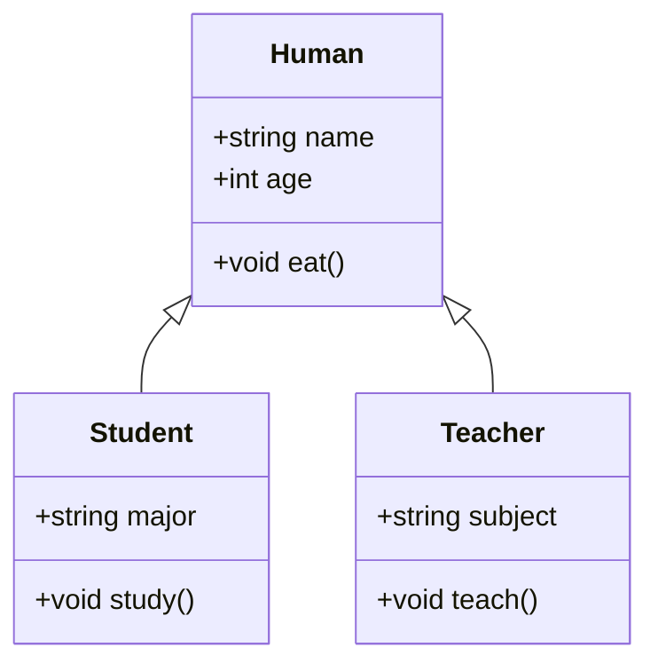

### Access Modifiers vs Access Table

| Access Modifier | External Code | Within Class | Derived Class |
| --------------- | ------------- | ------------ | ------------- |
| `public`        | Yes           | Yes          | Yes           |
| `protected`     | No            | Yes          | Yes           |
| `private`       | No            | Yes          | No            |

### Access Specifiers

| Base Class Access Specifier | Derived Class Access Level | Inherited Members Access Level |
| --------------------------- | -------------------------- | ------------------------------ |
| `public`                    | `public`                   | `public`                       |
| `public`                    | `protected`                | `protected`                    |
| `public`                    | `private`                  | `private`                      |
| `protected`                 | `public`                   | `protected`                    |
| `protected`                 | `protected`                | `protected`                    |
| `protected`                 | `private`                  | `private`                      |
| `private`                   | `public`                   | Not Inherited                  |
| `private`                   | `protected`                | Not Inherited                  |
| `private`                   | `private`                  | Not Inherited                  |

### Visual

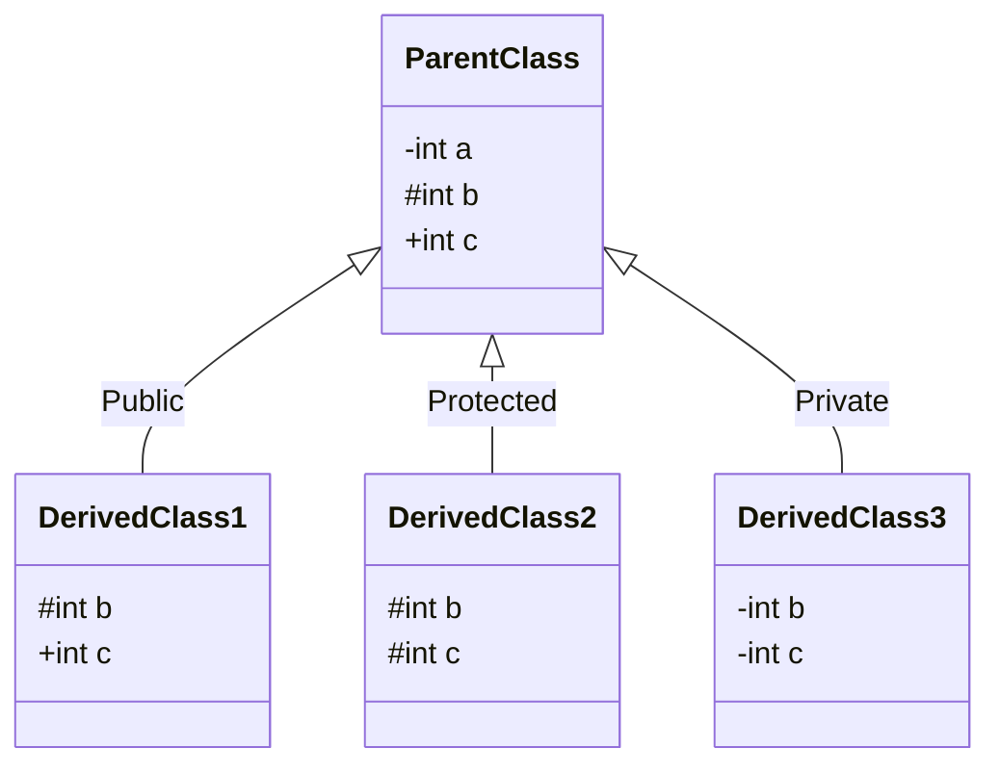

### Note

- `-` means private, `#` means protected, and `+` means public.
- `b` and `c` are not copy as shown in the mermaid diagram, but it is used for demonstration purposes to show the access level of the inherited members in the derived classes.

### Types of Inheritance

#### Single Inheritance

```cpp
#include <iostream>
#include <string>

class Animal {
private:
    int a; // need to be initialized in the constructor to avoid garbage value
public:
    void eat() {
        std::cout << "Animal is eating." << std::endl;
    }

    void commonFunction() {
        std::cout << "This is a common function made by Animal." << std::endl;
    }

    Animal(int a) {
        this->a = a;
        std::cout << "Animal constructor called." << std::endl;
    }

    ~Animal() {
        std::cout << "Animal destructor called." << std::endl;
    }
};

class Dog : public Animal {
private:
    int b; // needs to be initialized in the constructor to
    // avoid garbage value
public:
    void bark() {
        std::cout << "Dog is barking." << std::endl;
    }

    void commonFunction() {
        std::cout << "This is a common function made by Dog." << std::endl;
    }

    Dog(int a, int b) : Animal(a) {
        this->b = b;
        std::cout << "Dog constructor called." << std::endl;
    }

    ~Dog() {
        std::cout << "Dog destructor called." << std::endl;
    }
};

int main() {
    Dog dog1(10, 20);
    dog1.eat();
    dog1.bark();
    dog1.commonFunction(); // This will call the commonFunction() of
    // Dog class because it is overridden in the Dog class

    // output:
    // Animal constructor called. (value of a will be set to 10)
    // Dog constructor called. (value of b will be set to 20)
    // Animal is eating.
    // Dog is barking.
    // This is a common function made by Dog.
    // Dog destructor called.
    // Animal destructor called.

    return 0;
}
```

```text
Animal constructor called.
Dog constructor called.
Animal is eating.
Dog is barking.
This is a common function made by Dog.
Dog destructor called.
Animal destructor called.
```

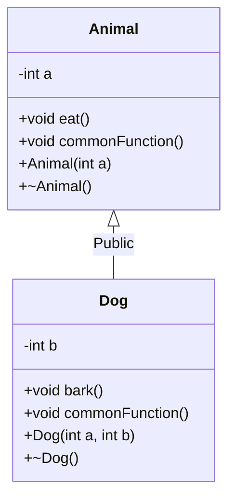

#### Multilevel Inheritance

```cpp
#include <iostream>
#include <string>

class Animal {
private:
    int a ;
public:
    void eat() {
        std::cout << "Animal is eating." << std::endl;
    }

    Animal(int a){
        this->a = a;
        std::cout << "Animal constructor called." << std::endl;
    }

    ~Animal() {
        std::cout << "Animal destructor called." << std::endl;
    }

};

class Dog : public Animal {
private:
    int b ;
public:
    void bark() {
        std::cout << "Dog is barking." << std::endl;
    }

    Dog(int a, int b) : Animal(a) {
        this->b = b;
        std::cout << "Dog constructor called." << std::endl;
    }

    ~Dog() {
        std::cout << "Dog destructor called." << std::endl;
    }
};

class Puppy : public Dog {
private:
    int c ;
public:
    void weep() {
        std::cout << "Puppy is weeping." << std::endl;
    }

    Puppy(int a, int b, int c) : Dog(a, b) {
        this->c = c;
        std::cout << "Puppy constructor called." << std::endl;
    }

    ~Puppy() {
        std::cout << "Puppy destructor called." << std::endl;
    }
};

int main(){
    Puppy puppy1(10, 20, 30);
    puppy1.eat();  // Inherited from Animal class
    puppy1.bark(); // Inherited from Dog class
    puppy1.weep(); // Defined in Puppy class

    // output:
    // Animal constructor called. (value of a will be set to 10)
    // Dog constructor called. (value of b will be set to 20)
    // Puppy constructor called. (value of c will be set to 30)
    // Animal is eating.
    // Dog is barking.
    // Puppy is weeping.
    // Puppy destructor called.
    // Dog destructor called.
    // Animal destructor called.

    return 0;
}
```

```text
Animal constructor called.
Dog constructor called.
Puppy constructor called.
Animal is eating.
Dog is barking.
Puppy is weeping.
Puppy destructor called.
Dog destructor called.
Animal destructor called.
```

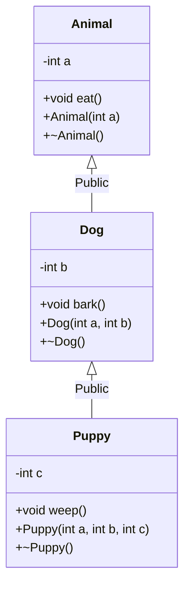

#### Multiple Inheritance

```cpp
#include <iostream>
#include <string>

class Animal {
private:
    int a;
public:
    void eat() {
        std::cout << "Animal is eating." << std::endl;
    }

    Animal(int a) {
        this->a = a;
        std::cout << "Animal constructor called." << std::endl;
    }

    ~Animal() {
        std::cout << "Animal destructor called." << std::endl;
    }
};

class Pet {
private:
    int b;
public:
    void play() {
        std::cout << "Pet is playing." << std::endl;
    }

    Pet(int b) {
        this->b = b;
        std::cout << "Pet constructor called." << std::endl;
    }

    ~Pet() {
        std::cout << "Pet destructor called." << std::endl;
    }
};

class Dog : public Animal, public Pet {
private:
    int c;
public:
    void bark() {
        std::cout << "Dog is barking." << std::endl;
    }

    Dog(int a, int b, int c) : Animal(a), Pet(b) {
        this->c = c;
        std::cout << "Dog constructor called." << std::endl;
    }

    ~Dog() {
        std::cout << "Dog destructor called." << std::endl;
    }
};

int main() {
    Dog dog1(10, 20, 30);
    dog1.eat();  // Inherited from Animal class
    dog1.play(); // Inherited from Pet class
    dog1.bark(); // Defined in Dog class

    // output:
    // Animal constructor called.
    // Pet constructor called.
    // Dog constructor called.
    // Animal is eating.
    // Pet is playing.
    // Dog is barking.
    // Dog destructor called.
    // Pet destructor called.
    // Animal destructor called.

    return 0;
}
```

```text
Animal constructor called.
Pet constructor called.
Dog constructor called.
Animal is eating.
Pet is playing.
Dog is barking.
Dog destructor called.
Pet destructor called.
Animal destructor called.
```

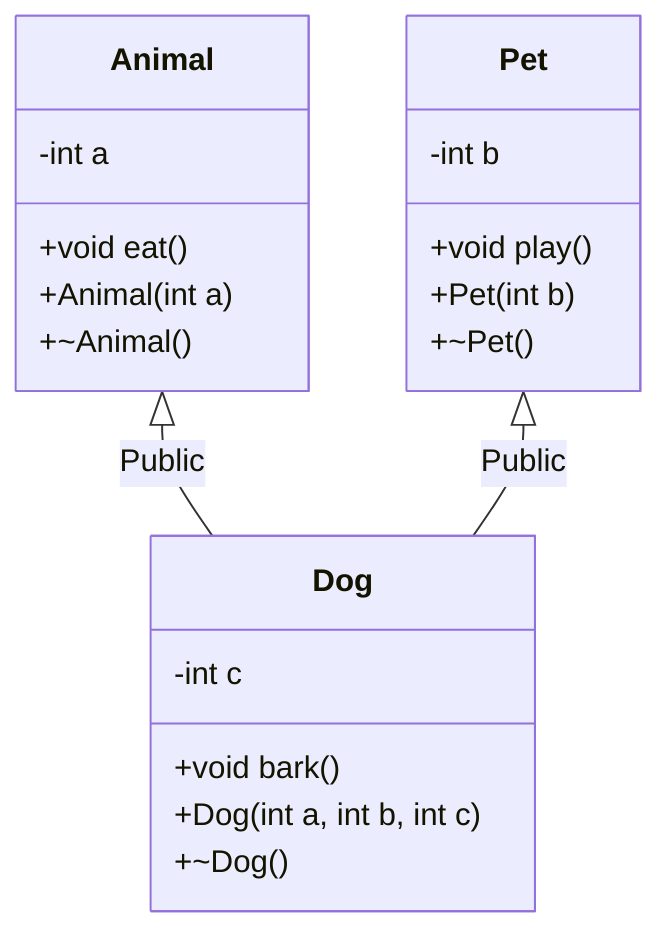

##### Note
When a class inherits from multiple base classes:

```cpp
class DerivedClass : public ParentClass1, public ParentClass2,
                     ..., public ParentClassN
```

Constructors are called in the **order of inheritance declaration**:

1. `ParentClass1` constructor
2. `ParentClass2` constructor
3. ...
4. `ParentClassN` constructor
5. `DerivedClass` constructor

Destructors are called in the **reverse order**:

1. `DerivedClass` destructor
2. `ParentClassN` destructor
3. ...
4. `ParentClass2` destructor
5. `ParentClass1` destructor

#### Hierarchical Inheritance

```cpp
#include <iostream>
#include <string>

class Animal {
private:
    int a;
public:
    void eat() {
        std::cout << "Animal is eating." << std::endl;
    }

    Animal(int a) {
        this->a = a;
        std::cout << "Animal constructor called." << std::endl;
    }

    ~Animal() {
        std::cout << "Animal destructor called." << std::endl;
    }
};

class Dog : public Animal {
private:
    int b;
public:
    void bark() {
        std::cout << "Dog is barking." << std::endl;
    }

    Dog(int a, int b) : Animal(a) {
        this->b = b;
        std::cout << "Dog constructor called." << std::endl;
    }

    ~Dog() {
        std::cout << "Dog destructor called." << std::endl;
    }
};

class Cat : public Animal {
private:
    int c;
public:
    void meow() {
        std::cout << "Cat is meowing." << std::endl;
    }

    Cat(int a, int c) : Animal(a) {
        this->c = c;
        std::cout << "Cat constructor called." << std::endl;
    }

    ~Cat() {
        std::cout << "Cat destructor called." << std::endl;
    }
};

int main() {
    Dog dog1(10, 20);
    dog1.eat();  // Inherited from Animal class
    dog1.bark(); // Defined in Dog class

    Cat cat1(30, 40);
    cat1.eat();  // Inherited from Animal class
    cat1.meow(); // Defined in Cat class

    // output:
    // Animal constructor called. (value of a will be set to 10)
    // Dog constructor called. (value of b will be set to 20)
    // Animal is eating.
    // Dog is barking.
    // Animal constructor called. (value of a will be set to 30)
    // Cat constructor called. (value of c will be set to 40)
    // Animal is eating.
    // Cat is meowing.
    // Cat destructor called.
    // Animal destructor called.
    // Dog destructor called.
    // Animal destructor called.

    return 0;
}
```

```text
Animal constructor called.
Dog constructor called.
Animal is eating.
Dog is barking.
Animal constructor called.
Cat constructor called.
Animal is eating.
Cat is meowing.
Cat destructor called.
Animal destructor called.
Dog destructor called.
Animal destructor called.
```

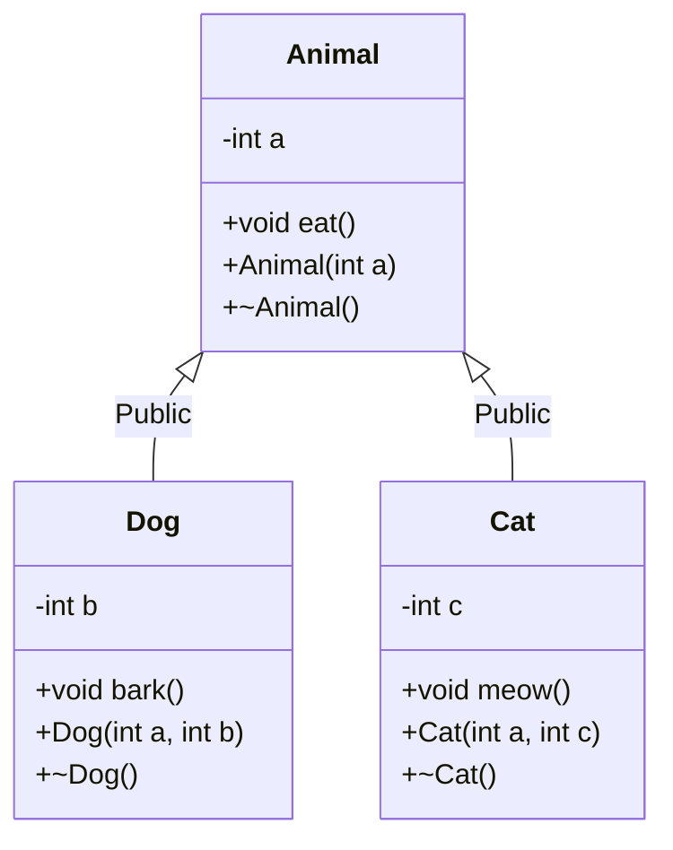

#### Hybrid Inheritance

```cpp
#include <iostream>
#include <string>

class Animal {
private:
    int a;
public:
    void eat() {
        std::cout << "Animal is eating." << std::endl;
    }

    Animal(int a) {
        this->a = a;
        std::cout << "Animal constructor called." << std::endl;
    }

    ~Animal() {
        std::cout << "Animal destructor called." << std::endl;
    }
};

class Pet {
private:
    int b;
public:
    void play() {
        std::cout << "Pet is playing." << std::endl;
    }

    Pet(int b) {
        this->b = b;
        std::cout << "Pet constructor called." << std::endl;
    }

    ~Pet() {
        std::cout << "Pet destructor called." << std::endl;
    }
};

class Dog : public Animal, public Pet {
private:
    int c;
public:
    void bark() {
        std::cout << "Dog is barking." << std::endl;
    }

    Dog(int a, int b, int c) : Animal(a), Pet(b) {
        this->c = c;
        std::cout << "Dog constructor called." << std::endl;
    }

    ~Dog() {
        std::cout << "Dog destructor called." << std::endl;
    }
};

class Puppy : public Dog {
private:
    int d;
public:
    void weep() {
        std::cout << "Puppy is weeping." << std::endl;
    }

    Puppy(int a, int b, int c, int d) : Dog(a, b, c) {
        this->d = d;
        std::cout << "Puppy constructor called." << std::endl;
    }

    ~Puppy() {
        std::cout << "Puppy destructor called." << std::endl;
    }
};

int main() {
    Puppy puppy1(10, 20, 30, 40);
    puppy1.eat();  // Inherited from Animal class via Dog
    puppy1.play(); // Inherited from Pet class via Dog
    puppy1.bark(); // Inherited from Dog class
    puppy1.weep(); // Defined in Puppy class

    // output:
    // Animal constructor called.
    // Pet constructor called.
    // Dog constructor called.
    // Puppy constructor called.
    // Animal is eating.
    // Pet is playing.
    // Dog is barking.
    // Puppy is weeping.
    // Puppy destructor called.
    // Dog destructor called.
    // Pet destructor called.
    // Animal destructor called.

    return 0;
}
```

```text
Animal constructor called.
Pet constructor called.
Dog constructor called.
Puppy constructor called.
Animal is eating.
Pet is playing.
Dog is barking.
Puppy is weeping.
Puppy destructor called.
Dog destructor called.
Pet destructor called.
Animal destructor called.
```

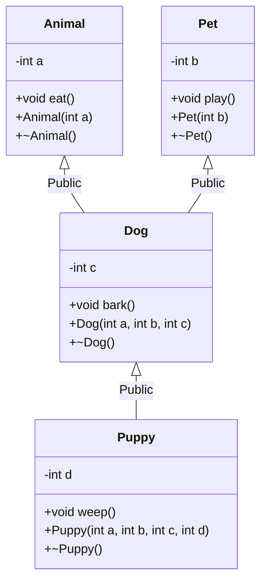

#### Multipath Inheritance (Diamond Problem)

Multipath inheritance occurs when a class is derived from two or more classes which, in turn, are derived from the same common base class. This creates a diamond-shaped hierarchy and leads to the **Diamond Problem**, where the derived class ends up with multiple copies of the common base class's attributes and methods. This creates ambiguity when trying to access those inherited members.

```cpp
#include <iostream>

class Animal {
public:
    int age;
};

class Mammal : public Animal {};

class Pet : public Animal {};

class Dog : public Mammal, public Pet {};

int main() {
    Dog d;
    // d.age = 5; // ERROR: Ambiguity! Is it d.Mammal::age or d.Pet::age?
    return 0;
}
```

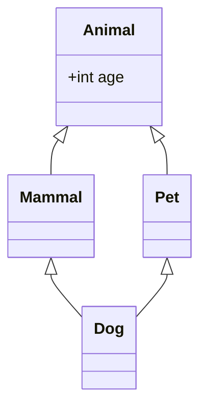

When `Dog` tries to access an attribute from `Animal` (like `age`), the compiler doesn't know whether to use the copy inherited through `Mammal` or the copy inherited through `Pet`.

##### Solution 1: Resolving via Scope Resolution Operator `::`

We can resolve the ambiguity explicitly by specifying which path to take using the scope resolution operator (`::`).

```cpp
#include <iostream>

class Animal {
public:
    int age;
};

class Mammal : public Animal {};

class Pet : public Animal {};

class Dog : public Mammal, public Pet {};

int main() {
    Dog d;

    // Explicitly defining the path
    d.Mammal::age = 5;
    d.Pet::age = 10;

    std::cout << "Age via Mammal: " << d.Mammal::age
              << std::endl; // Output: 5
    std::cout << "Age via Pet: " << d.Pet::age
              << std::endl;       // Output: 10

    // Note: This still leaves two separate copies of
    // 'Animal' (and 'age') in memory.
    return 0;
}
```

```text
Age via Mammal: 5
Age via Pet: 10
```

##### Solution 2: Virtual Inheritance (`virtual` Keyword)

The most common and efficient solution is to use **virtual inheritance**. By adding the `virtual` keyword when inheriting from the common base class, we ensure that only **one single instance** (one shared copy) of the base class is inherited by the deepest derived class, fixing both the memory overhead and the access ambiguity.

```cpp
#include <iostream>

class Animal {
public:
    int age;
};

// Use "virtual" keyword to prevent duplicate base class copies
class Mammal : virtual public Animal {};

class Pet : virtual public Animal {};

class Dog : public Mammal, public Pet {};

int main() {
    Dog d;

    // Works perfectly without ambiguity!
    d.age = 5;

    std::cout << "Dog's age is: " << d.age << std::endl; // Output: 5

    return 0;
}
```

```text
Dog's age is: 5
```

## Polymorphism

Polymorphism is a fundamental principle of Object-Oriented Programming (OOP) that allows objects of different classes to be treated as objects of a common base class. The word comes from Greek — "many forms" — and that's exactly what it delivers: one interface, multiple behaviors depending on the context. In C++, polymorphism is achieved through function overloading, operator overloading, and most powerfully, through **virtual functions** and **inheritance**.

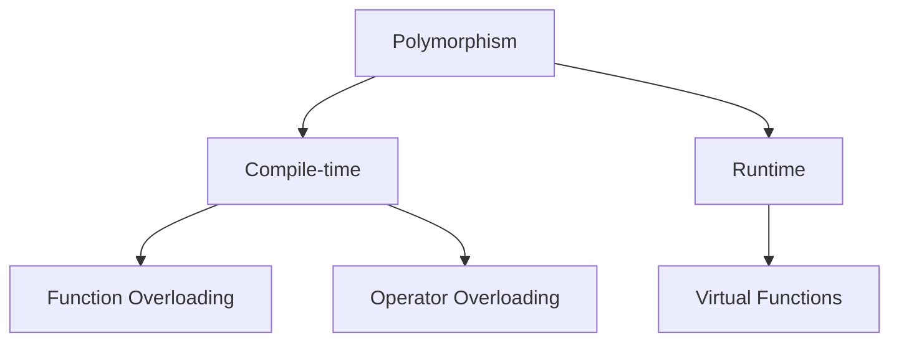

> **Compile-time polymorphism** is resolved by the compiler before the program runs. **Runtime polymorphism** is resolved while the program is executing, using the actual type of the object.

---

### Function Overloading

Function overloading lets you define multiple functions with the **same name** but **different parameter lists** — different in number, type, or both. The compiler picks the right version at compile time based on the arguments you pass.

```cpp
#include <iostream>

void print(int i) {
    std::cout << "Integer: " << i << std::endl;
}

void print(double d) {
    std::cout << "Double: " << d << std::endl;
}

void print(std::string s) {
    std::cout << "String: " << s << std::endl;
}

int main() {
    print(42);        // Calls print(int)
    print(3.14);      // Calls print(double)
    print("Hello");   // Calls print(std::string)

    return 0;
}
```

```text
Integer: 42
Double: 3.14
String: Hello
```

> **How the compiler decides:** It looks at the type of each argument and selects the best-matching overload. If no exact match exists, it attempts implicit conversions. If it finds zero or more than one match after conversions, it raises a compile error.

---

### Operator Overloading

Operator overloading lets you redefine the behavior of built-in operators (`+`, `-`, `*`, `==`, etc.) for your own classes. This makes user-defined types feel as natural to work with as primitives.

**Built-in example** — the `+` operator already behaves differently depending on type:

```cpp
#include <iostream>

int main() {
    int a = 5, b = 10;
    std::cout << a + b << std::endl; // Output: 15  (integer
    // addition)

    std::string x = "Dev ";
    std::string y = "Trivedi";
    std::cout << x + y << std::endl;  // Output: Dev Trivedi  (string concatenation)
}
```

```text
15
Dev Trivedi
```

**User-defined example** — overloading `+` for a `Complex` number class:

```cpp
#include <iostream>

class Complex {
private:
    double real;
    double imag;

public:
    Complex(double real, double imag) : real(real), imag(imag) {}

    // Overload + to add two Complex numbers
    Complex operator+(const Complex& other) const {
        return Complex(real + other.real, imag + other.imag);
    }

    void display() const {
        std::cout << real << " + " << imag << "i" << std::endl;
    }
};

int main() {
    Complex c1(1.0, 2.0);
    Complex c2(3.0, 4.0);

    Complex c3 = c1 + c2;  // Calls our overloaded operator+

    std::cout << "Result: ";
    c3.display();  // Output: 4 + 6i

    return 0;
}
```

```text
Result: 4 + 6i
```

> **Why `private` members are accessible:** `operator+` is a member function of `Complex`, so it has direct access to the private members of _any_ `Complex` object — not just `this`, but also `other`.

#### Operators That Cannot Be Overloaded

| Operator                                                        | Name                |
| --------------------------------------------------------------- | ------------------- |
| `::`                                                            | Scope resolution    |
| `.`                                                             | Member access       |
| `.*`                                                            | Pointer-to-member   |
| `?:`                                                            | Ternary conditional |
| `sizeof`                                                        | Size of type        |
| `typeid`                                                        | Runtime type info   |
| `alignof`                                                       | Alignment query     |
| `noexcept`                                                      | Exception check     |
| `static_cast`, `dynamic_cast`, `const_cast`, `reinterpret_cast` | Cast operators      |

---

### Method Overriding and Virtual Functions

Method overriding occurs when a derived class provides its own implementation of a method already defined in the base class — same name, same return type, same parameters. The key question in C++ is: _which version gets called when you go through a pointer or reference?_ The answer depends entirely on whether the method is `virtual`.

#### Without `virtual` (Static Dispatch)

Without `virtual`, C++ resolves the call at **compile time** based on the **declared type of the pointer** — not the actual object it points to. This is called static dispatch.

```cpp
#include <iostream>

class Animal {
public:
    void sound() {
        std::cout << "Animal makes a sound." << std::endl;
    }
};

class Dog : public Animal {
public:
    void sound() {
        std::cout << "Dog barks." << std::endl;
    }
};

int main() {
    Animal* ptr = new Dog();  // ptr is declared as Animal*
    ptr->sound();             // Compiler sees Animal* → calls Animal::sound()

    delete ptr;
    return 0;
}

// Output:
// Animal makes a sound.
```

```text
Animal makes a sound.
```

Even though `ptr` actually points to a `Dog`, the compiler only looks at the declared type `Animal*` and binds `sound()` to `Animal::sound()` at compile time. The `Dog` version is never called.

#### With `virtual` (Dynamic Dispatch)

Marking a method `virtual` tells C++ to defer the decision to **runtime**. It looks at the actual type of the object in memory and calls the appropriate version. This is called dynamic dispatch, and it's the foundation of runtime polymorphism.

```cpp
#include <iostream>

class Animal {
public:
    virtual void sound() {    // virtual enables runtime dispatch
        std::cout << "Animal makes a sound." << std::endl;
    }

    virtual ~Animal() {}      // Always declare a virtual destructor in base classes
};

class Dog : public Animal {
public:
    void sound() override {   // override is optional but catches typos at compile time
        std::cout << "Dog barks." << std::endl;
    }
};

int main() {
    Animal* ptr = new Dog();
    ptr->sound();  // Runtime: sees Dog object → calls Dog::sound()

    delete ptr;
    return 0;
}

// Output:
// Dog barks.
```

```text
Dog barks.
```

> **How it works under the hood:** Each class with virtual functions gets a hidden **vtable** (virtual function table) — an array of function pointers. Each object carries a hidden **vptr** that points to its class's vtable. When you call a virtual function, C++ follows the vptr to the vtable and calls the right function for the actual object type.

#### Polymorphism in Action — Heterogeneous Collections

The real power of virtual functions shines when you store different derived types through a common base pointer:

```cpp
#include <iostream>
#include <vector>
using namespace std;

class Animal {
public:
    virtual void sound() {
        cout << "Animal makes a sound." << endl;
    }
    virtual ~Animal() {}
};

class Dog : public Animal {
public:
    void sound() override {
        cout << "Dog barks." << endl;
    }
};

class Cat : public Animal {
public:
    void sound() override {
        cout << "Cat meows." << endl;
    }
};

int main() {
    vector<Animal*> animals;
    animals.push_back(new Dog());
    animals.push_back(new Cat());
    animals.push_back(new Animal());

    for (auto& animal : animals) {
        animal->sound();  // Calls the correct version for each object
    }

    for (auto& animal : animals) {
        delete animal;
    }

    return 0;
}
```
```text
Dog barks.
Cat meows.
Animal makes a sound.
```


This is the core benefit: you can write generic code that operates on `Animal*` and it automatically does the right thing for every derived type — even ones you haven't written yet.

#### Rules for Virtual Functions

- They **cannot be static** — virtual dispatch requires an object instance (a vptr), which static functions don't have.
- They are dispatched through **object pointers or references** — calling through a value type (e.g., `Animal a = Dog()`) slices the object and loses polymorphism.
- They **can be a friend** of another class — friendship and virtual dispatch are orthogonal features.
- They should be **defined in the base class** and optionally overridden in derived classes (an unoverridden virtual simply uses the base class version).
- Always declare a **virtual destructor** in any class with virtual functions. Without it, deleting a derived object through a base pointer is undefined behavior — the derived destructor won't be called and resources will leak.

#### Pure Virtual Functions and Abstract Classes

A **pure virtual function** is a virtual function with no implementation in the base class. It acts as a contract — any concrete derived class _must_ provide its own implementation, or it too becomes abstract and cannot be instantiated.

Syntax: append `= 0` to the function declaration.

```cpp
class Shape {
public:
    virtual double area() = 0;  // Pure virtual — no body here
    virtual ~Shape() {}
};
```

A class that contains at least one pure virtual function is called an **abstract class**. You cannot create objects of an abstract class directly — it exists solely to define an interface for its subclasses.

```cpp
#include <iostream>
#include <cmath>
using namespace std;

class Shape {
public:
    virtual double area() = 0;       // Pure virtual
    virtual void describe() = 0;     // Pure virtual

    virtual ~Shape() {}
};

class Circle : public Shape {
private:
    double radius;
public:
    Circle(double r) : radius(r) {}

    double area() override {
        return M_PI * radius * radius;
    }

    void describe() override {
        cout << "Circle with radius " << radius
             << ", area = " << area() << endl;
    }
};

class Rectangle : public Shape {
private:
    double width, height;
public:
    Rectangle(double w, double h) : width(w), height(h) {}

    double area() override {
        return width * height;
    }

    void describe() override {
        cout << "Rectangle " << width << "x" << height
             << ", area = " << area() << endl;
    }
};

int main() {
    // Shape s;  // Error: cannot instantiate an abstract class

    Shape* shapes[] = { new Circle(5.0), new Rectangle(4.0, 6.0) };

    for (auto& s : shapes) {
        s->describe();
        delete s;
    }

    return 0;
}
```

```text
Circle with radius 5, area = 78.5398
Rectangle 4x6, area = 24
```

> **Abstract class vs interface:** C++ has no dedicated `interface` keyword. An abstract class where _all_ methods are pure virtual and there is no data effectively acts as an interface — a pure capability contract with zero implementation.

#### Key Rules for Pure Virtual Functions and Abstract Classes

| Rule                   | Detail                                                                                                                                                  |
| ---------------------- | ------------------------------------------------------------------------------------------------------------------------------------------------------- |
| Instantiation          | Abstract classes cannot be instantiated directly                                                                                                        |
| Derived obligation     | A derived class must override **all** pure virtual functions, or it also becomes abstract                                                               |
| Partial implementation | A base class _can_ provide a body for a pure virtual function — derived classes can call it explicitly via `Base::method()`, but must still override it |
| Destructor             | Always declare a `virtual ~Shape() {}` in the base — even in abstract classes — to ensure correct cleanup through base pointers                         |

## Friend Functions and Classes

In C++, encapsulation ensures that private and protected members of a class cannot be accessed from outside. However, sometimes it is necessary to allow a specific external function or another class to access these private members. This is achieved using the `friend` keyword.

### Friend Function

A friend function is a function that is not a member of a class but is granted access to its private and protected members. It is declared inside the class using the `friend` keyword, but its definition is placed outside the class without the scope resolution operator (`::`).

```cpp
#include <iostream>

class Box {
private:
    double width;

public:
    Box() : width(0) {}

    void setWidth(double w) {
        width = w;
    }

    // Declaration of the friend function
    friend void printWidth(Box box);
};

// Definition of the friend function
// Note: It is not a member function, so no "Box::" is used
void printWidth(Box box) {
    // Because printWidth is a friend of Box, it can directly access the private 'width'
    std::cout << "Width of box: " << box.width << std::endl;
}

int main() {
    Box b;
    b.setWidth(10.5);

    // Calling the friend function
    printWidth(b);

    return 0;
}
// Output: Width of box: 10.5
```

```text
Width of box: 10.5
```

### Friend Class

You can also declare an entire class as a friend of another class. When class `B` is a friend of class `A`, all member functions of class `B` are granted access to the private and protected members of class `A`.

```cpp
#include <iostream>

class Engine {
private:
    int horsepower;

public:
    Engine(int hp) : horsepower(hp) {}

    // Declare class Car as a friend
    friend class Car;
};

class Car {
public:
    void printEnginePower(Engine& e) {
        // Can access private member 'horsepower' of Engine
        std::cout << "The car's engine has " << e.horsepower << " horsepower." << std::endl;
    }
};

int main() {
    Engine v8(450);
    Car myCar;

    myCar.printEnginePower(v8);

    return 0;
}
// Output: The car's engine has 450 horsepower.
```

```text
The car's engine has 450 horsepower.
```

### Important Rules Regarding Friendship

- **Friendship is not mutual:** If class `A` is a friend of class `B`, it does not mean class `B` is a friend of class `A` unless explicitly declared.
- **Friendship is not inherited:** The derived classes of a friend class do not automatically become friends with the class granting friendship.
- **Breaks encapsulation:** Because friends bypass access specifiers, they should be used sparingly. They are most commonly used in operator overloading (like `<<` and `>>`) where an external operator function needs access to internal class data to function correctly.
