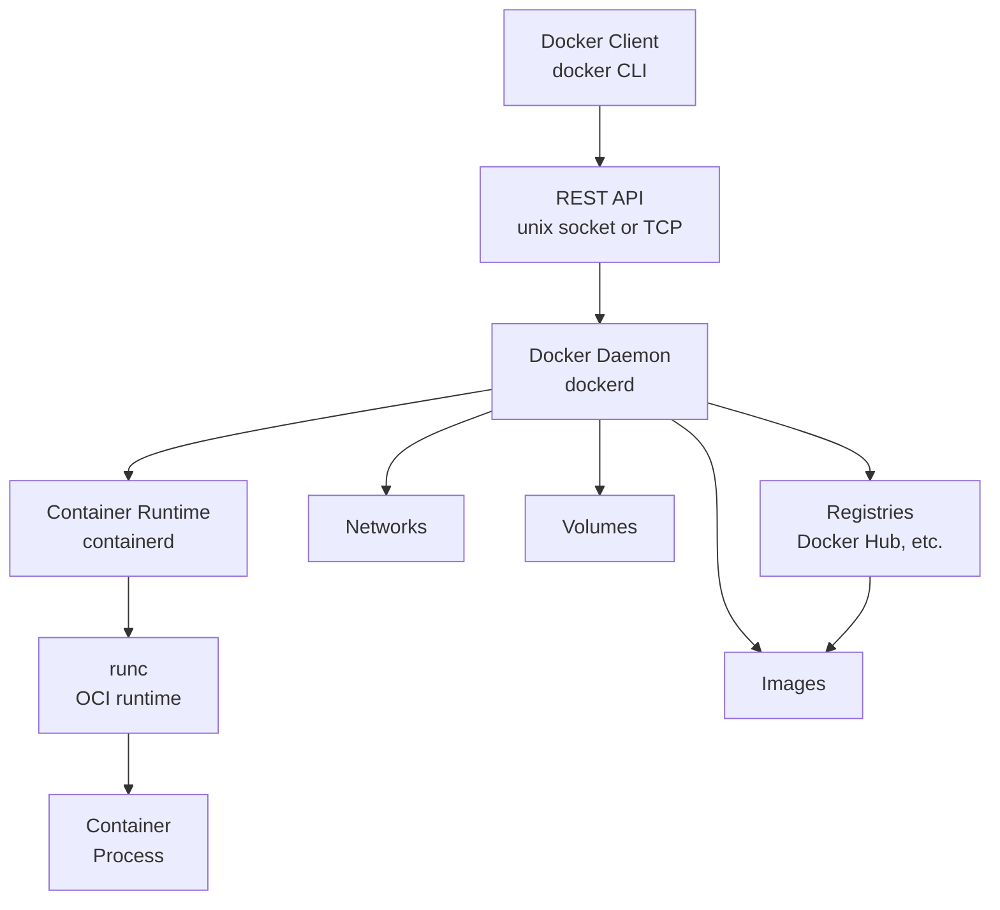
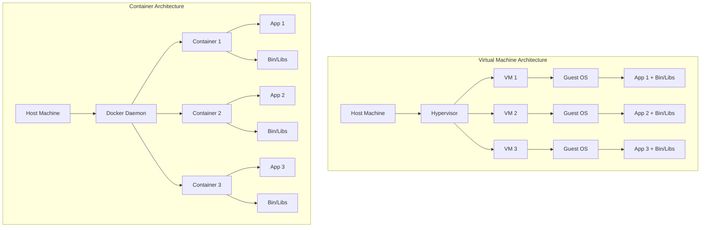
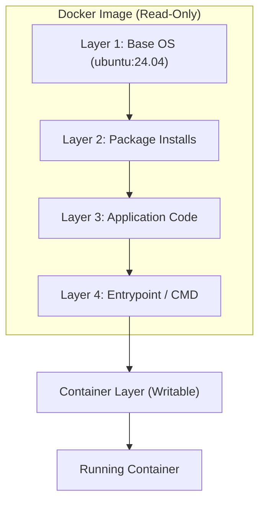
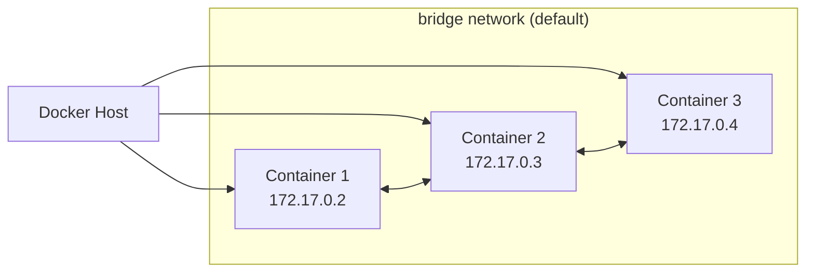
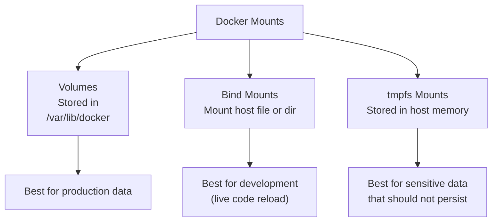

# Introduction to Docker

## What Is Docker?

Docker is an open-source platform designed to automate the deployment, scaling, and management of applications inside lightweight, portable containers. A container is a standalone executable package that includes everything needed to run a piece of software: the code, a runtime, system tools, libraries, and settings. Containers abstract away the underlying infrastructure, making software portable across different environments — from a developer's laptop to a production server, from bare-metal to virtual machines, and across cloud providers.

Docker was first released in 2013 by Solomon Hykes as an internal project at dotCloud and quickly became one of the most influential tools in modern software engineering. It standardized the concept of containerization and sparked a widespread shift from traditional virtual machine-based deployments to container-based architectures.

At its core, Docker solves the age-old problem of "it works on my machine." By packaging an application and all of its dependencies into a single, portable artifact, Docker eliminates environment differences and ensures that software behaves identically regardless of where it runs.

## Why Docker Matters

Before Docker, deploying software typically involved one of two approaches: either install everything directly on bare-metal servers (leading to dependency conflicts and "snowflake" servers), or use full virtual machines (which are heavy, slow to start, and waste resources). Docker introduced a third way — containers — that combines the best of both:

- **Lightweight** — containers share the host OS kernel and do not require a full operating system per application, making them much smaller and faster to start than VMs.
- **Portable** — a container built on a developer's laptop runs identically on a CI server, in a data center, or on any major cloud provider.
- **Isolation** — each container runs in its own isolated environment, preventing conflicts between applications and their dependencies.
- **Reproducibility** — containers are defined by code (Dockerfiles), making builds deterministic and version-controlled.
- **Resource efficiency** — multiple containers can run on a single host, maximizing utilization of CPU and memory.

These properties make Docker the foundation for modern practices like microservices, CI/CD pipelines, and cloud-native development.

# Docker Architecture

Docker uses a client-server architecture. The Docker client communicates with the Docker daemon, which does the heavy lifting: building, running, and distributing containers. The client and daemon can run on the same host, or the client can connect to a remote daemon.



## Docker Client

The Docker client (`docker`) is the primary interface users interact with. When you run a command like `docker run nginx`, the client sends it to the daemon via the REST API. The client can connect to the daemon over a Unix socket (`/var/run/docker.sock`) on the same host, or over TCP for remote connections.

```bash
# Check which Docker daemon the client is connected to
docker version

# Specify a remote Docker host via environment variable
DOCKER_HOST=tcp://192.168.1.100:2375 docker version
```

## Docker Daemon

The Docker daemon (`dockerd`) runs on the host machine and manages Docker objects: containers, images, networks, and volumes. The daemon listens for Docker API requests and handles all container operations, including building images, pulling from registries, and starting/stopping containers.

```bash
# The daemon is started as a system service
# On systemd-based systems:
systemctl status docker

# View daemon logs
journalctl -u docker -f

# Start, stop, or restart the daemon
sudo systemctl start docker
sudo systemctl stop docker
sudo systemctl restart docker
```

## Container Runtime

Docker uses an industry-standard container runtime called `containerd` (pronounced "container dee"), which was donated to the Cloud Native Computing Foundation (CNCF) as a standalone project. `containerd` handles the lifecycle operations of containers — create, start, stop, pause, delete — and manages image transfers and storage.

Underneath `containerd` is `runc`, the OCI (Open Container Initiative) reference implementation that actually creates and runs the container process. The chain is: Docker daemon → containerd → runc → container process.

```bash
# containerd is a background system service
# You typically interact with it through docker or ctr (containerd CLI)
ctr version

# List containers managed by containerd directly
ctr containers ls

# List images in containerd's storage
ctr images ls
```

```text
Client:
  Version:  1.7.13
  Revision: 8e2aee1c4a85d7a2a4e3a8b1b9e8c5d4e2f1a3b4
```

```text
CONTAINER    IMAGE                             RUNTIME
abc123       docker.io/library/nginx:1.27      io.containerd.runc.v2
def456       docker.io/library/redis:7.2       io.containerd.runc.v2
```

## Docker Registry

A Docker registry is a storage and distribution system for Docker images. The default public registry is Docker Hub (`https://hub.docker.com`), which hosts thousands of pre-built images like `nginx`, `ubuntu`, `postgres`, and `python`.

When you run `docker pull nginx`, Docker queries the configured registry (by default Docker Hub) for the `nginx` image and downloads it layer by layer.

```bash
# Search for images on Docker Hub
docker search nginx

# Pull a specific version (tag) of an image
docker pull nginx:1.27

# Pull the latest version (default)
docker pull nginx

# Log in to a private registry
docker login registry.example.com

# Push an image to a registry
docker push myregistry.azurecr.io/myapp:v1

# Log out
docker logout
```

## Docker Objects

Docker manages four primary object types:

- **Images** — a read-only template with instructions for creating a container.
- **Containers** — a runnable instance of an image.
- **Networks** — isolated networks that allow containers to communicate.
- **Volumes** — persistent data storage that survives container removal.

```bash
# List all Docker objects
docker images
docker ps -a
docker network ls
docker volume ls
```

```text
REPOSITORY   TAG       IMAGE ID       CREATED        SIZE
nginx        latest    2b82149d4cf3   2 weeks ago    187MB
postgres     16-alpine  4c9d2b1c8a3f   3 weeks ago    238MB
```

```text
CONTAINER ID   IMAGE    COMMAND    CREATED       STATUS      PORTS   NAMES
```

```text
NETWORK ID     NAME      DRIVER    SCOPE
b2c1...        bridge    bridge    local
f3a4...        host      host      local
```

```text
DRIVER    VOLUME NAME
local     my-data
local     postgres-data
```

# Docker vs Virtual Machines

Understanding the difference between containers and virtual machines is essential to appreciating what Docker brings to the table.



| Aspect               | Virtual Machine                                    | Docker Container                                     |
| -------------------- | -------------------------------------------------- | ---------------------------------------------------- |
| **Isolation**        | Full hardware-level isolation                      | OS-level isolation using namespaces and cgroups      |
| **Guest OS**         | Each VM runs a full operating system               | No separate OS; containers share the host kernel     |
| **Startup time**     | Minutes — boots a full OS                          | Seconds — just starts the application process        |
| **Size**             | Gigabytes (full OS + application)                  | Megabytes (application + dependencies only)          |
| **Performance**      | Some overhead from hypervisor emulation            | Near-native performance, minimal overhead            |
| **Resource usage**   | Fixed allocation; memory/CPU reserved even if idle | Shared resources; containers use only what they need |
| **Portability**      | Portable but large and slow to transfer            | Highly portable and fast to distribute               |
| **Maximum density**  | A few VMs per host                                 | Dozens or hundreds of containers per host            |
| **Boot consistency** | OS-level differences possible between environments | Identical from build to production                   |

Both approaches have their place. VMs are preferred when full OS isolation is required (different kernels, strict security boundaries, running Windows on a Linux host). Containers excel in cloud-native, microservices, and CI/CD environments where density, speed, and portability matter most.

# Installing Docker

Docker can be installed on Linux, macOS, and Windows. The recommended approach on Linux is via the official Docker repository.

```bash
# Remove any old versions that may conflict
sudo apt-get remove docker docker-engine docker.io containerd runc

# Install prerequisites
sudo apt-get update
sudo apt-get install -y ca-certificates curl gnupg lsb-release

# Add Docker's official GPG key
sudo mkdir -p /etc/apt/keyrings
curl -fsSL https://download.docker.com/linux/ubuntu/gpg \
    | sudo gpg --dearmor -o /etc/apt/keyrings/docker.gpg

# Set up the Docker repository
echo \
  "deb [arch=$(dpkg --print-architecture) \
  signed-by=/etc/apt/keyrings/docker.gpg] \
  https://download.docker.com/linux/ubuntu \
  $(lsb_release -cs) stable" | \
  sudo tee /etc/apt/sources.list.d/docker.list > /dev/null

# Install Docker Engine
sudo apt-get update
sudo apt-get install -y docker-ce docker-ce-cli containerd.io \
    docker-buildx-plugin docker-compose-plugin

# Verify the Installation
sudo docker run --rm hello-world
```

```text
# Content written to /etc/apt/sources.list.d/docker.list:
deb [arch=amd64 signed-by=/etc/apt/keyrings/docker.gpg] \
  https://download.docker.com/linux/ubuntu noble stable
```

```text
Hello from Docker!
This message shows that your installation appears to be working correctly.
```

After installation, it is good practice to add your user to the `docker` group so you can run Docker commands without `sudo`:

```bash
# Add your user to the docker group
sudo usermod -aG docker $USER

# Apply the new group membership (requires re-login)
newgrp docker

# Verify you can run Docker without sudo
docker ps
```

Docker also provides a convenience script for quick installation in development environments, though it is not recommended for production use:

```bash
# Download and run the convenience script
curl -fsSL https://get.docker.com -o get-docker.sh
sudo sh get-docker.sh

# Clean up the script
rm get-docker.sh
```

On macOS, Docker Desktop provides a complete Docker environment. On Windows, Docker Desktop with WSL 2 backend is the recommended approach.

# Verifying the Installation

After Docker is installed, verify that the installation is working correctly by checking the version and running a test container:

```bash
# Display Docker version information for both client and server
docker version

# Get detailed system-wide information
docker info

# Run the official test image
docker run --rm hello-world

# List running containers
docker ps

# List all containers (including stopped ones)
docker ps -a

# Check Docker's storage usage
docker system df
```

# Docker CLI Commands Reference

The Docker CLI is the primary interface for interacting with Docker. This section covers the most commonly used commands, organized by category.

## Managing Containers

Containers are the running (or stopped) instances of Docker images. Every time you run `docker run`, a new container is created from the image.

### Docker Run

The `docker run` command creates and starts a container from a given image. It is one of the most frequently used Docker commands.

```bash
# Run a container from the nginx image (latest tag by default)
docker run nginx

# Run in detached mode (in the background)
docker run -d nginx

# Run with a custom name
docker run --name my-nginx nginx

# Run and remove the container when it exits
docker run --rm nginx

# Run with environment variables
docker run -e APP_ENV=production -e DB_HOST=dbserver nginx

# Run with port mapping (host:container)
docker run -p 8080:80 nginx

# Run with a volume mount
docker run -v /path/on/host:/path/in/container nginx

# Run with resource limits
docker run --memory="512m" --cpus="0.5" nginx

# Run interactively with a TTY
docker run -it ubuntu bash

# Run a specific tag
docker run nginx:1.27-alpine

# Run with a network
docker run --network=my-network nginx

# Override the default command
docker run nginx cat /etc/os-release

# Run with a label
docker run --label environment=production nginx

# Run in privileged mode (use with caution)
docker run --privileged nginx
```

```text
NAME="Ubuntu"
VERSION="24.04.1 LTS (Noble Numbat)"
ID=ubuntu
ID_LIKE=debian
PRETTY_NAME="Ubuntu 24.04.1 LTS"
VERSION_ID="24.04"
```

`docker run` is a convenience command that combines `docker create` and `docker start`. If you want to create the container without starting it immediately, use `docker create`:

```bash
# Create a container without starting it
docker create --name my-app nginx

# Start the container later
docker start my-app
```

### Docker PS

The `docker ps` command lists running containers. By default, it shows only running containers.

```bash
# List all running containers
docker ps

# List all containers (including stopped)
docker ps -a

# List containers with their IDs only
docker ps -q

# List all containers (running and stopped) with IDs only
docker ps -aq

# Show the total file size of containers
docker ps -s

# Filter containers by status
docker ps --filter "status=running"
docker ps --filter "status=exited"
docker ps --filter "status=paused"

# Filter by name
docker ps --filter "name=nginx"

# Filter by label
docker ps --filter "label=environment=production"

# Format the output
docker ps --format "table {{.ID}}\t{{.Image}}\t{{.Status}}\t{{.Ports}}"

# Show only container IDs and names
docker ps -a --format "{{.ID}}: {{.Names}}"

# Show the latest container (by creation time)
docker ps -l
```

The columns in `docker ps` output include:

| Column       | Description                                                                       |
| ------------ | --------------------------------------------------------------------------------- |
| CONTAINER ID | The unique 64-character hexadecimal identifier (displayed as first 12 characters) |
| IMAGE        | The image used to create the container                                            |
| COMMAND      | The command running inside the container                                          |
| CREATED      | How long ago the container was created                                            |
| STATUS       | Current state (Up, Exited, Paused)                                                |
| PORTS        | Exposed and mapped ports                                                          |
| NAMES        | The container's name (auto-generated or custom)                                   |

### Docker Start, Stop, Restart

These commands manage the lifecycle of containers.

```bash
# Start one or more stopped containers
docker start my-nginx

# Start multiple containers
docker start my-nginx my-redis my-postgres

# Stop running containers (sends SIGTERM, then SIGKILL after grace period)
docker stop my-nginx

# Stop with a custom timeout (in seconds)
docker stop -t 30 my-nginx

# Force stop (sends SIGKILL immediately)
docker kill my-nginx

# Send a custom signal to a container
docker kill -s SIGUSR1 my-nginx

# Restart containers
docker restart my-nginx

# Restart with a custom timeout
docker restart -t 15 my-nginx
```

The difference between `docker stop` and `docker kill`:

- `docker stop` sends `SIGTERM` first, giving the process a chance to shut down gracefully (flush buffers, close connections, etc.). After a 10-second default timeout, it sends `SIGKILL`.
- `docker kill` sends `SIGKILL` immediately, bypassing graceful shutdown.

### Docker RM

The `docker rm` command removes one or more stopped containers. Running containers must be stopped first, or removed with the `-f` flag.

```bash
# Remove a stopped container
docker rm my-old-container

# Remove multiple containers
docker rm my-container-1 my-container-2 my-container-3

# Remove a running container (force)
docker rm -f my-running-container

# Remove all stopped containers
docker rm $(docker ps -aq --filter "status=exited")

# Remove containers older than a certain time
docker rm $(docker ps -aq --filter "status=exited" --filter "until=24h")

# Remove all containers (running and stopped)
docker rm -f $(docker ps -aq)

# Remove a container and its associated volumes
docker rm -v my-container
```

The `-v` flag removes any anonymous volumes attached to the container. Named volumes are not automatically removed by `docker rm` — they must be removed explicitly with `docker volume rm`.

### Docker Logs

The `docker logs` command fetches the logs of a container. This is the primary tool for debugging containerized applications.

```bash
# Fetch logs from a container
docker logs my-nginx

# Stream logs in real time
docker logs -f my-nginx

# Show the last N lines only
docker logs --tail 100 my-nginx

# Show logs since a specific time
docker logs --since "2024-01-01T00:00:00" my-nginx

# Show logs from the last N minutes
docker logs --since 30m my-nginx

# Show timestamps on each log line
docker logs -t my-nginx

# Show only the most recent entries and exit (like tail -f)
docker logs --tail 0 -f my-nginx

# Export logs to a file
docker logs my-nginx > /tmp/container.log 2>&1
```

```text
192.168.1.50 - - [15/Mar/2024:10:23:45 +0000] "GET /index.html HTTP/1.1"
  200 612 "-" "curl/7.68.0"
2024-03-15T10:23:46.123Z 192.168.1.51 - - "GET /api/health HTTP/1.1" 200
```

Docker stores logs in JSON format by default (on Linux: `/var/lib/docker/containers/<container-id>/<container-id>-json.log`). The `docker logs` command reads and formats this log file.

```bash
# View the raw JSON log file
CNTR_ID=$(docker inspect --format={{.Id}} my-nginx)
cat /var/lib/docker/containers/${CNTR_ID}/*-json.log | jq '.log' -r

# Check log file size
du -sh /var/lib/docker/containers/*/*-json.log
```

```text
142M    /var/lib/docker/containers/a1b2c3d4e5f6.../a1b2c3d4e5f6-json.log
```

### Docker Exec

The `docker exec` command runs a new command inside a running container. This is indispensable for debugging, inspecting the filesystem, and interacting with a running container.

```bash
# Open an interactive bash shell inside a running container
docker exec -it my-nginx bash

# Run a single command
docker exec my-nginx ls -la /usr/share/nginx/html

# Run as a different user
docker exec -u root my-nginx apt-get update

# Run with environment variables
docker exec -e MY_VAR=hello my-nginx env | grep MY_VAR

# Run in a specific working directory
docker exec -w /app my-container ls

# Run with a custom entrypoint override
docker exec --privileged my-container /bin/bash

# Run in a specific network namespace
docker exec --network=container:my-other-container hostname

# Get the container's PID
docker exec my-nginx cat /proc/1/cmdline | tr '\0' ' '
```

```text
/usr/sbin/nginx-snginxgunicorn:master:python3
```

```text
MY_VAR=hello
HOME=/root
PATH=/usr/local/bin:/usr/bin:/bin
```

```text
app/
app/__init__.py
app/main.py
app/config.py
```

```text
/usr/sbin/nginx-snginxgunicornpython3
```

```text
root        1   0.0   0.1   1234   567 pts/0    Ss    09:00   0:00   bash
root      123   0.1   0.2   2345   890 pts/0    Sl    09:01   0:00   nginx
```

```text
Proto Recv-Q Send-Q Local Address           Foreign Address         State
tcp6       0      0      :::80                 :::*                  LISTEN
```

```text
HOSTNAME=my-nginx
NGINX_VERSION=1.27.0
PATH=/usr/local/sbin:/usr/local/bin:/usr/sbin:/sbin
```

```text
Server:         8.8.8.8
Address:        8.8.8.8#53
Non-authoritative answer:
Name:   google.com
Address: 142.250.x.x
```

### Docker Pause and Unpause

These commands suspend and resume all processes in a container using Linux cgroups freezer.

```bash
# Pause all processes in a container
docker pause my-nginx

# Unpause (resume) processes
docker unpause my-nginx
```

Pausing is useful when you need to temporarily freeze a container's state without stopping it — for example, during a backup operation or when you want to prevent the container from accepting new requests while you investigate an issue.

## Docker Rename

```bash
# Rename a container
docker rename old-name new-name
```

Container names must be unique. If you try to rename a container to a name that already exists, Docker will return an error.

## Managing Images

Docker images are the building blocks of containers. An image is a read-only template with instructions for creating a Docker container. Images are stored in registries and referenced by name and tag.

```bash
# List all locally stored images
docker images

# List images with their full IDs
docker images --no-trunc

# List only image IDs
docker images -q

# List dangling images (untagged intermediate layers)
docker images -f dangling=true

# List images with a specific label
docker images --filter "label=maintainer=user@example.com"

# Pull an image from Docker Hub
docker pull nginx

# Pull a specific version (tag)
docker pull nginx:1.27-alpine

# Pull all tags of an image
docker pull -a nginx

# Remove an image
docker rmi nginx:latest

# Remove multiple images
docker rmi nginx:latest ubuntu:24.04

# Force remove an image (even if in use)
docker rmi -f nginx

# Remove all unused (dangling) images
docker image prune

# Remove all unused images (not just dangling)
docker image prune -a

# Remove images older than a certain time
docker image prune --filter "until=24h"
```

## Managing Networks

Docker networks allow containers to communicate with each other and with external networks.

```bash
# List all networks
docker network ls

# Inspect a network
docker network inspect bridge
```

```text
NETWORK ID     NAME       DRIVER    SCOPE
b2c1...        bridge     bridge    local
f3a4...        host       host      local
a7d9...        my-network bridge    local
```

```bash
# Create a bridge network
docker network create --driver bridge my-network

# Create an overlay network (for Swarm)
docker network create --driver overlay my-overlay

# Connect a running container to a network
docker network connect my-network my-nginx

# Disconnect a container from a network
docker network disconnect my-network my-nginx

# Remove a network
docker network rm my-network

# Remove all unused networks
docker network prune
```

## Managing Volumes

Docker volumes persist data generated by containers. They are the preferred mechanism for persisting data in Docker.

```bash
# List all volumes
docker volume ls

# Inspect a volume
docker volume inspect my-data
```

```text
DRIVER    VOLUME NAME
local     my-data
local     postgres-data
local     cache-volume
```

```bash
# Create a volume
docker volume create my-data

# Remove a volume
docker volume rm my-data

# Remove all unused volumes
docker volume prune

# Remove all volumes not used by at least one container
docker volume prune --all
```

## Inspecting Containers and Images

The `docker inspect` command returns detailed information about Docker objects in JSON format.

```bash
# Inspect a container
docker inspect my-nginx

# Get specific fields using Go templates
docker inspect --format='{{.State.Status}}' my-nginx
docker inspect --format='{{.NetworkSettings.IPAddress}}' my-nginx
docker inspect --format='{{.Config.Image}}' my-nginx
# Get mounts in a formatted way
docker inspect --format='{{json .Mounts}}' my-nginx | jq

# Inspect an image
docker inspect nginx:latest

# Get image architecture
docker inspect --format='{{.Architecture}}' nginx:latest

# Get image entrypoint and cmd
docker inspect --format='{{json .Config.Entrypoint}} {{json .Config.Cmd}}' \
    nginx:latest

# Inspect a network
docker network inspect my-network

# Inspect a volume
docker volume inspect my-data
```

## Docker System

The `docker system` command manages Docker's system-level operations.

```bash
# Show Docker disk usage
docker system df

# Show detailed disk usage by type
docker system df -v

# Remove all unused data (images, containers, volumes, networks)
docker system prune

# Remove all unused data, including non-dangling images
docker system prune -a

# Remove data older than a certain time
docker system prune --filter "until=24h"

# Show Docker daemon information
docker info

# Check Docker daemon events in real time
docker system events
```

## Container Stats

The `docker stats` command displays a live stream of resource usage statistics for running containers.

```bash
# Show live stats for all running containers
docker stats

# Show stats with no streaming (one-time)
docker stats --no-stream

# Show stats for specific containers
docker stats my-nginx my-redis

# Show stats with CPU percentage and memory usage
docker stats --format "table {{.Name}}\t{{.CPUPerc}}\t{{.MemUsage}}"

# Show stats with formatted output
docker stats --format "{{.Name}}: CPU={{.CPUPerc}}, MEM={{.MemUsage}}"
```

# Docker Images

## What Is a Docker Image?

A Docker image is a lightweight, standalone, executable package that includes everything needed to run a piece of software: the code, a runtime, libraries, environment variables, and configuration files. Images are read-only templates. When you run an image, Docker creates a writable container layer on top of the read-only image layers.

Images are built from a set of instructions called a Dockerfile. Each instruction creates a new layer in the image. When you change the Dockerfile and rebuild the image, only the changed layers are rebuilt, making images fast and small to distribute.

## Image Layers

Docker images are composed of multiple read-only layers. Each layer represents an instruction in the Dockerfile. When a container is created, Docker adds a thin writable layer on top of the image layers. This writable layer is called the container layer.



```bash
# Inspect an image to see its layers
docker history nginx:latest

# Show image layer sizes
docker history --no-trunc nginx:latest

# Inspect the full JSON details of an image
docker inspect nginx:latest
```

The key advantage of layered storage is that multiple images can share common layers. If you have five containers running the same base image, they all share the base OS layer, saving disk space. When an image is modified, only the changed layers are rebuilt or redistributed.

## Image Naming and Tagging

Docker images are identified by their name and tag. The tag is a way to version an image. If no tag is specified, Docker defaults to the `latest` tag.

```bash
# Image naming format: registry/repository:tag
# registry is optional (defaults to Docker Hub)
# repository is the name of the image
# tag is the version or variant

# Pull from Docker Hub (default registry)
docker pull nginx:1.27

# Pull from a specific registry
docker pull myregistry.azurecr.io/myapp:v1

# Pull from Docker Hub with full path
docker pull docker.io/library/nginx:1.27

# Tag an existing image
docker tag nginx:latest myregistry.azurecr.io/myapp:v1
docker tag nginx:latest myapp:prod
docker tag myapp:v1 myapp:latest

# Full naming with registry, repository, and tag
docker tag nginx:1.27 myregistry.azurecr.io/web/frontend:v1.2.3

# List all tags for a specific repository on Docker Hub
# (via the Hub API — not a native docker CLI command, but curl can query it)
curl -s https://hub.docker.com/v2/repositories/library/nginx/tags \
    | jq '.results[].name'
```

## Building Images with a Dockerfile

A Dockerfile is a text document that contains all the instructions needed to build a Docker image. Each instruction in a Dockerfile creates a new layer in the image.

```bash
# Build an image from a Dockerfile in the current directory
docker build .

# Build with a custom name and tag
docker build -t myapp:v1 .

# Build with no cache (force rebuild of all layers)
docker build --no-cache -t myapp:v1 .

# Build with build arguments
docker build --build-arg VERSION=1.0 -t myapp:v1 .

# Build with a specific Dockerfile path
docker build -f /path/to/Dockerfile -t myapp:v1 .

# Build with labels
docker build --label "version=1.0" --label "env=prod" -t myapp:v1 .

# Build with target stage (for multi-stage builds)
docker build --target builder -t myapp:builder .

# Build with secrets (only available with BuildKit)
DOCKER_BUILDKIT=1 docker build --secret id=aws,src=.aws/credentials .

# Build with SSH agent (for private repositories)
DOCKER_BUILDKIT=1 docker build --ssh default .

# View the build cache
docker builder prune --verbose
```

## Dockerfile Instructions

The following instructions are the most commonly used in a Dockerfile:

### FROM

The `FROM` instruction initializes a new build stage and sets the base image for subsequent instructions. It must be the first instruction in a Dockerfile (except for comments and `ARG` instructions before `FROM`).

```dockerfile
# Use an official base image
FROM ubuntu:24.04

# Use a specific variant (Alpine is much smaller)
FROM python:3.12-alpine

# Use a specific variant (slim has fewer packages)
FROM node:20-slim

# Use a scratch image (empty base, for statically compiled binaries)
FROM scratch
```

### RUN

The `RUN` instruction executes commands during the build process. Each `RUN` creates a new layer in the image.

```dockerfile
# Using shell form (default shell is /bin/sh -c)
RUN apt-get update && apt-get install -y \
    nginx \
    curl \
    git

# Using exec form (recommended — no shell processing)
RUN ["apt-get", "update"]
RUN ["apt-get", "install", "-y", "nginx", "curl", "git"]

# Clean up in the same layer to reduce image size
RUN apt-get update && \
    apt-get install -y --no-install-recommends nginx && \
    apt-get clean && \
    rm -rf /var/lib/apt/lists/*
```

### COPY and ADD

Both `COPY` and `ADD` copy files from the build context into the image.

```dockerfile
# Copy a file from the build context
COPY package.json /app/package.json

# Copy all files (supports glob patterns)
COPY . /app

# Copy with specific owner
COPY --chown=nginx:nginx . /app

# Copy with specific permissions
COPY --chmod=644 config.json /app/config.json

# ADD can copy from URLs (not recommended for regular files)
ADD https://example.com/config.tar.gz /app/

# ADD can extract tar files automatically
ADD app.tar.gz /app/

# COPY is preferred for regular file copying (more cache-friendly)
COPY app.tar.gz /app/
RUN tar -xzf /app/app.tar.gz -C /app && rm /app/app.tar.gz
# (this achieves the same as ADD's auto-extract, but is more explicit)
```

### WORKDIR

The `WORKDIR` instruction sets the working directory for any subsequent instructions.

```dockerfile
# Set working directory
WORKDIR /app

# Create the directory if it doesn't exist (WORKDIR creates parents)
WORKDIR /app/src

# Use absolute paths
WORKDIR /

# Refer to previously defined ARG
ARG APP_HOME=/app
WORKDIR ${APP_HOME}
```

### ENV

The `ENV` instruction sets environment variables that persist when a container is run from the image.

```dockerfile
# Set environment variables
ENV NODE_ENV=production
ENV APP_PORT=8080
ENV APP_HOME=/app

# Set multiple variables at once
ENV APP_PORT=8080 APP_HOME=/app DB_HOST=localhost

# Use variables in later instructions
ENV APP_HOME=/app
WORKDIR ${APP_HOME}
```

### EXPOSE

The `EXPOSE` instruction informs Docker that the container listens on the specified network ports at runtime. It is documentation only and does not actually publish the port.

```dockerfile
# Document that the container listens on port 80
EXPOSE 80

# Document multiple ports
EXPOSE 80 443 8080

# Document with protocol
EXPOSE 80/tcp
EXPOSE 53/udp
```

### CMD

The `CMD` instruction provides the default command to execute when a container is run. There can only be one `CMD` instruction in a Dockerfile. If there are multiple, only the last one takes effect.

```dockerfile
# Shell form
CMD echo "Hello from Docker"

# Exec form (preferred)
CMD ["echo", "Hello from Docker"]

# Run a script
CMD ["/bin/bash", "-c", "/app/entrypoint.sh"]

# JSON array form (the command is run directly, without a shell)
CMD ["python", "app.py"]

# Using variables set by ENV
ENV CMD_WORD="World"
CMD echo "Hello $CMD_WORD"
```

### ENTRYPOINT

The `ENTRYPOINT` instruction configures a container to run as an executable. Unlike `CMD`, the arguments passed to `docker run` are appended to the entrypoint command rather than replacing it.

```dockerfile
# Set an entrypoint for the container
ENTRYPOINT ["python", "app.py"]

# Override entrypoint at runtime
docker run --entrypoint /bin/sh myapp

# Combine ENTRYPOINT with CMD (CMD provides default arguments)
ENTRYPOINT ["python", "app.py"]
CMD ["--help"]

# Shell form (discouraged — no signal handling, no process substitution)
ENTRYPOINT python app.py
```

```bash
# Run with CMD arguments appended to entrypoint
docker run myapp                    # runs: python app.py
docker run myapp --verbose          # runs: python app.py --verbose
docker run myapp --help             # runs: python app.py --help

# Override the entrypoint entirely
docker run --entrypoint /bin/sh myapp
```

### ARG

The `ARG` instruction defines a variable that users can pass at build time with the `docker build --build-arg` flag. `ARG` values are not persisted in the final image.

```dockerfile
# Define a build argument with a default value
ARG VERSION=latest
ARG APP_NAME=myapp

# Use the argument in instructions
RUN echo "Building version ${VERSION} of ${APP_NAME}"

# Build with custom arguments
# docker build --build-arg VERSION=1.0 --build-arg APP_NAME=myapp .
```

### LABEL

The `LABEL` instruction adds metadata to an image as key-value pairs.

```dockerfile
# Add maintainer metadata (deprecated in favor of LABEL)
MAINTAINER Jane Doe <jane@example.com>

# Add labels
LABEL version="1.0"
LABEL description="A web application"
LABEL maintainer="Jane Doe <jane@example.com>"
LABEL environment="production"

# Multiple labels in one instruction
LABEL app.version="1.0" \
      app.maintainer="Jane Doe" \
      app.description="A web application"
```

```bash
# View all labels of an image
docker inspect --format='{{json .Config.Labels}}' nginx:latest | jq

# Search for images by label on Docker Hub
docker search --filter "is-official=true" --filter "stars=100" nginx
```

### USER

The `USER` instruction sets the user (and optionally group) for subsequent instructions and when running the container.

```dockerfile
# Create a non-root user
RUN groupadd -r appgroup && useradd -r -g appgroup appuser

# Switch to the non-root user
USER appuser

# Switch with specific UID/GID
USER 1001:1001
```

### VOLUME

The `VOLUME` instruction creates a mount point for externally mounted volumes.

```dockerfile
# Create a volume at the specified path
VOLUME /var/lib/postgresql/data

# Create multiple volumes
VOLUME ["/var/lib/data", "/var/log/myapp"]

# Use a named volume
VOLUME data
```

### ONBUILD

The `ONBUILD` instruction adds a trigger instruction to the image that will be executed when the image is used as a base for another build.

```dockerfile
# This instruction runs when another image builds FROM this image
ONBUILD COPY . /app
ONBUILD RUN npm install

# Practical example: a base Python image with onbuild triggers
FROM python:3.12-slim
WORKDIR /app
ONBUILD COPY requirements.txt /app/
ONBUILD RUN pip install --no-cache-dir -r requirements.txt
ONBUILD COPY . /app/
```

### HEALTHCHECK

The `HEALTHCHECK` instruction tells Docker how to test that a container is still working.

```dockerfile
# Check using curl
HEALTHCHECK --interval=30s --timeout=10s --retries=3 \
    CMD curl -f http://localhost:80/health || exit 1

# Check using a script
HEALTHCHECK --interval=1m --timeout=30s --start-period=5s --retries=3 \
    CMD /app/healthcheck.sh

# Disable health check from a parent image
HEALTHCHECK NONE
```

```bash
# View the health status of a container
docker inspect --format='{{.State.Health.Status}}' myapp

# View the health check log
docker inspect --format='{{json .State.Health.Log}}' myapp | jq
```

### SHELL

The `SHELL` instruction overrides the default shell used for shell form instructions.

```dockerfile
# Use bash with specific options
SHELL ["/bin/bash", "-c"]

# Use PowerShell on Windows containers
SHELL ["powershell", "-Command"]
```

## Multi-Stage Builds

Multi-stage builds allow you to use multiple `FROM` instructions in a single Dockerfile. This lets you separate build-time dependencies from runtime dependencies, significantly reducing the final image size.

In a multi-stage build, you can copy artifacts from one stage to another, keeping only the artifacts you need in the final image.

```dockerfile
# Stage 1: Build the application
FROM python:3.12-slim AS builder

WORKDIR /app

# Install build dependencies
RUN apt-get update && apt-get install -y --no-install-recommends \
    gcc \
    libpq-dev \
    && rm -rf /var/lib/apt/lists/*

# Copy and install dependencies
COPY requirements.txt .
RUN pip install --user -r requirements.txt

# Copy source code
COPY . .

# Compile Python extensions (if any)
RUN pip install --user .

# Stage 2: Create a minimal runtime image
FROM python:3.12-slim AS runtime

# Install only runtime dependencies
RUN apt-get update && apt-get install -y --no-install-recommends \
    libpq5 \
    && rm -rf /var/lib/apt/lists/*

WORKDIR /app

# Copy compiled artifacts from the builder stage
COPY --from=builder /root/.local /root/.local
ENV PATH=/root/.local/bin:$PATH

# Copy application code
COPY --from=builder /app .

# Run as non-root user
RUN useradd --create-home appuser && \
    chown -R appuser:appuser /app
USER appuser

# Set the default command
CMD ["python", "app.py"]
```

```bash
# Build the image
docker build -t myapp:v1 .

# Build only a specific stage
docker build --target builder -t myapp:builder .

# Build all stages
docker build --target runtime -t myapp:runtime .

# Show the size difference between build stages
docker build --target builder -t myapp:builder .
docker images myapp:builder myapp:v1
```

The final runtime image contains only the application and its runtime dependencies — not the compiler, build tools, or source code. A typical Python application that might be 1.2 GB in a single-stage build can be reduced to 150 MB in a multi-stage build.

## Build Arguments vs Environment Variables

Build arguments (`ARG`) and environment variables (`ENV`) serve different purposes:

| Aspect                 | ARG                                   | ENV                               |
| ---------------------- | ------------------------------------- | --------------------------------- |
| **When available**     | Build time only (in Dockerfile build) | Build time and container runtime  |
| **Set by**             | `--build-arg` flag at build time      | Dockerfile `ENV` instruction      |
| **Persisted in image** | No (unless used in a `RUN` command)   | Yes (visible in `docker inspect`) |
| **Use case**           | Version numbers, feature flags, paths | Runtime configuration             |

```dockerfile
# Build argument: available during build
ARG VERSION=1.0
ARG BUILD_DATE
RUN echo "Building version ${VERSION} on ${BUILD_DATE}"

# Environment variable: available at build AND runtime
ENV APP_VERSION=1.0
ENV APP_HOME=/app

# Use ARG to set an ENV value
ARG APP_VERSION
ENV APP_VERSION=${APP_VERSION:-1.0}
```

## Building Efficient Images

Here are best practices for writing efficient Dockerfiles:

```dockerfile
# Use specific base image tags (not 'latest')
FROM python:3.12-slim  # pinned to major.minor

# Order instructions from least to most frequently changing
# This maximizes Docker's build cache
FROM python:3.12-slim
WORKDIR /app

# Dependencies change less often than application code
# Copy and install them first to leverage cache
COPY requirements.txt .
RUN pip install --no-cache-dir -r requirements.txt

# Application code changes most frequently — copy last
COPY . .

# Combine RUN commands to reduce layers
RUN apt-get update && \
    apt-get install -y --no-install-recommends nginx curl && \
    apt-get clean && \
    rm -rf /var/lib/apt/lists/*

# Use .dockerignore to exclude files from build context
# .dockerignore prevents sending large or sensitive files to the daemon
# Example .dockerignore:
# .git
# .gitignore
# node_modules
# *.md
# tests/
# .env*
```

```bash
# Build with a .dockerignore file
docker build -t myapp:v1 .

# Show build cache
docker builder inspect

# Build without using cache
docker build --no-cache -t myapp:v1 .
```

## Pushing and Pulling Images

After building an image, you can push it to a registry for sharing or deployment.

```bash
# Tag an image for a registry
docker tag myapp:v1 myregistry.azurecr.io/myapp:v1

# Log in to a registry (required for private repos)
docker login myregistry.azurecr.io -u username
# or use --password-stdin to pipe the password
docker login myregistry.azurecr.io -u username --password-stdin \
    < password.txt

# Push the image to the registry
docker push myregistry.azurecr.io/myapp:v1

# Pull the image from the registry
docker pull myregistry.azurecr.io/myapp:v1

# Log out when done
docker logout myregistry.azurecr.io

# Pull from Docker Hub
docker pull nginx:1.27

# Pull from an unofficial registry
docker pull gcr.io/myproject/myapp:v1
```

# Docker Networking

Docker networking allows containers to communicate with each other and with the outside world. Docker provides several network drivers, each suited for different use cases.

## Network Drivers

### Bridge Driver (Default)

The bridge driver creates a private internal network on the host. Containers connected to the same bridge network can communicate with each other. This is the default driver when you run `docker run`.

```bash
# Create a user-defined bridge network
docker network create --driver bridge my-bridge

# List available networks
docker network ls

# Inspect the default bridge network
docker network inspect bridge

# Run a container attached to a specific bridge
docker run -d --name web --network my-bridge nginx

# Run a container with the default bridge
docker run -d --name default-web nginx
```

```text
NETWORK ID     NAME        DRIVER    SCOPE
2e3...         bridge      bridge    local
6ab...         my-bridge   bridge    local
7cd...         host        host      local
9ef...         none        null      local
```



User-defined bridge networks differ from the default bridge in several important ways:

- Containers on a user-defined bridge can resolve each other by name (DNS-based service discovery).
- Containers can be attached/detached from user-defined bridges on the fly.
- User-defined bridges provide better isolation and configurable options.

### Host Driver

The host driver removes the network isolation between the container and the host. The container shares the host's network namespace directly, using the host's IP address and ports.

```bash
# Run a container using the host network
docker run -d --network host nginx
```

```text
# Container listens directly on the host's IP and ports
# No port mapping (-p) is needed or allowed
# No network isolation between container and host
```

**Security warning:** The host driver effectively disables network isolation. The container has direct access to all host network interfaces. This is useful for performance-critical applications but reduces security.

### None Driver

The `none` driver disables networking for the container. The container gets a `lo` (loopback) interface only and cannot communicate with other containers or external networks.

```bash
# Run a container with no networking
docker run -d --network none alpine
```

### Overlay Driver

The overlay driver enables communication between containers across multiple Docker hosts. It is used primarily in Docker Swarm mode.

```bash
# Initialize a Docker Swarm
docker swarm init

# Create an overlay network
docker network create --driver overlay my-overlay

# Deploy a service on the overlay network
docker service create --name web --network my-overlay nginx

# List overlay networks
docker network ls --filter driver=overlay
```

```text
NETWORK ID     NAME         DRIVER    SCOPE
ab1...         my-overlay   overlay   swarm
cd2...         ingress      overlay   swarm
```

### Macvlan Driver

The macvlan driver assigns a MAC address to each container, making them appear as physical devices on the network. This is useful for legacy applications that expect to be on the same physical network as other devices.

```bash
# Create a macvlan network
docker network create -d macvlan \
    --subnet=192.168.1.0/24 \
    --gateway=192.168.1.1 \
    -o parent=eth0 my-macvlan

# Run a container on the macvlan network
docker run -d --network my-macvlan nginx
```

### Ipvlan Driver

Similar to macvlan, but shares the parent interface's MAC address.

```bash
# Create an ipvlan network
docker network create -d ipvlan \
    --subnet=192.168.1.0/24 \
    --gateway=192.168.1.1 \
    -o parent=eth0 my-ipvlan
```

## Port Mapping

Port mapping binds a container port to a host port, allowing external clients to access container services.

```bash
# Map a single port (host:container)
docker run -p 8080:80 nginx

# Map with explicit protocol
docker run -p 8080:80/tcp nginx
docker run -p 53:53/udp nginx

# Map to a specific host IP
docker run -p 127.0.0.1:8080:80 nginx

# Map a range of ports
docker run -p 8000-8100:8000-8100 nginx

# Random host port (Docker assigns)
docker run -p 80 nginx

# Map all exposed ports
docker run -P nginx
```

```text
# After docker run -p 8080:80, on the host:
$ curl http://localhost:8080/
# Forwards to container port 80
```

## Container DNS and Service Discovery

Docker provides built-in DNS for containers on user-defined networks. Containers can resolve each other by name.

```bash
# Create a network
docker network create my-app-net

# Run a database container
docker run -d --name db --network my-app-net postgres

# Run an app container that can reach db by name
docker run -d --name app --network my-app-net myapp

# From inside the app container, db resolves to its IP
docker exec app ping db
```

```text
# Output:
PING db (172.18.0.2): 56 data bytes
64 bytes from 172.18.0.2: seq=0 ttl=64 time=0.123 ms
```

```bash
# Add an alias to a container on a network
docker network connect --alias database my-app-net db

# Add multiple aliases
docker network connect --alias db --alias postgres my-app-net db

# Inspect a network to see connected containers
docker network inspect my-app-net
```

Containers on the default `bridge` network cannot resolve each other by name. To enable name-based resolution, use a user-defined bridge network.

## Exposing Ports vs Publishing Ports

There is an important distinction between exposing and publishing ports:

- **EXPOSE** (in Dockerfile) is documentation. It tells Docker that the container listens on these ports, but does not actually publish them.
- **docker run -p** (publish) actually creates a port mapping from host to container, making the service accessible from outside.

```bash
# EXPOSE in Dockerfile is just documentation
# EXPOSE 80

# Publishing a port with -p is what makes it accessible
docker run -p 8080:80 nginx

# The capital -P flag publishes all EXPOSEd ports to random host ports
docker run -P nginx
```

# Docker Volumes and Data Persistence

Containers are ephemeral by design — when a container is removed, any data written inside it is lost. Docker provides three ways to persist data: volumes, bind mounts, and tmpfs mounts.

## Types of Mounts



### Volumes

Volumes are the preferred mechanism for persisting data in Docker. They are managed by Docker and stored in a part of the host filesystem (`/var/lib/docker/volumes/` on Linux) that Docker controls.

```bash
# Create a named volume
docker volume create my-data

# Create a volume with specific options
docker volume create --driver local \
    --opt type=nfs \
    --opt o=addr=192.168.1.100,rw \
    --opt device=:/path/to/dir \
    my-nfs-volume

# List all volumes
docker volume ls

# Inspect a volume
docker volume inspect my-data

# Use the volume in a container
docker run -d -v my-data:/app/data myapp

# Mount a volume with options
docker run -d -v my-data:/app/data:ro myapp

# Remove a volume
docker volume rm my-data

# Remove all unused volumes
docker volume prune
```

```text
[
  {
    "Name": "my-data",
    "Driver": "local",
    "Mountpoint": "/var/lib/docker/volumes/my-data/_data",
    "Labels": {},
    "Scope": "local"
  }
]
```

### Bind Mounts

Bind mounts mount a file or directory from the host into a container. They are useful during development for live-reloading code, but should be used with caution in production.

```bash
# Mount a host directory to a container path
docker run -d -v /path/on/host:/app myapp

# Mount a single file
docker run -d -v /home/user/.ssh/id_rsa:/root/.ssh/id_rsa:ro myapp

# Use --mount for more explicit syntax
docker run -d --mount type=bind,source=/path/on/host,target=/app myapp

# Read-only bind mount
docker run -d --mount \
    type=bind,source=/path/on/host,target=/app,readonly \
    myapp

# Mount a specific file
docker run -d --mount \
    type=bind,source=/etc/localtime,target=/etc/localtime,readonly \
    myapp
```

```text
# Files in /path/on/host are visible in /app inside the container
# Changes in either location are reflected in the other
# Bind mounts bypass Docker's UFS storage
```

### Tmpfs Mounts

tmpfs mounts store data in the host's memory only. The data is not persisted when the container stops.

```bash
# Mount a tmpfs volume
docker run -d --tmpfs /app/cache myapp

# Use --mount for more control
docker run -d --mount type=tmpfs,destination=/app/cache,tmpfs-size=100m myapp
```

## Volume vs Bind Mount: When to Use

| Use Case                          | Recommended Mount            |
| --------------------------------- | ---------------------------- |
| Production database data          | Volume                       |
| Development with live code reload | Bind mount                   |
| Sensitive data not to persist     | tmpfs                        |
| Sharing configuration files       | Bind mount (read-only)       |
| Cross-host shared storage         | Volume (with NFS/CSI driver) |
| Container-to-container sharing    | Volume                       |

## Backup and Restore Volumes

Volumes can be backed up by mounting them in a temporary container.

```bash
# Back up a volume to a tar file
docker run --rm \
    -v my-data:/source:ro \
    -v $(pwd):/backup \
    alpine tar -czf /backup/my-data-backup.tar.gz -C /source .

# Restore a volume from a tar file
docker run --rm \
    -v my-data:/target \
    -v $(pwd):/backup \
    alpine sh -c "tar -xzf /backup/my-data-backup.tar.gz -C /target"

# Verify the backup
tar -tzf my-data-backup.tar.gz | head

# Copy a volume to another volume
docker run --rm \
    -v source-data:/from:ro \
    -v dest-data:/to \
    alpine sh -c "cp -a /from/. /to/"

# Inspect a volume's mount point
docker volume inspect --format '{{ .Mountpoint }}' my-data
```

```text
/var/lib/docker/volumes/my-data/_data
```

# Docker Compose

Docker Compose is a tool for defining and running multi-container applications. With Compose, you describe your application's services in a single `docker-compose.yml` file and use a single command to start everything.

## Why Docker Compose?

Real applications typically consist of multiple containers: a web server, a database, a cache, a message queue, etc. Managing each of these with separate `docker run` commands becomes unwieldy. Compose provides:

- **Declarative configuration** — describe your application's services in a YAML file.
- **Single-command orchestration** — start, stop, and rebuild your entire stack with one command.
- **Service discovery** — services can reach each other by name.
- **Reproducibility** — the same compose file works on any machine.
- **Environment separation** — different compose files for dev, staging, and prod.

## Installing Docker Compose

Docker Compose is now bundled with Docker Desktop and most Docker Engine installations as a plugin (`docker compose`). The older standalone Python version is deprecated.

```bash
# Check if Compose is installed
docker compose version

# Install the Compose plugin (Linux)
sudo apt-get update
sudo apt-get install -y docker-compose-plugin

# Verify installation
docker compose version

# Install standalone Compose v2 (deprecated, but still available)
curl -SL https://github.com/docker/compose/releases/download/v2.28.0/\
docker-compose-linux-x86_64 \
    -o /usr/local/bin/docker-compose
sudo chmod +x /usr/local/bin/docker-compose
docker-compose --version
```

```text
Docker Compose version v2.27.0
```

## The Docker-Compose File

A `docker-compose.yml` file describes the services, networks, and volumes that make up your application.

```yaml
services:
  web:
    image: nginx:1.27-alpine
    ports:
      - "8080:80"
    volumes:
      - ./html:/usr/share/nginx/html:ro
    networks:
      - frontend
    depends_on:
      - api
    restart: unless-stopped
    environment:
      - NGINX_HOST=example.com
    healthcheck:
      test: ["CMD", "curl", "-f", "http://localhost/health"]
      interval: 30s
      timeout: 10s
      retries: 3

  api:
    build: ./api
    ports:
      - "3000:3000"
    environment:
      - DATABASE_URL=postgres://user:pass@db:5432/mydb
      - REDIS_URL=redis://cache:6379
    depends_on:
      - db
      - cache
    networks:
      - frontend
      - backend
    restart: unless-stopped

  db:
    image: postgres:16-alpine
    environment:
      POSTGRES_USER: user
      POSTGRES_PASSWORD: pass
      POSTGRES_DB: mydb
    volumes:
      - db-data:/var/lib/postgresql/data
    networks:
      - backend
    restart: unless-stopped

  cache:
    image: redis:7-alpine
    networks:
      - backend
    restart: unless-stopped

volumes:
  db-data:

networks:
  frontend:
  backend:
```

## Compose File Versions

The `docker-compose.yml` file no longer requires an explicit `version` field (it was deprecated in Compose V2). If you see `version: '3'` in older files, you can safely remove it.

```yaml
# Modern Compose (V2+) — no version field needed
services:
  web:
    image: nginx

# Older Compose V1 — included a version field
# version: '3.8'  # DEPRECATED — remove this in V2
# services:
#   web:
#     image: nginx
```

## Common Compose Commands

```bash
# Start services defined in docker-compose.yml
docker compose up

# Start in detached mode (background)
docker compose up -d

# Build images before starting
docker compose up --build

# Start a specific service
docker compose up web

# View running services
docker compose ps

# View logs from all services
docker compose logs

# View logs from a specific service
docker compose logs web

# Follow logs (live tail)
docker compose logs -f web

# View the last N lines
docker compose logs --tail 50 web

# Run a one-off command in a new container
docker compose run web bash

# Run a one-off command in the running service's container
docker compose exec web bash

# Stop services
docker compose stop

# Stop and remove containers, networks
docker compose down

# Stop, remove containers, networks, and volumes
docker compose down -v

# Stop, remove containers, networks, and images
docker compose down --rmi all

# Restart services
docker compose restart

# Restart a specific service
docker compose restart web

# Build or rebuild services
docker compose build

# Pull images for all services
docker compose pull

# Push images for all services
docker compose push

# Show the compose configuration
docker compose config

# Validate the compose file
docker compose config --quiet

# Show service resource usage
docker compose top

# Show service dependency graph
docker compose ps --format json 2>/dev/null | jq .

# List running compose projects
docker compose ls
```

```text
NAME                STATUS              CONFIG FILES
default             running(3)         ./docker-compose.yml
myapp               running(2)         ./myapp/compose.yml
```

## Compose File Reference

The compose file has three top-level sections: `services`, `networks`, and `volumes`.

### Service Configuration

Each service in the `services` block defines a container. Common options include:

```yaml
services:
  web:
    # Image to use
    image: nginx:1.27-alpine

    # Build from a Dockerfile
    build:
      context: ./web
      dockerfile: Dockerfile
      args:
        - VERSION=1.0
      target: production-stage

    # Container name (overrides auto-generated)
    container_name: my-web

    # Port mapping
    ports:
      - "8080:80"
      - "127.0.0.1:8443:443"

    # Environment variables
    environment:
      - NODE_ENV=production
      - DEBUG=false
      - DATABASE_URL=postgres://db:5432/app

    # Or use an env file
    env_file:
      - .env
      - .env.production

    # Mount volumes
    volumes:
      - data:/app/data
      - ./config:/app/config:ro
      - /tmp:/tmp

    # Networks
    networks:
      - frontend
      - backend

    # Dependencies
    depends_on:
      db:
        condition: service_healthy
      cache:
        condition: service_started

    # Restart policy
    restart: unless-stopped

    # Resource limits
    deploy:
      resources:
        limits:
          cpus: "0.5"
          memory: 512M
        reservations:
          cpus: "0.25"
          memory: 256M

    # Health check
    healthcheck:
      test: ["CMD", "curl", "-f", "http://localhost"]
      interval: 30s
      timeout: 10s
      retries: 3
      start_period: 40s

    # Logging configuration
    logging:
      driver: json-file
      options:
        max-size: "10m"
        max-file: "3"

    # User
    user: "1000:1000"

    # Working directory
    working_dir: /app

    # Default command
    command: ["python", "app.py"]

    # Entry point
    entrypoint: ["/app/entrypoint.sh"]

    # Stop signal
    stop_signal: SIGTERM

    # Stop grace period
    stop_grace_period: 30s

    # Extra hosts entries
    extra_hosts:
      - "host.docker.internal:host-gateway"
      - "db.local:192.168.1.100"

    # DNS servers
    dns:
      - 8.8.8.8
      - 1.1.1.1
```

### Networks and Volumes

```yaml
# Top-level networks
networks:
  frontend:
    driver: bridge
  backend:
    driver: bridge
    internal: true # No external connectivity
  custom-network:
    driver: overlay
    name: my-overlay-net

# Top-level volumes
volumes:
  db-data:
    driver: local
    driver_opts:
      type: nfs
      o: addr=192.168.1.100,rw
      device: ":/path/to/dir"
  cache-data:
    external: true
    name: my-existing-volume
```

## Environment Variables and Files

Compose can read environment variables from the shell or from a `.env` file in the same directory as the compose file.

```bash
# .env file (auto-loaded by compose)
POSTGRES_USER=admin
POSTGRES_PASSWORD=secretpassword
POSTGRES_DB=myapp
APP_VERSION=1.0
```

```yaml
# docker-compose.yml — uses variables from .env
services:
  db:
    image: postgres:16-alpine
    environment:
      POSTGRES_USER: ${POSTGRES_USER}
      POSTGRES_PASSWORD: ${POSTGRES_PASSWORD}
      POSTGRES_DB: ${POSTGRES_DB}

  web:
    image: myapp:${APP_VERSION}
    build:
      context: .
      args:
        - VERSION=${APP_VERSION}
```

```bash
# Override values via shell environment
POSTGRES_USER=otheruser docker compose up

# Use a different env file
docker compose --env-file .env.production up
```

## Compose Profiles

Profiles let you define which services run in different environments (e.g., dev, test, prod).

```yaml
services:
  web:
    image: nginx
    profiles: [frontend, full]

  api:
    image: myapi
    profiles: [backend, full]

  db:
    image: postgres
    profiles: [backend, full]

  debug-tools:
    image: alpine
    profiles: [dev]
    command: sleep infinity
```

```bash
# Start only services with no profile (none in this case)
docker compose up

# Start a specific profile
docker compose --profile frontend up

# Start multiple profiles
docker compose --profile backend --profile dev up

# List all profiles
docker compose --profile invalid up 2>&1 | grep -i profile
```

```text
no service are referenced by the specified profile
```

## Multiple Compose Files

You can use multiple compose files together to override or extend the base configuration.

```bash
# Base file: docker-compose.yml
# Override file: docker-compose.override.yml (auto-loaded)
# Production override: docker-compose.prod.yml
# Development override: docker-compose.dev.yml

# Combine files explicitly
docker compose -f docker-compose.yml -f docker-compose.prod.yml up

# Order matters — later files override earlier ones
```

```yaml
# docker-compose.yml (base)
services:
  web:
    image: nginx
    ports:
      - "80:80"

# docker-compose.prod.yml (production overrides)
services:
  web:
    image: nginx:1.27-alpine
    deploy:
      replicas: 3
      resources:
        limits:
          memory: 512M
    environment:
      - NGINX_HOST=prod.example.com
```

## Health Checks in Compose

Health checks help Docker determine when a service is ready to accept traffic.

```yaml
services:
  web:
    image: nginx
    healthcheck:
      test: ["CMD", "curl", "-f", "http://localhost/health"]
      interval: 30s
      timeout: 10s
      retries: 3
      start_period: 40s

  api:
    build: .
    healthcheck:
      test:
        - CMD-SHELL
        - >-
          python -c "import requests;
          requests.get('http://localhost:8000/health')"
      interval: 10s
      timeout: 5s
      retries: 5

  # Use a service_healthy condition in depends_on
  worker:
    image: myworker
    depends_on:
      api:
        condition: service_healthy
```

```bash
# View health status
docker compose ps

# Output shows STATUS column with health info
```

```text
NAME                SERVICE   STATUS              PORTS
myapp-web-1         web       Up (healthy)        0.0.0.0:8080->80/tcp
myapp-api-1         api       Up (healthy)        0.0.0.0:3000->3000/tcp
myapp-db-1          db        Up (healthy)        5432/tcp
```

## Scaling Services

Compose can run multiple instances of a service.

```bash
# Run 3 instances of the web service
docker compose up -d --scale web=3

# Scale a running service
docker compose scale web=3

# Note: scaling doesn't work with --build for the same service
# You need to build the image first
docker compose build
docker compose up -d --scale web=3
```

Note: The `scale` command has been deprecated in Compose V2 in favor of `up --scale`. For complex deployments with load balancing, Docker Swarm or Kubernetes is the recommended approach.

# Docker Swarm

Docker Swarm is Docker's native clustering and orchestration solution. It turns a group of Docker hosts into a single virtual Docker host. Swarm is built into the Docker Engine, so no additional installation is required.

## Swarm Architecture

A Swarm cluster consists of two types of nodes:

- **Manager nodes** — maintain cluster state, schedule services, and serve the HTTP API. Manager nodes use the Raft Consensus Algorithm to manage the cluster state. You should run an odd number of manager nodes (1, 3, 5, or 7) for fault tolerance.
- **Worker nodes** — execute containers. Worker nodes communicate with manager nodes via a control plane. By default, every manager is also a worker, though you can configure managers to be manager-only.

Swarm uses a distributed consensus protocol called Raft. In a Raft consensus group, a majority of nodes must agree on values. With 3 managers, the cluster can tolerate 1 manager failure. With 5 managers, it can tolerate 2. With 7 managers, it can tolerate 3.

Services are the central primitive in Swarm. You declare the desired state — number of replicas, image, ports, resources — and the Swarm manager schedules the work across the cluster.

## Docker Swarm Commands

```bash
# Initialize a Swarm (makes this machine a manager)
docker swarm init

# Initialize as a manager in a multi-manager cluster
docker swarm init --advertise-addr 192.168.1.10

# Get the worker join token
docker swarm join-token worker

# Get the manager join token
docker swarm join-token manager

# Join a node to the cluster
docker swarm join --token <token> 192.168.1.10:2377

# Leave the cluster (from a worker)
docker swarm leave

# Leave the cluster (from a manager, forces cluster to demote it)
docker swarm leave --force

# List nodes in the cluster
docker node ls
```

```text
ID       HOSTNAME   STATUS   AVAILABILITY   MANAGER STATUS
x7k2...  manager1   Ready    Active         Leader
9ab3...                       worker1    Ready     Active
cde4...                       worker2    Ready     Active
```

## Managing Nodes

```bash
# Inspect a specific node
docker node inspect manager1 --pretty

# Promote a worker to manager
docker node promote worker2

# Demote a manager to worker
docker node demote manager2

# Drain a node (evacuate containers, no new scheduling)
docker node update --availability drain worker1

# Pause a node (no new containers scheduled)
docker node update --availability pause worker1

# Make a drained node active again
docker node update --availability active worker1

# Remove a node from the cluster (must be done from the node itself)
docker node rm worker2
```

## Swarm Services

```bash
# Create a service
docker service create --name web --replicas 3 -p 80:80 nginx

# List all services
docker service ls

# Inspect a service
docker service inspect web --pretty

# View running tasks for a service
docker service ps web

# Update a service (rolling update)
docker service update --image nginx:1.25 web

# Scale a service up/down
docker service scale web=5

# Roll back to the previous version
docker service rollback web

# Remove a service
docker service rm web
```

```text
ID             NAME   MODE        REPLICAS   IMAGE      PORTS
f8a1...        web    replicated  3/3        nginx:1.25  *:80->80/tcp
```

## Replicated vs Global Services

Swarm supports two service modes:

- **Replicated** — runs a specific number of replicas across the cluster. Default mode.
- **Global** — runs one replica on every node that meets placement constraints. Useful for logging agents, monitoring sidecars.

```bash
# Create a replicated service with 3 replicas
docker service create --name api --replicas 3 my-api:latest

# Create a global service (one per node)
docker service create --name logger --mode global fluent/fluent-bit:latest
```

## Rolling Updates

Swarm supports rolling updates with configurable delay between updating replicas.

```bash
# Create a service and perform a rolling update
docker service create \
    --name api \
    --replicas 5 \
    --update-delay 10s \
    --update-parallelism 2 \
    my-api:v1

# Update the image with a 10s delay between 2-container batches
docker service update --image my-api:v2 api

# Monitor the rollout progress
docker service ps api
```

```text
ID             NAME   IMAGE       CURRENT STATE          ERROR
a1b2...        api.1  my-api:v2  Running 5 seconds ago
c3d4...        api.2  my-api:v2  Running 5 seconds ago
e5f6...        api.1  my-api:v1  Shutdown 2 seconds ago
...
```

## Swarm Networking

Swarm creates two networks automatically when initialized:

- **ingress** — overlay network for load-balanced external traffic
- **docker_gwbridge** — bridge network for node-level communication

```bash
# Create an overlay network for services
docker network create --driver overlay --attachable my-overlay-net

# Create a service attached to the overlay network
docker service create \
    --name api \
    --network my-overlay-net \
    --replicas 3 \
    my-api:latest

# Inspect the ingress network
docker network inspect ingress --pretty
```

## Secrets Management

Docker Swarm supports secret management for sensitive data like passwords, TLS certificates, and API keys. Secrets are encrypted at rest and in transit, and only exposed to containers that have explicit access.

```bash
# Create a secret from stdin
echo "my-secret-password" | docker secret create db_password -

# Create a secret from a file
docker secret create tls-cert /path/to/cert.pem

# List secrets
docker secret ls

# Inspect a secret (shows only metadata, not the value)
docker secret inspect db_password --pretty

# Remove a secret
docker secret rm db_password
```

```text
ID                          NAME          CREATED        UPDATED
g7h3...                     db_password   2 hours ago   2 hours ago
i8j4...                     tls-cert      1 day ago     1 day ago
```

```bash
# Create a service with a secret
docker service create \
    --name api \
    --secret db_password \
    --secret tls-cert \
    my-api:latest

# The secret is available at /run/secrets/<secret_name>
# inside the container
docker exec <container-id> cat /run/secrets/db_password
```

```text
my-secret-password
```

## Configs Management

Swarm configs are similar to secrets but are not encrypted. They are intended for non-sensitive configuration files.

```bash
# Create a config from a file
docker config create nginx-conf /path/to/nginx.conf

# Create a config from stdin
echo "log_level=info" | docker config create app-config -

# List configs
docker config ls

# Use a config in a service
docker service create \
    --name web \
    --config source=nginx-conf,target=/etc/nginx/nginx.conf \
    nginx:latest

# Remove a config
docker config rm app-config
```

```text
ID                          NAME          CREATED        UPDATED
p9q1...                     nginx-conf    2 hours ago   2 hours ago
r2s3...                     app-config    1 day ago     1 day ago
```

## Health Checks in Services

You can define health checks in the Dockerfile or override them in the service definition.

```bash
# Create a service with a health check
docker service create \
    --name api \
    --health-cmd="curl -f http://localhost:8080/health || exit 1" \
    --health-interval=10s \
    --health-timeout=5s \
    --health-retries=3 \
    --health-start-period=30s \
    my-api:latest

# Check the health status of a service
docker service ps api
```

## Placement Constraints

Use constraints to control which nodes run which containers.

```bash
# Run only on nodes with a specific label
docker service create \
    --name db \
    --constraint "node.labels.disktype==ssd" \
    postgres:latest

# Run only on manager nodes
docker service create \
    --name admin \
    --constraint "node.role==manager" \
    admin-tool:latest

# Run on nodes with specific labels (multiple constraints)
docker service create \
    --name cache \
    --constraint "node.labels.zone==us-east" \
    --constraint "node.labels.type==memory-optimized" \
    redis:alpine

# List available node labels
docker node ls -q | xargs docker node inspect --format \
    '{{ .ID }} {{ .Spec.Labels }}'
```

```text
x7k2... map[disktype:ssd zone:us-east]
9ab3... map[disktype:hdd zone:us-west]
```

## Resource Constraints

Set CPU and memory limits for services.

```bash
# Create a service with resource limits
docker service create \
    --name api \
    --limit-cpu 0.5 \
    --limit-memory 512M \
    --reserve-cpu 0.25 \
    --reserve-memory 256M \
    my-api:latest

# Update resource limits on an existing service
docker service update \
    --limit-cpu 1 \
    --limit-memory 1G \
    api

# Check resource usage
docker service stats --no-stream api
```

```text
ID                NAME   CPU %   MEM USAGE / LIMIT     MEM %   NET I/O
abc...            api    0.15%   128MiB / 1GiB         12.50%  1.2kB / 500B
```

## Logging Drivers

Configure logging for service containers.

```bash
# Create a service with a specific log driver
docker service create \
    --name api \
    --log-driver json-file \
    --log-opt max-size=10m \
    --log-opt max-file=3 \
    my-api:latest

# Use syslog driver
docker service create \
    --name api \
    --log-driver syslog \
    --log-opt syslog-address=tcp://localhost:514 \
    my-api:latest

# Check current log driver settings
docker service inspect api --format '{{ .Endpoint.Spec.LogDriver }}'
```

## Docker Stack

A stack is a group of services defined in a `docker-compose.yml` file, deployed to a Swarm cluster.

```bash
# Deploy a stack
docker stack deploy -c docker-compose.yml myapp

# List all stacks
docker stack ls

# List services in a stack
docker stack services myapp

# List tasks in a stack
docker stack ps myapp

# Remove a stack (stops all services)
docker stack rm myapp
```

```text
NAME                SERVICES
myapp               4
voting              5
monitoring          3
```

## Docker Compose for Swarm

The same `docker-compose.yml` file works for both standalone Compose and Swarm, with some Swarm-specific keys:

```yaml
version: "3.9"

services:
  web:
    image: my-web:latest
    ports:
      - "80:80"
    deploy:
      replicas: 3
      update_config:
        parallelism: 2
        delay: 10s
        order: start-first
      restart_policy:
        condition: on-failure
        max_attempts: 3
      resources:
        limits:
          cpus: "0.5"
          memory: 512M
        reservations:
          cpus: "0.25"
          memory: 256M
    volumes:
      - web-data:/app/data
    networks:
      - frontend

  api:
    image: my-api:latest
    deploy:
      replicas: 5
      placement:
        constraints:
          - node.labels.zone == us-east
    networks:
      - frontend
      - backend

volumes:
  web-data:
    driver: local

networks:
  frontend:
    driver: overlay
    attachable: true
  backend:
    driver: overlay
    attachable: true
```

## Swarm Limitations

Docker Swarm is simpler than Kubernetes but has some limitations:

- No built-in auto-scaling based on CPU/memory (you must script this)
- Limited custom scheduling policies compared to Kubernetes
- No built-in Helm package management
- Simpler ingress/load balancing (no built-in Ingress controller)
- Secrets and configs are cluster-scoped, not namespace-scoped
- No built-in service mesh support (though you can integrate Istio, Linkerd)

For production workloads requiring auto-scaling, advanced scheduling, or complex microservice routing, Kubernetes is the recommended path.

# Docker BuildKit

BuildKit is the next-generation build backend for Docker. It provides faster builds, better caching, improved parallelization, and new features not available with the legacy builder.

## Enabling BuildKit

```bash
# Enable BuildKit for a single build
DOCKER_BUILDKIT=1 docker build .

# Enable BuildKit permanently
export DOCKER_BUILDKIT=1

# Enable in /etc/docker/daemon.json
```

```json
{
  "features": {
    "buildkit": true
  }
}
```

```bash
# Restart Docker to apply changes
sudo systemctl restart docker
```

## BuildKit Improvements

BuildKit provides several advantages over the legacy builder:

- **Parallel build steps** — unrelated steps run concurrently
- **Automatic garbage collection** — removes unused build cache
- **Better caching** — cache mount options for efficient dependency caching
- **Skip unused build stages** — only builds stages referenced in the target
- **Kerberos authentication support** — for corporate proxy scenarios
- **Exporting build artifacts** — without loading into Docker daemon

## Cache Mounts

Cache mounts let you persist package manager caches between builds, dramatically speeding up rebuilds.

```dockerfile
# syntax=docker/dockerfile:1
FROM node:20-alpine AS builder

# Cache npm packages between builds
RUN --mount=type=cache,target=/root/.npm \
    npm ci --only=production

# Cache Go module downloads
FROM golang:1.22-alpine AS go-builder
RUN --mount=type=cache,target=/go/pkg/mod \
    go mod download

# Cache pip packages
FROM python:3.12-slim
RUN --mount=type=cache,target=/root/.cache/pip \
    pip install -r requirements.txt
```

## Secret Mounts

Mount secrets during build without leaking them into the image layers.

```dockerfile
# syntax=docker/dockerfile:1
FROM node:20-alpine

# Mount a secret (not stored in image layers)
RUN --mount=type=secret,id=npmrc \
    cat /run/secrets/npmrc > ~/.npmrc && npm ci

# Build with a secret file
docker build --secret id=npmrc,src=/path/to/.npmrc .
```

## SSH Agent Forwarding

Forward your local SSH agent into the build container.

```dockerfile
# syntax=docker/dockerfile:1
FROM alpine

# Use SSH agent for private git repos
RUN --mount=type=ssh \
    git clone git@github.com:myorg/private-repo.git
```

```bash
docker build --ssh default .
```

## Build Secrets in CI/CD

Use BuildKit secrets safely in CI environments.

```bash
# Build with multiple secrets
docker build \
    --secret id=npm-token \
    --secret id=gcp-creds,env=GCP_CREDS \
    --progress=plain \
    -t myapp:latest .

# The secret is available at /run/secrets/<id>
```

## Multi-Platform Builds

Build images for multiple architectures simultaneously with QEMU or native builders.

```bash
# Build for multiple platforms using QEMU (requires binfmt-support)
docker buildx build \
    --platform linux/amd64,linux/arm64 \
    -t myorg/myapp:latest \
    --push \
    .

# Use a remote Docker builder for native performance
docker buildx create \
    --name my-builder \
    --driver remote \
    tcp://builder-host:2375

docker buildx use my-builder

docker buildx build \
    --platform linux/amd64,linux/arm64,linux/arm/v7 \
    -t myorg/myapp:latest \
    --push \
    .
```

## Build Cache Management

```bash
# List build cache
docker buildx du

# Prune build cache
docker buildx prune

# Prune all build cache
docker buildx prune --all

# Prune cache older than 7 days
docker buildx prune --filter "until=168h"
```

```text
TYPE            TOTAL     ACTIVE    SIZE      DESCRIPTION
builder         1         0         0B
buildkit.cache  42        0         4.2GB     buildkit cache
```

## Inline Build Cache

Include cache metadata in the image itself for registry caching.

```bash
# Build with inline cache and push to registry
docker build \
    --build-arg BUILDKIT_INLINE_CACHE=1 \
    --cache-from myorg/myapp:buildcache \
    -t myorg/myapp:latest \
    --push \
    .
```

```dockerfile
# syntax=docker/dockerfile:1
# Use previous image as cache source
FROM --cache-from=myorg/myapp:buildcache myorg/myapp AS builder
```

## Build Arguments

Build arguments are available only during build time and are not persisted in the image.

```dockerfile
# syntax=docker/dockerfile:1
ARG APP_VERSION=1.0.0
ARG BUILD_DATE
ARG GIT_COMMIT

LABEL org.opencontainers.image.version="${APP_VERSION}"
LABEL org.opencontainers.image.created="${BUILD_DATE}"
LABEL org.opencontainers.image.revision="${GIT_COMMIT}"

FROM alpine AS builder
ARG APP_VERSION
RUN echo "Building version ${APP_VERSION}"
```

```bash
# Pass build arguments
docker build \
    --build-arg APP_VERSION=2.0.0 \
    --build-arg BUILD_DATE=$(date -u +%Y-%m-%dT%H:%M:%SZ) \
    --build-arg GIT_COMMIT=$(git rev-parse HEAD) \
    -t myapp:2.0.0 \
    .
```

## Target Multi-Stage Builds

Build specific stages for different purposes.

```dockerfile
# syntax=docker/dockerfile:1

# Stage 1: Build
FROM node:20 AS builder
WORKDIR /app
COPY package*.json ./
RUN npm ci
COPY . .
RUN npm run build

# Stage 2: Production runtime
FROM node:20-alpine AS production
WORKDIR /app
COPY --from=builder /app/dist ./dist
COPY --from=builder /app/node_modules ./node_modules
COPY package*.json ./
USER node
EXPOSE 3000
CMD ["node", "dist/server.js"]

# Stage 3: Development (not built by default)
FROM node:20 AS development
WORKDIR /app
COPY . .
RUN npm install
CMD ["npm", "run", "dev"]
```

```bash
# Build the default target (production)
docker build -t myapp:prod .

# Build a specific target
docker build --target development -t myapp:dev .

# Build a specific target and push
docker build --target production \
    --cache-from myapp:buildcache \
    -t myorg/myapp:latest \
    --push \
    .
```

# Docker Security

Security is critical when running containers in production. Docker provides multiple layers of security and hardening options.

## Container Isolation

By default, Docker containers have limited isolation from the host:

```bash
# Run with seccomp profile (system call filtering)
docker run --security-opt seccomp=default.json \
    nginx:latest

# Run without seccomp (more permissive)
docker run --security-opt seccomp=unconfined \
    --privileged \
    custom-tool:latest

# List available seccomp profiles
ls /usr/share/containers/seccomp/
```

```text
seccomp.json
```

## AppArmor/SELinux Profiles

```bash
# Run with AppArmor profile
docker run --security-opt apparmor=default \
    nginx:latest

# Run with a custom AppArmor profile
docker run --security-opt apparmor=my-custom-profile \
    myapp:latest

# Check AppArmor status
aa-status 2>/dev/null || apparmor_status
```

## User Namespaces

Map container root to a non-root user on the host for additional isolation.

```bash
# Enable user namespaces in daemon.json
```

```json
{
  "userns-remap": "default"
}
```

```bash
# Restart Docker after enabling user namespaces
sudo systemctl restart docker

# Verify namespace remapping
docker run --rm alpine cat /proc/self/uid_map
```

```text
         0     165536      65536
```

## Rootless Mode

Run the Docker daemon as a non-root user. This is the most secure way to run Docker.

```bash
# Check if rootless mode is available
dockerd-rootless-setuptool.sh check

# Set up rootless Docker
dockerd-rootless-setuptool.sh install

# Use Docker in rootless mode
export DOCKER_HOST=unix:///run/user/1000/docker.sock
docker run --rm hello-world
```

## Capabilities

Containers run with a default set of Linux capabilities. Drop unnecessary ones.

```bash
# Drop all capabilities
docker run --cap-drop ALL nginx:latest

# Add specific capability
docker run --cap-drop ALL --cap-add NET_BIND_SERVICE \
    myapp:latest

# Run fully privileged (discouraged)
docker run --privileged myapp:latest
```

```bash
# List all capabilities
docker run --rm alpine capsh --print

# Check current container capabilities
docker inspect --format '{{ .HostConfig.CapAdd }}' <container-id>
```

## No New Privileges

Prevent containers from gaining additional privileges.

```bash
# Run with no new privileges flag
docker run --security-opt no-new-privileges:true \
    myapp:latest
```

## Read-Only Root Filesystem

Mount the container's root filesystem as read-only.

```bash
# Run with read-only root filesystem
docker run --read-only \
    --tmpfs /tmp \
    --tmpfs /run \
    nginx:latest

# Mount specific volumes for writable areas
docker run \
    --read-only \
    -v app-data:/app/data \
    -v /tmp \
    myapp:latest
```

## Resource Limits

Always set resource limits to prevent container resource exhaustion.

```bash
# Set memory limit
docker run -m 512m nginx:latest

# Set CPU limit (relative weight, not absolute)
docker run --cpu-shares 512 nginx:latest

# Set CPU quota (limit CPU time per period)
docker run --cpu-quota 50000 nginx:latest  # 50% of 1 CPU

# Set CPU count
docker run --cpus 0.5 nginx:latest

# Set memory and CPU
docker run \
    --memory 512m \
    --memory-swap 1g \
    --cpus 1 \
    nginx:latest
```

## Image Signing and Content Trust

Enable Docker Content Trust to sign and verify images.

```bash
# Enable content trust (per session)
export DOCKER_CONTENT_TRUST=1

# Enable content trust permanently
echo "DOCKER_CONTENT_TRUST=1" | sudo tee -a /etc/environment
```

```text
DOCKER_CONTENT_TRUST=1
```

```bash
# Pull a signed image
docker pull myorg/myapp:latest

# Push with signing (when DOCKER_CONTENT_TRUST=1)
docker push myorg/myapp:latest
```

## Scanning Images for Vulnerabilities

Use Trivy or other scanners to find vulnerabilities in images.

```bash
# Scan an image with Trivy
trivy image nginx:latest

# Scan with JSON output for CI/CD
trivy image --format json \
    --output /tmp/scan-results.json \
    nginx:latest

# Scan with severity filtering
trivy image \
    --severity HIGH,CRITICAL \
    myapp:latest

# Scan a filesystem directory
trivy fs --severity HIGH,CRITICAL /path/to/project
```

```text
nginx:latest (debian 12.7)
==========================
Total: 5 (HIGH: 3, CRITICAL: 2)

ID          VULNERABILITY   SEVERITY   INSTALLED VERSION   FIXED VERSION
CVE-2024... foo             CRITICAL   1.0.0               1.0.1
CVE-2024... bar             HIGH       2.3.0               -
```

## Best Practices Summary

- Use minimal base images (alpine, distroless, scratch)
- Run containers as non-root users
- Drop all capabilities and add only what's needed
- Use read-only root filesystems with tmpfs for temp data
- Scan images for vulnerabilities regularly
- Keep base images updated with security patches
- Use multi-stage builds to minimize image size
- Avoid storing secrets in image layers or environment variables
- Use Docker secrets for sensitive data in Swarm
- Enable AppArmor/SELinux profiles
- Use no-new-privileges flag
- Set resource limits on all containers

# Docker Networking In-Depth

Understanding Docker's networking model is essential for building reliable distributed applications.

## Container DNS

Docker provides an embedded DNS server for container name resolution.

```bash
# Create a custom network
docker network create mynet

# Run containers on the network
docker run -d --name web --network mynet nginx
docker run -d --name api --network mynet myapi:latest

# Containers can reach each other by name
docker exec web ping -c 1 api

# Add a container to a network after creation
docker network connect mynet db
docker network disconnect mynet db
```

## Network Drivers Deep Dive

Docker supports several network drivers, each suited for different use cases.

```bash
# Bridge network (default)
docker network create --driver bridge my-bridge-net

# Host network (removes container isolation)
docker run --network host myapp:latest

# None network (no network access)
docker run --network none myapp:latest

# Overlay network (multi-host)
docker network create --driver overlay my-overlay-net

# Macvlan network (physical network integration)
docker network create \
    --driver macvlan \
    --subnet=192.168.1.0/24 \
    --gateway=192.168.1.1 \
    --ip-range=192.168.1.200/29 \
    my-macvlan-net

# IPvlan network (layer 2 or layer 3)
docker network create \
    --driver ipvlan \
    --subnet=192.168.1.0/24 \
    --gateway=192.168.1.1 \
    --ipam-driver=default \
    my-ipvlan-net
```

## DNS Configuration

Customize DNS settings for containers and networks.

```bash
# Set DNS servers for a container
docker run --dns 8.8.8.8 \
    --dns 8.8.4.4 \
    nginx:latest

# Set DNS search domain
docker run --dns-search example.com \
    myapp:latest

# Add hosts entries
docker run --add-host myhost:192.168.1.100 \
    myapp:latest

# Create network with custom DNS
docker network create \
    --driver bridge \
    --subnet=172.20.0.0/16 \
    --gateway=172.20.0.1 \
    --dns 8.8.8.8 \
    my-custom-net
```

## Port Mapping Internals

When you publish a port, Docker's iptables rules route traffic.

```bash
# Publish a port (host:container)
docker run -p 8080:80 nginx

# Publish a random host port
docker run -P nginx  # Random high port -> 80

# Publish UDP port
docker run -p 53:53/udp my-dns-server

# Publish to specific IP
docker run -p 127.0.0.1:8080:80 nginx

# List published ports
docker port <container-id>
```

```text
80/tcp -> 0.0.0.0:8080
```

## Internal-Only Networks

Create networks that are completely isolated from external access.

```bash
# Create an isolated network
docker network create --internal isolated-net

# Run a database on the isolated network
docker run -d \
    --network isolated-net \
    --name db \
    postgres:latest

# Backend service on isolated network
docker run -d \
    --network isolated-net \
    --name api \
    myapi:latest

# Nginx on default bridge, can reach api through join
docker network connect isolated-net nginx-proxy
```

## HTTP Proxy Configuration

Configure proxy settings for containers that need external network access.

```bash
# Create network with HTTP proxy
docker network create proxy-net

# Environment file for proxy
echo "HTTP_PROXY=http://proxy.example.com:3128" > .env
echo "HTTPS_PROXY=http://proxy.example.com:3128" >> .env
echo "NO_PROXY=localhost,127.0.0.1,.local" >> .env

# Run container with proxy environment
docker run --env-file .env myapp:latest
```

```text
proxy-net
HTTP_PROXY=http://proxy.example.com:3128
HTTPS_PROXY=http://proxy.example.com:3128
NO_PROXY=localhost,127.0.0.1,.local
```

# Docker Registry

A registry is a storage and distribution system for Docker images. Docker Hub is the public registry, but you can run your own.

## Docker Hub

Docker Hub is the default public registry.

```bash
# Search for images
docker search nginx

# Pull an image
docker pull nginx:latest

# Push an image (must be tagged with your username)
docker tag myapp:latest myusername/myapp:latest
docker push myusername/myapp:latest

# Create an automated build from GitHub
# (Configure in Docker Hub web UI)
```

```text
NAME                DESCRIPTION                     STARS    OFFICIAL
nginx               Official build of Nginx         19000+   [OK]
postgres            Official build of PostgreSQL    12000+   [OK]
```

## Running Your Own Registry

```bash
# Start a local registry
docker run -d \
    --name registry \
    --restart=always \
    -p 5000:5000 \
    -v registry-data:/var/lib/registry \
    registry:2

# Push to local registry
docker tag myapp:latest localhost:5000/myapp:latest
docker push localhost:5000/myapp:latest

# Pull from local registry
docker pull localhost:5000/myapp:latest

# List images in registry
curl http://localhost:5000/v2/_catalog
```

```text
{"repositories":["myapp","myapi","nginx"]}
```

## Registry Authentication

Secure your registry with basic authentication.

```bash
# Create auth directory
mkdir -p auth

# Create password file
docker run --entrypoint htpasswd \
    httpd:2 \
    -Bbn myuser mypassword > auth/htpasswd

# Start registry with authentication
docker run -d \
    --name registry \
    -p 5000:5000 \
    -v $(pwd)/auth:/auth \
    -v $(pwd)/certs:/certs \
    -e REGISTRY_AUTH=htpasswd \
    -e REGISTRY_AUTH_HTPASSWD_REALM="Registry" \
    -e REGISTRY_AUTH_HTPASSWD_PATH=/auth/htpasswd \
    -e REGISTRY_HTTP_TLS_CERTIFICATE=/certs/domain.crt \
    -e REGISTRY_HTTP_TLS_KEY=/certs/domain.key \
    registry:2

# Login to the registry
docker login myregistry.example.com
```

## TLS for Registry

Enable HTTPS for secure access.

```bash
# Generate self-signed certificate
mkdir -p certs
openssl req -newkey rsa:4096 \
    -nodes -sha256 \
    -keyout certs/domain.key \
    -x509 -days 365 \
    -out certs/domain.crt \
    -subj "/C=US/ST=State/L=City/O=Org/CN=myregistry"

# Add certificate to system trust store
sudo cp certs/domain.crt /usr/local/share/ca-certificates/myregistry.crt
sudo update-ca-certificates

# Start registry with TLS
docker run -d \
    --name registry \
    -p 5000:5000 \
    -v $(pwd)/certs:/certs \
    -e REGISTRY_HTTP_TLS_CERTIFICATE=/certs/domain.crt \
    -e REGISTRY_HTTP_TLS_KEY=/certs/domain.key \
    registry:2
```

## Image Tagging and Versioning

Use meaningful tags for version control.

```bash
# Tag an image for a specific version
docker tag myapp:latest myregistry.com/myapp:v1.0.0
docker tag myapp:latest myregistry.com/myapp:1.0.1
docker tag myapp:latest myregistry.com/myapp:1.1.0

# Tag for latest stable release
docker tag myapp:latest myregistry.com/myapp:stable

# Tag for latest development
docker tag myapp:latest myregistry.com/myapp:latest

# Push all tags
docker push myregistry.com/myapp:v1.0.0
docker push myregistry.com/myapp:stable
docker push myregistry.com/myapp:latest

# List tags for an image in a registry
curl -s https://myregistry.com/v2/myapp/tags/list
```

```text
{"name":"myapp","tags":["v1.0.0","v1.0.1","v1.1.0","stable","latest"]}
```

## Garbage Collection

Clean up unused blobs in a self-hosted registry.

```bash
# Enable garbage collection in registry
docker run -d \
    --name registry \
    -p 5000:5000 \
    -e REGISTRY_STORAGE_DELETE_ENABLED=true \
    registry:2

# Run garbage collection (in the registry container)
docker exec registry bin/registry garbage-collect \
    /etc/docker/registry/config.yml

# Prune unused images
docker exec registry bin/registry \
    garbage-collect /etc/docker/registry/config.yml \
    --delete-untagged
```

# Docker Debugging

Effective debugging is essential for troubleshooting containerized applications.

## Container Inspection

```bash
# Inspect all container details
docker inspect mycontainer

# Get specific field with jq
docker inspect mycontainer --format '{{ .NetworkSettings.IPAddress }}'

# Get mount points
docker inspect mycontainer --format '{{ json .Mounts }}' | jq .

# Get container's PID
docker inspect --format '{{ .State.Pid }}' mycontainer

# Get port bindings
docker inspect --format '{{ json .HostConfig.PortBindings }}' \
    mycontainer | jq .
```

## Container Logs

```bash
# View logs
docker logs mycontainer

# Follow logs in real-time
docker logs -f mycontainer

# Show last N lines
docker logs --tail 100 mycontainer

# Show logs since a time
docker logs --since 2024-01-01T00:00:00 mycontainer

# Show logs in the last 5 minutes
docker logs --since 5m mycontainer

# Show logs with timestamps
docker logs -t mycontainer

# Combine options
docker logs --tail 50 --since 10m -f mycontainer
```

## Process Inspection

```bash
# List processes in a container
docker top mycontainer

# Full process list with arguments
docker top mycontainer aux

# View running processes (from inside container)
docker exec mycontainer ps aux

# Check container resource usage
docker stats mycontainer --no-stream

# View all containers resource usage
docker stats --no-stream
```

```text
CONTAINER ID   NAME         CPU %   MEM USAGE / LIMIT     MEM %   NET I/O
abc123         mycontainer  0.15%   128MiB / 512MiB       25.00%  1.2kB / 500B
```

## Network Debugging

```bash
# Inspect network configuration
docker network inspect bridge

# View container's network settings
docker exec mycontainer cat /etc/hosts

# Check DNS resolution
docker exec mycontainer nslookup api

# Test network connectivity
docker exec mycontainer ping -c 3 api

# Trace network path
docker exec mycontainer traceroute google.com

# Check open ports inside container
docker exec mycontainer netstat -tlnp

# View iptables rules (from host)
sudo iptables -L -n -t nat | grep <container-id>
```

```text
Chain DOCKER (2 references)
target     prot opt source        destination
RETURN     all  --  0.0.0.0/0     0.0.0.0/0
```

## Filesystem Debugging

```bash
# Copy files from container to host
docker cp mycontainer:/app/logs/error.log ./error.log

# Copy files from host to container
docker cp ./config.json mycontainer:/app/config.json

# Inspect container filesystem changes
docker diff mycontainer
```

```text
C /app/cache
C /app/logs
A /app/logs/error.log
```

## Strace System Calls

Trace system calls to debug application behavior.

```bash
# Attach strace to a running container
docker exec --privileged mycontainer \
    strace -p 1 -f -e trace=network

# Trace specific syscalls
docker exec --privileged mycontainer \
    strace -p 1 -e trace=read,write,open,close

# Full trace (verbose)
docker exec --privileged mycontainer \
    strace -p 1 -c  # Count syscalls
```

## Network Namespaces

Inspect the container's network namespace directly.

```bash
# Get container's PID
PID=$(docker inspect --format '{{ .State.Pid }}' mycontainer)

# List network namespaces
ls -la /var/run/netns/

# Enter container's network namespace
ip netns exec $PID ip addr

# Create a veth pair and move to container namespace
ip link add veth0 type veth peer name veth1
ip link set veth1 netns $PID
```

```text
1: lo: <LOOPBACK,UP> mtu 65536
2: eth0@if42: <BROADCAST,MULTICAST,UP> mtu 1500
```

## Entry Point Debugging

Debug startup failures by overriding the entry point.

```bash
# Run shell instead of application
docker run --rm -it --entrypoint /bin/sh myimage

# Run custom command
docker run --rm -it --entrypoint /bin/bash myimage -c "env"

# Debug ENTRYPOINT scripts
docker run --rm -it --entrypoint /bin/sh myimage -c "sh -x /entrypoint.sh"

# Inspect what the entrypoint script does
docker history myimage
```

## Health Check Debugging

```bash
# Check health status
docker inspect --format '{{ .State.Health.Status }}' mycontainer

# View health check logs
docker inspect --format '{{ .State.Health.Log }}' mycontainer | jq .

# Manually run health check
docker exec mycontainer curl -f http://localhost:8080/health
```

## Container Runtime Debugging

```bash
# Check if container is running
docker ps -a | grep mycontainer

# View container events
docker events --since 10m --filter container=mycontainer

# Check Docker daemon logs
sudo journalctl -u docker -n 50 --no-pager

# View daemon debug logs
docker info 2>&1 | grep -i debug
```

```text
Debug Mode: false
```

## Nsenter - Enter Container Namespace

Use nsenter to enter a container's namespaces.

```bash
# Get container PID
PID=$(docker inspect --format '{{ .State.Pid }}' mycontainer)

# Enter all namespaces
nsenter -t $PID -m -u -i -n -p /bin/bash

# Now you're inside the container's namespace
# can run: ip addr, netstat, etc.
```

# Docker in CI/CD

Integrating Docker into continuous integration and deployment pipelines.

## GitHub Actions

```yaml
name: Build and Push Docker Image

on:
  push:
    branches: [main]
  pull_request:
    branches: [main]

jobs:
  build:
    runs-on: ubuntu-latest
    steps:
      - uses: actions/checkout@v4

      - name: Set up Docker Buildx
        uses: docker/setup-buildx-action@v3

      - name: Login to Container Registry
        uses: docker/login-action@v3
        with:
          registry: ghcr.io
          username: ${{ github.actor }}
          password: ${{ secrets.GITHUB_TOKEN }}

      - name: Build and Push
        uses: docker/build-push-action@v5
        with:
          context: .
          push: ${{ github.event_name != 'pull_request' }}
          tags: ghcr.io/${{ github.repository }}:latest
          cache-from: type=gha
          cache-to: type=gha,mode=max
```

## GitLab CI

```yaml
stages:
  - build
  - test
  - push

variables:
  IMAGE_TAG: $CI_REGISTRY_IMAGE:$CI_COMMIT_SHA

build:
  stage: build
  image: docker:24-dind
  services:
    - docker:24-dind
  script:
    - docker build -t $IMAGE_TAG .

test:
  stage: test
  image: $IMAGE_TAG
  script:
    - npm test

push:
  stage: push
  image: docker:24-dind
  services:
    - docker:24-dind
  script:
    - docker login -u $CI_REGISTRY_USER -p $CI_REGISTRY_PASSWORD $CI_REGISTRY
    - docker push $IMAGE_TAG
  only:
    - main
```

## Jenkins Pipeline

```groovy
pipeline {
    agent {
        docker {
            image 'docker:24-dind'
            args '--privileged'
        }
    }
    environment {
        IMAGE_NAME = "myorg/myapp"
        REGISTRY = "registry.example.com"
    }
    stages {
        stage('Build') {
            steps {
                sh 'docker build -t $IMAGE_NAME:$GIT_COMMIT .'
            }
        }
        stage('Test') {
            steps {
                sh 'docker run $IMAGE_NAME:$GIT_COMMIT npm test'
            }
        }
        stage('Push') {
            when {
                branch 'main'
            }
            steps {
                sh 'docker tag $IMAGE_NAME:$GIT_COMMIT ' \
                    '$REGISTRY/$IMAGE_NAME:$GIT_COMMIT'
                sh 'docker tag $IMAGE_NAME:$GIT_COMMIT ' \
                    '$REGISTRY/$IMAGE_NAME:latest'
                    docker login $REGISTRY -u $REGISTRY_USER -p $REGISTRY_PASS
                    docker push $REGISTRY/$IMAGE_NAME:$GIT_COMMIT
                    docker push $REGISTRY/$IMAGE_NAME:latest
                '''
            }
        }
    }
}
```

## Dockerfile Optimization for CI

Optimize Dockerfiles for frequent CI builds.

```dockerfile
# syntax=docker/dockerfile:1

# Order: things that change least come first
FROM python:3.12-slim AS builder

# Copy dependency files first (better cache)
COPY requirements.txt .
RUN pip install --no-cache-dir -r requirements.txt

# Copy source last (changes most frequently)
COPY . .

# Multi-stage for smaller final image
FROM python:3.12-slim
COPY --from=builder \
    /usr/local/lib/python3.12/site-packages \
    /usr/local/lib/python3.12/site-packages
COPY --from=builder /app /app
WORKDIR /app
USER nobody
CMD ["python", "app.py"]
```

## Skipping Unnecessary Steps in CI

```bash
# Build only (no push) for pull requests
if [ "$CI_PULL_REQUEST" ]; then
    docker build -t $IMAGE_TAG .
else
    docker build --push -t $IMAGE_TAG .
fi
```

## Using Kaniko (Rootless Image Building)

Kaniko builds images from a Dockerfile without needing Docker daemon or root access.

```bash
# Run Kaniko in a Kubernetes pod or CI runner
docker run \
    -v $(pwd):/workspace \
    -v $HOME/.docker/config.json:/kaniko/.docker/config.json:ro \
    gcr.io/kaniko-project/executor:latest \
    --context /workspace \
    --destination $IMAGE_TAG \
    --no-push  # Remove for actual push
```

# Docker Performance Tuning

Optimize Docker for better resource utilization and performance.

## Storage Driver Selection

```bash
# Check current storage driver
docker info --format '{{ .Driver }}'

# Set storage driver in daemon.json
```

```json
{
  "storage-driver": "overlay2",
  "storage-opts": ["overlay2.override_kernel_check=true"]
}
```

```bash
# Restart Docker to apply
sudo systemctl restart docker

# For older systems, btrfs might be better
# Check supported drivers for your system
docker info | grep -i "storage"
```

```text
Storage Driver: overlay2
```

## Network Performance

```bash
# Increase default bridge network MTU
# Edit daemon.json
```

```json
{
  "bip": "172.17.0.1/16",
  "mtu": 1500,
  "storage-driver": "overlay2"
}
```

## Kernel Parameter Tuning

```bash
# Increase inotify limits for file watching
echo fs.inotify.max_user_watches=524288 | \
    sudo tee -a /etc/sysctl.conf
echo fs.inotify.max_user_instances=512 | \
    sudo tee -a /etc/sysctl.conf
sudo sysctl -p

# Increase connection tracking limit
echo net.netfilter.nf_conntrack_max=1048576 | \
    sudo tee -a /etc/sysctl.conf
sudo sysctl -p
```

```text
fs.inotify.max_user_watches = 524288
fs.inotify.max_user_instances = 512
net.netfilter.nf_conntrack_max = 1048576
```

## Resource Reservation vs Limits

```bash
# Reserve resources (soft guarantee)
docker run -d \
    --name api \
    --memory-reservation 256M \
    --cpus-reservation 0.5 \
    myapi:latest

# Hard limits (cannot exceed)
docker run -d \
    --name api \
    --memory 512M \
    --cpus 1 \
    myapi:latest

# Both together
docker run -d \
    --name api \
    --memory 512M \
    --memory-reservation 256M \
    --cpus 1 \
    --cpus-reservation 0.5 \
    myapi:latest
```

# Logging Driver Configuration

```bash
# Configure JSON file log size
# Edit /etc/docker/daemon.json
```

```json
{
  "log-driver": "json-file",
  "log-opts": {
    "max-size": "10m",
    "max-file": "3"
  }
}
```

```bash
# Set per-container logging
docker run \
    --log-driver json-file \
    --log-opt max-size=50m \
    --log-opt max-file=5 \
    nginx:latest

# Use local log driver (more performant)
docker run --log-driver local myapp:latest
```

```json
{
  "log-driver": "local",
  "log-opts": {
    "max-size": "100m",
    "max-file": "5"
  }
}
```

## CPU Pinning

Pin containers to specific CPU cores for consistent performance.

```bash
# Pin to specific cores
docker run --cpuset-cpus 0,1 myapp:latest

# Pin to cores 0-3
docker run --cpuset-cpus 0-3 myapp:latest

# Use CPU quota for precise control
docker run --cpu-quota 100000 myapp:latest  # 100% of 1 core
docker run --cpu-quota 50000 myapp:latest   # 50% of 1 core
```

## Disk I/O Limits

```bash
# Set I/O read rate limit (1048576 = 1 MB/s)
docker run \
    --device-read-bps /dev/sda:1mb \
    myapp:latest

# Set I/O write rate limit
docker run \
    --device-write-bps /dev/sda:1mb \
    myapp:latest

# Set I/O operations per second
docker run \
    --device-read-iops /dev/sda:100 \
    --device-write-iops /dev/sda:100 \
    myapp:latest
```

## Container Performance Monitoring

```bash
# Real-time stats for all containers
docker stats --no-stream

# Stats with formatted output
docker stats --no-stream \
    --format "table {{.Name}}\t{{.CPUPerc}}\t{{.MemUsage}}"

# Monitor specific container
docker run -d --name monitor.sh \
    --privileged \
    alpine sh -c "while true; do \
        docker stats --no-stream --format \
            '{{.Name}} {{.CPUPerc}} {{.MemUsage}}'; \
        sleep 5; \
    done"
```

# Docker Volumes In-Depth

Deep dive into Docker's volume system for persistent storage.

## Volume Drivers

Docker supports multiple volume drivers for different storage backends.

```bash
# Create a volume with the local driver (default)
docker volume create my-data

# List volumes
docker volume ls

# Inspect a volume
docker volume inspect my-data

# Remove a volume
docker volume rm my-data

# Remove all unused volumes
docker volume prune
```

```text
DRIVER    VOLUME NAME
local     my-old-data
Total reclaimed space: 1.2GB
```

```json
[
  {
    "CreatedAt": "2024-01-15T10:30:00Z",
    "Driver": "local",
    "Labels": {},
    "Mountpoint": "/var/lib/docker/volumes/my-data/_data",
    "Name": "my-data",
    "Options": {},
    "Scope": "local"
  }
]
```

## Named vs Anonymous Volumes

```bash
# Named volume (persists after container removal)
docker run -v my-named-volume:/app/data myapp:latest

# Anonymous volume (removed when container is removed)
docker run -v /app/data myapp:latest

# Mount read-only
docker run -v my-volume:/app/data:ro myapp:latest
```

## Volume Labels

```bash
# Create volume with labels
docker volume create \
    --label env=production \
    --label team=backend \
    my-data

# Create service with volume and labels in Compose
```

```yaml
volumes:
  my-data:
    driver: local
    driver_opts:
      type: none
      o: bind
      device: /mnt/data
    labels:
      env: production
      team: backend
```

## Tmpfs Mounts for Sensitive Data

Store sensitive data in memory, not on disk.

```bash
# tmpfs mount (stored in memory)
docker run -d \
    --tmpfs /run/secrets \
    myapp:latest

# With size and mode options
docker run -d \
    --mount type=tmpfs,destination=/run/secrets,\
tmpfs-size=64m,tmpfs-mode=0700 \
    myapp:latest
```

## Sharing Data Between Containers

```bash
# Create a shared volume
docker volume create shared-data

# Start container A that writes to the volume
docker run -d --name writer \
    -v shared-data:/data \
    busybox sh -c 'echo "Hello" > /data/file.txt; sleep 3600'

# Start container B that reads from the volume
docker run -d --name reader \
    -v shared-data:/data \
    busybox tail -f /dev/null

# Verify shared data
docker exec reader cat /data/file.txt
```

```text
Hello
```

## Bind Mounts for Development

```bash
# Mount source directory for live editing
docker run -d \
    --name dev-server \
    -p 3000:3000 \
    -v $(pwd):/app \
    -w /app \
    node:20-alpine \
    npm run dev

# Mount with read-only option
docker run -d \
    --name prod-server \
    -v $(pwd):/app:ro \
    -w /app \
    node:20-alpine \
    npm start
```

## Volume Backup Strategies

```bash
# Backup volume to a tar file
docker run --rm \
    -v my-data:/source:ro \
    -v $(pwd):/backup \
    alpine tar -czf /backup/my-data-backup-$(date +%Y%m%d).tar.gz \
        -C /source .

# Restore from backup
docker run --rm \
    -v my-data:/target \
    -v $(pwd):/backup \
    alpine sh -c "tar -xzf /backup/my-data-backup-20240115.tar.gz -C /target"

# Incremental backup with rsync
docker run --rm \
    -v my-data:/source:ro \
    -v backup-target:/backup \
    alpine sh -c "apk add rsync && rsync -av /source/ /backup/"
```

## NFS Volumes

Mount NFS shares as Docker volumes.

```bash
# Create NFS volume
docker volume create \
    --driver local \
    --opt type=nfs \
    --opt o=addr=nfs-server.example.com,rw \
    --opt device=:/exported/path \
    nfs-data

# Use NFS volume in Compose
```

```yaml
volumes:
  nfs-data:
    driver: local
    driver_opts:
      type: nfs
      o: addr=nfs-server.example.com,rw
      device: ":/exported/path"
```

# Docker Tips and Tricks

Handy commands and patterns for everyday Docker use.

## Cleanup Commands

```bash
# Remove stopped containers
docker container prune

# Remove all stopped containers, unused networks, dangling images
docker system prune

# Remove all unused images (not just dangling)
docker system prune -a

# Remove all unused volumes
docker volume prune

# Remove all unused networks
docker network prune

# Full cleanup (careful!)
docker system prune -a --volumes
```

## Container Lifecycle Shortcuts

```bash
# Run and remove automatically when stopped
docker run --rm myapp:latest

# Auto-remove on exit (for one-off tasks)
docker run --rm -it ubuntu bash

# Keep container running (for debugging)
docker run -d --name debug ubuntu sleep infinity

# Restart containers automatically
docker run -d --restart unless-stopped myapp:latest

# Restart on failure with delay
docker run -d --restart on-failure:5 --restart-delay 5s \
    myapp:latest
```

## Interactive Container Debugging

```bash
# Get a shell in a running container
docker exec -it mycontainer /bin/bash
docker exec -it mycontainer /bin/sh

# Run as root to debug (if needed)
docker exec -u 0 -it mycontainer /bin/bash

# Run process inside container namespace
docker exec -it mycontainer nsenter --target 1 --mount \
    sh -c "cat /proc/1/environ | tr '\\0' '\\n'"
```

## Image Layer Analysis

```bash
# View image history and sizes
docker history myimage:latest

# Find largest files in image
docker run --rm myimage find / -type f -exec du -h {} \; \
    2>/dev/null | sort -rh | head -20

# Analyze what changed between two images
docker diff $(docker create myimage:v1) $(docker create myimage:v2)
```

```text
C /app
C /app/config.json
A /app/new-file.txt
```

## Dockerfile Debugging

```bash
# Build with verbose output
docker build --progress=plain -t myapp .

# Do not use cache
docker build --no-cache -t myapp .

# Build with specific target stage
docker build --target development -t myapp:dev .

# Build with build args
docker build --build-arg ENV=production \
    --build-arg VERSION=1.2.3 \
    -t myapp:1.2.3 .
```

## Docker Context

```bash
# List contexts
docker context ls

# Create a context for a remote Docker host
docker context create my-remote \
    --docker "host=ssh://user@remote-host"

# Use a context
docker context use my-remote
docker ps

# Use context inline
docker --context my-remote ps
```

```text
NAME         TYPE     DESCRIPTION   DOCKER ENDPOINT
default *    moby     Current host  unix:///var/run/docker.sock
my-remote    ssh      Remote host   ssh://user@remote-host
```

## Container Exit Codes

Understanding exit codes helps debug failures:

```bash
# Exit code 0 — successful exit
# Exit code 1 — general error
# Exit code 137 — killed by SIGKILL (OOM or explicit kill)
# Exit code 139 — killed by SIGSEGV (segmentation fault)
# Exit code 143 — killed by SIGTERM (graceful termination)

# Check exit code of a stopped container
docker inspect --format '{{ .State.ExitCode }}' mycontainer

# View termination logs
docker inspect --format '{{ .State.OOMKilled }}' mycontainer
docker inspect --format '{{ .State.Error }}' mycontainer
```

## Dockerignore

Exclude files from the build context.

```gitignore
# Comments
.git
.gitignore
.env*
*.md
docs/
tests/
*.log
node_modules/
__pycache__/
*.pyc
.vscode/
.idea/
tmp/
```

## Docker Build Cache Efficiency

```bash
# Copy dependency files first
COPY package*.json ./
RUN npm ci

# Copy source code last
COPY . .

# Combine RUN commands to reduce layers
RUN apt-get update && \
    apt-get install -y --no-install-recommends \
        curl \
        git \
        vim && \
    apt-get clean && \
    rm -rf /var/lib/apt/lists/*

# Use multi-line for readability
RUN apt-get update && \
    apt-get install -y \
        curl \
        git \
        vim
```
