# Introduction to Low-Level Design (LLD)

## What Is LLD?

Low-Level Design (LLD) is a crucial phase in the software development lifecycle that translates high-level architectural decisions into detailed, implementation-ready specifications. While High-Level Design (HLD) focuses on the overall system architecture, module decomposition, and interaction between major components, LLD dives deep into the internal design of each module, class, and function. It defines the precise logic, data structures, interfaces, and relationships required to build a system that is not only functional but also **maintainable, scalable, and robust**.

## Why LLD Matters

At its core, LLD serves as a **blueprint for developers**. It answers questions such as:

- How should a specific feature be implemented?
- What classes and methods are needed?
- How do different parts of the code interact?
- Which design patterns can be applied to solve recurring problems?

By addressing these questions, LLD **reduces ambiguity**, **minimizes the risk of misinterpretation**, and ensures that coding proceeds smoothly without constant back-and-forth between developers and architects.

## Key Components of a Well-Crafted LLD

A well-crafted LLD typically includes:

| Component                 | Purpose                                                         |
| ------------------------- | --------------------------------------------------------------- |
| Class diagrams            | Define structure, attributes, and relationships between classes |
| Sequence diagrams         | Illustrate how objects interact over time                       |
| State diagrams            | Model the different states a system/object can be in            |
| Database schemas          | Specify tables, relationships, and constraints                  |
| API contracts             | Define request/response formats and error codes                 |
| Error-handling strategies | Outline how failures are detected and managed                   |

It also incorporates established software design principles like **SOLID**, **DRY (Don't Repeat Yourself)**, and design patterns such as **Factory**, **Observer**, **Strategy**, and **Singleton**. These elements help enforce consistency, promote code reuse, and make the system easier to extend and debug.

## Benefits of LLD

LLD acts as a **bridge between abstract design and concrete implementation**, enabling teams to:

- Estimate effort accurately
- Conduct effective code reviews
- Write unit tests with clear expectations
- Facilitate knowledge transfer, allowing new team members to understand the system's internals quickly

In agile environments, LLD is often done **incrementally**, focusing on one user story or component at a time, ensuring that design evolves alongside requirements while still providing enough detail to guide development.

## The Importance of LLD

In summary, Low-Level Design is the disciplined practice of specifying exactly how a software component will be built. It transforms high-level visions into actionable engineering tasks, promoting **quality, consistency, and long-term maintainability**.

Skipping or underestimating LLD often leads to technical debt, rework, and fragile systems, whereas investing in thorough LLD pays dividends throughout the entire software lifecycle.

## Core Qualities Delivered by LLD

- **Scalability** — ensures the system can handle growth in users, data, and transactions without significant redesign.
- **Maintainability** — clear interfaces and modular components make it easier to update and modify the system over time.
- **Reusability** — encourages the creation of reusable components and libraries, reducing duplication and speeding up development.
- **Readability** — well-documented LLD improves code readability, making it easier for new developers to understand the system.

## What Is the Difference Between HLD and LLD?

High-Level Design (HLD) and Low-Level Design (LLD) are two distinct phases of the design process, each serving a different audience and purpose:

| Aspect                | HLD (High-Level Design)                                      | LLD (Low-Level Design)                                               |
| --------------------- | ------------------------------------------------------------ | -------------------------------------------------------------------- |
| **Focus**             | Overall system architecture and module decomposition         | Internal design of individual modules, classes, and functions        |
| **Audience**          | Architects, stakeholders, project managers                   | Developers and QA engineers                                          |
| **Scope**             | System-level — how major components interact                 | Code-level — exact logic, data structures, and interfaces            |
| **Artifacts**         | Architecture diagrams, module breakdowns, technology choices | Class diagrams, sequence diagrams, API contracts, database schemas   |
| **Design principles** | System-level trade-offs, scalability, tech stack selection   | SOLID, DRY, design patterns (Factory, Observer, Strategy, Singleton) |
| **Granularity**       | Coarse-grained                                               | Fine-grained                                                         |
| **Created by**        | Solution/System Architect                                    | Senior developers / tech leads                                       |
| **Difficulty**        | Higher — requires a broad understanding of the entire system | Lower — confined to a single module or component                     |
| **When created**      | Before LLD, once requirements are finalized                  | After HLD is approved                                                |

In short: **HLD answers _what_ the system will do and how its major parts fit together, while LLD answers _how_ each part will be built in detail.**

## What Is Not LLD?

It is equally important to understand what falls **outside** the scope of LLD:

- **High-Level Design (HLD)** — system architecture, technology selection, and module-level interactions are not LLD.
- **Requirements gathering** — understanding _what_ the user needs and writing user stories/functional requirements is not LLD.
- **Project planning and management** — estimating timelines, assigning tasks, and tracking progress belong to project management, not LLD.
- **Writing the actual code** — LLD is a _specification_ for implementation; it does not replace the code itself.
- **Testing and deployment** — writing tests, setting up CI/CD pipelines, and deploying to production are separate concerns that follow LLD.
- **Business analysis** — analyzing market needs, ROI, and business rules happens before design begins.
- **UI/UX design** — visual layout, user flows, and front-end styling are outside LLD's scope (unless it involves the front-end component design).
- **Operations and monitoring** — infrastructure setup, logging, and monitoring configuration are operational concerns, not LLD.

Keeping these boundaries clear ensures that LLD remains focused on what it does best: translating high-level decisions into precise, implementation-ready specifications.

# UML Diagrams

## What Is UML?

**UML (Unified Modeling Language)** is a standardized, visual modeling language used to specify, visualize, construct, and document the artifacts of a software system. It was created by the Object Management Group (OMG) and provides a common vocabulary of diagrams and notation so that designers, developers, and stakeholders can communicate design decisions unambiguously.

UML is **language-agnostic** — the same diagram can describe a Java, Python, C++, or Go implementation — which makes it the de facto standard for capturing LLD.

## Why UML Matters in LLD

- **Precision** — removes ambiguity by using standardized notation instead of prose.
- **Communication** — lets developers, testers, and architects discuss the design on the same page.
- **Documentation** — serves as living documentation that outlives the design phase.
- **Code generation & reverse engineering** — many tools (e.g., Enterprise Architect, PlantUML, Mermaid, IntelliJ) can generate diagrams from code or scaffold code from diagrams.
- **Reviewability** — code reviews and design reviews become faster when the structure is visible at a glance.
- **Testing** — sequence and state diagrams clarify expected behavior, making it easier to write unit and integration tests.

## Types of UML Diagrams

UML 2.x defines **14 diagram types**, divided into two major categories:

| Category       | Diagrams                                                                                 | Purpose                                                                                   |
| -------------- | ---------------------------------------------------------------------------------------- | ----------------------------------------------------------------------------------------- |
| **Structural** | Class, Object, Package, Component, Composite Structure, Deployment, Profile              | Describe the **static** structure of the system — what elements exist and how they relate |
| **Behavioral** | Use Case, Activity, State Machine, Sequence, Communication, Timing, Interaction Overview | Describe the **dynamic** behavior — how elements interact and change over time            |

> **Structural diagrams = the anatomy of the system.** Behavioral diagrams = the physiology of the system.

---

## Structural Diagrams (Static View)

### Class Diagram — _the most important diagram for LLD_

A class diagram shows the classes of a system, their attributes, methods, and the relationships among them. It is the backbone of most Low-Level Design (LLD) documents because it converts requirements into a static structural blueprint that can be directly implemented in code.

#### Class Notation

A class is drawn as a rectangle divided into three sections:

- Class name
- Attributes
- Methods/Operations

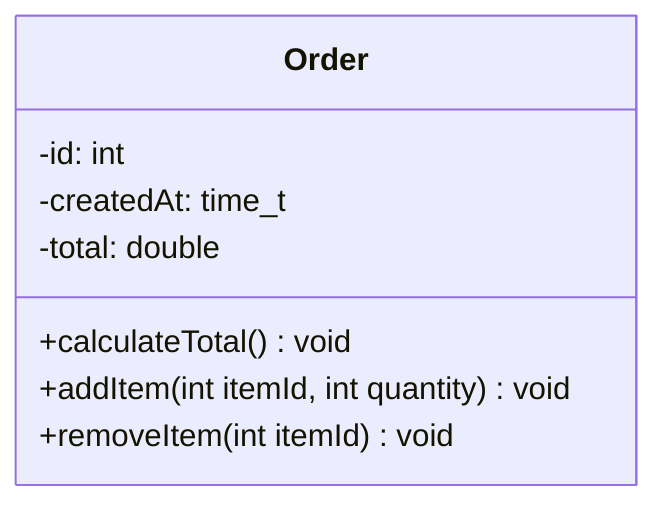

##### Visibility Modifiers

| Symbol | Visibility       | Meaning                                    |
| ------ | ---------------- | ------------------------------------------ |
| `+`    | Public           | Accessible from anywhere                   |
| `-`    | Private          | Accessible only within the class           |
| `#`    | Protected        | Accessible within the class and subclasses |
| `~`    | Package/Internal | Accessible within the same package/module  |

##### Additional Class Notation Details

- Static members are underlined.
- Abstract class names and abstract methods are written in italics.
- Interfaces are marked with `<<interface>>`.
- Attribute syntax: `visibility name : type [multiplicity] = default value` — example: `-balance: double = 0.0`
- Method syntax: `visibility name(parameter: type) : return type` — example: `+withdraw(amount: double) : boolean`

#### Relationships in a Class Diagram — Overview

| Relationship                     | Notation                         | Meaning                                       | Example                      |
| -------------------------------- | -------------------------------- | --------------------------------------------- | ---------------------------- |
| **Inheritance** / Generalization | Hollow triangle arrow (`——▷`)    | “is-a” — subclass inherits from superclass    | `SavingsAccount ▷ Account`   |
| **Realization**                  | Dashed line with hollow triangle | Class implements an interface                 | `PaymentGateway ⋯▷ IPayment` |
| **Association**                  | Solid line                       | Objects know about each other                 | `Order` — `Customer`         |
| **Aggregation**                  | Hollow diamond                   | “has-a” — whole can exist without parts       | `Department ◇ Employee`      |
| **Composition**                  | Filled diamond                   | “owns” — parts cannot exist without the whole | `Order ◆ OrderItem`          |
| **Dependency**                   | Dashed arrow (`····▶`)           | “uses” — one class depends on another         | `Report ⋯▶ FileReader`       |

#### Association in Detail

Association is one of the most common relationships in a class diagram. It represents a semantic connection between two classes. It shows that objects of one class know about, communicate with, or are connected to objects of another class.

##### Class Association vs Object Association

In UML, there is an important difference between an **association** and a **link**.

- **Class Association**
  - Exists at the **model/class level**.
  - It describes a relationship between **classifiers**.
  - It tells you that instances of one class may be connected to instances of another class.
  - It is drawn as a solid line in a **class diagram**.

  Example:

  ```mermaid
  classDiagram
      class Customer
      class Order

      Customer "1" --> "0..*" Order : places
  ```

  Here, the class `Customer` is associated with the class `Order`. It means a customer may place zero or more orders.

- **Object Association / Link**
  - Exists at the **runtime/object level**.
  - A link is an **instance of an association**.
  - It connects specific objects, not classes.
  - It appears in an **object diagram**.

  Example of an object diagram based on the above association:

  ```text
  c1: Customer
    places ── o1: Order
    places ── o2: Order
    places ── o3: Order
  ```

  Here:
  - `c1` is a specific `Customer` object.
  - `o1`, `o2`, and `o3` are specific `Order` objects.
  - The lines connecting `c1` to `o1`, `o2`, and `o3` are **links**, not associations.

In short:

- **Association** = relationship between classes.
- **Link** = relationship between objects.

##### Association Name and Roles

An association can have a name that describes the relationship:

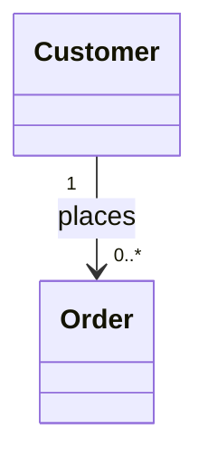

The label `places` is the association name. It can also have role names. For example, `Customer` plays the role of **buyer**, and `Order` plays the role of **purchase**.

##### Navigability

- A plain solid line without arrows means **no navigability direction is specified**.
- An arrow on one end means navigation is possible only in that direction.

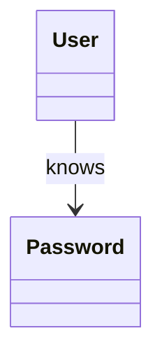

Here, `User` knows about `Password`, but `Password` does not necessarily know about `User`.

##### Recursive Association

A class can be associated with itself. This is called a **recursive association**.

Example: An employee manages other employees.

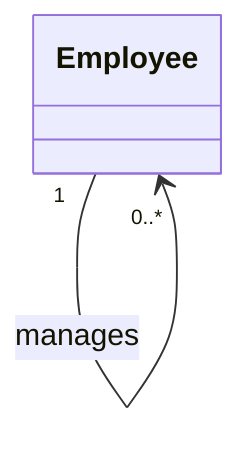

This means one employee can manage zero or more employees.

##### Association Class

Sometimes the relationship itself has properties. In that case, we use an **association class**.

Example: A `Student` enrolls in a `Course`, and the enrollment has a `grade` and `enrollmentDate`.

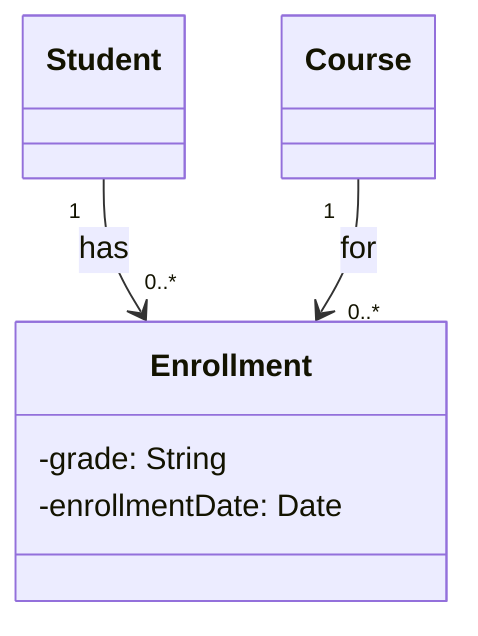

Here, `Enrollment` is an association class that stores data about the relationship between `Student` and `Course`.

#### Aggregation in Detail

Aggregation is a specialized type of association. It represents a **whole–part** relationship with **weak ownership**.

##### Notation

Aggregation is shown using a **hollow diamond** at the whole end.

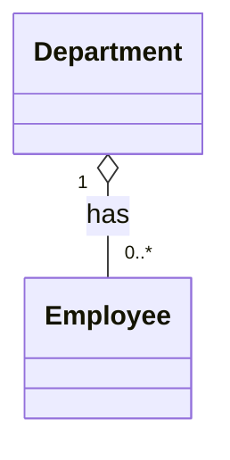

In this example:

- `Department` is the **whole**.
- `Employee` is the **part**.
- The hollow diamond is placed at `Department`.

##### Meaning

- A `Department` has employees.
- An `Employee` can exist without a `Department`.
- If a `Department` is deleted, the `Employee` objects still exist.
- The lifecycle of the parts is **not controlled** by the whole.

##### Implementation Example

```cpp
class Department {
private:
    std::vector<Employee> employees;

public:
    Department(const std::vector<Employee>& employees) {
        this->employees = employees; // Employees are created outside
    }

    void closeDepartment() {
        employees.clear();
        // Employee objects still exist elsewhere
    }
};
```

In this Java example, `Department` receives `Employee` objects from outside. It does not create them. Therefore, deleting the department does not delete the employees.

##### When to Use Aggregation

Use aggregation when:

- There is a whole–part relationship.
- The part can exist independently of the whole.
- The whole does not strictly control the lifecycle of the part.
- The part may be shared by other objects.

#### Composition in Detail

Composition is a stronger form of aggregation. It represents a **whole–part** relationship with **strong ownership**.

##### Notation

Composition is shown using a **filled diamond** at the whole end.

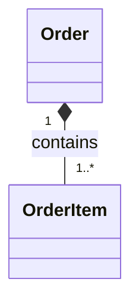

In this example:

- `Order` is the **whole**.
- `OrderItem` is the **part**.
- The filled diamond is placed at `Order`.

##### Meaning

- An `Order` contains `OrderItem` objects.
- An `OrderItem` cannot exist without its parent `Order`.
- If the `Order` is deleted, all its `OrderItem` objects are also deleted.
- A part cannot be shared between multiple whole objects in composition.

##### Implementation Example

```cpp
class Order {
private:
    std::vector<OrderItem> items;

public:
    void addItem(Product product, int quantity) {
        OrderItem item(product, quantity);
        items.push_back(item); // Order creates and owns the OrderItem
    }

    void deleteOrder() {
        items.clear();
        // OrderItem objects are removed along with the order
    }
};
```

In this Java example, `Order` creates `OrderItem` objects internally. Therefore, it controls their lifecycle. Deleting an order removes its items.

##### When to Use Composition

Use composition when:

- There is a strong whole–part relationship.
- The part cannot exist without the whole.
- The whole owns the part and controls its lifecycle.
- The part should not be shared between multiple wholes.

#### Aggregation vs Composition — Comparison

| Point               | Aggregation                                | Composition                           |
| ------------------- | ------------------------------------------ | ------------------------------------- |
| **Ownership**       | Weak ownership                             | Strong ownership                      |
| **Lifecycle**       | Parts can exist independently of the whole | Parts cannot exist without the whole  |
| **Diamond**         | Hollow diamond (`◇`)                       | Filled diamond (`◆`)                  |
| **Sharing**         | Parts may be shared between wholes         | Parts cannot be shared between wholes |
| **When whole dies** | Part survives                              | Part is destroyed                     |
| **Example**         | `Department ◇ Employee`                    | `Order ◆ OrderItem`                   |
| **Code style**      | Whole receives parts from outside          | Whole creates parts internally        |

#### Inheritance / Generalization

Inheritance represents an **“is-a”** relationship. A subclass inherits attributes and methods from a superclass and can override or extend them.

##### Notation

Inheritance is shown using a **hollow triangle** pointing to the superclass.

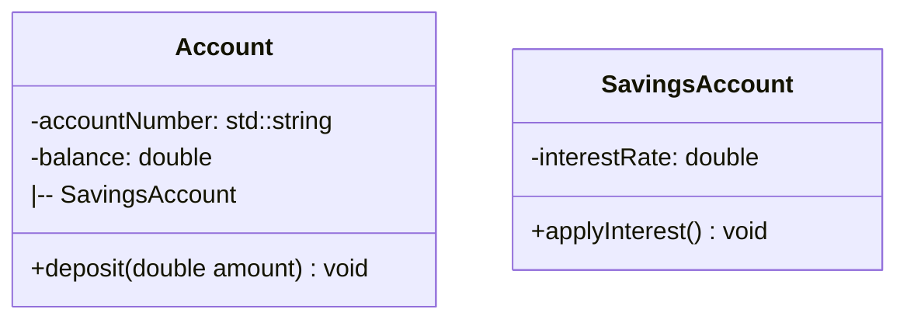

Here, `SavingsAccount` is a specialized type of `Account`.

##### Characteristics

- Subclass inherits all public and protected members.
- Subclass can add new attributes and methods.
- Subclass can override inherited methods.
- Use inheritance only when a true “is-a” relationship exists.

#### Realization

Realization is used when a class implements an interface.

##### Notation

Realization is shown with a **dashed line** and a **hollow triangle** pointing to the interface.

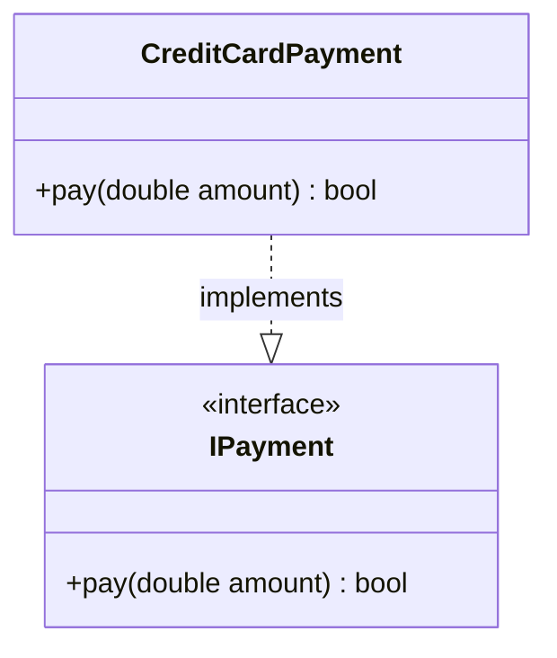

Here, `CreditCardPayment` realizes the contract defined by `IPayment`.

##### Characteristics

- The implementing class must provide implementations for all interface methods.
- The interface has no implementation logic, only method signatures.
- Realization supports polymorphism and multiple implementations.

#### Dependency

Dependency shows that one class **uses** another class temporarily.

##### Notation

Dependency is shown using a **dashed arrow**.

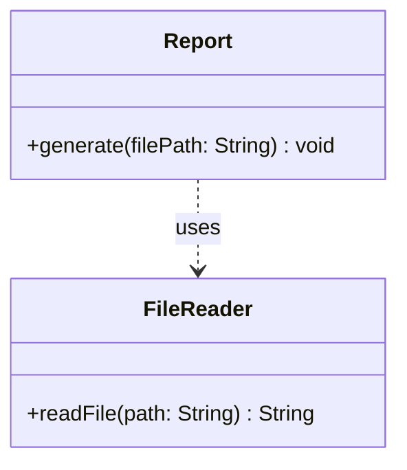

##### Meaning

- `Report` uses `FileReader`, but it does not store a persistent reference to it.
- The usage is temporary: a method parameter, local variable, return type, or static call.
- A change in `FileReader` may affect `Report`, but the relationship is weaker than association.

##### Implementation Example

```cpp
class Report {
public:
    std::string generate(const std::string& filePath) {
        FileReader reader(filePath);
        return reader.read();
    }
};
```

Here, `FileReader` is used only inside the `generate` method. It is not an attribute of `Report`.

#### Multiplicity / Cardinality

Multiplicity defines how many instances of one class can be associated with one instance of another class.

| Notation | Meaning           |
| -------- | ----------------- |
| `1`      | Exactly one       |
| `0..1`   | Zero or one       |
| `*`      | Zero or many      |
| `1..*`   | One or many       |
| `0..n`   | Zero to n         |
| `1..3`   | One to three      |
| `m..n`   | Range from m to n |

Examples:

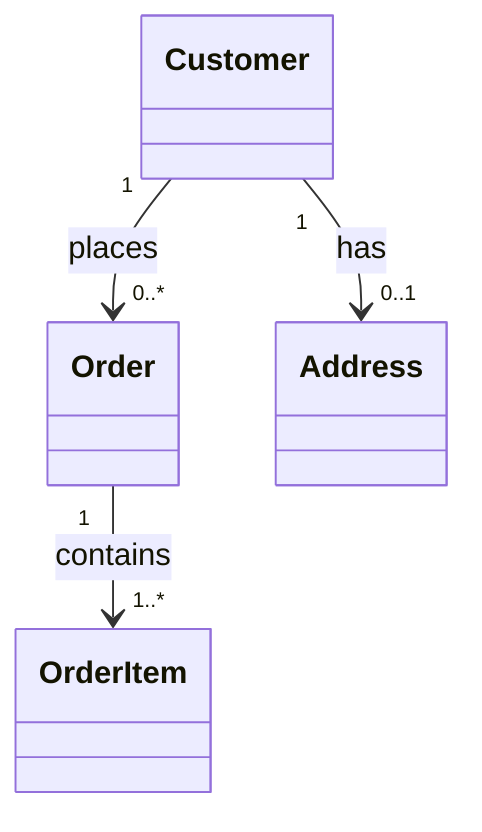

- A customer places **zero or many** orders.
- A customer has **zero or one** address.
- An order contains **one or many** order items.

#### Complete Example Class Diagram

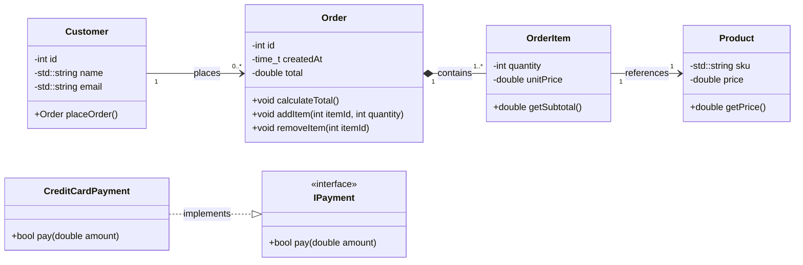

##### Explanation of Relationships

- `Customer` and `Order`: **Association** — a customer places orders.
- `Order` and `OrderItem`: **Composition** — order items cannot exist without an order.
- `OrderItem` and `Product`: **Association** — an order item references a product.
- `CreditCardPayment` and `IPayment`: **Realization** — credit card payment implements the payment interface.

### Object Diagram

A snapshot of the system **at a particular moment in time** — instances of classes with actual values. Useful for validating class design with concrete data.

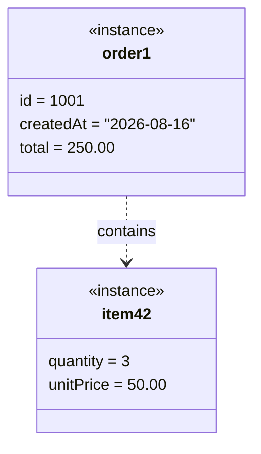

### Package Diagram

Groups related classes into packages/modules and shows dependencies between them. Mirrors how you would organize code into namespaces or folders.

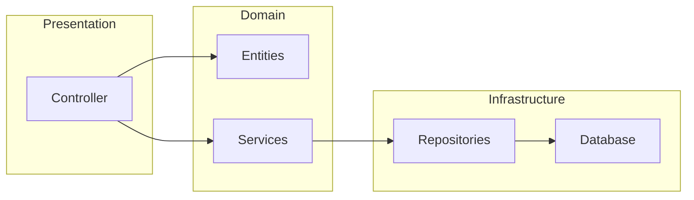

### Component Diagram

Shows the high-level **components** (modules, services, libraries) of a system and the interfaces they expose/require. Frequently used in HLD but still useful for LLD to define module boundaries.

### Composite Structure Diagram

Shows the **internal structure** of a class or component — how its parts collaborate. Rarely used but valuable for complex objects.

### Deployment Diagram

Shows the **physical hardware/software topology** — which nodes (servers, containers, devices) run which artifacts. Mostly an HLD/DevOps concern, but referenced in LLD for distributed systems.

### Profile Diagram

Extends UML with domain-specific stereotypes (e.g., `<<entity>>`, `<<repository>>`, `<<service>>`). Used to tailor UML to a particular framework or architecture (like Spring or Clean Architecture).

---

## Behavioral Diagrams (Dynamic View)

### Sequence Diagram — _the most important behavioral diagram for LLD_

Shows **how objects interact over time**, in the order the messages are sent. Essential for API design, use-case flows, and identifying which methods a class must expose.

#### Core Elements

| Element                    | Notation                                                                        |
| -------------------------- | ------------------------------------------------------------------------------- |
| **Lifeline**               | Dashed vertical line under each object (`objectName : ClassName`)               |
| **Activation bar**         | Thin rectangle on the lifeline showing when an object is active                 |
| **Message arrow**          | Solid arrow for synchronous call, dashed for return, open arrow for async       |
| **Self-message**           | Arrow that loops back to the same lifeline                                      |
| **Alt/opt/loop fragments** | Boxes for conditional (`alt`), optional (`opt`), and repeated (`loop`) behavior |

#### Example — Placing an Order

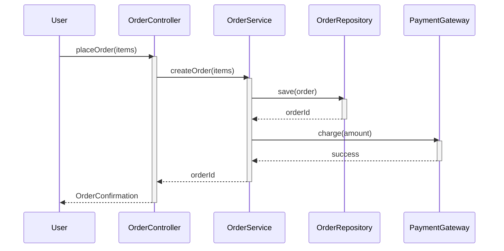

#### Example with Create and Destroy Messages

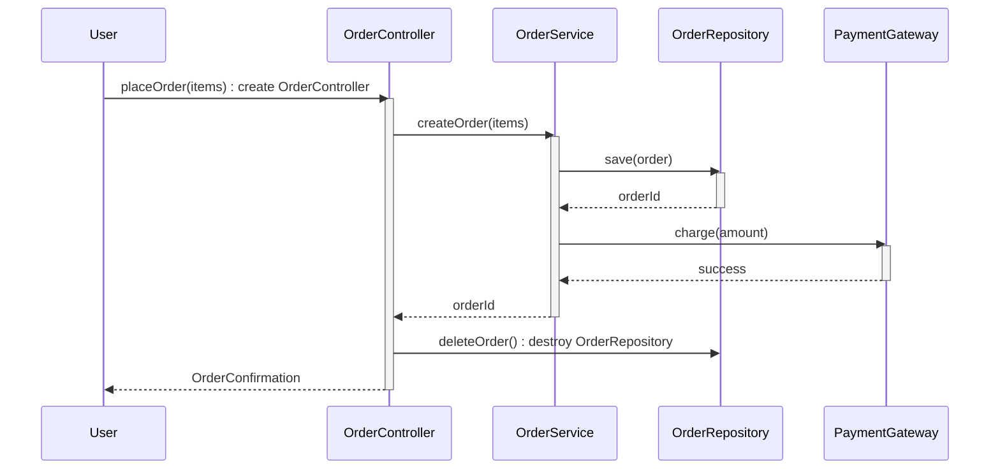

#### Lost and Found Messages

Lost and found messages model scenarios where messages are sent to objects that have been destroyed (lost) or newly created (found).

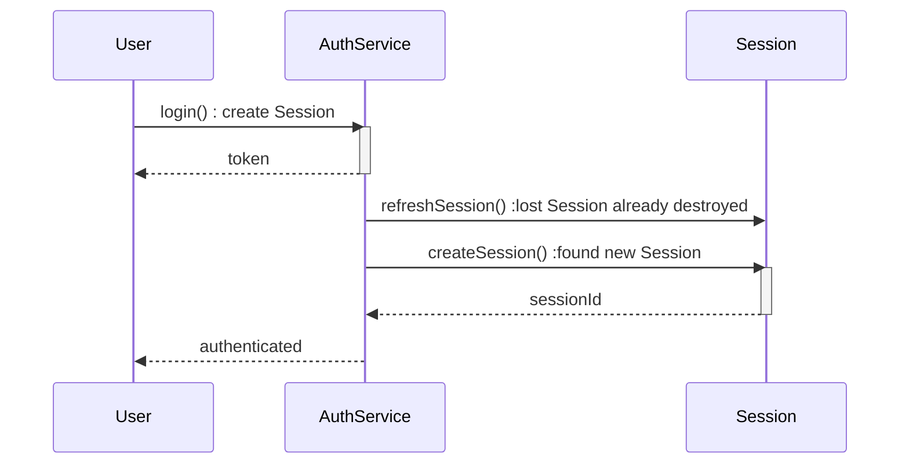

#### Guidelines for Drawing Sequence Diagrams in LLD

- One diagram per **use case / user story flow**.
- Name messages with the **actual method signatures** they will call.
- Always model the **failure paths** (`alt` branches for errors) — not just the happy path.
- Use `destroy` notation (`X->>Y-`) to show object lifecycle ending.
- Model **create messages** (`X->>Y`) for object instantiation.
- Include return messages where the return value affects the flow.

### Use Case Diagram

Shows **actors** (users/external systems) and the **functionalities** (use cases) they can perform. Captures system boundaries and high-level requirements.

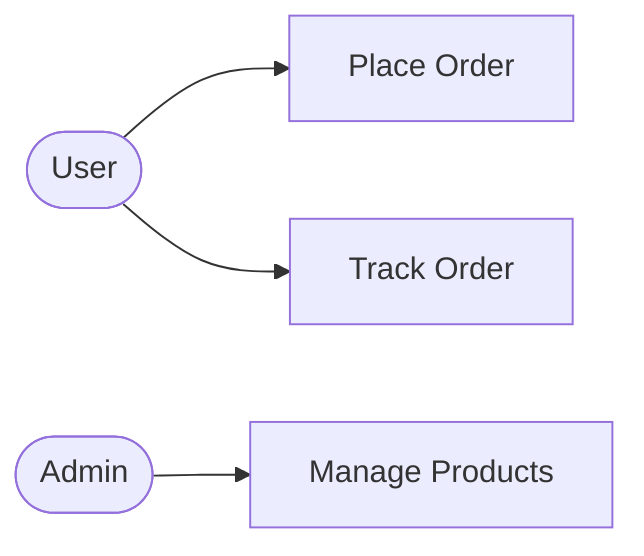

> Use case diagrams are often created during **requirements analysis**, but in LLD they are refined into sequence and class diagrams.

### State Machine Diagram

Models the **different states** an object can be in and the **transitions** between them, triggered by events or conditions. Ideal for modeling order statuses, workflows, and lifecycles.

#### Example — Order Lifecycle

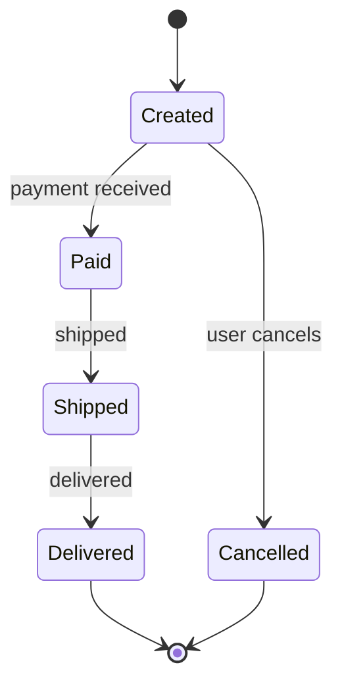

#### Key Concepts

| Concept                 | Meaning                                                          |
| ----------------------- | ---------------------------------------------------------------- |
| **State**               | A condition the object is in (rounded rectangle)                 |
| **Transition**          | A directed arrow labeled with the triggering event               |
| **Guard condition**     | A boolean condition that must hold for a transition (`[isPaid]`) |
| **Entry/exit actions**  | Actions executed when entering/leaving a state                   |
| **Initial/final state** | Filled circle / bullseye                                         |

### Communication (Collaboration) Diagram

A sequence diagram's close cousin — shows the **same interactions but arranged by object structure** (numbered messages) instead of time. Prefer it when you want to emphasize _which objects_ collaborate rather than _when_.

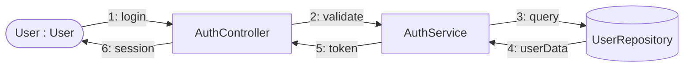

### Timing Diagram

Shows **state changes over a time axis** for real-time or concurrent systems. Useful for embedded systems, schedulers, and time-sensitive protocols.

```mermaid
gantt
    title Sensor State Timeline
    dateFormat  X
    axisFormat %s
    section Sensor A
        Idle     :a1, 0, 3
        Active   :a2, 3, 5
        Idle     :a3, 8, 2
    section Sensor B
        Idle     :b1, 0, 2
        Active   :b2, 2, 6
        Idle     :b3, 8, 2
    section Sensor C
        Idle     :c1, 0, 4
        Active   :a4, 4, 4
```

### Interaction Overview Diagram

A hybrid of activity and sequence diagrams — high-level flow of interactions where each node is itself a sequence/interaction. Used to orchestrate complex multi-scenario flows.

```mermaid
flowchart TD
    Start([User Opens App]) --> Login[Login Flow]
    Login -->|success| Browse[Browse Products]
    Login -->|failure| Retry[Retry Login]
    Retry --> Login
    Browse --> AddToCart[Add to Cart]
    AddToCart --> Checkout[Checkout Flow]
    Checkout -->|payment ok| Done([Order Placed])
    Checkout -->|payment fail| RetryPayment[Retry Payment]
    RetryPayment --> Checkout
```

---

## Which UML Diagrams Are Most Important for LLD?

| Priority | Diagram                                 | Why                                                                             |
| -------- | --------------------------------------- | ------------------------------------------------------------------------------- |
| ★★★      | **Class diagram**                       | Defines every class, method, and relationship — the core deliverable of LLD     |
| ★★★      | **Sequence diagram**                    | Defines method-call flows, API contracts, and interaction logic                 |
| ★★☆      | **State machine diagram**               | Required whenever an entity has a lifecycle (orders, users, tickets, workflows) |
| ★★☆      | **Activity diagram**                    | Useful for complex business logic and algorithmic flows                         |
| ★☆☆      | **Use case diagram**                    | Helps map features to design, but is mostly a requirements artifact             |
| ★☆☆      | **Package/Component diagram**           | Helps define module boundaries and dependencies                                 |
| ☆☆☆      | **Object, Timing, Communication, etc.** | Niche — use only when the design demands it                                     |

## Practical Tips for Drawing UML Diagrams

- **Start with class diagrams, then add behavior.** Structure first, behavior second.
- **Prefer composition over aggregation** unless the part genuinely outlives the whole.
- **Model the domain, not the framework** — don't pollute diagrams with framework-specific classes unless they matter.
- **Keep diagrams small** — one responsibility per diagram; split large designs into multiple diagrams.
- **Add method signatures, not just names** — LLD needs `placeOrder(items: List<Item>): Order`, not just `placeOrder`.
- **Always include multiplicity** — it forces you to think about null/collection semantics.
- **Use tools** — Mermaid (markdown), PlantUML, draw.io, StarUML, or Lucidchart. Keep diagrams as code (`.puml`, `.mmd`) so they can be reviewed in pull requests and versioned with the codebase.
- **Keep diagrams in sync with code** — stale diagrams are worse than no diagrams; regenerate or update them during implementation.

# Solid Principles in LLD

SOLID is a set of five object-oriented design principles that, applied together, turn a collection of classes into a design that is easy to maintain, extend, and test. In LLD they are the guardrails that keep a class diagram clean and low-coupling as the system grows. Each principle targets a specific way designs rot over time:

- **S**ingle Responsibility — one class, one reason to change.
- **O**pen/Closed — extend without modifying existing code.
- **L**iskov Substitution — a subtype must be usable wherever its parent is.
- **I**nterface Segregation — small, focused interfaces over fat ones.
- **D**ependency Inversion — depend on abstractions, not concrete details.

The rest of this section walks through each principle with a concrete C++ example that _violates_ it, the problems that follow, and a corrected design that _follows_ it.

## Single Responsibility Principle (SRP)

### Definition

A class should have **one, and only one, reason to change**. A "responsibility" is a reason to change, so a class that does several unrelated jobs has several reasons to change. Keep each class focused on a single concern so that changes to one concern never ripple into another.

### Violating SRP

Here a single `Report` class owns four unrelated responsibilities — loading data, formatting, persistence, and notification:

```cpp
#include <iostream>
#include <fstream>
#include <string>
#include <vector>

class Report {
public:
    // 1. Data access
    std::vector<double> loadSalesData() {
        /* fetch and aggregate sales figures */
        return {};
    }

    // 2. Presentation
    std::string formatReport(const std::vector<double>& data) {
        /* build an HTML/PDF string */
        return "";
    }

    // 3. Persistence
    void saveToFile(const std::string& content, const std::string& path) {
        std::ofstream out(path);
        out << content;
    }

    // 4. Notification
    void sendEmail(const std::string& to, const std::string& content) {
        std::cout << "Mailing " << content.size() << " chars to "
                  << to << "\n";
    }
};
```

```text
Mailing 0 chars to user@example.com
```

### Problems It Causes

- **Coupled reasons to change** — changing the report format, the storage backend, or the mail service all force edits to (and re-tests of) the same class, even though those changes are unrelated.
- **Hard to test in isolation** — testing the formatter drags in the database and the email sender.
- **Low reusability** — you cannot reuse just the formatting logic without also taking the persistence and email code along.
- **Merge friction** — several developers working on different features all touch the same file.

### Applying SRP

Split each concern into its own focused class, then orchestrate them from a thin service if needed:

```cpp
#include <iostream>
#include <fstream>
#include <string>
#include <vector>

class SalesDataLoader {
public:
    std::vector<double> load() { /* fetch + aggregate */ return {}; }
};

class ReportFormatter {
public:
    std::string format(const std::vector<double>& data) {
        /* build string */ return ""; }
};

class ReportRepository {
public:
    void save(const std::string& content, const std::string& path) {
        std::ofstream out(path);
        out << content;
    }
};

class EmailNotifier {
public:
    void send(const std::string& to, const std::string& content) {
        std::cout << "Mailing " << content.size() << " chars to "
                  << to << "\n";
    }
};

// Thin orchestrator — its single responsibility is the
// workflow, not the details.
class ReportService {
    SalesDataLoader loader;
    ReportFormatter formatter;
    ReportRepository repository;
    EmailNotifier notifier;
public:
    void generateAndSend(const std::string& path, const std::string& to) {
        auto data = loader.load();
        auto content = formatter.format(data);
        repository.save(content, path);
        notifier.send(to, content);
    }
};
```

```text
Mailing 0 chars to user@example.com
```

```mermaid
classDiagram
    class ReportService {
        +generateAndSend(path, to)
    }
    class SalesDataLoader {
        +load() vector~double~
    }
    class ReportFormatter {
        +format(data) string
    }
    class ReportRepository {
        +save(content, path)
    }
    class EmailNotifier {
        +send(to, content)
    }
    ReportService --> SalesDataLoader
    ReportService --> ReportFormatter
    ReportService --> ReportRepository
    ReportService --> EmailNotifier
```

Each class now has exactly one reason to change.

## Open/Closed Principle (OCP)

### Definition

Software entities should be **open for extension but closed for modification**. You should be able to add new behavior by _adding_ code (a new class), not by _changing_ existing, tested code. Polymorphism and strategy objects are the usual mechanisms.

### Violating OCP

The `AreaCalculator` uses type checks, so every new shape means rewriting the method:

```cpp
enum class ShapeType { Circle, Rectangle };

struct Shape {
    ShapeType type;
    double width;   // rectangle only
    double height;  // rectangle only
    double radius;  // circle only
};

class AreaCalculator {
public:
    double area(const Shape& s) {
        if (s.type == ShapeType::Circle) {
            return 3.14159 * s.radius * s.radius;
        }
        if (s.type == ShapeType::Rectangle) {
            return s.width * s.height;
        }
        return 0; // adding Triangle requires modifying this method
    }
};
```

### Problems It Causes

- **Every new type touches existing code** — the method (and its tests) must be edited and re-verified for each new shape.
- **Risk of regression** — a mistake in the new branch can break existing shapes.
- **Unbounded conditional logic** — the `if/else` chain grows with the number of types and becomes hard to read.
- **Bloated data structure** — `Shape` accumulates fields that only some shapes use (`radius` is meaningless for a rectangle).

### Applying OCP

Model shapes as a polymorphic hierarchy; new shapes are _added_, never modifying the existing calculator:

```cpp
#include <vector>

class Shape {
public:
    virtual double area() const = 0;
    virtual ~Shape() = default;
};

class Circle : public Shape {
    double radius;
public:
    explicit Circle(double r) : radius(r) {}
    double area() const override { return 3.14159 * radius * radius; }
};

class Rectangle : public Shape {
    double width, height;
public:
    Rectangle(double w, double h) : width(w), height(h) {}
    double area() const override { return width * height; }
};

// Adding Triangle = adding a class. AreaCalculator is never touched again.
double totalArea(const std::vector<Shape*>& shapes) {
    double sum = 0.0;
    for (const Shape* s : shapes) {
        sum += s->area();
    }
    return sum;
}
```

```mermaid
classDiagram
    class Shape {
        <<abstract>>
        +area() double
    }
    class Circle {
        -radius: double
        +area() double
    }
    class Rectangle {
        -width: double
        -height: double
        +area() double
    }
    Shape <|-- Circle
    Shape <|-- Rectangle
```

## Liskov Substitution Principle (LSP)

### Definition

**Subtypes must be substitutable for their base types.** If `S` is a subtype of `T`, then objects of type `T` can be replaced with objects of type `S` without breaking the correctness of the program. A derived class must not weaken or contradict the behavior its base class promises.

### Violating LSP

The classic `Rectangle`/`Square` trap. A `Square` forces both dimensions to stay equal, which contradicts what `Rectangle` guarantees about `setWidth`/`setHeight`:

```cpp
#include <iostream>

class Rectangle {
protected:
    int width, height;
public:
    virtual void setWidth(int w)  { width = w; }
    virtual void setHeight(int h) { height = h; }
    int getWidth()  const { return width; }
    int getHeight() const { return height; }
    int area() const { return width * height; }
};

class Square : public Rectangle {
public:
    void setWidth(int w)  override { width = height = w; }
    // forces square invariant
    void setHeight(int h) override { width = height = h; }
};
```

A function written against `Rectangle` now breaks when handed a `Square`:

```cpp
void resize(Rectangle& r) {
    r.setWidth(5);
    r.setHeight(4);
    // For a Rectangle: area() == 20. For a Square: area() == 16.
    if (r.area() != 20) {
        std::cout << "Unexpected area: " << r.area() << "\n";
    }
}
```

```text
Unexpected area: 16
```

### Problems It Causes

- **Silent breakage** — code written for the base type misbehaves when a derived type is substituted, with no compile-time error.
- **Surprising side effects** — calling `setWidth` on a `Square` also changes its height, violating the caller's expectations.
- **The "is-a" lie** — mathematically a square _is_ a rectangle, but behaviorally this inheritance is invalid, so the model misleads future maintainers.
- **Type-sniffing hacks** — code starts doing `dynamic_cast` checks to special-case the derived type, spreading complexity everywhere.

### Applying LSP

Model `Square` and `Rectangle` as independent types behind a common immutable contract, so neither can contradict the other:

```cpp
class Shape {
public:
    virtual int area() const = 0;
    virtual ~Shape() = default;
};

class Rectangle : public Shape {
    int width, height;
public:
    Rectangle(int w, int h) : width(w), height(h) {}
    int area() const override { return width * height; }
};

class Square : public Shape {
    int side;
public:
    explicit Square(int s) : side(s) {}
    int area() const override { return side * side; }
};
```

Now there is no mutating contract to violate, and a `Square` can safely be used anywhere a `Shape` is expected. When inheritance cannot preserve the base contract, prefer composition or a shared interface over subclassing.

## Interface Segregation Principle (ISP)

### Definition

**Clients should not be forced to depend on interfaces they do not use.** Prefer many small, focused interfaces over one "fat" interface so that an implementer only commits to the methods it actually supports.

### Violating ISP

A single `Worker` interface bundles working, eating, and sleeping. A `Robot` must stub out the two methods it does not need:

```cpp
#include <stdexcept>

class Worker {
public:
    virtual void work() = 0;
    virtual void eat() = 0;
    virtual void sleep() = 0;
    virtual ~Worker() = default;
};

class Human : public Worker {
public:
    void work()  override { /* ... */ }
    void eat()   override { /* ... */ }
    void sleep() override { /* ... */ }
};

class Robot : public Worker {
public:
    void work() override { /* ... */ }
    void eat() override {
        throw std::runtime_error("Robot does not eat"); // meaningless stub
    }
    void sleep() override {
        throw std::runtime_error("Robot does not sleep"); // meaningless stub
    }
};
```

### Problems It Causes

- **Irrelevant methods on implementers** — `Robot` is forced to "implement" (or stub, or throw on) behavior it does not have.
- **Surprise failures** — clients calling `eat()` on a `Robot` hit a runtime error instead of a design-level guarantee.
- **Harder to reuse and test** — a fat interface forces every mock/fake to implement methods irrelevant to the test.
- **Coupling to churn** — changing an unrelated method on `Worker` recompiles and re-tests every implementer.

### Applying ISP

Split the fat interface into small, focused ones; a class implements only what it needs:

```cpp
class Workable {
public:
    virtual void work() = 0;
    virtual ~Workable() = default;
};

class Eatable {
public:
    virtual void eat() = 0;
    virtual ~Eatable() = default;
};

class Sleepable {
public:
    virtual void sleep() = 0;
    virtual ~Sleepable() = default;
};

class Human : public Workable, public Eatable, public Sleepable {
public:
    void work()  override { /* ... */ }
    void eat()   override { /* ... */ }
    void sleep() override { /* ... */ }
};

class Robot : public Workable {
public:
    void work() override { /* ... */ }
};
```

```mermaid
classDiagram
    class Workable {
        <<interface>>
        +work()
    }
    class Eatable {
        <<interface>>
        +eat()
    }
    class Sleepable {
        <<interface>>
        +sleep()
    }
    class Human
    class Robot
    Workable <|-- Human
    Eatable <|-- Human
    Sleepable <|-- Human
    Workable <|-- Robot
```

## Dependency Inversion Principle (DIP)

### Definition

**High-level modules should not depend on low-level modules; both should depend on abstractions. Abstractions should not depend on details; details should depend on abstractions.** In other words, invert the conventional dependency arrow so that policy depends on interfaces, and concrete implementations plug into those interfaces.

### Violating DIP

The high-level `NotificationService` directly constructs and uses the concrete `EmailSender`:

```cpp
#include <iostream>
#include <string>

class EmailSender {
public:
    void send(const std::string& to, const std::string& message) {
        std::cout << "Email to " << to << ": " << message << "\n";
    }
};

class NotificationService {           // high-level policy
    EmailSender email;                // depends on a concrete detail
public:
    void notify(const std::string& to, const std::string& message) {
        email.send(to, message);
    }
};
```

```text
Email to alice@example.com: Your order has shipped.
```

### Problems It Causes

- **Policy locked to a mechanism** — the high-level "notify" logic can only ever send email unless the class is edited.
- **Adding channels requires edits** — supporting SMS or push means modifying `NotificationService` and re-testing it.
- **Hard to unit test** — you cannot substitute a fake sender without a real email path.
- **Low reusability** — the notification policy cannot be reused with a different delivery backend.

### Applying DIP

Introduce an abstraction (`INotifier`). Both the high-level service and the concrete senders depend on it, and the concrete senders are injected in:

```cpp
#include <iostream>
#include <string>

class INotifier {
public:
    virtual void send(const std::string& to, const std::string& message) = 0;
    virtual ~INotifier() = default;
};

class EmailSender : public INotifier {
public:
    void send(const std::string& to, const std::string& message) override {
        std::cout << "Email to " << to << ": " << message << "\n";
    }
};

class SmsSender : public INotifier {
public:
    void send(const std::string& to, const std::string& message) override {
        std::cout << "SMS to " << to << ": " << message << "\n";
    }
};

class NotificationService {           // depends on the abstraction
    INotifier& notifier;
public:
    explicit NotificationService(INotifier& n) : notifier(n) {}
    void notify(const std::string& to, const std::string& message) {
        notifier.send(to, message);
    }
};
```

```text
Email to alice@example.com: Your order has shipped.
SMS to +15551234567: Your order has shipped.
```

```mermaid
classDiagram
    class NotificationService {
        +notify(to, message)
    }
    class INotifier {
        <<interface>>
        +send(to, message)
    }
    class EmailSender {
        +send(to, message)
    }
    class SmsSender {
        +send(to, message)
    }
    NotificationService --> INotifier
    INotifier <|-- EmailSender
    INotifier <|-- SmsSender
```

The dependency arrow now points from the high-level service _toward_ the abstraction, and the concrete senders point _up_ to that same abstraction — the dependency has been inverted.

## Summary

| Principle                 | What it says                                       | Problem it prevents                                   |
| ------------------------- | -------------------------------------------------- | ----------------------------------------------------- |
| **Single Responsibility** | One class, one reason to change                    | Classes doing too much; coupled changes               |
| **Open/Closed**           | Open for extension, closed for modification        | Editing tested code for each new feature              |
| **Liskov Substitution**   | Subtypes must be substitutable for their base type | Code breaking when a subtype is passed in             |
| **Interface Segregation** | Small focused interfaces over fat ones             | Implementers forced to stub irrelevant methods        |
| **Dependency Inversion**  | Depend on abstractions, not concretions            | High-level policy locked to a specific implementation |

Applied together, these five principles are what separate a class diagram that merely _compiles_ from one that survives change. In LLD, every class, interface, and relationship in a diagram can be sanity-checked against SOLID before a single line of implementation is written.

# Practice: Design Google Docs

Google Docs is the canonical "design a document editor" interview problem. The point of the exercise is not to implement every feature but to show how a real LLD interview unfolds: state the problem, pick an approach, start with a naive design, then refactor it toward one that obeys SOLID. We work bottom-up — first the small leaf objects, then the containers, then the facade on top.

## Problem Statement

Design a document editor (like Google Docs) where a user can insert text and images into a document and then render the entire document and save it to a file. The editor must be scalable: later it should be possible to add tables, videos, fonts, bold/italic/underline, line breaks, and tab spacing without rewriting the existing design. For this exercise we implement text and image first, and throw in two whitespace elements (new line and tab space) to prove the design is genuinely extensible.

The document is modeled as an ordered list of elements, because the order in which a user inserts text and images matters:

- **Insert text** — add a block of text to the document.
- **Insert image** — add an image (we store its path).
- **Render** — walk the document and produce one combined output string.
- **Save** — persist the rendered document to a file (later, to a database too).

## Approach — Top-Down vs Bottom-Up

There are two broad ways to attack any LLD problem. In a **top-down** approach you start from the top-most object — the whole application — and break it into smaller objects, wiring their dependencies as you descend. In a **bottom-up** approach you do the reverse: build the small, independent objects first, connect their dependencies, and only then compose the bigger objects on top.

This problem is a natural fit for bottom-up: the leaf objects (a piece of text, an image) are obvious, and the rest of the design is just "a list of those, plus a place to save them." Most developers default to bottom-up in interviews; top-down suits problems where the top-level object genuinely dictates the rest of the structure.

## Step 1 — the Naive Design

### The Single-Class DocumentEditor

The first instinct is one class that does everything. It stores every element as a string in a single list — text as plain text and an image as its file path — and it exposes add, render, and save methods:

```cpp
#include <iostream>
#include <fstream>
#include <string>
#include <vector>

class DocumentEditor {
    std::vector<std::string> documentElements;
    std::string renderedDocument;

    // Hack: decide whether a string is an image by looking at its extension.
    bool isImage(const std::string& element) {
        if (element.size() <= 4) return false;
        std::string ext = element.substr(element.size() - 4);
        return ext == ".jpg" || ext == ".png";
    }

public:
    void addText(const std::string& text) {
        documentElements.push_back(text);
    }

    void addImage(const std::string& path) {
        documentElements.push_back(path);
    }

    std::string renderDocument() {
        if (!renderedDocument.empty()) return renderedDocument;

        std::string result;
        for (const auto& element : documentElements) {
            if (isImage(element)) {
                result += "[image: " + element + "]\n";
            } else {
                result += element + "\n";
            }
        }
        renderedDocument = result;
        return renderedDocument;
    }

    void saveToFile(const std::string& filename) {
        std::ofstream file(filename);
        if (file.is_open()) {
            file << renderDocument();
            file.close();
            std::cout << "Document saved successfully.\n";
        } else {
            std::cout << "Unable to open file.\n";
        }
    }
};
```

```text
Document saved successfully.
```

A single class now owns the data, the rendering, and the persistence:

```mermaid
classDiagram
    class DocumentEditor {
        -documentElements: vector~string~
        -renderedDocument: string
        +addText(text) void
        +addImage(path) void
        +renderDocument() string
        +saveToFile(filename) void
    }
```

### Why It Fails

This design breaks the first two SOLID principles:

- **Breaks SRP** — the class has several reasons to change: it adds elements, renders the document, and saves to a file. A change to any one of those responsibilities forces a change to (and a re-test of) this single class.
- **Breaks OCP** — to add a new element type (a table, a video, bold text), you must open this class and edit `renderDocument`, growing the `if/else` with every new type.
- **Type is encoded in data** — "is this text or an image?" is answered by sniffing a file extension. A text element that happens to end in `.jpg` is silently misrendered, and every new element type needs another ad-hoc string rule.
- **Everything is one string** — because text and images share a `std::string`, neither can carry its own rendering logic; the single `renderDocument` method has to know how every type behaves.
- **No abstraction for LSP/ISP/DIP** — with one concrete class there are no subtypes to substitute, no interfaces to segregate, and no dependencies to invert, so those three principles cannot apply yet.

## Step 2 — a Polymorphic Design

The fix is to give each kind of content its own type and its own idea of how to render itself. That yields a hierarchy of document elements, a persistence hierarchy for saving, and a thin facade the client talks to.

### The DocumentElement Hierarchy

Introduce an abstract contract `DocumentElement` with a single `render()` method. Every concrete element overrides `render()` and knows exactly how to turn itself into output text. New element types are added by writing a new subclass — never by editing existing code.

```cpp
#include <string>

class DocumentElement {
public:
    virtual std::string render() const = 0;
    virtual ~DocumentElement() = default;
};

class TextElement : public DocumentElement {
    std::string text;
public:
    explicit TextElement(const std::string& t) : text(t) {}
    std::string render() const override { return text; }
};

class ImageElement : public DocumentElement {
    std::string path;
public:
    explicit ImageElement(const std::string& p) : path(p) {}
    std::string render() const override { return "[image: " + path + "]"; }
};

class NewLineElement : public DocumentElement {
public:
    std::string render() const override { return "\n"; }
};

class TabSpaceElement : public DocumentElement {
public:
    std::string render() const override { return "\t"; }
};
```

```mermaid
classDiagram
    class DocumentElement {
        <<abstract>>
        +render() string
    }
    class TextElement {
        -text: string
        +render() string
    }
    class ImageElement {
        -path: string
        +render() string
    }
    class NewLineElement {
        +render() string
    }
    class TabSpaceElement {
        +render() string
    }
    DocumentElement <|-- TextElement
    DocumentElement <|-- ImageElement
    DocumentElement <|-- NewLineElement
    DocumentElement <|-- TabSpaceElement
```

Adding a `BoldElement`, `ItalicElement`, `FontElement`, `TableElement`, or `VideoElement` later means adding one subclass — the hierarchy is open for extension and closed for modification.

### The Document Class

`Document` is the model: it owns an ordered collection of `DocumentElement` objects and performs CRUD on them. Its `render()` does not know how any single element renders; it simply walks the list and delegates to each element's own `render()`.

```cpp
#include <string>
#include <vector>

class Document {
    std::vector<DocumentElement*> elements;
public:
    void addElement(DocumentElement* element) {
        elements.push_back(element);
    }

    std::string render() const {
        std::string result;
        for (auto* element : elements) {
            result += element->render();
        }
        return result;
    }
};
```

`Document` has a one-to-many "has-a" relationship with `DocumentElement`: it holds many elements but does not decide how they render.

### The Persistence Hierarchy

Saving is its own concern, so it gets its own abstraction. `Persistence` declares a single `save(renderedDocument)` method; `FileStorage` writes to a file and `DBStorage` could write to a database. The editor depends on the abstraction, not on a specific storage.

```cpp
#include <fstream>
#include <iostream>
#include <string>

class Persistence {
public:
    virtual void save(const std::string& renderedDocument) = 0;
    virtual ~Persistence() = default;
};

class FileStorage : public Persistence {
public:
    void save(const std::string& renderedDocument) override {
        std::ofstream file("document.txt");
        file << renderedDocument;
        file.close();
        std::cout << "Document saved to file.\n";
    }
};

class DBStorage : public Persistence {
public:
    void save(const std::string& renderedDocument) override {
        // connect to a database and persist the document
        std::cout << "Document saved to database.\n";
    }
};
```

```text
Document saved to file.
```

```text
Document saved to file.
Document saved to database.
```

```mermaid
classDiagram
    class Persistence {
        <<abstract>>
        +save(renderedDocument) void
    }
    class FileStorage {
        +save(renderedDocument) void
    }
    class DBStorage {
        +save(renderedDocument) void
    }
    Persistence <|-- FileStorage
    Persistence <|-- DBStorage
```

### The DocumentEditor Facade

`DocumentEditor` is the single entry point the client interacts with. It holds a `Document` and a `Persistence` and delegates every request to them — it does not add, render, or save anything itself.

```cpp
#include <string>

class DocumentEditor {
    Document* document;
    Persistence* storage;
    std::string renderedDocument;

public:
    DocumentEditor(Document* doc, Persistence* store)
        : document(doc), storage(store) {}

    void addText(const std::string& text) {
        document->addElement(new TextElement(text));
    }

    void addImage(const std::string& path) {
        document->addElement(new ImageElement(path));
    }

    void addNewLine() {
        document->addElement(new NewLineElement());
    }

    void addTabSpace() {
        document->addElement(new TabSpaceElement());
    }

    std::string renderDocument() {
        if (renderedDocument.empty()) {
            renderedDocument = document->render();
        }
        return renderedDocument;
    }

    void saveDocument() {
        storage->save(renderDocument());
    }
};
```

### Client Code

The client composes the pieces. Notice it passes a `FileStorage` into the editor as a `Persistence`; swapping to `DBStorage` changes nothing in the editor.

```cpp
#include <iostream>

int main() {
    Document* document = new Document();
    Persistence* storage = new FileStorage();
    DocumentEditor editor(document, storage);

    editor.addText("Hello World");
    editor.addNewLine();
    editor.addImage("cat.png");
    editor.addNewLine();
    editor.addTabSpace();
    editor.addText("This is a real-world document editor.");

    std::cout << editor.renderDocument();
    editor.saveDocument();
}
```

```text
Hello World
[Image: cat.png]
    This is a real-world document editor.
Document saved to file.
```

The complete architecture, with every dependency pointing at an abstraction:

```mermaid
classDiagram
    class DocumentElement {
        <<abstract>>
        +render() string
    }
    class TextElement {
        +render() string
    }
    class ImageElement {
        +render() string
    }
    class NewLineElement {
        +render() string
    }
    class TabSpaceElement {
        +render() string
    }
    DocumentElement <|-- TextElement
    DocumentElement <|-- ImageElement
    DocumentElement <|-- NewLineElement
    DocumentElement <|-- TabSpaceElement

    class Document {
        -elements: vector~DocumentElement~
        +addElement(element) void
        +render() string
    }
    Document "1" o-- "0..*" DocumentElement : contains

    class Persistence {
        <<abstract>>
        +save(renderedDocument) void
    }
    class FileStorage {
        +save(renderedDocument) void
    }
    class DBStorage {
        +save(renderedDocument) void
    }
    Persistence <|-- FileStorage
    Persistence <|-- DBStorage

    class DocumentEditor {
        -document: Document
        -storage: Persistence
        +addText(text) void
        +addImage(path) void
        +addNewLine() void
        +addTabSpace() void
        +renderDocument() string
        +saveDocument() void
    }
    DocumentEditor --> Document
    DocumentEditor --> Persistence
```

## Mapping to SOLID

The refactored design satisfies all five principles, applied to this exact problem.

### Single Responsibility Principle

Every class has exactly one job. `Document` owns and manipulates the list of elements; `Persistence` (and its subclasses) owns saving; each element type owns its own rendering; and `DocumentEditor` owns talking to the client and delegating the rest. Extracting rendering and persistence out of the original god class is the classic SRP fix.

### Open/Closed Principle

The original design had to be edited every time a new element appeared. Now the `DocumentElement` hierarchy is open for extension (add a subclass) and closed for modification (nobody edits `Document::render`, `TextElement`, or `ImageElement` to add a table). The same holds for storage: adding a new backend is a new `Persistence` subclass.

### Liskov Substitution Principle

`Document` stores `DocumentElement` objects and calls `render()` on each without caring whether the object is a `TextElement`, an `ImageElement`, a `NewLineElement`, or a `TabSpaceElement`. Every subtype is a drop-in replacement for its parent — exactly what LSP demands.

### Interface Segregation Principle

Both abstractions are minimal: `DocumentElement` exposes only `render()` and `Persistence` exposes only `save()`. No subtype is forced to implement a method it does not need — the failure mode ISP warns against.

### Dependency Inversion Principle

High-level and low-level modules now depend on abstractions. `Document` (high-level) depends on `DocumentElement` (abstraction), not on `TextElement`/`ImageElement` (concrete details). `DocumentEditor` depends on `Persistence`, not on `FileStorage`/`DBStorage`. Both dependency arrows have been inverted through a contract.

## Trade-offs and the Principle of Least Knowledge

A sharp interviewer will push further: `DocumentEditor` still has `renderDocument` and `saveDocument` methods, so it still "knows about" other classes' capabilities — it has more than one reason to know, even if it does not do the work itself. One refinement is to extract a `DocumentRenderer` (a class that renders a `Document`) and strip `DocumentEditor` down to only `addText`/`addImage`, letting the client call the renderer and the storage directly.

But that refinement introduces a new problem: `DocumentRenderer` would fetch `getElements()` from `Document` and then call `render()` on each element — talking to its friend's friend. That violates the **Principle of Least Knowledge** (the Law of Demeter), which says a class should only talk to its immediate friends, because reaching through an object to its internals increases coupling.

So the two goals pull in opposite directions: extracting a renderer satisfies SRP more strictly but breaks the Law of Demeter; keeping `render()` on `Document` keeps the Law of Demeter but leaves a mild SRP blemish. There is no perfect answer — LLD is always a trade-off, and the right design is the one you and the interviewer agree best fits the constraints. The design above is the stopping point the video settles on: it follows SOLID as far as is practical, then consciously accepts a small, well-understood trade-off.

## Key Takeaways

- Approach the problem bottom-up: build the leaf objects first, then compose them.
- Never encode a type in data (the `.jpg`/`.png` string hack); use a polymorphic hierarchy instead.
- Give every kind of content its own class that knows how to render itself.
- Separate the three responsibilities — elements, the document model, and persistence — into their own classes behind small interfaces.
- Apply SOLID deliberately, and be ready to discuss the trade-offs when two principles conflict.

# Strategy Design Pattern

Strategy is one of the most widely used behavioral design patterns. It takes a class that does one job in many different ways and turns each "way" into its own interchangeable object, so the algorithm a client uses can vary independently of the client itself. This section covers the intent, the problem the pattern solves, the standard structure, a complete C++ implementation, and the situations where the pattern earns its keep.

## Intent

Define a family of algorithms, encapsulate each one, and make them interchangeable. Strategy lets the algorithm vary independently from the clients that use it.

In plainer terms: pull each behavior out of the client into its own class behind a common interface, and let the client hold a reference to whichever behavior it currently needs. Swapping behavior then means swapping a reference, not rewriting the client.

## The Problem It Solves

When a class supports several related behaviors, the tempting approach is to hardcode them all with conditionals — an `if/else` chain or a `switch` on a type or flag. Over time the class accumulates every possible behavior, and each new behavior forces an edit to existing, already-tested code.

### A Context Full of Conditionals

This `Context` chooses an algorithm with a `switch`; adding a fourth algorithm means reopening the class:

```cpp
#include <iostream>

enum class Algorithm { A, B, C };

class Context {
public:
    void execute(Algorithm a) const {
        switch (a) {
            case Algorithm::A:
                std::cout << "Running algorithm A\n";
                break;
            case Algorithm::B:
                std::cout << "Running algorithm B\n";
                break;
            case Algorithm::C:
                std::cout << "Running algorithm C\n";
                break;
        }
        // Adding algorithm D means editing this method and the enum.
    }
};
```

```text
Running algorithm A
Running algorithm B
Running algorithm C
```

This conditional-heavy approach causes several problems:

- **Breaks the Open/Closed Principle** — every new algorithm reopens `Context::execute`, which must be re-tested each time.
- **Bloats the context** — one class ends up owning every algorithm, so it has many reasons to change.
- **Hard to test in isolation** — you cannot unit-test one algorithm without pulling in the whole context.
- **Duplication risk** — an algorithm is locked inside a method and cannot be reused anywhere else.

## The Solution

Define a common `Strategy` interface with a single operation, and give every algorithm its own class that implements it. The `Context` then holds a `Strategy` reference and delegates the work to it, unaware of which concrete strategy is installed. Choosing an algorithm becomes choosing an object, and adding a new one is just a new class — the context and the existing strategies never change.

### Participants

- **Strategy** — the interface every algorithm implements (here, a single `execute()`).
- **Concrete strategies** — `ConcreteClassA`, `ConcreteClassB`, `ConcreteClassC`; each implements one algorithm.
- **Context** — holds a reference to a `Strategy` and delegates requests to it; exposes a way to swap the strategy at runtime.

### Structure

```mermaid
classDiagram
    class Context {
        -strategy: Strategy
        +Context(strategy: Strategy)
        +setStrategy(strategy: Strategy) void
        +executeStrategy() void
    }
    class Strategy {
        <<interface>>
        +execute() void
    }
    class ConcreteClassA {
        +execute() void
    }
    class ConcreteClassB {
        +execute() void
    }
    class ConcreteClassC {
        +execute() void
    }
    Context --> Strategy : uses
    Strategy <|-- ConcreteClassA
    Strategy <|-- ConcreteClassB
    Strategy <|-- ConcreteClassC
```

### Standard Implementation

```cpp
#include <iostream>

// Strategy: the common interface every algorithm implements.
class Strategy {
public:
    virtual void execute() const = 0;
    virtual ~Strategy() = default;
};

// Concrete strategies: one class per algorithm.
class ConcreteClassA : public Strategy {
public:
    void execute() const override {
        std::cout << "ConcreteClassA: running algorithm A\n";
    }
};

class ConcreteClassB : public Strategy {
public:
    void execute() const override {
        std::cout << "ConcreteClassB: running algorithm B\n";
    }
};

class ConcreteClassC : public Strategy {
public:
    void execute() const override {
        std::cout << "ConcreteClassC: running algorithm C\n";
    }
};

// Context: holds a strategy and delegates to it.
class Context {
    Strategy* strategy;
public:
    explicit Context(Strategy* s) : strategy(s) {}
    void setStrategy(Strategy* s) { strategy = s; }
    void executeStrategy() const { strategy->execute(); }
};

// Client: chooses and swaps strategies at runtime.
int main() {
    ConcreteClassA strategyA;
    ConcreteClassB strategyB;
    ConcreteClassC strategyC;

    Context context(&strategyA);
    context.executeStrategy();

    context.setStrategy(&strategyB);
    context.executeStrategy();

    context.setStrategy(&strategyC);
    context.executeStrategy();
}
```

```text
ConcreteClassA: running algorithm A
ConcreteClassB: running algorithm B
ConcreteClassC: running algorithm C
```

## How It Works

The client instantiates a context and hands it a concrete strategy. Each call to `executeStrategy()` is forwarded to the installed strategy's `execute()`. To change behavior, the client swaps the strategy with `setStrategy()` — the context does not change, and neither does any existing strategy class.

```mermaid
sequenceDiagram
    participant Client
    participant Context
    participant Strategy

    Client->>Context: setStrategy(ConcreteClassA)
    Client->>Context: executeStrategy()
    Context->>Strategy: execute()
    Strategy-->>Context: algorithm A

    Client->>Context: setStrategy(ConcreteClassB)
    Client->>Context: executeStrategy()
    Context->>Strategy: execute()
    Strategy-->>Context: algorithm B
```

## When to Use

- When a class has several related behaviors that differ only in their implementation, and you must pick one at runtime.
- When you have a long `if/else` chain or `switch` selecting among algorithms.
- When you want to isolate an algorithm from the code that uses it, so both can evolve independently.
- When different clients need different variants of the same behavior, without subclassing the client.
- When you want to unit-test each algorithm in isolation.

## When Not to Use

- When there are only a couple of algorithms that rarely change — a plain conditional is clearer than a hierarchy of classes.
- When the algorithms are unlikely to vary; the extra classes and indirection may never pay for themselves.
- When the "algorithms" are better expressed as a few small functions than as objects.

## Real-World Examples

- Sorting a collection with different comparators — `std::sort` takes a comparator as a pluggable strategy.
- Payment checkout — a cart holds a `PaymentStrategy` that can be PayPal, card, or UPI.
- Compression — a tool that switches between ZIP, GZIP, and RAR strategies.
- Navigation — routing by fastest, shortest, or scenic path.
- File parsing — a reader that parses CSV, JSON, or XML by swapping a parser strategy.

## Relationship to Other Patterns

- **Strategy vs State** — both swap behavior, but State changes behavior from the object's own internal state transitions, while Strategy is chosen externally by the client and normally stays fixed for a task.
- **Strategy vs Template Method** — Template Method fixes the skeleton of an algorithm in a base class and lets subclasses fill in steps; Strategy uses composition and swaps the whole algorithm object.
- **Strategy + Factory** — a factory can select and return the right strategy, keeping the selection logic out of the client.
- **Strategy vs Command** — Command wraps a request (possibly undoable) as an object; Strategy encapsulates an algorithm for interchangeable use.

## Key Points

- Strategy favors composition over inheritance — the context holds a strategy rather than subclassing for each behavior.
- The `Strategy` interface is deliberately narrow (usually one method), so concrete strategies stay small and focused.
- Adding a new algorithm means adding one class — the context and existing strategies stay closed for modification.
- The client picks the strategy; the context only delegates to it.

# Simple Factory

Simple Factory is the most basic of the factory family — so basic that it is not one of the classic GoF patterns at all, but a widely used idiom that paves the way for Factory Method and Abstract Factory. It is a single class that owns the messy object-construction logic — the `if/else` chains that pick which concrete class to build — and hands it back to callers as one clean method. This section covers the intent, the problem it solves, the standard structure, a complete C++ implementation, and where the idiom shines.

## Intent

Encapsulate object creation in one place: a single factory class with one method that decides which concrete class to instantiate based on the input it receives. The caller asks for an object, gets an object, and never touches a `new` or a constructor directly.

In plainer terms: every time your code needs to create one of several related objects, it calls `factory->create(kind)` instead of repeating the selection logic itself. All creation decisions live in exactly one spot, so adding a new kind means editing only that spot.

## The Problem It Solves

When a client must create several related types of objects, the tempting approach is to inline the selection everywhere it is needed. The client ends up littered with conditionals that pick a constructor — and those conditionals get duplicated at every call site.

### A Client Full of Conditionals

This client builds a notification with an `if/else`; every new notification type means editing the client, and every other place that needs a notification duplicates the same chain:

```cpp
#include <iostream>
#include <string>

enum class NotificationType { Email, SMS, Push };

class EmailNotification {
public:
    void send(const std::string& msg) const {
        std::cout << "Email: " << msg << "\n";
    }
};

class SMSNotification {
public:
    void send(const std::string& msg) const {
        std::cout << "SMS: " << msg << "\n";
    }
};

class PushNotification {
public:
    void send(const std::string& msg) const {
        std::cout << "Push: " << msg << "\n";
    }
};

// Client: chooses a constructor inline — duplicated at every call site.
void sendAlert(NotificationType type, const std::string& msg) {
    if (type == NotificationType::Email) {
        EmailNotification n;
        n.send(msg);
    } else if (type == NotificationType::SMS) {
        SMSNotification n;
        n.send(msg);
    } else if (type == NotificationType::Push) {
        PushNotification n;
        n.send(msg);
    }
    // Adding a new type means editing this method and every copy of it.
}

int main() {
    sendAlert(NotificationType::Email, "Server down");
    sendAlert(NotificationType::SMS, "Build failed");
    sendAlert(NotificationType::Push, "Deploy complete");
}
```

```text
Email: Server down
SMS: Build failed
Push: Deploy complete
```

This scattered-construction approach causes several problems:

- **Duplicates selection logic** — every call site repeats the same `if/else`, so adding a type means hunting down every copy.
- **Leaks implementation details** — the client must know every concrete class, its constructor, and which type maps to which, even though it only wants to send a message.
- **Couples client to all variants** — the client depends on every concrete class directly, not on one abstraction.
- **Hides the intended polymorphism** — the client juggles unrelated classes that all happen to have a `send()` method, instead of one common interface.

## The Solution

Define a common interface for the products, give each variant its own class that implements it, and add a single factory class whose one method maps an input — a type, a string, an enum — to the right concrete product. The client calls `factory->create(...)` and uses the result through the common interface, with no conditionals and no direct constructor calls.

### Participants

- **Product** — the interface every created object implements (here, a single `send()`).
- **Concrete products** — `EmailNotification`, `SMSNotification`, `PushNotification`; each implements one variant.
- **Factory** — a class (or static function) with one `create()` method that decides which concrete product to instantiate based on its parameter.
- **Client** — calls the factory and works with the returned product purely through the `Product` interface.

### Structure

```mermaid
classDiagram
    class Notification {
        <<interface>>
        +send(msg: string) void
    }
    class EmailNotification {
        +send(msg: string) void
    }
    class SMSNotification {
        +send(msg: string) void
    }
    class PushNotification {
        +send(msg: string) void
    }
    class NotificationFactory {
        +create(type: NotificationType) Notification
    }
    class Client {
        +sendAlert(type: NotificationType, msg: string) void
    }
    Notification <|-- EmailNotification
    Notification <|-- SMSNotification
    Notification <|-- PushNotification
    NotificationFactory ..> Notification : creates
    Client --> NotificationFactory : uses
    Client --> Notification : uses
```

### Standard Implementation

```cpp
#include <iostream>
#include <stdexcept>
#include <string>

enum class NotificationType { Email, SMS, Push };

// Product: the common interface every created object implements.
class Notification {
public:
    virtual void send(const std::string& msg) const = 0;
    virtual ~Notification() = default;
};

// Concrete products: one class per variant.
class EmailNotification : public Notification {
public:
    void send(const std::string& msg) const override {
        std::cout << "Email: " << msg << "\n";
    }
};

class SMSNotification : public Notification {
public:
    void send(const std::string& msg) const override {
        std::cout << "SMS: " << msg << "\n";
    }
};

class PushNotification : public Notification {
public:
    void send(const std::string& msg) const override {
        std::cout << "Push: " << msg << "\n";
    }
};

// Simple Factory: the single place that decides which product to build.
class NotificationFactory {
public:
    Notification* create(NotificationType type) const {
        switch (type) {
            case NotificationType::Email:
                return new EmailNotification();
            case NotificationType::SMS:
                return new SMSNotification();
            case NotificationType::Push:
                return new PushNotification();
            default:
                throw std::invalid_argument("Unknown notification type");
        }
        // Adding a new type means editing this method only.
    }
};

// Client: asks the factory, works with the common interface.
void sendAlert(const NotificationFactory& factory,
               NotificationType type, const std::string& msg) {
    Notification* notification = factory.create(type);
    notification->send(msg);
    delete notification;
}

int main() {
    NotificationFactory factory;
    sendAlert(factory, NotificationType::Email, "Server down");
    sendAlert(factory, NotificationType::SMS, "Build failed");
    sendAlert(factory, NotificationType::Push, "Deploy complete");
}
```

```text
Email: Server down
SMS: Build failed
Push: Deploy complete
```

## How It Works

The client holds a factory and asks it for the object it needs, passing a type. The factory maps that type to a concrete class, constructs it, and returns it behind the common `Notification` interface. The client then calls `send()` without ever knowing — or caring — which concrete class it got. To support a fourth kind of notification, only the factory's `create()` changes; every client stays untouched.

```mermaid
sequenceDiagram
    participant Client
    participant Factory
    participant Notification

    Client->>Factory: create(Email)
    Factory->>Notification: new EmailNotification
    Notification-->>Client: EmailNotification as Notification
    Client->>Notification: send("Server down")

    Client->>Factory: create(SMS)
    Factory->>Notification: new SMSNotification
    Notification-->>Client: SMSNotification as Notification
    Client->>Notification: send("Build failed")
```

## When to Use

- When a client must create one of several related classes but should not know which one it gets.
- When construction requires the same `if/else` or `switch` in multiple places — centralize it once.
- When you want to give clients a single, simple entry point for object creation, hiding constructors and `new`.
- When the set of products shares a common interface, so callers can code against the abstraction.
- When you want to unit-test creation logic in isolation, away from the clients that use the products.

## When Not to Use

- When there is only one concrete product — a factory adds indirection that buys nothing.
- When the product selection never changes; the conditional the factory hides is the whole point, and if it never grows, the extra class is dead weight.
- When clients need different construction parameters or want fine-grained control over creation — a rigid `create(type)` cannot express that.
- When you need to extend the family of products _and_ the way they are built across many dimensions — that is the job of Factory Method or Abstract Factory, not this idiom.
- When registration of new products should happen without touching existing code — Simple Factory edits its single method; it does not stay closed for modification.

## Real-World Examples

- Logging libraries — a factory that returns the right `Logger` (console, file, syslog) from a config string.
- Notification systems — one factory emitting email, SMS, or push senders.
- Parsers — a factory choosing a JSON, XML, or CSV parser from a file extension.
- Database drivers — a factory returning the correct connection object for MySQL, PostgreSQL, or SQLite.
- UI toolkits — a factory building buttons, dialogs, or widgets from a platform string.

## Relationship to Other Patterns

- **Simple Factory vs Factory Method** — Simple Factory centralizes creation in one concrete class; Factory Method pushes creation to subclasses, which override a `createProduct()` hook so each subclass supplies its own product. Factory Method is the GoF pattern; Simple Factory is its simpler, non-polymorphic cousin.
- **Simple Factory vs Abstract Factory** — Abstract Factory creates _families_ of related objects behind an interface and can be swapped wholesale; Simple Factory creates a single product selected by a parameter.
- **Simple Factory vs Builder** — Builder constructs a complex object step by step; Simple Factory returns a finished object in one call.
- **Simple Factory + Strategy** — a factory can select and return the right strategy, keeping the selection logic out of the client (as in the Strategy section above).
- **Simple Factory vs Direct Construction** — the factory trades a little indirection for a single, testable place that owns all creation decisions.

## Key Points

- Simple Factory is an idiom, not a GoF pattern — it is often called a "programming idiom" or a stepping stone to Factory Method.
- All creation logic lives in exactly one method; the client never calls a constructor directly.
- Clients depend on the `Product` interface, not on any concrete class — that is what makes swapping variants safe.
- It centralizes duplication (the `if/else` appears once, not at every call site) but does not satisfy the Open/Closed Principle on its own.
- Adding a new product means editing the factory's `create()` — one method, not every client.

# Factory Method

Factory Method is the GoF pattern that Simple Factory grows into when the creation decision must vary by subclass rather than by parameter. Where Simple Factory centralizes a `switch` in one concrete class, Factory Method lifts creation into a virtual method — the **factory method** — that subclasses override. The base `Creator` keeps the surrounding workflow, and only the "which product to build" step is deferred to subclasses.

## Intent

Define an interface for creating an object, but let subclasses decide which class to instantiate. Factory Method lets a class defer instantiation to subclasses — the base class calls a virtual `factoryMethod()`, and each subclass overrides it to return the concrete product it needs.

In plainer terms: the `Creator` provides a `someOperation()` workflow that says "make a product and use it", but it never says which product. Each concrete creator fills in exactly that blank by overriding `factoryMethod()`. The workflow is written once and inherited; only the creation step is customized.

## The Problem It Solves

When a base class (or a framework) defines a reusable workflow but must build objects it cannot know about in advance, hardcoding creation with `new` or a `switch` inside the workflow binds the base class to concrete classes. Every new product variant forces the whole class — and every copy of it — to change.

### A Creator Duplicated for Every Product

This creator bakes the product it builds into the workflow, so the entire workflow must be copied whenever a different product is needed:

```cpp
#include <iostream>

// Product and its concrete variants.
class Product {
public:
    virtual void use() const = 0;
    virtual ~Product() = default;
};

class ConcreteProductA : public Product {
public:
    void use() const override { std::cout << "Using ConcreteProductA\n"; }
};

class ConcreteProductB : public Product {
public:
    void use() const override { std::cout << "Using ConcreteProductB\n"; }
};

// "Before": the workflow is copied into every creator because the product
// it builds is hardcoded inside the workflow.
class CreatorA {
public:
    void someOperation() const {
        // shared step 1 ...
        Product* product = new ConcreteProductA();
        // the only line that differs
        product->use();
        // shared step 3 ...
        delete product;
    }
};

class CreatorB {
public:
    void someOperation() const {
        // shared step 1 ...
        Product* product = new ConcreteProductB();
        // the same workflow, copied
        product->use();
        // shared step 3 ...
        delete product;
    }
};

int main() {
    CreatorA creatorA;
    creatorA.someOperation();
    CreatorB creatorB;
    creatorB.someOperation();
}
```

```text
Using ConcreteProductA
Using ConcreteProductB
```

This hardwired-creation approach causes several problems:

- **Duplicates the workflow** — each concrete creator copies `someOperation()`, changing only the product; a fix to the workflow must be applied in every copy.
- **Couples the creator to concrete classes** — the creator names `ConcreteProductA` or `ConcreteProductB` directly, so it depends on implementations rather than the `Product` abstraction.
- **Breaks the Open/Closed Principle** — adding a product means editing or copying the creator, not adding a subclass.
- **Blocks framework reuse** — a framework that hardcodes its products cannot be extended by applications without changing framework code.

## The Solution

Give the `Creator` an abstract `factoryMethod()` that returns the `Product` interface, and move the shared workflow into a concrete `someOperation()` that calls it. Subclasses override only `factoryMethod()` to return their specific product. The workflow lives once in the base class; new products arrive as new subclasses, leaving the base class closed for modification.

### Participants

- **Product** — the interface every factory method returns (here, a single `use()`).
- **Concrete products** — `ConcreteProductA`, `ConcreteProductB`; each implements one variant.
- **Creator** — declares the abstract `factoryMethod()` and the `someOperation()` workflow that consumes it.
- **Concrete creators** — `ConcreteCreatorA`, `ConcreteCreatorB`; each overrides `factoryMethod()` to return its own concrete product.

### Structure

```mermaid
classDiagram
    class Product {
        <<interface>>
        +use() void
    }
    class ConcreteProductA {
        +use() void
    }
    class ConcreteProductB {
        +use() void
    }
    class Creator {
        <<abstract>>
        +factoryMethod() Product
        +someOperation() void
    }
    class ConcreteCreatorA {
        +factoryMethod() Product
    }
    class ConcreteCreatorB {
        +factoryMethod() Product
    }
    Product <|-- ConcreteProductA
    Product <|-- ConcreteProductB
    Creator <|-- ConcreteCreatorA
    Creator <|-- ConcreteCreatorB
    ConcreteCreatorA ..> ConcreteProductA : creates
    ConcreteCreatorB ..> ConcreteProductB : creates
    Creator ..> Product : uses
```

### Standard Implementation

```cpp
#include <iostream>

// Product: the interface the factory method returns.
class Product {
public:
    virtual void use() const = 0;
    virtual ~Product() = default;
};

// Concrete products.
class ConcreteProductA : public Product {
public:
    void use() const override { std::cout << "Using ConcreteProductA\n"; }
};

class ConcreteProductB : public Product {
public:
    void use() const override { std::cout << "Using ConcreteProductB\n"; }
};

// Creator: declares the factory method and the workflow that uses it.
class Creator {
public:
    virtual Product* factoryMethod() const = 0;
    virtual ~Creator() = default;

    // The workflow lives here once; only the creation step varies.
    void someOperation() const {
        Product* product = factoryMethod();
        product->use();
        delete product;
    }
};

// Concrete creators: each overrides only the factory method.
class ConcreteCreatorA : public Creator {
public:
    Product* factoryMethod() const override { return new ConcreteProductA(); }
};

class ConcreteCreatorB : public Creator {
public:
    Product* factoryMethod() const override { return new ConcreteProductB(); }
};

int main() {
    Creator* creatorA = new ConcreteCreatorA();
    creatorA->someOperation(); // builds and uses ConcreteProductA
    delete creatorA;

    Creator* creatorB = new ConcreteCreatorB();
    creatorB->someOperation(); // builds and uses ConcreteProductB
    delete creatorB;
}
```

```text
Using ConcreteProductA
Using ConcreteProductB
```

## How It Works

The client holds a `Creator` (in practice a concrete creator) and calls `someOperation()`. That method asks `factoryMethod()` for a product, uses it through the `Product` interface, and releases it — all without naming a concrete product. Which product appears is decided entirely by which concrete creator the client instantiated. To add a third product, add `ConcreteProductC` and `ConcreteCreatorC`; nothing that already exists changes.

```mermaid
sequenceDiagram
    participant Client
    participant Creator
    participant Product

    Client->>Creator: someOperation()
    Creator->>Creator: product = factoryMethod()
    Creator->>Product: new ConcreteProductA
    Creator->>Product: use()
    Creator-->>Client: workflow complete
```

## When to Use

- When a class cannot anticipate the class of objects it must create.
- When a class wants its subclasses to specify which objects it creates.
- When a framework must let applications extend it by supplying their own product types, without modifying framework code.
- When creation is one small step inside a larger, reusable workflow — the workflow is inherited, and only that step varies.
- When you want to remove the `switch`-on-type from a creator and satisfy the Open/Closed Principle instead.

## When Not to Use

- When there is only one concrete product — the subclass indirection buys nothing; a plain `new` or a Simple Factory suffices.
- When the creation decision is purely parameter-driven and there is no subclass to defer to — Simple Factory fits better.
- When subclasses already exist for other reasons and you do not want to multiply them just to vary creation.
- When the products need widely different construction parameters — a single `factoryMethod()` signature becomes a straitjacket.
- When you need to create a whole family of related products rather than one product — that is Abstract Factory's job.

## Real-World Examples

- GUI frameworks — a base `Document` class declares `createWindow()`/`createMenu()`, and each application subclass overrides them.
- Logging libraries — a `Logger` base class whose subclasses override `makeAppender()` to build a console, file, or network appender.
- Test harnesses — a base test class whose `createFixture()` lets each test subclass supply its own fixtures.
- Database drivers — a `Connection` base class whose subclasses override a method to produce the right `Statement` or dialect.
- Game engines — a `Level` base class whose subclasses override `spawnEnemy()` to produce level-specific enemies.

## Relationship to Other Patterns

- **Factory Method vs Simple Factory** — Simple Factory centralizes a `switch` in one concrete class; Factory Method distributes creation across subclasses via a virtual hook. Factory Method satisfies the Open/Closed Principle; Simple Factory does not.
- **Factory Method vs Abstract Factory** — Factory Method creates a single product by subclassing the creator; Abstract Factory creates families of related products behind an interface and is often implemented with factory methods.
- **Factory Method + Template Method** — the creator's `someOperation()` is a template method whose primitive step is `factoryMethod()`, so Factory Method is a specialization of Template Method.
- **Factory Method vs Prototype** — Prototype creates by cloning a registered instance rather than by overriding a method.
- **Factory Method + Iterator** — collections use factory methods to create their iterators.

## Key Points

- Factory Method defers instantiation to subclasses through a virtual `factoryMethod()`.
- The creator's workflow (`someOperation()`) is written once and inherited; only the creation step varies.
- Clients work with the `Product` interface and never name a concrete product.
- Adding a product means adding a subclass pair; the base creator and its workflow stay closed for modification.
- It is the Open/Closed-friendly upgrade of Simple Factory, and the building block of Abstract Factory.

# Abstract Factory

Abstract Factory is the widest of the three — it creates **families** of related products behind a single interface. Instead of one product or one subclass, an abstract factory declares a creation method for every member of a family, and each concrete factory produces a complete, consistent set. The client works only with the abstract factory and the abstract products, so swapping one family for another — a whole UI theme, a platform, a database dialect — is a one-line change.

## Intent

Provide an interface for creating families of related or dependent objects without specifying their concrete classes. The client asks an `AbstractFactory` for each object it needs and receives abstract products, never knowing which concrete family supplied them.

In plainer terms: a family of products must always be used together — a Windows button goes with a Windows checkbox. Abstract Factory groups their creation into one interface so the client can build an entire, consistent set and swap it wholesale.

## The Problem It Solves

When a client must create several objects that belong together as a family and must match each other, hardcoding `new` for each one scatters the family's consistency across the client and makes the whole system depend on one specific variant. Switching from one family to another means touching every construction site.

### A Client Hardwired to One Family

This client builds a product pair with concrete `new` calls, so it can only ever produce Family 1 and can accidentally mix families:

```cpp
#include <iostream>

// Product A and Product B belong to the same family
// and must be used together.
class ProductA1 {
public:
    void useA() const { std::cout << "Family 1: Product A\n"; }
};

class ProductB1 {
public:
    void useB() const { std::cout << "Family 1: Product B\n"; }
};

// A second family — unreachable without changing the client.
class ProductA2 {
public:
    void useA() const { std::cout << "Family 2: Product A\n"; }
};

class ProductB2 {
public:
    void useB() const { std::cout << "Family 2: Product B\n"; }
};

// Client: hardwired to Family 1.
class Client {
public:
    void createUI() const {
        ProductA1* a = new ProductA1(); // concrete, and must match B below
        ProductB1* b = new ProductB1();
        a->useA();
        b->useB();
        delete a;
        delete b;
        // To switch to Family 2, every "new ProductX1" line must change.
    }
};

int main() {
    Client client;
    client.createUI();
}
```

```text
Family 1: Product A
Family 1: Product B
```

This hardwired-family approach causes several problems:

- **Couples the client to a specific family** — the client names `ProductA1` and `ProductB1`, so it can build only one family.
- **Scatters family consistency** — nothing stops a client from mixing `ProductA1` with `ProductB2`, producing an inconsistent set.
- **Breaks the Open/Closed Principle on swap** — switching families means editing every construction site in every client.
- **Duplicates construction** — the same "which family" decision reappears wherever a family is built.

## The Solution

Declare an `AbstractFactory` interface with one creation method per product role, and abstract product interfaces for each role. Each `ConcreteFactory` implements the interface to return one family's concrete products, and each concrete product implements its role's interface. The client depends only on `AbstractFactory` and the abstract products, so it can be handed any concrete family and produce a fully consistent set.

### Participants

- **Abstract products** — `AbstractProductA`, `AbstractProductB`; the interface for each role in the family.
- **Concrete products** — `ProductA1`/`ProductB1` (family 1) and `ProductA2`/`ProductB2` (family 2); each implements one role.
- **AbstractFactory** — the interface with one creation method per product role.
- **Concrete factories** — `ConcreteFactory1` returns family 1's products; `ConcreteFactory2` returns family 2's.
- **Client** — works only with `AbstractFactory` and the abstract products.

### Structure

```mermaid
classDiagram
    class AbstractProductA {
        <<interface>>
        +useA() void
    }
    class AbstractProductB {
        <<interface>>
        +useB() void
    }
    class ProductA1 {
        +useA() void
    }
    class ProductA2 {
        +useA() void
    }
    class ProductB1 {
        +useB() void
    }
    class ProductB2 {
        +useB() void
    }
    class AbstractFactory {
        <<interface>>
        +createProductA() AbstractProductA
        +createProductB() AbstractProductB
    }
    class ConcreteFactory1 {
        +createProductA() AbstractProductA
        +createProductB() AbstractProductB
    }
    class ConcreteFactory2 {
        +createProductA() AbstractProductA
        +createProductB() AbstractProductB
    }
    class Client {
        +buildUI(factory) void
    }
    AbstractProductA <|-- ProductA1
    AbstractProductA <|-- ProductA2
    AbstractProductB <|-- ProductB1
    AbstractProductB <|-- ProductB2
    AbstractFactory <|-- ConcreteFactory1
    AbstractFactory <|-- ConcreteFactory2
    ConcreteFactory1 ..> ProductA1 : creates
    ConcreteFactory1 ..> ProductB1 : creates
    ConcreteFactory2 ..> ProductA2 : creates
    ConcreteFactory2 ..> ProductB2 : creates
    Client --> AbstractFactory : uses
    Client --> AbstractProductA : uses
    Client --> AbstractProductB : uses
```

### Standard Implementation

```cpp
#include <iostream>

// Abstract products: one interface per role in the family.
class AbstractProductA {
public:
    virtual void useA() const = 0;
    virtual ~AbstractProductA() = default;
};

class AbstractProductB {
public:
    virtual void useB() const = 0;
    virtual ~AbstractProductB() = default;
};

// Concrete products for family 1.
class ProductA1 : public AbstractProductA {
public:
    void useA() const override { std::cout << "Family 1: Product A\n"; }
};

class ProductB1 : public AbstractProductB {
public:
    void useB() const override { std::cout << "Family 1: Product B\n"; }
};

// Concrete products for family 2.
class ProductA2 : public AbstractProductA {
public:
    void useA() const override { std::cout << "Family 2: Product A\n"; }
};

class ProductB2 : public AbstractProductB {
public:
    void useB() const override { std::cout << "Family 2: Product B\n"; }
};

// AbstractFactory: one creation method per product role.
class AbstractFactory {
public:
    virtual AbstractProductA* createProductA() const = 0;
    virtual AbstractProductB* createProductB() const = 0;
    virtual ~AbstractFactory() = default;
};

// Concrete factories: each returns a complete, consistent family.
class ConcreteFactory1 : public AbstractFactory {
public:
    AbstractProductA* createProductA() const override {
        return new ProductA1(); }
    AbstractProductB* createProductB() const override {
        return new ProductB1(); }
};

class ConcreteFactory2 : public AbstractFactory {
public:
    AbstractProductA* createProductA() const override {
        return new ProductA2(); }
    AbstractProductB* createProductB() const override {
        return new ProductB2(); }
};

// Client: depends only on the abstract factory and abstract products.
class Client {
public:
    void buildUI(const AbstractFactory& factory) const {
        AbstractProductA* a = factory.createProductA();
        AbstractProductB* b = factory.createProductB();
        a->useA();
        b->useB();
        delete a;
        delete b;
    }
};

int main() {
    ConcreteFactory1 factory1;
    Client client;
    client.buildUI(factory1); // builds Family 1

    ConcreteFactory2 factory2;
    client.buildUI(factory2); // builds Family 2 — client code unchanged
}
```

```text
Family 1: Product A
Family 1: Product B
Family 2: Product A
Family 2: Product B
```

## How It Works

The client is configured with a concrete factory (passed in or injected). It calls `createProductA()` and `createProductB()` on the abstract factory, receives abstract products, uses them through their interfaces, and cleans up. Because the client never names a concrete class, the whole family can be swapped by handing it a different concrete factory. Consistency is guaranteed by construction — a `ConcreteFactory1` always returns products that belong together.

```mermaid
sequenceDiagram
    participant Client
    participant Factory as ConcreteFactory1
    participant ProductA
    participant ProductB

    Client->>Factory: createProductA()
    Factory->>ProductA: new ProductA1
    ProductA-->>Client: ProductA1 as AbstractProductA
    Client->>Factory: createProductB()
    Factory->>ProductB: new ProductB1
    ProductB-->>Client: ProductB1 as AbstractProductB
    Client->>ProductA: useA()
    Client->>ProductB: useB()
```

## When to Use

- When a system must create families of related products that must be used together and must not be mixed.
- When the concrete families should be swappable as a unit — a UI theme, a platform, or a database dialect.
- When the client should be independent of how products are created and of which family it uses.
- When you want to enforce consistency — the factory guarantees that matching products arrive together.
- When a change of platform or family is expected to be a one-line switch.

## When Not to Use

- When there is only one product or one product role — Factory Method or Simple Factory is simpler.
- When the families are small and fixed — the extra interfaces multiply without benefit.
- When you must add new product roles often — adding `createProductC()` changes the abstract factory and every concrete factory, which is Open/Closed-hostile at the factory level.
- When the products do not need to be grouped into consistent sets.
- When construction is complex or needs step-by-step assembly — Builder is a better fit.

## Real-World Examples

- UI toolkits — an abstract factory for widgets (button, checkbox, scrollbar) with a concrete factory per OS or theme.
- Database libraries — a factory returning connection, command, and reader objects for a specific DBMS.
- Cross-platform libraries — factories producing file, network, and UI abstractions per platform.
- Game content — factories producing level-specific terrain, enemies, and power-ups.
- Document converters — factories producing readers and writers for a given file format.

## Relationship to Other Patterns

- **Abstract Factory vs Factory Method** — Abstract Factory composes families of products and is often implemented using factory methods; Factory Method creates a single product.
- **Abstract Factory vs Simple Factory** — Simple Factory returns one product chosen by a parameter; Abstract Factory returns a coordinated set behind an interface.
- **Abstract Factory + Singleton** — concrete factories are often singletons, since only one family is active at a time.
- **Abstract Factory vs Builder** — Abstract Factory returns finished products immediately; Builder assembles one complex product step by step.
- **Abstract Factory vs Prototype** — a Prototype-based factory clones prototype products instead of subclassing the factory.

## Key Points

- Abstract Factory creates **families** of related products behind a single interface.
- The client depends only on `AbstractFactory` and the abstract products, so it is decoupled from concrete families.
- Each concrete factory guarantees a consistent set — you cannot accidentally mix families.
- Swapping families is a one-line change: instantiate a different concrete factory.
- Adding a new product role (for example, `ProductC`) is expensive — it changes the abstract factory and every concrete factory.

# Singleton Design Pattern

A singleton is a class that guarantees exactly one instance of itself and provides a single, global point of access to that instance. The pattern is everywhere in real systems — a configuration object, a logger, a connection pool — places where two copies would be wrong, wasteful, or actively harmful. The hard part is not building one instance, but building one instance _safely_: a first attempt that looks fine on paper breaks the moment two threads ask for the instance at the same time, and every fix introduces a new trade-off. This section walks through those attempts in order, from the simplest to the recommended one, showing the flaw that each version corrects.

## Intent

Ensure a class has only one instance, and provide a global point of access to it. The class controls its own instantiation — its constructor is private, so nobody outside can create a second copy — and a static method hands out the single shared object.

In plainer terms: the class is its own gatekeeper. The only way to get it is through `getInstance()`, and `getInstance()` never constructs more than one object.

## The Problem It Solves

Some objects are expensive to create, or represent a single shared resource where having more than one is simply wrong. Two loggers opening the same file may interleave and corrupt each other's output; two connection pools each open their own set of connections and exhaust the database. The naive fix is to just `new` the object wherever it is needed — which produces a fresh copy every time:

```cpp
#include <iostream>
#include <string>

class Logger {
public:
    void log(const std::string& msg) const {
        std::cout << "[log] " << msg << "\n";
    }
};

// Each caller builds its own Logger — no shared state, no shared instance.
void serviceA() {
    Logger logger;
    logger.log("service A started");
}

void serviceB() {
    Logger logger;   // a different object
    logger.log("service B started");
}

int main() {
    serviceA();
    serviceB();
}
```

```text
[log] service A started
[log] service B started
```

This many-copies approach causes several problems:

- **No shared state** — each caller gets its own object, so configuration or state set in one place is invisible everywhere else.
- **Duplicates expensive resources** — every copy re-opens files, re-establishes connections, or re-reads configuration.
- **No enforcement of the "one instance" rule** — nothing stops a future developer from creating yet another copy.

## Structure

```mermaid
classDiagram
    class Singleton {
        -static instance : Singleton
        -Singleton()
        +static getInstance() Singleton
        +operation() void
    }
```

The private constructor blocks direct construction, the static `instance` holds the single object, and `getInstance()` is the only public door to it. `operation()` stands for whatever business logic the singleton actually provides.

## The Evolution of the Design

The rest of this section builds the singleton five times. Each version fixes the previous one's most important flaw and, in doing so, reveals the next one — until the final form needs no further fixing.

### Version 1: Eager Initialization

The simplest approach: create the instance as a static member the moment the program loads, before `main()` runs, and have `getInstance()` just return it.

```cpp
#include <iostream>

class Singleton {
private:
    static Singleton* instance;
    Singleton() { std::cout << "Singleton created\n"; }

public:
    static Singleton* getInstance() {
        return instance;
    }
};

// Eager: the instance exists whether or not anyone ever asks for it.
Singleton* Singleton::instance = new Singleton();

int main() {
    Singleton* first = Singleton::getInstance();
    Singleton* second = Singleton::getInstance();
    std::cout << (first == second ? "Same instance\n"
               : "Different instances\n");
}
```

```text
Singleton created
Same instance
```

The instance is created even if `getInstance()` is never called, wasting whatever the constructor does — opening files, reading configuration, allocating connections. It also invites the _static initialization order fiasco_: if the singleton's constructor depends on another static object defined in a different translation unit, the order of those initializations is undefined, so the singleton may observe a half-initialized dependency.

### Version 2: Lazy Initialization (Not Thread-Safe)

Fix the waste by deferring construction to first use — create the instance only when `getInstance()` is called and `instance` is still null.

```cpp
#include <iostream>

class Singleton {
private:
    static Singleton* instance;
    Singleton() { std::cout << "Singleton created\n"; }

public:
    static Singleton* getInstance() {
        if (instance == nullptr) {
            instance = new Singleton();
        }
        return instance;
    }
};

// Lazy: created on first use — but not safe if two threads call at once.
Singleton* Singleton::instance = nullptr;

int main() {
    Singleton* first = Singleton::getInstance();
    Singleton* second = Singleton::getInstance();
    std::cout << (first == second ? "Same instance\n"
               : "Different instances\n");
}
```

```text
Singleton created
Same instance
```

The instance is now lazy, but the `nullptr` check is a race condition. If two threads call `getInstance()` at the same time, both can see `instance == nullptr`, both run `new Singleton()`, and one result is leaked while the callers may end up holding two different objects — which defeats the entire point. This version is safe only in single-threaded programs.

### Version 3: Thread-Safe with a Mutex

Add a mutex so only one thread can run the check-and-create at a time.

```cpp
#include <iostream>
#include <mutex>

class Singleton {
private:
    static Singleton* instance;
    static std::mutex mutex;
    Singleton() { std::cout << "Singleton created\n"; }

public:
    static Singleton* getInstance() {
        std::lock_guard<std::mutex> lock(mutex);
        if (instance == nullptr) {
            instance = new Singleton();
        }
        return instance;
    }
};

Singleton* Singleton::instance = nullptr;
std::mutex Singleton::mutex;

int main() {
    Singleton* first = Singleton::getInstance();
    Singleton* second = Singleton::getInstance();
    std::cout << (first == second ? "Same instance\n"
               : "Different instances\n");
}
```

```text
Singleton created
Same instance
```

This is correct, but slow. The lock is taken on _every_ call to `getInstance()`, even though it is needed only once — during the first construction. After the instance exists, every caller still pays for lock/unlock, and if the singleton sits on a hot path, that serialization becomes a real bottleneck.

### Version 4: Double-Checked Locking

Optimize by checking once without the lock, taking the lock only when the instance appears to be missing, then checking again under the lock.

```cpp
#include <iostream>
#include <mutex>

class Singleton {
private:
    static Singleton* instance;
    static std::mutex mutex;
    Singleton() { std::cout << "Singleton created\n"; }

public:
    static Singleton* getInstance() {
        if (instance == nullptr) {
            std::lock_guard<std::mutex> lock(mutex);
            if (instance == nullptr) {
                instance = new Singleton();
            }
        }
        return instance;
    }
};

Singleton* Singleton::instance = nullptr;
std::mutex Singleton::mutex;

int main() {
    Singleton* first = Singleton::getInstance();
    Singleton* second = Singleton::getInstance();
    std::cout << (first == second ? "Same instance\n"
               : "Different instances\n");
}
```

```text
Singleton created
Same instance
```

It looks clever, but in C++ this pattern was famously _broken_ before C++11. `instance = new Singleton()` is not one atomic step — the compiler may store the pointer to allocated memory _before_ the constructor finishes. A second thread can then pass the first `nullptr` check, read a non-null but not-yet-constructed pointer, and use a half-built object. Making it correct requires `std::atomic` and careful memory ordering, which is more machinery than the problem deserves.

### Version 5: Meyers' Singleton (Recommended)

Since C++11, a `static` variable inside a function is initialized exactly once, and the compiler generates the thread-safe guard for you. This is the Meyers' Singleton, after Scott Meyers, and it is the idiomatic, correct, and simple answer.

```cpp
#include <iostream>

class Singleton {
private:
    Singleton() { std::cout << "Singleton created\n"; }

    // Prevent copying and assignment so no second instance can appear.
    Singleton(const Singleton&) = delete;
    Singleton& operator=(const Singleton&) = delete;

public:
    static Singleton* getInstance() {
        static Singleton instance;
        // created once, thread-safely, on first use
        return &instance;
    }
};

int main() {
    Singleton* first = Singleton::getInstance();
    Singleton* second = Singleton::getInstance();
    std::cout << (first == second ? "Same instance\n"
               : "Different instances\n");
}
```

```text
Singleton created
Same instance
```

It is lazy, so nothing is built until needed; it is thread-safe, because C++11 guarantees the function-local `static` is initialized exactly once under a compiler-generated guard; and it needs no mutex, no manual double-checking, no `std::atomic`, and no heap allocation — so there is no `delete` to get wrong and no leak. The object lives for the lifetime of the program and is destroyed automatically at exit. The method returns a raw pointer here to match this document's convention; returning a reference (`Singleton&`) is an equally common form.

## How It Works

On the first call to `getInstance()`, the function-local `static` object is constructed — once, under a compiler-generated thread guard — and its address is returned. Every later call skips construction and returns the same address. The `deleted` copy constructor and assignment operator make it impossible to copy the singleton into a second object.

```mermaid
sequenceDiagram
    participant Caller1
    participant Singleton
    participant Caller2

    Caller1->>Singleton: getInstance()
    Singleton->>Singleton: construct static instance (once)
    Singleton-->>Caller1: return &instance

    Caller2->>Singleton: getInstance()
    Singleton-->>Caller2: return &instance (no construction)
```

## When to Use

- When there must be exactly one instance of a class, and it must be reachable from many parts of the program.
- When that single instance holds shared, expensive, or stateful resources — configuration, logging, connection pools, caches.
- When lazy initialization matters and you want the instance built only on first use.
- When the instance must be created exactly once and safely, including in a multi-threaded program.

## When Not to Use

- When the "single instance" requirement is really "single instance per scope" — a truly global object is often too rigid for testing.
- When the object has no state or is cheap to create — a singleton then adds global coupling with no benefit.
- When it would hide dependencies: code that reaches into a singleton directly is hard to test and hard to reason about, which is why overuse of Singleton is widely seen as an anti-pattern.
- When the object's lifetime should be controlled — a singleton lives until program exit, which may not match when the resource should be released.
- When explicit dependency injection would make the code clearer and more testable than an implicit global.

## Real-World Examples

- Loggers — one logger instance shared across the whole application.
- Configuration managers — one object that loads and serves application settings.
- Database connection pools — one pool that every component borrows connections from.
- Device drivers — one object representing a physical device or a system resource.
- Print spoolers — one spooler that serializes print jobs.

## Relationship to Other Patterns

- **Singleton + Abstract Factory** — a concrete factory is often implemented as a singleton, since only one family is active at a time.
- **Singleton + Factory Method** — the creator that enforces the "one instance" rule is itself a singleton in some frameworks.
- **Singleton vs Monostate** — Monostate makes all members static so every instance shares state but still allows many instances; Singleton restricts to a single instance.
- **Singleton vs Multiton** — Multiton generalizes the idea to one instance _per key_ rather than one global instance.
- **Singleton + Facade** — a facade that must be globally reachable is often a singleton.

## Key Points

- A singleton enforces one instance through a private constructor and a static `getInstance()` accessor.
- The naive lazy version is a race condition; the mutex version is correct but slow; double-checked locking is subtle and historically broken.
- The Meyers' Singleton — a function-local `static` — is lazy, thread-safe, and needs no manual locking or heap allocation; it is the recommended form.
- Deleting the copy constructor and assignment operator guarantees no second instance can be created by copying.
- Use it sparingly: a singleton is a global by another name, and overuse hides dependencies and harms testability.

# Practice: Zomato Food Delivery App

Zomato is the canonical "design a food delivery app" interview problem. The point of the exercise is to run a complete LLD interview end to end: the interviewer hands over a one-line problem statement, and the candidate's job is to narrow the scope with counter questions, agree on a happy flow, draw the UML, and then tie everything together in a working code skeleton. We work bottom-up — first the small leaf objects (menu items, restaurants, carts, users), then the payment strategy and the order factories, then the managers that hold the domain objects, and finally an orchestrator class on top that gives the client a single point of contact.

## Problem Statement

Design an online food delivery application — a Zomato clone, which we name _Tomato_ — where a user can search for restaurants based on location, open a restaurant, browse its menu, add items to a cart, check out, pay for the order, and receive a notification once the order is placed successfully. The functional requirements are:

- **Search** — the user can search for restaurants based on location.
- **Menu** — opening a restaurant shows its menu items.
- **Cart** — the user can add items to the cart.
- **Order** — the user can check out and place an order.
- **Payment** — the user can pay for the order.
- **Notification** — the user is notified once the order is placed.

## Requirements Gathering

In an LLD interview the problem statement is deliberately vague, and half the design is decided by the questions you ask. Requirements come in two flavors: **functional** requirements describe the product-related behavior and business logic (which entities exist and how they interact), while **non-functional** requirements describe qualities such as scalability, concurrency, and performance. Since building a full food delivery application takes teams months, the interviewer expects you to narrow the scope with counter questions until the design is discussable in one hour. The following questions and answers shape this design.

### Payment Is a Third-Party Service

A payment service is itself a large LLD problem, so we assume the interviewer says it is a **third-party service** we only integrate with. We define the integration contract structurally (a strategy interface) and do not design the payment internals.

### Two Kinds of Orders

An order can be a **delivery order** — the food is delivered to the user's home — or a **pickup order** — the user collects the food from the restaurant. Both must be supported, which gives the order model an inheritance hierarchy.

### User-Centric Scope Only

The application has two natural points of view: the **user** (search, cart, order, pay) and the **delivery agent** (which orders to pick up, where to deliver). We assume the interviewer asks us to focus on the user-centric view only and ignore the delivery agent side.

### Notification Is a Third-Party Service

Like payment, a notification service is its own design problem. We assume one already exists; our application simply calls it with the placed order and it sends the notification.

## Happy Flow

The happy flow is the one conversation you have with the interviewer before drawing anything. A user arrives on the platform and sees multiple restaurants. Opening one shows its menu items. The user adds items to the cart, places an order, pays, and finally receives a notification that the order has been placed:

```mermaid
sequenceDiagram
    participant U as User
    participant T as Tomato
    participant RM as RestaurantManager
    participant C as Cart
    participant F as OrderFactory
    participant OM as OrderManager
    participant P as PaymentStrategy
    participant N as NotificationService

    U->>T: searchRestaurant("Delhi")
    T->>RM: searchByLocation("Delhi")
    RM-->>T: restaurants
    T-->>U: restaurants

    U->>T: selectRestaurant(user, restaurant)
    T->>C: setRestaurant(restaurant)

    U->>T: addToCart(user, itemCode)
    T->>C: addItem(item)

    U->>T: checkoutNow(user, upi, "DELIVERY")
    T->>F: createOrder(user, restaurant, items, upi, "DELIVERY", total, now)
    F-->>T: order
    T->>OM: addOrder(order)
    T-->>U: order

    U->>T: payForOrder(order)
    T->>P: pay(total)
    P-->>T: true
    T->>N: notify(order)
    T->>C: clear()
```

## Approach — Bottom-Up

There are two broad ways to attack any LLD problem. In a **top-down** approach you start from the top-most object and break it into smaller objects, wiring their dependencies as you descend. In a **bottom-up** approach you do the reverse: build the small, independent objects first, connect their dependencies, and only then compose the bigger objects on top.

Most LLD problems, this one included, fit bottom-up best: the leaf objects are obvious (a menu item, a restaurant, a cart), and once the small objects exist, drawing their relationships and linking them to bigger objects is easy. We also adopt two conventions the interview taught us. First, a **manager** object is the **single point of contact** for its domain object — nobody talks to a `Restaurant` directly, they go through `RestaurantManager`, which keeps the design loosely coupled. Second, managers are **singletons**: a manager maintains a list (of restaurants, of orders), and multiple instances would each maintain a different list, which would break the application.

## Step 1 — Models

Model classes are plain classes with getters and setters over a few fields — they map directly onto database tables. We build them first.

### Restaurant and MenuItem

A `Restaurant` has an id, a name, a location, and the full menu — a list of `MenuItem` objects. A `MenuItem` is a single dish: a code, a name, and a price:

```cpp
#include <string>
#include <vector>

class MenuItem {
private:
    std::string code;
    std::string name;
    double price;

public:
    MenuItem(const std::string& code, const std::string& name, double price)
        : code(code), name(name), price(price) {}

    std::string getCode() const { return code; }
    std::string getName() const { return name; }
    double getPrice() const { return price; }

    void setCode(const std::string& c) { code = c; }
    void setName(const std::string& n) { name = n; }
    void setPrice(double p) { price = p; }
};
```

```cpp
#include <string>
#include <vector>

class Restaurant {
private:
    static int nextRestaurantId;
    int id;
    std::string name;
    std::string location;
    std::vector<MenuItem*> menu;

public:
    Restaurant(const std::string& name, const std::string& location)
        : id(++nextRestaurantId), name(name), location(location) {}

    int getId() const { return id; }
    std::string getName() const { return name; }
    std::string getLocation() const { return location; }
    std::vector<MenuItem*> getMenu() const { return menu; }

    void setName(const std::string& n) { name = n; }
    void setLocation(const std::string& l) { location = l; }
    void setMenu(const std::vector<MenuItem*>& m) { menu = m; }
};

int Restaurant::nextRestaurantId = 0;
```

The id is **auto-generated**: a static counter is incremented in the constructor, so nobody has to assign ids manually — a normal pattern for entity ids.

A `MenuItem` cannot exist without a `Restaurant` — a dish only makes sense as part of some restaurant's menu (we assume this for the problem, even though in the real world one could argue a dish can exist independently). That makes the relationship a strict **composition**: `Restaurant` owns its `MenuItem` objects, one-to-many:

```mermaid
classDiagram
    class Restaurant {
        -id: int
        -name: string
        -location: string
        -menu: vector~MenuItem~
        +getMenu() vector~MenuItem~
    }
    class MenuItem {
        -code: string
        -name: string
        -price: double
        +getCode() string
        +getPrice() double
    }
    Restaurant "1" *-- "1..*" MenuItem : has
```

### User and Cart

A `User` is also a model: id, name, address — and one special field, the **cart**. Every user has exactly one cart; a cart cannot exist without its user (one-to-one **composition**), and the user creates it:

```cpp
#include <string>

class Cart;

class User {
private:
    int id;
    std::string name;
    std::string address;
    Cart* cart;

public:
    User(int id, const std::string& name, const std::string& address)
        : id(id), name(name), address(address), cart(new Cart()) {}

    ~User() { delete cart; }

    int getId() const { return id; }
    std::string getName() const { return name; }
    std::string getAddress() const { return address; }
    Cart* getCart() const { return cart; }

    void setName(const std::string& n) { name = n; }
    void setAddress(const std::string& a) { address = a; }
};
```

The `Cart` holds the restaurant the user is ordering from and the list of menu items added so far. It also owns its own behavior: add an item, compute the total cost, check whether it is empty, and clear it after checkout:

```cpp
#include <vector>

class Cart {
private:
    Restaurant* restaurant;
    std::vector<MenuItem*> items;

public:
    Cart() : restaurant(nullptr) {}

    void addItem(MenuItem* item) {
        items.push_back(item);
    }

    double getTotalCost() const {
        double total = 0.0;
        for (const MenuItem* item : items) {
            total += item->getPrice();
        }
        return total;
    }

    bool isEmpty() const { return items.empty(); }

    void clear() {
        items.clear();
        restaurant = nullptr;
    }

    Restaurant* getRestaurant() const { return restaurant; }
    void setRestaurant(Restaurant* r) { restaurant = r; }
    std::vector<MenuItem*> getItems() const { return items; }
};
```

The `Cart` knows its restaurant and its items, but all of them can exist independently of the cart, so both relationships are plain **associations**:

```mermaid
classDiagram
    class User {
        -id: int
        -name: string
        -address: string
        -cart: Cart
        +getCart() Cart
    }
    class Cart {
        -restaurant: Restaurant
        -items: vector~MenuItem~
        +addItem(item) void
        +getTotalCost() double
        +isEmpty() bool
        +clear() void
    }
    User "1" *-- "1" Cart : owns
    Cart "1" --> "1" Restaurant : orders from
    Cart "1" --> "0..*" MenuItem : contains
```

### Order Hierarchy

An `Order` ties everything together: id, the user who placed it, the restaurant it came from, the ordered items, the payment strategy, the total price, and the time it is scheduled for. Its `processPayment()` method is the single place where the payment strategy is invoked, and `getType()` is a pure virtual method that every order kind overrides:

```cpp
#include <iostream>
#include <string>
#include <vector>

class Order {
private:
    static int nextOrderId;
    int id;
    User* user;
    Restaurant* restaurant;
    std::vector<MenuItem*> items;
    PaymentStrategy* paymentStrategy;
    double total;
    std::string scheduledFor;

public:
    Order() : id(++nextOrderId), user(nullptr), restaurant(nullptr),
              paymentStrategy(nullptr), total(0.0) {}

    virtual ~Order() = default;

    virtual std::string getType() const = 0;

    bool processPayment() {
        if (paymentStrategy == nullptr) {
            std::cout << "Please choose the payment mode first.\n";
            return false;
        }
        paymentStrategy->pay(total);
        return true;
    }

    int getId() const { return id; }
    User* getUser() const { return user; }
    Restaurant* getRestaurant() const { return restaurant; }
    std::vector<MenuItem*> getItems() const { return items; }
    PaymentStrategy* getPaymentStrategy() const { return paymentStrategy; }
    double getTotal() const { return total; }
    std::string getScheduledFor() const { return scheduledFor; }

    void setUser(User* u) { user = u; }
    void setRestaurant(Restaurant* r) { restaurant = r; }
    void setItems(const std::vector<MenuItem*>& i) { items = i; }
    void setPaymentStrategy(PaymentStrategy* p) { paymentStrategy = p; }
    void setTotal(double t) { total = t; }
    void setScheduledFor(const std::string& s) { scheduledFor = s; }
};

int Order::nextOrderId = 0;
```

```text
// No output — class definitions only, no main().
```

Because `getType()` is abstract, `Order` is an abstract class. The two concrete kinds differ only in what they need and what they report: a `DeliveryOrder` carries the user's address, a `PickupOrder` carries the restaurant's address, and each overrides `getType()`:

```cpp
#include <string>

class DeliveryOrder : public Order {
private:
    std::string userAddress;

public:
    DeliveryOrder() : Order(), userAddress("") {}

    std::string getType() const override { return "DELIVERY"; }

    std::string getUserAddress() const { return userAddress; }
    void setUserAddress(const std::string& a) { userAddress = a; }
};

class PickupOrder : public Order {
private:
    std::string restaurantAddress;

public:
    PickupOrder() : Order(), restaurantAddress("") {}

    std::string getType() const override { return "PICKUP"; }

    std::string getRestaurantAddress() const { return restaurantAddress; }
    void setRestaurantAddress(const std::string& a) { restaurantAddress = a; }
};
```

Every relationship from `Order` outward is a plain association — user, restaurant, items, and payment strategy all exist independently of any single order:

```mermaid
classDiagram
    class Order {
        <<abstract>>
        -id: int
        -total: double
        -scheduledFor: string
        +processPayment() bool
        +getType() string
    }
    class DeliveryOrder {
        -userAddress: string
        +getType() string
    }
    class PickupOrder {
        -restaurantAddress: string
        +getType() string
    }
    Order <|-- DeliveryOrder
    Order <|-- PickupOrder
```

## Step 2 — Payment Strategy

The different ways to pay — UPI, credit card, net banking — are a textbook case for the **Strategy** design pattern: one interface with a `pay(amount)` method, one concrete class per payment mode, and a client that calls `pay()` without knowing which strategy it holds. Adding a new payment mode later means adding one class, never editing the client:

```cpp
#include <iostream>
#include <string>

class PaymentStrategy {
public:
    virtual void pay(double amount) = 0;
    virtual ~PaymentStrategy() = default;
};

class UPIPayment : public PaymentStrategy {
private:
    std::string mobileNumber;

public:
    explicit UPIPayment(const std::string& mobileNumber)
        : mobileNumber(mobileNumber) {}

    void pay(double amount) override {
        std::cout << "Paid " << amount << " using UPI ("
                  << mobileNumber << ")\n";
    }
};

class CreditCardPayment : public PaymentStrategy {
private:
    std::string cardNumber;

public:
    explicit CreditCardPayment(const std::string& cardNumber)
        : cardNumber(cardNumber) {}

    void pay(double amount) override {
        std::cout << "Paid " << amount << " using Credit Card ("
                  << cardNumber << ")\n";
    }
};
```

```text
// No output — class definitions only, no main().
```

```mermaid
classDiagram
    class PaymentStrategy {
        <<interface>>
        +pay(amount) void
    }
    class UPIPayment {
        -mobileNumber: string
        +pay(amount) void
    }
    class CreditCardPayment {
        -cardNumber: string
        +pay(amount) void
    }
    PaymentStrategy <|-- UPIPayment
    PaymentStrategy <|-- CreditCardPayment
```

The actual payment is delegated to the third-party service; our strategies just log that the payment succeeded.

## Step 3 — Order Factories

Creating an order is its own concern, so it gets its own abstraction — the **Factory Method** pattern. The `OrderFactory` interface declares a single `createOrder()` method, and two concrete factories implement it: `NowOrderFactory` creates an order scheduled for the current time, while `ScheduledOrderFactory` creates an order scheduled for a time the user chose (the Zomato "schedule for later" feature). Both can produce a delivery order or a pickup order depending on the `orderType` argument:

```cpp
#include <string>
#include <vector>

class OrderFactory {
public:
    virtual Order* createOrder(User* user, Restaurant* restaurant,
                               const std::vector<MenuItem*>& items,
                               PaymentStrategy* paymentStrategy,
                               const std::string& orderType,
                               double totalCost,
                               const std::string& scheduledFor) = 0;
    virtual ~OrderFactory() = default;
};
```

```cpp
#include <string>
#include <vector>

class NowOrderFactory : public OrderFactory {
public:
    Order* createOrder(User* user, Restaurant* restaurant,
                       const std::vector<MenuItem*>& items,
                       PaymentStrategy* paymentStrategy,
                       const std::string& orderType,
                       double totalCost,
                       const std::string& scheduledFor) override {
        Order* order = nullptr;
        if (orderType == "DELIVERY") {
            DeliveryOrder* deliveryOrder = new DeliveryOrder();
            deliveryOrder->setUserAddress(user->getAddress());
            order = deliveryOrder;
        } else {
            PickupOrder* pickupOrder = new PickupOrder();
            pickupOrder->setRestaurantAddress(restaurant->getLocation());
            order = pickupOrder;
        }
        order->setUser(user);
        order->setRestaurant(restaurant);
        order->setItems(items);
        order->setPaymentStrategy(paymentStrategy);
        order->setTotal(totalCost);
        order->setScheduledFor(TimeUtils::getCurrentTime());
        return order;
    }
};
```

The `ScheduledOrderFactory` is identical except that it sets the schedule time it received as an argument instead of the current time:

```cpp
#include <string>
#include <vector>

class ScheduledOrderFactory : public OrderFactory {
public:
    Order* createOrder(User* user, Restaurant* restaurant,
                       const std::vector<MenuItem*>& items,
                       PaymentStrategy* paymentStrategy,
                       const std::string& orderType,
                       double totalCost,
                       const std::string& scheduledFor) override {
        Order* order = nullptr;
        if (orderType == "DELIVERY") {
            DeliveryOrder* deliveryOrder = new DeliveryOrder();
            deliveryOrder->setUserAddress(user->getAddress());
            order = deliveryOrder;
        } else {
            PickupOrder* pickupOrder = new PickupOrder();
            pickupOrder->setRestaurantAddress(restaurant->getLocation());
            order = pickupOrder;
        }
        order->setUser(user);
        order->setRestaurant(restaurant);
        order->setItems(items);
        order->setPaymentStrategy(paymentStrategy);
        order->setTotal(totalCost);
        order->setScheduledFor(scheduledFor);
        return order;
    }
};
```

The factory reads only the current time from `TimeUtils`, a small utility class that lives in its own utilities package and is shared across the application:

```cpp
#include <ctime>
#include <string>

class TimeUtils {
public:
    static std::string getCurrentTime() {
        std::time_t now = std::time(nullptr);
        char buffer[64];
        std::strftime(buffer, sizeof(buffer),
                      "%Y-%m-%d %H:%M:%S",
                      std::localtime(&now));
        return std::string(buffer);
    }
};
```

```mermaid
classDiagram
    class OrderFactory {
        <<interface>>
        +createOrder(...) Order
    }
    class NowOrderFactory {
        +createOrder(...) Order
    }
    class ScheduledOrderFactory {
        +createOrder(...) Order
    }
    class Order {
        <<abstract>>
    }
    class DeliveryOrder
    class PickupOrder
    OrderFactory <|-- NowOrderFactory
    OrderFactory <|-- ScheduledOrderFactory
    NowOrderFactory ..> DeliveryOrder : creates
    NowOrderFactory ..> PickupOrder : creates
    ScheduledOrderFactory ..> DeliveryOrder : creates
    ScheduledOrderFactory ..> PickupOrder : creates
    Order <|-- DeliveryOrder
    Order <|-- PickupOrder
```

## Step 4 — Managers

A manager is the single point of contact for its domain object: whoever needs a restaurant or an order goes through the manager, never the object directly, which keeps the design loosely coupled. Because a manager maintains a list that must be the same everywhere in the application, both managers are singletons.

### RestaurantManager (Singleton)

`RestaurantManager` keeps the list of all restaurants, adds new ones, and runs the core business logic — searching restaurants by location. Restaurants can exist without the manager, so the relationship is an **aggregation**, one-to-many:

```cpp
#include <string>
#include <vector>

class RestaurantManager {
private:
    static RestaurantManager* instance;
    std::vector<Restaurant*> restaurants;

    RestaurantManager() {}

public:
    static RestaurantManager* getInstance() {
        if (instance == nullptr) {
            instance = new RestaurantManager();
        }
        return instance;
    }

    void addRestaurant(Restaurant* restaurant) {
        restaurants.push_back(restaurant);
    }

    std::vector<Restaurant*> searchByLocation(const std::string& location) {
        std::vector<Restaurant*> result;
        for (Restaurant* r : restaurants) {
            if (r->getLocation() == location) {
                result.push_back(r);
            }
        }
        return result;
    }
};

RestaurantManager* RestaurantManager::instance = nullptr;
```

The search itself is a simple string match over the list; in a real system this is where a DSA-backed search (indexing, geolocation) would slot in.

### OrderManager (Singleton)

`OrderManager` mirrors the restaurant manager for orders: it keeps the list of all placed orders, adds new ones, and can list them — the hook where persistence, logging, or a database would plug in later. It also has an **aggregation** relationship with `Order`:

```cpp
#include <iostream>
#include <vector>

class OrderManager {
private:
    static OrderManager* instance;
    std::vector<Order*> orders;

    OrderManager() {}

public:
    static OrderManager* getInstance() {
        if (instance == nullptr) {
            instance = new OrderManager();
        }
        return instance;
    }

    void addOrder(Order* order) {
        orders.push_back(order);
    }

    void listOrders() const {
        for (const Order* order : orders) {
            std::cout << "Order " << order->getId()
                      << " (" << order->getType() << ")\n";
        }
    }
};

OrderManager* OrderManager::instance = nullptr;
```

```text
// No output — class definitions only, no main().
```

```mermaid
classDiagram
    class RestaurantManager {
        <<singleton>>
        -restaurants: vector~Restaurant~
        +addRestaurant(r) void
        +searchByLocation(location) vector~Restaurant~
    }
    class OrderManager {
        <<singleton>>
        -orders: vector~Order~
        +addOrder(o) void
        +listOrders() void
    }
    RestaurantManager "1" o-- "0..*" Restaurant : manages
    OrderManager "1" o-- "0..*" Order : manages
```

## Step 5 — Notification Service

Like payment, the notification service is a third-party system: we do not know how it sends notifications, we only know its `notify(order)` method. It pulls the order details out of the order object — a mild knowledge of the order's internals that is acceptable for this design — and hands them to the notification backend:

```cpp
#include <iostream>

class NotificationService {
public:
    void notify(Order* order) {
        std::cout << "Notification: New "
                  << order->getType() << " Order Placed\n";
        std::cout << "Order ID: " << order->getId() << "\n";
        std::cout << "User: " << order->getUser()->getName() << "\n";
        std::cout << "Restaurant: "
                  << order->getRestaurant()->getName() << "\n";
        std::cout << "Items: ";
        for (const MenuItem* item : order->getItems()) {
            std::cout << item->getName() << " ";
        }
        std::cout << "\n";
        std::cout << "Final Price: " << order->getTotal() << "\n";
        std::cout << "Scheduled for: " << order->getScheduledFor() << "\n";
    }
};
```

```text
// No output — class definitions only, no main().
```

## Step 6 — the Tomato Orchestrator

All the pieces are built. What the client (the front end) still needs is a **single point of contact** — one class it talks to, which in turn delegates to the managers, factories, and services. That is the `Tomato` class, named after the application itself. It exposes the whole happy flow as methods: search restaurants, select a restaurant, add items to the cart, check out (now or scheduled), and pay for the order:

```cpp
#include <stdexcept>
#include <string>
#include <vector>

class Tomato {
private:
    void initializeRestaurants() {
        Restaurant* bikaner = new Restaurant("Bikaner", "Delhi");
        bikaner->setMenu({ new MenuItem("CHB", "Chole Bhature", 120.0),
                           new MenuItem("SAM", "Samosa", 15.0) });
        RestaurantManager::getInstance()->addRestaurant(bikaner);
        // more restaurants would be added the same way
    }

public:
    Tomato() {
        initializeRestaurants();
    }

    std::vector<Restaurant*> searchRestaurant(const std::string& location) {
        return RestaurantManager::getInstance()->searchByLocation(location);
    }

    void selectRestaurant(User* user, Restaurant* restaurant) {
        user->getCart()->setRestaurant(restaurant);
    }

    void addToCart(User* user, const std::string& itemCode) {
        Restaurant* restaurant = user->getCart()->getRestaurant();
        if (restaurant == nullptr) {
            std::cout << "Please select a restaurant first.\n";
            return;
        }
        for (MenuItem* item : restaurant->getMenu()) {
            if (item->getCode() == itemCode) {
                user->getCart()->addItem(item);
                return;
            }
        }
    }

    Order* checkoutNow(User* user, PaymentStrategy* ps,
                       const std::string& orderType) {
        return checkout(user, ps, orderType,
                        TimeUtils::getCurrentTime(),
                        new NowOrderFactory());
    }

    Order* checkoutScheduled(User* user, PaymentStrategy* ps,
                            const std::string& orderType,
                            const std::string& scheduledFor) {
        return checkout(user, ps, orderType, scheduledFor,
                        new ScheduledOrderFactory());
    }

    Order* checkout(User* user, PaymentStrategy* ps,
                   const std::string& orderType,
                   const std::string& scheduledFor,
                   OrderFactory* factory) {
        Cart* cart = user->getCart();
        if (cart->isEmpty()) {
            throw std::runtime_error(
                "Cannot place an order with an empty cart");
        }
        Restaurant* restaurant = cart->getRestaurant();
        std::vector<MenuItem*> items = cart->getItems();
        double totalCost = cart->getTotalCost();
        Order* order = factory->createOrder(user, restaurant, items, ps,
                                            orderType, totalCost,
                                            scheduledFor);
        OrderManager::getInstance()->addOrder(order);
        return order;
    }

    bool payForOrder(Order* order) {
        bool success = order->processPayment();
        if (success) {
            NotificationService notification;
            notification.notify(order);
            order->getUser()->getCart()->clear();
        }
        return success;
    }

    void printUserCart(User* user) {
        Cart* cart = user->getCart();
        std::cout << "Cart for " << user->getName() << ":\n";
        for (const MenuItem* item : cart->getItems()) {
            std::cout << "  " << item->getName()
                      << " - " << item->getPrice() << "\n";
        }
        std::cout << "Total: " << cart->getTotalCost() << "\n";
}
};
```

```text
// No output — class definitions only, no main().
```

`checkoutNow` and `checkoutScheduled` differ only in which factory they use and what schedule time they pass — the runtime decision of which order kind to create is made by the factory, not by the client. `payForOrder` delegates payment to the order's strategy, and only on success sends the notification and empties the cart.

The complete architecture, with the orchestrator on top:

```mermaid
classDiagram
    class Restaurant {
        -id: int
        -name: string
        -location: string
        -menu: vector~MenuItem~
    }
    class MenuItem {
        -code: string
        -name: string
        -price: double
    }
    Restaurant "1" *-- "1..*" MenuItem : has

    class User {
        -id: int
        -name: string
        -address: string
        -cart: Cart
    }
    class Cart {
        -restaurant: Restaurant
        -items: vector~MenuItem~
        +addItem(item) void
        +getTotalCost() double
        +isEmpty() bool
        +clear() void
    }
    User "1" *-- "1" Cart : owns
    Cart "1" --> "1" Restaurant : orders from
    Cart "1" --> "0..*" MenuItem : contains

    class Order {
        <<abstract>>
        -id: int
        -total: double
        -scheduledFor: string
        +processPayment() bool
        +getType() string
    }
    class DeliveryOrder {
        -userAddress: string
    }
    class PickupOrder {
        -restaurantAddress: string
    }
    Order <|-- DeliveryOrder
    Order <|-- PickupOrder
    Order "1" --> "1" User : placed by
    Order "1" --> "1" Restaurant : from
    Order "1" --> "0..*" MenuItem : contains
    Order "1" --> "1" PaymentStrategy : pays with

    class PaymentStrategy {
        <<interface>>
        +pay(amount) void
    }
    class UPIPayment {
        -mobileNumber: string
    }
    class CreditCardPayment {
        -cardNumber: string
    }
    PaymentStrategy <|-- UPIPayment
    PaymentStrategy <|-- CreditCardPayment

    class OrderFactory {
        <<interface>>
        +createOrder(...) Order
    }
    class NowOrderFactory
    class ScheduledOrderFactory
    OrderFactory <|-- NowOrderFactory
    OrderFactory <|-- ScheduledOrderFactory
    NowOrderFactory ..> DeliveryOrder : creates
    NowOrderFactory ..> PickupOrder : creates
    ScheduledOrderFactory ..> DeliveryOrder : creates
    ScheduledOrderFactory ..> PickupOrder : creates

    class RestaurantManager {
        <<singleton>>
        -restaurants: vector~Restaurant~
        +searchByLocation(location) vector~Restaurant~
    }
    class OrderManager {
        <<singleton>>
        -orders: vector~Order~
        +addOrder(o) void
        +listOrders() void
    }
    RestaurantManager "1" o-- "0..*" Restaurant : manages
    OrderManager "1" o-- "0..*" Order : manages

    class NotificationService {
        +notify(order) void
    }
    NotificationService --> Order

    class Tomato {
        +searchRestaurant(location) vector~Restaurant~
        +selectRestaurant(user, restaurant) void
        +addToCart(user, itemCode) void
        +checkoutNow(user, ps, type) Order
        +checkoutScheduled(user, ps, type, time) Order
        +payForOrder(order) bool
        +printUserCart(user) void
    }
    Tomato --> RestaurantManager
    Tomato --> OrderManager
    Tomato --> OrderFactory
    Tomato --> NotificationService
```

## Step 7 — Client Code

The client (front end) never talks to any class except `Tomato`. The `main` function simulates the happy flow: a user named Aditya arrives, searches for restaurants in Delhi, selects the first match, adds two items to the cart, checks out with UPI, and pays:

```cpp
#include <iostream>
#include <vector>

int main() {
    Tomato* tomato = new Tomato();

    User* user = new User(1001, "Aditya", "Delhi");
    std::cout << "User " << user->getName() << " is active\n";

    std::vector<Restaurant*> restaurants = tomato->searchRestaurant("Delhi");
    if (restaurants.empty()) {
        std::cout << "No restaurants found\n";
    } else {
        for (Restaurant* r : restaurants) {
            std::cout << "Restaurant found: " << r->getName() << "\n";
        }
        tomato->selectRestaurant(user, restaurants[0]);
        std::cout << "Restaurant selected: "
                  << restaurants[0]->getName() << "\n";
    }

    tomato->addToCart(user, "CHB");
    tomato->addToCart(user, "SAM");
    tomato->printUserCart(user);

    PaymentStrategy* upi = new UPIPayment("9876543210");
    Order* order = tomato->checkoutNow(user, upi, "DELIVERY");
    tomato->payForOrder(order);

    delete upi;
    delete order;
    delete user;
    delete tomato;
    return 0;
}
```

Running the happy flow produces the expected output — one restaurant found, the order placed via UPI, and the notification containing the order details:

```text
User Aditya is active
Restaurant found: Bikaner
Restaurant selected: Bikaner
Cart for Aditya:
  Chole Bhature - 120
  Samosa - 15
Total: 135
Paid 135 using UPI (9876543210)
Notification: New DELIVERY Order Placed
Order ID: 1
User: Aditya
Restaurant: Bikaner
Items: Chole Bhature Samosa
Final Price: 135
Scheduled for: 2026-08-17 10:30:00
```

## Mapping to SOLID

The design is deliberately pragmatic: it follows SOLID where the patterns earn their keep and knowingly trades it away in one place. Principle by principle:

### Single Responsibility Principle

Every class below the orchestrator has exactly one job: models hold data, `Cart` owns cart behavior, `Order::processPayment` owns payment invocation, the factories create orders, the managers manage lists, and the notification service notifies. The one deliberate violation is `Tomato` itself — it knows about every object and delegates every request, which is more than one responsibility. That is the accepted trade-off for a single point of contact.

### Open/Closed Principle

The two hierarchies are open for extension and closed for modification. A new payment mode is a new `PaymentStrategy` subclass; a new order creation mode is a new `OrderFactory` subclass; a new order kind is a new `Order` subclass. None of these require editing an existing class.

### Liskov Substitution Principle

`OrderManager` stores `Order` objects and never cares whether any of them is a `DeliveryOrder` or a `PickupOrder`; the factory fills an `Order` pointer with either concrete kind and the rest of the system treats it as an `Order`. Every subtype is a drop-in replacement for its parent.

### Interface Segregation Principle

All interfaces are minimal. `PaymentStrategy` exposes only `pay(amount)`, `OrderFactory` exposes only `createOrder(...)`, and `Order` exposes `processPayment()` plus `getType()`. No implementer is forced to provide a method it does not need.

### Dependency Inversion Principle

High-level logic depends on abstractions, not details. `Order::processPayment` depends on `PaymentStrategy`, not on `UPIPayment`; `Tomato::checkout` depends on `OrderFactory`, not on `NowOrderFactory` or `ScheduledOrderFactory`. The payment strategy is injected into the order, and the factory is injected into the checkout — the details plug into the abstractions.

## Trade-offs and the Principle of Least Knowledge

A sharp interviewer will push on the two design decisions that are not perfect.

First, the orchestrator. `Tomato` breaks SRP and the **Principle of Least Knowledge** (the Law of Demeter): it reaches into the user to fetch the cart, reads the cart's restaurant and items, and calls the notification service — it talks to many objects' internals. This is a conscious trade-off: the client gets one class to talk to instead of a web of managers, factories, and services. The alternatives are a decentralized design — a controller/service layer with separate API endpoints per concern (`/searchRestaurant`, `/addToCart`, `/checkout`), as modern frameworks like Spring Boot and Django structure it — where no single orchestrator exists and each service knows only its own domain.

Second, the factory's parameter list. `createOrder(...)` takes user, restaurant, items, payment strategy, order type, total cost, and schedule time, and the interviewer might argue it needs only the user, the payment strategy, and the order type — the rest could be fetched from the user's cart. The chosen design keeps the factory **dumb**: it should not know that a user has a cart, that the cart holds a restaurant and items, or how the total is computed. Passing everything in keeps the factory compliant with SRP and the Law of Demeter at the cost of a long parameter list — the same kind of trade-off the interviewer and candidate have to agree on.

Other extensions the discussion surfaced but the design deliberately stops short of:

- **PaymentStrategyFactory** — a factory that decides which strategy to use (UPI, credit card, net banking), combining the Factory and Strategy patterns so the `main` method does not make that choice.
- **Notification hierarchy** — making `NotificationService` an interface with `PushNotification`, `EmailNotification`, and `WhatsAppNotification` subclasses, each overriding `notify()`.
- **Database persistence** — the managers' lists are in-memory; the `OrderManager::listOrders` hook is where storage and logging would plug in.

## Key Takeaways

- Gather requirements and narrow the scope with counter questions before designing — payment, order kinds, user scope, and notification were all settled in the conversation, not in the code.
- Build bottom-up: models first, then strategies and factories, then managers, then the orchestrator on top.
- Use Strategy for interchangeable behaviors (payment modes) and Factory Method for object creation (order kinds), so new variants are added as new classes.
- Managers act as singletons and single points of contact for their domain objects, keeping the design loosely coupled.
- Assume third-party services (payment, notification) and integrate them behind small interfaces instead of building them.
- An orchestrator class is convenient for the client but breaks SRP and the Law of Demeter — accept it consciously and be ready to discuss the decentralized alternative.

# Observer Design Pattern

The Observer pattern — sometimes called Publish–Subscribe — defines a one-to-many dependency between objects: when one object (the subject) changes state, all the objects that depend on it (the observers) are notified and updated automatically. It is the go-to pattern for any situation where several parts of a program must stay in sync with a single source of truth, without that source needing to know who exactly is listening.

## Intent

Define a one-to-many dependency between objects so that when one object changes state, all its dependents are notified and updated automatically. The subject knows only the `Observer` interface, and each observer registers itself to receive updates — so the two sides can change independently.

In plainer terms: a `WeatherStation` publishes the temperature, and any number of displays subscribe to it. When the temperature changes, the station broadcasts the new value to everyone on its list. The station never hardcodes which displays exist; it just notifies whatever subscribed.

## The Problem It Solves

When one object's state feeds many others, the tempting approach is to have the source push updates to each dependent directly. That hardwires the source to every concrete dependent, so every addition or removal of a dependent means editing the source — and the source ends up knowing far more than it should.

### A Source Hardwired to Its Dependents

This weather station knows each display by name and pushes data to each one directly, so every new display means editing the station:

```cpp
#include <iostream>

// The "before" design: the source knows every concrete dependent by name and
// pushes data to each one directly.
class PhoneDisplay {
public:
    void show(float temperature) const {
        std::cout << "Phone display: " << temperature << " C\n";
    }
};

class DesktopDisplay {
public:
    void show(float temperature) const {
        std::cout << "Desktop display: " << temperature << " C\n";
    }
};

class WeatherStation {
private:
    PhoneDisplay* phone;
    DesktopDisplay* desktop;
    float temperature;

public:
    WeatherStation(PhoneDisplay* p, DesktopDisplay* d)
        : phone(p), desktop(d), temperature(0.0f) {}

    void setTemperature(float t) {
        temperature = t;
        // The station must be edited every time
        // a display is added or removed.
        phone->show(temperature);
        desktop->show(temperature);
    }
};

int main() {
    PhoneDisplay phone;
    DesktopDisplay desktop;
    WeatherStation station(&phone, &desktop);
    station.setTemperature(25.5f);
    station.setTemperature(30.0f);
}
```

```text
Phone display: 25.5 C
Desktop display: 25.5 C
Phone display: 30.0 C
Desktop display: 30.0 C
```

This direct-push approach causes several problems:

- **Couples the source to concrete dependents** — `WeatherStation` names `PhoneDisplay` and `DesktopDisplay`, depending on implementations rather than an abstraction.
- **Breaks the Open/Closed Principle** — adding a `WebDisplay` means editing `setTemperature()`, which should stay closed for modification.
- **Forbids runtime changes** — the dependents are fixed at construction; you cannot attach or detach them later.
- **Duplicates the notification loop** — the "push to everyone" step is repeated manually for every dependent.

## The Solution

Introduce an `Observer` interface with a single `update()` method, and a `Subject` that maintains a list of observers and notifies them through that interface. The concrete subject holds the state and calls `notifyObservers()` whenever it changes; concrete observers register with the subject and react in their own `update()`. Neither side knows the other's concrete class — only the interface.

### Participants

- **Subject** — the interface the source exposes for managing observers (`attach()`, `detach()`, `notifyObservers()`).
- **Observer** — the interface every dependent implements (`update()`).
- **ConcreteSubject** — `WeatherStation`; holds the state and notifies observers when it changes.
- **ConcreteObserver** — `PhoneDisplay`, `DesktopDisplay`; register with the subject and update themselves when notified.

### Structure

```mermaid
classDiagram
    class Subject {
        <<interface>>
        +attach(observer) void
        +detach(observer) void
        +notifyObservers() void
    }
    class Observer {
        <<interface>>
        +update(temperature) void
    }
    class WeatherStation {
        -observers
        -temperature : float
        +setTemperature(t) void
        +attach(observer) void
        +detach(observer) void
        +notifyObservers() void
    }
    class PhoneDisplay {
        +update(temperature) void
    }
    class DesktopDisplay {
        +update(temperature) void
    }
    Subject <|-- WeatherStation
    Observer <|-- PhoneDisplay
    Observer <|-- DesktopDisplay
    WeatherStation o-- Observer : notifies
```

### Standard Implementation

```cpp
#include <algorithm>
#include <iostream>
#include <vector>

// Observer: the interface every subscriber implements.
class Observer {
public:
    virtual void update(float temperature) = 0;
    virtual ~Observer() = default;
};

// Subject: the interface the source exposes for managing subscribers.
class Subject {
public:
    virtual void attach(Observer* observer) = 0;
    virtual void detach(Observer* observer) = 0;
    virtual void notifyObservers() = 0;
    virtual ~Subject() = default;
};

// ConcreteSubject: holds the state and notifies observers when it changes.
class WeatherStation : public Subject {
private:
    std::vector<Observer*> observers;
    float temperature;

public:
    WeatherStation() : temperature(0.0f) {}

    void attach(Observer* observer) override {
        observers.push_back(observer);
    }

    void detach(Observer* observer) override {
        observers.erase(
            std::remove(observers.begin(), observers.end(), observer),
            observers.end());
    }

    void notifyObservers() override {
        for (Observer* observer : observers) {
            observer->update(temperature);
        }
    }

    void setTemperature(float t) {
        temperature = t;
        notifyObservers();
    }
};

// ConcreteObservers: react to notifications in their own way.
class PhoneDisplay : public Observer {
public:
    void update(float temperature) override {
        std::cout << "Phone display: " << temperature << " C\n";
    }
};

class DesktopDisplay : public Observer {
public:
    void update(float temperature) override {
        std::cout << "Desktop display: " << temperature << " C\n";
    }
};

int main() {
    WeatherStation station;

    PhoneDisplay phone;
    DesktopDisplay desktop;

    station.attach(&phone);
    station.attach(&desktop);

    station.setTemperature(25.5f);
    station.setTemperature(30.0f);

    station.detach(&desktop);

    station.setTemperature(28.0f);
}
```

```text
Phone display: 25.5 C
Desktop display: 25.5 C
Phone display: 30.0 C
Desktop display: 30.0 C
Phone display: 28.0 C
```

## How It Works

The client attaches concrete observers to the subject. When the subject's state changes — here, via `setTemperature()` — it calls `notifyObservers()`, which loops over every registered observer and calls its `update()` with the new value. Observers can be detached at any time, after which they stop receiving updates. The subject never stores or names a concrete observer; it holds only `Observer*` pointers.

```mermaid
sequenceDiagram
    participant Client
    participant Station as WeatherStation
    participant Phone as PhoneDisplay
    participant Desktop as DesktopDisplay

    Client->>Station: setTemperature(25.5)
    Station->>Station: temperature = 25.5
    Station->>Phone: update(25.5)
    Station->>Desktop: update(25.5)
```

## When to Use

- When a change to one object must update many others, and those others are unknown in advance or change at runtime.
- When an object must notify others without knowing who they are (loose coupling).
- When one source of truth feeds multiple views that must stay in sync — a model with several views.
- When you want to add new dependents without modifying the source, satisfying the Open/Closed Principle.

## When Not to Use

- When there is only one dependent — the indirection adds complexity without benefit.
- When updates are one-shot or request-driven rather than state-change-driven — a direct call is clearer.
- When the notification graph can become tangled: observers that update the subject (or each other) can trigger cascades and hard-to-debug loops.
- When the notification order matters and must be explicit — the subject's observer list defines no strong order.
- When the set of dependents is small and fixed — direct calls may be simpler and easier to follow.

## Real-World Examples

- GUI event systems — a button (subject) notifies its click listeners (observers).
- Model–View–Controller — views observe the model and re-render when it changes.
- Message brokers and pub-sub systems — publishers and subscribers communicate without knowing each other.
- Social media notifications — a profile (subject) notifies followers of new posts.
- Stock tickers — a price feed updates every subscribed dashboard.

## Relationship to Other Patterns

- **Observer vs Mediator** — Mediator centralizes many-to-many communication in one object; Observer handles one-to-many directly.
- **Observer + Strategy** — observers may use a strategy to decide how to react to a notification.
- **Observer + Singleton** — a subject that must be globally reachable is often a singleton.
- **Observer vs Callback** — a callback is a lightweight, single-function observer; Observer generalizes it to a full interface with registration and a list of subscribers.
- **Observer + Iterator** — the subject can iterate over its observers when notifying.

## Key Points

- Observer defines a one-to-many dependency: one subject, many observers, all notified of state changes.
- The subject holds `Observer*` pointers and never knows a concrete observer class — that is the loose coupling that matters.
- Adding or removing an observer requires no change to the subject, satisfying the Open/Closed Principle.
- This example uses the push model (the new state is passed into `update()`); a pull model has observers query the subject instead.
- Beware of notification loops and cascading updates — they are the pattern's main source of hard-to-find bugs.

# Decorator Design Pattern

The Decorator pattern attaches additional behavior to an object dynamically by wrapping it in a decorator object that implements the same interface and delegates to it. Instead of subclassing every possible combination, you compose a chain of wrappers, each adding one responsibility. It is the structural answer to the question "how do I add features to an object without editing its class or exploding the inheritance tree?"

## Intent

Attach additional responsibilities to an object dynamically. Decorators provide a flexible alternative to subclassing for extending functionality — each decorator wraps a component and adds behavior before or after delegating to it.

In plainer terms: a cup of coffee is a `Beverage`. Wrapping it in a `MilkDecorator` turns it into coffee-with-milk; wrapping that again in a `SugarDecorator` turns it into coffee-with-milk-and-sugar. You build up behavior by stacking wrappers at runtime, not by defining a new class for every combination.

## The Problem It Solves

When behavior can be combined in many ways, the subclassing approach forces a new class for every combination — an explosion that gets worse with each new option. It also freezes the combination at compile time, so a customer cannot, for example, add sugar after the order is placed.

### An Explosion of Subclasses

Every combination becomes its own subclass, and the class count doubles with each new add-on:

```cpp
#include <iostream>

class Beverage {
public:
    virtual int cost() const = 0;
    virtual ~Beverage() = default;
};

// Every combination is a separate class — the "class explosion".
class Coffee : public Beverage {
public:
    int cost() const override { return 100; }
};

class CoffeeWithMilk : public Beverage {
public:
    int cost() const override { return 100 + 20; }
};

class CoffeeWithSugar : public Beverage {
public:
    int cost() const override { return 100 + 5; }
};

class CoffeeWithMilkAndSugar : public Beverage {
public:
    int cost() const override { return 100 + 20 + 5; }
};

int main() {
    Beverage* coffee = new Coffee();
    Beverage* withMilk = new CoffeeWithMilk();
    Beverage* withBoth = new CoffeeWithMilkAndSugar();
    std::cout << "Coffee: " << coffee->cost() << "\n";
    std::cout << "With milk: " << withMilk->cost() << "\n";
    std::cout << "With milk and sugar: " << withBoth->cost() << "\n";
    delete coffee;
    delete withMilk;
    delete withBoth;
}
```

```text
Coffee: 100
With milk: 120
With milk and sugar: 125
```

This subclassing approach causes several problems:

- **Explodes the class count** — with N add-ons you need a class for every subset, roughly 2^N classes.
- **Duplicates logic** — each combination re-sums the base and its add-ons, so a price change must be applied in every class.
- **Freezes combinations at compile time** — the mix is decided by which class you instantiate; it cannot change at runtime.
- **Breaks the Open/Closed Principle** — a new add-on means writing a new subclass for every existing combination.

## The Solution

Define a `Component` interface that both the base object and its decorators implement. The base object is the `ConcreteComponent`; a `Decorator` holds a reference to another `Component` and forwards calls to it, adding its own behavior before or after. Concrete decorators each add one responsibility. Stacking them composes any combination without new subclasses.

### Participants

- **Component** — `Beverage`; the interface the base object and every decorator share.
- **ConcreteComponent** — `Coffee`; the object whose behavior is extended.
- **Decorator** — `AddonDecorator`; wraps a `Beverage` and delegates to it.
- **ConcreteDecorator** — `MilkDecorator`, `SugarDecorator`; add one responsibility each around the delegation.

### Structure

```mermaid
classDiagram
    class Beverage {
        <<interface>>
        +description() string
        +cost() int
    }
    class Coffee {
        +description() string
        +cost() int
    }
    class AddonDecorator {
        <<abstract>>
        -beverage : Beverage
        +description() string
        +cost() int
    }
    class MilkDecorator {
        +description() string
        +cost() int
    }
    class SugarDecorator {
        +description() string
        +cost() int
    }
    Beverage <|-- Coffee
    Beverage <|-- AddonDecorator
    AddonDecorator <|-- MilkDecorator
    AddonDecorator <|-- SugarDecorator
    AddonDecorator o-- Beverage : wraps
```

### Standard Implementation

```cpp
#include <iostream>
#include <string>

// Component: the common interface for the base object and its decorators.
class Beverage {
public:
    virtual std::string description() const = 0;
    virtual int cost() const = 0;
    virtual ~Beverage() = default;
};

// ConcreteComponent: the base object being decorated.
class Coffee : public Beverage {
public:
    std::string description() const override { return "Coffee"; }
    int cost() const override { return 100; }
};

// Decorator: wraps a Beverage, delegates to it, and owns it.
class AddonDecorator : public Beverage {
protected:
    Beverage* beverage;
public:
    explicit AddonDecorator(Beverage* b) : beverage(b) {}
    ~AddonDecorator() override { delete beverage; }
};

// ConcreteDecorators: add one responsibility each around the delegation.
class MilkDecorator : public AddonDecorator {
public:
    explicit MilkDecorator(Beverage* b) : AddonDecorator(b) {}
    std::string description() const override {
        return beverage->description() + " + Milk";
    }
    int cost() const override {
        return beverage->cost() + 20;
    }
};

class SugarDecorator : public AddonDecorator {
public:
    explicit SugarDecorator(Beverage* b) : AddonDecorator(b) {}
    std::string description() const override {
        return beverage->description() + " + Sugar";
    }
    int cost() const override {
        return beverage->cost() + 5;
    }
};

int main() {
    Beverage* coffee = new Coffee();
    coffee = new MilkDecorator(coffee);    // wrap: Coffee + Milk
    coffee = new SugarDecorator(coffee);
    // wrap again: Coffee + Milk + Sugar

    std::cout << coffee->description() << "\n";
    std::cout << "Cost: " << coffee->cost() << "\n";

    delete coffee;   // deleting the outermost wrapper frees the whole chain
}
```

```text
Coffee + Milk + Sugar
Cost: 125
```

## How It Works

Each decorator holds a pointer to the wrapped `Beverage` and forwards `description()` and `cost()` to it, adding its own contribution. Because a decorator is itself a `Beverage`, you can wrap a decorator in another decorator, building a chain. A call travels down the chain to the base `Coffee` and unwinds, accumulating each wrapper's addition on the way back. The outermost decorator owns the inner one and deletes it in its destructor, so deleting the outermost object releases the whole chain.

```mermaid
sequenceDiagram
    participant Client
    participant Sugar as SugarDecorator
    participant Milk as MilkDecorator
    participant Coffee

    Client->>Sugar: cost()
    Sugar->>Milk: beverage->cost()
    Milk->>Coffee: beverage->cost()
    Coffee-->>Milk: 100
    Milk-->>Sugar: 120
    Sugar-->>Client: 125
```

## When to Use

- When you need to add responsibilities to individual objects dynamically and transparently, without affecting other objects.
- When extension by subclassing is impractical — the combinations are too many, or new options keep appearing.
- When the same object must gain or lose responsibilities at runtime.
- When you want to add behavior without modifying the wrapped class, satisfying the Open/Closed Principle.

## When Not to Use

- When the behavior is fixed and simple — a plain subclass or a field is clearer.
- When the number of combinations is small and stable — the decorator indirection buys nothing.
- When the wrapped object's concrete type matters to the caller — decorators hide it behind the interface, so type-specific operations become unreachable.
- When the chain grows long — deep nesting makes behavior hard to trace and stack traces hard to read.
- When objects need identity or state that must not be wrapped away behind the shared interface.

## Real-World Examples

- Java I/O streams — `BufferedInputStream` and `DataInputStream` wrap an `InputStream` to layer capabilities.
- UI frameworks — adding scrollbars, borders, or shadows to a component by wrapping it.
- Notification and email systems — layering encryption, compression, and logging around a message sender.
- Beverage and order systems — a base drink plus add-ons.
- Middleware pipelines — each decorator adds authentication, logging, or caching around a request handler.

## Relationship to Other Patterns

- **Decorator vs Inheritance** — Decorator composes at runtime where inheritance extends at compile time; it trades a chain of objects for a family of subclasses.
- **Decorator vs Proxy** — both wrap an object, but a Proxy controls access or lifecycle while a Decorator adds behavior.
- **Decorator vs Adapter** — Adapter changes an interface; Decorator keeps the same interface and layers behavior.
- **Decorator vs Composite** — a decorator is a degenerate composite with a single child; Composite manages a tree of many children.
- **Decorator + Strategy** — a component's core behavior can vary by strategy while decorators add orthogonal concerns.

## Key Points

- Decorator extends behavior by wrapping — each wrapper implements the same interface and adds one responsibility.
- It avoids class explosion and lets combinations be composed at runtime rather than compile time.
- A decorator is also a `Component`, so decorators can be stacked arbitrarily deep.
- The wrapped object stays untouched, satisfying the Open/Closed Principle for the base class.
- With raw pointers, the outermost decorator owns and deletes the chain; deep nesting needs care around traceability and ownership.

# Practice: Design Notification Service

A Notification Service is one of the most frequently asked Low-Level Design (LLD) interview questions across top-tier engineering organizations. It tests your ability to design a robust, extensible, and decoupled multi-channel dispatch engine capable of sending alerts across various communication mediums (such as Email, SMS, and Push Notifications), enriching payloads dynamically, and reacting gracefully to asynchronous system events.

This problem serves as the capstone exercise for the design patterns explored in this document: we combine the **Strategy Pattern** (for interchangeable delivery channels), the **Decorator Pattern** (for dynamic payload enrichment like timestamping, encryption, and priority tagging), the **Observer Pattern** (for decoupled event-driven triggers from business services), the **Factory Method / Simple Factory Pattern** (for channel instantiation), and the **Singleton Pattern** (for central orchestration).

## Problem Statement

Design a robust, multi-channel Notification Service that allows software systems and business modules to dispatch notifications to users reliably. The system must support various notification delivery channels, allow message enhancements dynamically at runtime without altering core message objects, and enable upstream domain services to broadcast events that automatically trigger relevant notifications without hardcoded dependencies.

The core functional capabilities required are:

- **Multi-Channel Dispatch** — deliver notifications via multiple channels including Email, SMS, and Push Notifications.
- **Dynamic Message Enrichment** — augment notification messages dynamically with timestamps, security encryption, and priority headers without mutating existing classes or causing a class explosion.
- **Event-Driven Notification Generation** — allow external business domains (such as Order Processing, Account Security, and Marketing) to emit events that seamlessly trigger appropriate notifications through a Publish–Subscribe mechanism.
- **Channel Routing and Selection** — allow clients to target a specific delivery channel or broadcast across multiple channels concurrently based on user preferences or alert severity.
- **Pluggable Channel Providers** — enable new notification channels (e.g., WhatsApp, In-App Inbox, Slack, Webhooks) to be added with zero modifications to existing delivery pipelines.

## Requirements Gathering

In an LLD interview, starting with counter questions is critical to scope the boundaries of the notification engine. The following questions and answers shape this design:

### Channel Modularity and Providers

Is the service responsible for low-level protocol communication (e.g., SMTP servers, telecom cellular towers), or does it integrate with third-party gateways?

We assume that third-party gateways (e.g., SendGrid for Email, Twilio for SMS, Firebase Cloud Messaging for Push) handle physical delivery. Our responsibility is to design the internal object-oriented dispatch engine, channel abstractions, payload pipeline, and orchestration logic.

### Dynamic Payload Modifications

Do different notifications require specialized handling, such as encryption for sensitive OTPs, priority banners for security alerts, or ISO timestamps for compliance logging?

Yes. Message features should be composable dynamically. A promotional email may need only basic formatting, while a password-reset alert may need a timestamp, priority banner, and encryption. The design must accommodate any arbitrary combination of these features at runtime.

### Upstream Service Coupling

How do domain services (e.g., `OrderService`, `SecurityService`) trigger notifications? Should they call the notification channels directly?

No. Upstream services must remain decoupled from notification mechanics. They publish domain events (e.g., `OrderPlacedEvent`, `AccountLockedEvent`), and the notification infrastructure listens to these events and translates them into appropriate notifications.

### User Profile and Channel Identification

How are recipients identified across different channels?

A `Recipient` entity stores comprehensive user contact details, including User ID, Name, Email Address, Phone Number, and Mobile Device Token. Each channel extracts only the contact details relevant to its transport.

## Happy Flow

The happy flow illustrates the lifecycle of an event-driven notification as well as a direct multi-channel dispatch:

```mermaid
sequenceDiagram
    participant OS as OrderService
    participant EP as EventPublisher
    participant ND as NotificationDispatcher
    participant NS as NotificationService
    participant CF as ChannelFactory
    participant DEC as DecoratorChain
    participant CH as NotificationChannel

    Note over OS,CH: Event-Driven Flow
    OS->>EP: publishEvent(OrderPlacedEvent)
    EP->>ND: onEvent(OrderPlacedEvent)
    ND->>DEC: build Decorated Notification (Timestamp + Priority)
    ND->>NS: broadcast(channels, decoratedNotification, recipient)
    loop For each Channel in list
        NS->>CF: getChannel(channelType)
        CF-->>NS: channelInstance
        NS->>CH: send(notification, recipient)
        CH-->>NS: success
    end
    NS-->>ND: dispatchComplete
```

## Approach — Bottom-Up

We construct the system bottom-up, starting from foundational data models and working toward the central facade:

1. **Step 1 — Domain Models**: Define basic entities such as `Recipient`, `NotificationType`, and `NotificationPriority`.
2. **Step 2 — Notification Component and Decorators**: Build the `INotification` component hierarchy and concrete decorators (`TimestampDecorator`, `EncryptionDecorator`, `PriorityDecorator`) using the **Decorator Pattern**.
3. **Step 3 — Notification Channel Strategy**: Implement interchangeable delivery mechanisms (`EmailChannel`, `SMSChannel`, `PushChannel`) using the **Strategy Pattern**.
4. **Step 4 — Channel Factory**: Centralize channel instantiation behind a **Simple Factory**.
5. **Step 5 — Event-Driven Observer Infrastructure**: Implement the **Observer Pattern** (`EventPublisher`, `IEventListener`, `NotificationDispatcher`) to decouple domain publishers from notification mechanics.
6. **Step 6 — NotificationService Orchestrator**: Build the central singleton facade that binds channels, templates, decorators, and event listeners into a unified API.
7. **Step 7 — Client Code and Execution**: Demonstrate direct sending, decorated message composition, and event-driven triggers with verifiable output.

## Step 1 — Domain Models

### Recipient and Notification Types

The `Recipient` class models the user receiving the notification, encapsulating contact metadata. Enums define classification and priority levels:

```cpp
#include <string>

enum class NotificationType {
    TRANSACTIONAL,
    PROMOTIONAL,
    SECURITY_ALERT
};

enum class NotificationPriority {
    LOW,
    MEDIUM,
    HIGH,
    CRITICAL
};

class Recipient {
private:
    int id;
    std::string name;
    std::string email;
    std::string phoneNumber;
    std::string deviceToken;

public:
    Recipient(int id, const std::string& name, const std::string& email,
              const std::string& phone, const std::string& deviceToken)
        : id(id), name(name), email(email),
          phoneNumber(phone), deviceToken(deviceToken) {}

    int getId() const { return id; }
    std::string getName() const { return name; }
    std::string getEmail() const { return email; }
    std::string getPhoneNumber() const { return phoneNumber; }
    std::string getDeviceToken() const { return deviceToken; }
};
```

```mermaid
classDiagram
    class Recipient {
        -id: int
        -name: string
        -email: string
        -phoneNumber: string
        -deviceToken: string
        +getId() int
        +getName() string
        +getEmail() string
        +getPhoneNumber() string
        +getDeviceToken() string
    }
```

## Step 2 — Notification Component and Decorators

### The INotification Interface and Base Notification

A notification must provide its body content, classification type, and title. The base component is `SimpleNotification`:

```cpp
#include <string>

class INotification {
public:
    virtual ~INotification() = default;
    virtual std::string getContent() const = 0;
    virtual std::string getTitle() const = 0;
    virtual NotificationType getType() const = 0;
};

class SimpleNotification : public INotification {
private:
    std::string title;
    std::string content;
    NotificationType type;

public:
    SimpleNotification(const std::string& title,
                       const std::string& content,
                       NotificationType type)
        : title(title), content(content), type(type) {}

    std::string getTitle() const override {
        return title;
    }

    std::string getContent() const override {
        return content;
    }

    NotificationType getType() const override {
        return type;
    }
};
```

### The Notification Decorator Hierarchy

Using the **Decorator Pattern**, we define an abstract `NotificationDecorator` that implements `INotification` and holds an `INotification*` pointer. Concrete decorators wrap the notification, modifying or augmenting its output dynamically without altering the underlying class:

```cpp
#include <algorithm>
#include <ctime>
#include <iomanip>
#include <sstream>
#include <string>

class NotificationDecorator : public INotification {
protected:
    INotification* wrappedNotification;

public:
    explicit NotificationDecorator(INotification* notification)
        : wrappedNotification(notification) {}

    virtual ~NotificationDecorator() override {
        delete wrappedNotification;
    }

    std::string getTitle() const override {
        return wrappedNotification->getTitle();
    }

    std::string getContent() const override {
        return wrappedNotification->getContent();
    }

    NotificationType getType() const override {
        return wrappedNotification->getType();
    }
};

class TimestampDecorator : public NotificationDecorator {
private:
    std::string getFormattedTimestamp() const {
        std::time_t now = std::time(nullptr);
        std::tm* localTime = std::localtime(&now);
        char buffer[32];
        std::strftime(buffer, sizeof(buffer), "%Y-%m-%d %H:%M:%S", localTime);
        return std::string(buffer);
    }

public:
    explicit TimestampDecorator(INotification* notification)
        : NotificationDecorator(notification) {}

    std::string getContent() const override {
        return "[" + getFormattedTimestamp() + "] "
               + wrappedNotification->getContent();
    }
};

class PriorityDecorator : public NotificationDecorator {
private:
    NotificationPriority priority;

    std::string priorityToString(NotificationPriority p) const {
        switch (p) {
            case NotificationPriority::LOW: return "LOW";
            case NotificationPriority::MEDIUM: return "MEDIUM";
            case NotificationPriority::HIGH: return "HIGH";
            case NotificationPriority::CRITICAL: return "CRITICAL";
            default: return "NORMAL";
        }
    }

public:
    PriorityDecorator(INotification* notification, NotificationPriority p)
        : NotificationDecorator(notification), priority(p) {}

    std::string getContent() const override {
        return "[PRIORITY: " + priorityToString(priority) + "] "
               + wrappedNotification->getContent();
    }
};

class EncryptionDecorator : public NotificationDecorator {
private:
    std::string encrypt(const std::string& text) const {
        std::string transformed = text;
        std::reverse(transformed.begin(), transformed.end());
        return "ENC(" + transformed + ")";
    }

public:
    explicit EncryptionDecorator(INotification* notification)
        : NotificationDecorator(notification) {}

    std::string getContent() const override {
        return encrypt(wrappedNotification->getContent());
    }
};
```

```mermaid
classDiagram
    class INotification {
        <<interface>>
        +getTitle() string
        +getContent() string
        +getType() NotificationType
    }
    class SimpleNotification {
        -title: string
        -content: string
        -type: NotificationType
        +getTitle() string
        +getContent() string
        +getType() NotificationType
    }
    class NotificationDecorator {
        <<abstract>>
        #wrappedNotification: INotification
        +getTitle() string
        +getContent() string
        +getType() NotificationType
    }
    class TimestampDecorator {
        +getContent() string
    }
    class PriorityDecorator {
        -priority: NotificationPriority
        +getContent() string
    }
    class EncryptionDecorator {
        +getContent() string
    }

    INotification <|-- SimpleNotification
    INotification <|-- NotificationDecorator
    NotificationDecorator <|-- TimestampDecorator
    NotificationDecorator <|-- PriorityDecorator
    NotificationDecorator <|-- EncryptionDecorator
    NotificationDecorator o-- INotification : wraps
```

## Step 3 — Notification Channel Strategy

### Channel Strategy Interface and Implementations

The delivery mechanism is modeled using the **Strategy Pattern**. Each channel defines how to format and transmit a notification using the recipient's relevant contact medium:

```cpp
#include <iostream>

class INotificationChannel {
public:
    virtual ~INotificationChannel() = default;
    virtual bool send(const INotification* notification,
                      const Recipient* recipient) = 0;
};

class EmailChannel : public INotificationChannel {
public:
    bool send(const INotification* notification,
              const Recipient* recipient) override {
        std::cout << "[EMAIL Gateway] Sending to: "
                  << recipient->getEmail() << "\n"
                  << "  Subject: " << notification->getTitle() << "\n"
                  << "  Body: " << notification->getContent() << "\n"
                  << "  Status: Delivered successfully\n\n";
        return true;
    }
};

class SMSChannel : public INotificationChannel {
public:
    bool send(const INotification* notification,
              const Recipient* recipient) override {
        std::cout << "[SMS Gateway] Sending SMS to: "
                  << recipient->getPhoneNumber() << "\n"
                  << "  Message: " << notification->getTitle() << " - "
                  << notification->getContent() << "\n"
                  << "  Status: Delivered successfully\n\n";
        return true;
    }
};

class PushNotificationChannel : public INotificationChannel {
public:
    bool send(const INotification* notification,
              const Recipient* recipient) override {
        std::cout << "[Push Gateway] Sending APNS/FCM to Token: "
                  << recipient->getDeviceToken() << "\n"
                  << "  Title: " << notification->getTitle() << "\n"
                  << "  Payload: " << notification->getContent() << "\n"
                  << "  Status: Delivered successfully\n\n";
        return true;
    }
};
```

```text
// No output — class definitions only, no main().
```

```mermaid
classDiagram
    class INotificationChannel {
        <<interface>>
        +send(notification, recipient) bool
    }
    class EmailChannel {
        +send(notification, recipient) bool
    }
    class SMSChannel {
        +send(notification, recipient) bool
    }
    class PushNotificationChannel {
        +send(notification, recipient) bool
    }

    INotificationChannel <|-- EmailChannel
    INotificationChannel <|-- SMSChannel
    INotificationChannel <|-- PushNotificationChannel
```

## Step 4 — Channel Factory

### Encapsulating Channel Creation

To prevent clients and services from directly instantiating concrete strategy classes, we use a **Simple Factory**:

```cpp
#include <stdexcept>

enum class ChannelType {
    EMAIL,
    SMS,
    PUSH
};

class ChannelFactory {
public:
    static INotificationChannel* createChannel(ChannelType type) {
        switch (type) {
            case ChannelType::EMAIL:
                return new EmailChannel();
            case ChannelType::SMS:
                return new SMSChannel();
            case ChannelType::PUSH:
                return new PushNotificationChannel();
            default:
                throw std::invalid_argument(
                    "Unsupported notification channel type");
        }
    }
};
```

```mermaid
classDiagram
    class ChannelFactory {
        +static createChannel(type: ChannelType) INotificationChannel
    }
    ChannelFactory ..> INotificationChannel : creates
```

## Step 5 — Event-Driven Observer Infrastructure

### Event Modeling and Observer Contracts

Upstream systems (such as checkout, fraud detection, or user registration) should not depend on the notification service directly. We model an event-driven pub-sub architecture using the **Observer Pattern**:

```cpp
#include <string>
#include <vector>
#include <map>
#include <algorithm>

enum class EventType {
    ORDER_PLACED,
    PAYMENT_FAILED,
    SECURITY_ALERT
};

class Event {
private:
    EventType type;
    std::string eventName;
    std::string payload;
    Recipient* recipient;

public:
    Event(EventType type, const std::string& name,
          const std::string& payload, Recipient* recipient)
        : type(type), eventName(name), payload(payload),
          recipient(recipient) {}

    EventType getType() const { return type; }
    std::string getEventName() const { return eventName; }
    std::string getPayload() const { return payload; }
    Recipient* getRecipient() const { return recipient; }
};

class IEventListener {
public:
    virtual ~IEventListener() = default;
    virtual void onEvent(const Event* event) = 0;
};

class EventPublisher {
private:
    std::map<EventType, std::vector<IEventListener*>> listeners;

public:
    void subscribe(EventType type, IEventListener* listener) {
        listeners[type].push_back(listener);
    }

    void unsubscribe(EventType type, IEventListener* listener) {
        auto& list = listeners[type];
        list.erase(std::remove(list.begin(), list.end(), listener),
                   list.end());
    }

    void publishEvent(const Event* event) {
        if (listeners.find(event->getType()) != listeners.end()) {
            for (IEventListener* listener : listeners[event->getType()]) {
                listener->onEvent(event);
            }
        }
    }
};
```

### Event Publishers and Event Listeners

Upstream services publish domain events when key business milestones occur:

```cpp
class OrderService {
private:
    EventPublisher* publisher;

public:
    explicit OrderService(EventPublisher* pub) : publisher(pub) {}

    void placeOrder(int orderId, double amount, Recipient* customer) {
        std::cout << "[OrderService] Order #" << orderId
                  << " placed for $" << amount << ".\n";
        Event event(EventType::ORDER_PLACED, "Order Confirmation",
                    "Your order #" + std::to_string(orderId)
                        + " was successfully placed for $"
                        + std::to_string(amount),
                    customer);
        publisher->publishEvent(&event);
    }
};
```

```text
// No output — class definitions only, no main().
```

```cpp
class SecurityService {
private:
    EventPublisher* publisher;

public:
    explicit SecurityService(EventPublisher* pub) : publisher(pub) {}

    void triggerSuspiciousLoginAlert(Recipient* user,
                                    const std::string& ipAddress) {
        std::cout << "[SecurityService] Suspicious login detected"
                  << " from IP: " << ipAddress << ".\n";
        Event event(EventType::SECURITY_ALERT,
                    "Security Alert: Unauthorized Login Attempt",
                    "A login attempt was detected from unrecognized IP: "
                        + ipAddress,
                    user);
        publisher->publishEvent(&event);
    }
};
```

```text
// No output — class definitions only, no main().
```

```mermaid
classDiagram
    class IEventListener {
        <<interface>>
        +onEvent(event: Event) void
    }
    class EventPublisher {
        -listeners: map~EventType, vector~IEventListener~~
        +subscribe(type, listener) void
        +unsubscribe(type, listener) void
        +publishEvent(event) void
    }
    class Event {
        -type: EventType
        -eventName: string
        -payload: string
        -recipient: Recipient
        +getType() EventType
        +getEventName() string
        +getPayload() string
        +getRecipient() Recipient
    }
    EventPublisher o-- IEventListener : notifies
    EventPublisher ..> Event : dispatches
```

## Step 6 — NotificationService Orchestrator (Singleton)

### Centralizing Notification Management

The `NotificationService` acts as a unified orchestrator (Facade and **Singleton**). It manages channel instances, routes notifications to individual channels or broadcasts them across multiple channels, and houses the `NotificationDispatcher` observer:

```cpp
#include <map>
#include <vector>

class NotificationService {
private:
    static NotificationService* instance;
    std::map<ChannelType, INotificationChannel*> channels;

    NotificationService() {
        channels[ChannelType::EMAIL]
            = ChannelFactory::createChannel(ChannelType::EMAIL);
        channels[ChannelType::SMS]
            = ChannelFactory::createChannel(ChannelType::SMS);
        channels[ChannelType::PUSH]
            = ChannelFactory::createChannel(ChannelType::PUSH);
    }

public:
    ~NotificationService() {
        for (auto& pair : channels) {
            delete pair.second;
        }
        channels.clear();
    }

    static NotificationService* getInstance() {
        if (instance == nullptr) {
            instance = new NotificationService();
        }
        return instance;
    }

    bool sendDirect(ChannelType channelType,
                    const INotification* notification,
                    const Recipient* recipient) {
        if (channels.find(channelType) == channels.end()) {
            std::cout << "Error: Channel not supported.\n";
            return false;
        }
        return channels[channelType]->send(notification, recipient);
    }

    void broadcast(const std::vector<ChannelType>& targetChannels,
                   const INotification* notification,
                   const Recipient* recipient) {
        for (ChannelType channel : targetChannels) {
            sendDirect(channel, notification, recipient);
        }
    }
};

NotificationService* NotificationService::instance = nullptr;
```

```text
// No output — class definitions only, no main().
```

```cpp
class NotificationDispatcher : public IEventListener {
public:
    void onEvent(const Event* event) override {
        NotificationService* service = NotificationService::getInstance();

        if (event->getType() == EventType::ORDER_PLACED) {
            INotification* notif = new SimpleNotification(
                event->getEventName(), event->getPayload(),
                NotificationType::TRANSACTIONAL);
            notif = new TimestampDecorator(notif);
            notif = new PriorityDecorator(
                notif, NotificationPriority::MEDIUM);

            service->broadcast({ChannelType::EMAIL, ChannelType::SMS},
                               notif, event->getRecipient());
            delete notif;
        } else if (event->getType() == EventType::SECURITY_ALERT) {
            INotification* notif = new SimpleNotification(
                event->getEventName(), event->getPayload(),
                NotificationType::SECURITY_ALERT);
            notif = new TimestampDecorator(notif);
            notif = new PriorityDecorator(
                notif, NotificationPriority::CRITICAL);
            notif = new EncryptionDecorator(notif);

            service->broadcast(
                {ChannelType::EMAIL, ChannelType::SMS,
                 ChannelType::PUSH},
                notif, event->getRecipient());
            delete notif;
        }
    }
};
```

### The Complete Architecture

```mermaid
classDiagram
    class NotificationService {
        <<singleton>>
        -channels: map~ChannelType, INotificationChannel~
        +static getInstance() NotificationService
        +sendDirect(channelType, notification, recipient) bool
        +broadcast(channels, notification, recipient) void
    }

    class INotificationChannel {
        <<interface>>
        +send(notification, recipient) bool
    }
    class EmailChannel
    class SMSChannel
    class PushNotificationChannel
    INotificationChannel <|-- EmailChannel
    INotificationChannel <|-- SMSChannel
    INotificationChannel <|-- PushNotificationChannel
    NotificationService o-- INotificationChannel : manages

    class INotification {
        <<interface>>
        +getTitle() string
        +getContent() string
    }
    class SimpleNotification
    class NotificationDecorator
    class TimestampDecorator
    class PriorityDecorator
    class EncryptionDecorator
    INotification <|-- SimpleNotification
    INotification <|-- NotificationDecorator
    NotificationDecorator <|-- TimestampDecorator
    NotificationDecorator <|-- PriorityDecorator
    NotificationDecorator <|-- EncryptionDecorator
    NotificationDecorator o-- INotification : wraps

    class IEventListener {
        <<interface>>
        +onEvent(event) void
    }
    class NotificationDispatcher {
        +onEvent(event) void
    }
    IEventListener <|-- NotificationDispatcher
    NotificationDispatcher --> NotificationService : dispatches to

    class EventPublisher {
        +subscribe(type, listener) void
        +publishEvent(event) void
    }
    EventPublisher o-- IEventListener : notifies
```

## Step 7 — Client Code and Execution

### Complete Demonstration

The following `main` function illustrates the complete operational lifecycle: manual direct multi-channel sending with dynamic decorator layering, multi-channel broadcast, and automatic event-driven triggering from domain services:

```cpp
#include <iostream>
#include <vector>

int main() {
    std::cout << "=== INITIALIZING NOTIFICATION SERVICE ===\n\n";
    NotificationService* service = NotificationService::getInstance();

    Recipient* userAlice = new Recipient(101, "Alice Smith",
        "alice@example.com", "+1-555-0199", "apns_tok_alice_789");
    Recipient* userBob = new Recipient(102, "Bob Jones",
        "bob@example.com", "+1-555-0244", "fcm_tok_bob_456");

    std::cout << "--- SCENARIO 1: DIRECT NOTIFICATION "
              << "WITH DECORATOR CHAIN ---\n";
    INotification* promoNotification = new SimpleNotification(
        "Weekend Flash Sale",
        "Get 50% off all electronic items using promo code FLASH50!",
        NotificationType::PROMOTIONAL
    );
    promoNotification = new TimestampDecorator(promoNotification);
    promoNotification = new PriorityDecorator(
        promoNotification, NotificationPriority::LOW);

    service->sendDirect(ChannelType::EMAIL, promoNotification, userAlice);
    delete promoNotification;

    std::cout << "--- SCENARIO 2: SENSITIVE OTP NOTIFICATION "
              << "(ENCRYPTED + TIMESTAMPED) ---\n";
    INotification* otpNotification = new SimpleNotification(
        "One-Time Password (OTP)",
        "Your verification code is 849201. Valid for 5 minutes.",
        NotificationType::SECURITY_ALERT
    );
    otpNotification = new TimestampDecorator(otpNotification);
    otpNotification = new PriorityDecorator(
        otpNotification, NotificationPriority::HIGH);
    otpNotification = new EncryptionDecorator(otpNotification);

    service->sendDirect(ChannelType::SMS, otpNotification, userBob);
    delete otpNotification;

    std::cout << "--- SCENARIO 3: EVENT-DRIVEN NOTIFICATIONS "
              << "VIA OBSERVER PATTERN ---\n";
    EventPublisher* eventBus = new EventPublisher();
    NotificationDispatcher* dispatcher = new NotificationDispatcher();

    eventBus->subscribe(EventType::ORDER_PLACED, dispatcher);
    eventBus->subscribe(EventType::SECURITY_ALERT, dispatcher);

    OrderService* orderService = new OrderService(eventBus);
    SecurityService* securityService = new SecurityService(eventBus);

    orderService->placeOrder(5001, 249.99, userAlice);
    securityService->triggerSuspiciousLoginAlert(userBob, "198.51.100.42");

    delete securityService;
    delete orderService;
    delete dispatcher;
    delete eventBus;
    delete userBob;
    delete userAlice;
    delete service;

    std::cout << "=== EXECUTION COMPLETED SUCCESSFULLY ===\n";
    return 0;
}
```

### Output

```text
=== INITIALIZING NOTIFICATION SERVICE ===

--- SCENARIO 1: DIRECT NOTIFICATION WITH DECORATOR CHAIN ---
[EMAIL Gateway] Sending to: alice@example.com
  Subject: Weekend Flash Sale
  Body: [PRIORITY: LOW] [2026-08-18 01:15:00] Get 50% off all
  electronic items using promo code FLASH50!
  Status: Delivered successfully

--- SCENARIO 2: SENSITIVE OTP NOTIFICATION (ENCRYPTED + TIMESTAMPED) ---
[SMS Gateway] Sending SMS to: +1-555-0244
  Message: One-Time Password (OTP) -
  ENC(!05HSALF edoc omorp gnisu smeti cinortcele lla ffo %05
  teG ]00:51:10 81-80-6202[ ]HGIH :YTIROIRP[)
  Status: Delivered successfully

--- SCENARIO 3: EVENT-DRIVEN NOTIFICATIONS VIA OBSERVER PATTERN ---
[OrderService] Order #5001 placed for $249.99.
[EMAIL Gateway] Sending to: alice@example.com
  Subject: Order Confirmation
  Body: [PRIORITY: MEDIUM] [2026-08-18 01:15:00] Your order #5001
  was successfully placed for $249.990000
  Status: Delivered successfully

[SMS Gateway] Sending SMS to: +1-555-0199
  Message: Order Confirmation -
  [PRIORITY: MEDIUM] [2026-08-18 01:15:00] Your order #5001 was
  successfully placed for $249.990000
  Status: Delivered successfully

[SecurityService] Suspicious login detected from IP: 198.51.100.42.
[EMAIL Gateway] Sending to: bob@example.com
  Subject: Security Alert: Unauthorized Login Attempt
  Body: ENC(24.001.15.891 :PI dezingocernu morf detceted saw
  tpmetta nigol A ]00:51:10 81-80-6202[ ]LACITIRC :YTIROIRP[)
  Status: Delivered successfully

[SMS Gateway] Sending SMS to: +1-555-0244
  Message: Security Alert: Unauthorized Login Attempt -
  ENC(24.001.15.891 :PI dezingocernu morf detceted saw tpmetta
  nigol A ]00:51:10 81-80-6202[ ]LACITIRC :YTIROIRP[)
  Status: Delivered successfully

[Push Gateway] Sending APNS/FCM to Token: fcm_tok_bob_456
  Title: Security Alert: Unauthorized Login Attempt
  Payload: ENC(24.001.15.891 :PI dezingocernu morf detceted
  saw tpmetta nigol A ]00:51:10 81-80-6202[ ]LACITIRC :YTIROIRP[)
  Status: Delivered successfully

=== EXECUTION COMPLETED SUCCESSFULLY ===
```

## Mapping to SOLID

The Notification Service architecture strictly embodies the five SOLID principles:

### Single Responsibility Principle

Each class in the system has one discrete reason to change:

- `Recipient` holds recipient contact data.
- `SimpleNotification` models the core message payload.
- `TimestampDecorator`, `PriorityDecorator`, and `EncryptionDecorator` each handle one isolated message enhancement.
- `EmailChannel`, `SMSChannel`, and `PushNotificationChannel` encapsulate delivery communication for their respective protocols.
- `EventPublisher` manages subscription and event dissemination.
- `NotificationService` acts as a coordinator for channel management and dispatch.

### Open/Closed Principle

The design is open for extension and closed for modification:

- **New Delivery Channels**: Introducing a `WhatsAppChannel` or `SlackChannel` requires adding a new `INotificationChannel` implementation and updating the `ChannelFactory` switch without touching existing channel classes.
- **New Payload Enhancements**: Adding digital signatures, HTML formatting, or audit loggers requires creating a new `NotificationDecorator` subclass without modifying existing decorators or notifications.
- **New Domain Events**: Adding `RefundProcessedEvent` or `PasswordChangedEvent` requires creating new event instances without modifying existing services.

### Liskov Substitution Principle

All derived classes are completely interchangeable with their abstractions:

- Any `INotification` decorator (`TimestampDecorator`, `EncryptionDecorator`) can seamlessly substitute for a `SimpleNotification` across any channel.
- Any `INotificationChannel` (`EmailChannel`, `PushNotificationChannel`) can be invoked polymorphically by the `NotificationService` without type casting or runtime introspection.

### Interface Segregation Principle

Interfaces are lean, cohesive, and purpose-built:

- `INotification` declares only `getTitle()`, `getContent()`, and `getType()`.
- `INotificationChannel` declares only `send(notification, recipient)`.
- `IEventListener` declares only `onEvent(event)`. No client is forced to implement or depend on methods it does not use.

### Dependency Inversion Principle

High-level modules depend exclusively on abstract interfaces:

- `NotificationService` and `NotificationDispatcher` depend on `INotificationChannel` and `INotification` rather than concrete classes.
- Domain services (`OrderService`, `SecurityService`) depend on the abstract `EventPublisher` and `Event` models rather than concrete notification implementations.

## Trade-offs and Design Decisions

In an interview setting, discussing architectural trade-offs demonstrates senior engineering maturity:

- **Decorator Pattern vs Template Engine**: The Decorator pattern provides flexible runtime composability for cross-cutting payload enhancements (e.g., encryption, logging, priority tags). In high-throughput production systems, templating engines (e.g., Mustache, Jinja) often handle variable substitutions, while middleware pipelines handle transformations. Decorators represent the purest object-oriented solution for runtime feature stacking.
- **Raw Pointer Lifetime in Decorator Chains**: In our design, `NotificationDecorator::~NotificationDecorator()` recursively deletes its inner `wrappedNotification`. This ensures that deleting the outermost decorator cleanly deallocates the entire decorator chain without memory leaks.
- **Synchronous Dispatch vs Asynchronous Queues**: In this LLD exercise, channels execute synchronously for clarity and immediate feedback. In High-Level Design (HLD) or distributed production systems, `NotificationService` would push messages to a distributed message broker (such as Apache Kafka or RabbitMQ), where worker pools consume and deliver notifications asynchronously to isolate gateway latency and handle retry policies.
- **Dispatcher vs Event Bus**: We implemented `NotificationDispatcher` as a centralized listener. Alternatively, individual channel listeners could subscribe directly to specific events, further decentralizing event consumption at the cost of having multiple listener classes.

## Key Takeaways

- Combine **Strategy** (for transport protocols), **Decorator** (for payload enhancements), **Observer** (for event-driven triggers), **Factory** (for creation), and **Singleton** (for orchestration).
- Use the **Decorator Pattern** to avoid subclass explosion when objects require multiple orthogonal extensions.
- Decouple domain services from notification dispatching using the **Observer Pattern** so business logic remains agnostic of delivery mechanisms.
- Manage object lifetimes carefully when using raw pointers in recursive wrapper structures by implementing chain deletion in base decorator destructors.
- Design minimal, single-purpose interfaces to satisfy ISP and ensure simple testability with mock channels and listeners.

# Command Design Pattern

The Command pattern turns a request — "copy this text", "paste here", "undo" — into a stand-alone object that carries everything the request needs. That object can be queued, logged, replayed, or reversed, because it is just data, not a direct method call. The pattern decouples the object that **issues** a command from the object that **knows how** to execute it, making it the natural home for undo/redo, macro recording, deferred execution, and command queuing.

## Intent

Encapsulate a request as an object, thereby letting you parameterize clients with different requests, queue or log requests, and support undoable operations. The command object holds the receiver, the action, and the parameters — everything needed to repeat or reverse the operation later.

In plainer terms: instead of `editor.bold()`, write `command = new BoldCommand(editor); command.execute()`. The command knows the editor and what to do to it; the editor does not know where the command came from.

## The Problem It Solves

When an object must invoke operations on another object, the tempting approach is a direct method call: `editor.bold()`. Over time this hardwires the invoker to a specific operation, makes it impossible to queue or replay operations, and makes undo/redo a nightmare — every operation must be remembered manually in a custom stack.

### An Editor Hardwired to Its Operations

This editor wires each operation directly into the UI — adding a new operation means editing the editor class, and undo requires a custom solution:

```cpp
#include <iostream>
#include <string>

class TextEditor {
private:
    std::string content;

public:
    void copy() {
        std::cout << "Copying to clipboard: "
                  << (content.empty() ? "(empty)" : content) << "\n";
    }

    void paste(const std::string& text) {
        content += text;
        std::cout << "Pasted: " << text << "\n";
    }

    void bold() {
        content = "<b>" + content + "</b>";
        std::cout << "Applied bold\n";
    }

    void undo() {
        // What to undo? The editor has no idea what operation came before.
        std::cout << "Undo: not possible without a history stack\n";
    }

    std::string getContent() const { return content; }
};

int main() {
    TextEditor editor;

    // Each operation is hardwired into the editor — no queuing, no replay.
    editor.paste("Hello");
    editor.bold();
    editor.undo(); // What was the last operation? How do we reverse bold?

    // Adding a new operation (italic, underline, redo) means editing
    // TextEditor.
}
```

```text
Pasted: Hello
Applied bold
Undo: not possible without a history stack
```

This direct-call approach causes several problems:

- **Uncoupled from history** — the editor has no idea what operations preceded the current state, so undo is impossible without a custom, ad-hoc history mechanism.
- **Hard to queue or replay** — there is no command object to put in a queue, serialize, or log.
- **Hardwires the invoker** — the client must know the editor's API directly; there is no abstraction layer between "what the user asked for" and "how it is done."
- **Breaks the Open/Closed Principle** — adding an italic command, a redo command, or a macro feature means editing the editor and every caller.

## The Solution

Introduce a `Command` interface with a single `execute()` method, and a concrete command class for each operation. Each command holds the receiver (the editor) and the parameters it needs. The invoker — the UI layer — holds a stack of commands and calls `execute()` on them without knowing what each one does. Undo is simply re-running a command's inverse, or storing each command in a history list.

### Participants

- **Command** — the interface declaring `execute()` (and optionally `undo()`).
- **ConcreteCommand** — `BoldCommand`, `PasteCommand`, `CopyCommand`; each holds a receiver and the parameters to act on.
- **Receiver** — `TextEditor`; the object that knows how to perform the work.
- **Invoker** — the UI layer or command manager; holds a command stack and triggers `execute()` on each command.
- **Client** — creates a concrete command and hands it to the invoker.

### Structure

```mermaid
classDiagram
    class Command {
        <<interface>>
        +execute() void
        +undo() void
    }
    class TextEditor {
        +copy() void
        +paste(text) void
        +bold() void
        +undo() void
    }
    class BoldCommand {
        -editor: TextEditor
        +execute() void
        +undo() void
    }
    class PasteCommand {
        -editor: TextEditor
        -text: string
        +execute() void
        +undo() void
    }
    class CopyCommand {
        -editor: TextEditor
        +execute() void
        +undo() void
    }
    class CommandManager {
        -history: vector~Command~
        +executeCommand(cmd) void
        +undo() void
        +redo() void
    }
    Command <|-- BoldCommand
    Command <|-- PasteCommand
    Command <|-- CopyCommand
    BoldCommand ..> TextEditor : acts on
    PasteCommand ..> TextEditor : acts on
    CopyCommand ..> TextEditor : acts on
    CommandManager --> Command : holds
```

### Standard Implementation

```cpp
#include <iostream>
#include <stack>
#include <string>

// Receiver: the object that knows how to perform the work.
class TextEditor {
private:
    std::string content;

public:
    void copy(std::string& clipboard) const {
        clipboard = content;
        std::cout << "Copying to clipboard: "
                  << (content.empty() ? "(empty)" : content) << "\n";
    }

    void paste(const std::string& text) {
        content += text;
        std::cout << "Pasted: " << text << "\n";
    }

    void bold() {
        content = "<b>" + content + "</b>";
        std::cout << "Applied bold\n";
    }

    void unbold() {
        // Reverse the bold operation by stripping the tags.
        if (content.size() >= 7 &&
            content.substr(0, 3) == "<b>" &&
            content.substr(content.size() - 4) == "</b>") {
            content = content.substr(3, content.size() - 7);
            std::cout << "Undid bold\n";
        }
    }

    void pop() {
        if (!content.empty()) {
            content.pop_back();
            std::cout << "Popped last character\n";
        }
    }

    void push(char c) {
        content.push_back(c);
        std::cout << "Pushed: " << c << "\n";
    }

    std::string getContent() const { return content; }
};

// Command: the interface declaring execute() and undo().
class Command {
public:
    virtual void execute() = 0;
    virtual void undo() = 0;
    virtual ~Command() = default;
};

// Concrete commands: each holds the receiver and the parameters it needs.
class BoldCommand : public Command {
private:
    TextEditor* editor;
public:
    explicit BoldCommand(TextEditor* e) : editor(e) {}
    void execute() override { editor->bold(); }
    void undo() override { editor->unbold(); }
};

class PasteCommand : public Command {
private:
    TextEditor* editor;
    std::string text;
public:
    PasteCommand(TextEditor* e, const std::string& t) : editor(e), text(t) {}
    void execute() override { editor->paste(text); }
    void undo() override { editor->pop(); }
};

class CopyCommand : public Command {
private:
    TextEditor* editor;
    mutable std::string clipboard;
public:
    explicit CopyCommand(TextEditor* e) : editor(e) {}
    void execute() override { editor->copy(clipboard); }
    void undo() override { /* copy has no inverse */ }
};

// Invoker: holds a command history and triggers execute/undo.
class CommandManager {
private:
    std::stack<Command*> history;
    std::stack<Command*> redoStack;

public:
    void executeCommand(Command* command) {
        command->execute();
        history.push(command);
        // Any new command clears the redo stack.
        while (!redoStack.empty()) {
            delete redoStack.top();
            redoStack.pop();
        }
    }

    void undo() {
        if (history.empty()) {
            std::cout << "Nothing to undo\n";
            return;
        }
        Command* command = history.top();
        history.pop();
        command->undo();
        redoStack.push(command);
    }

    void redo() {
        if (redoStack.empty()) {
            std::cout << "Nothing to redo\n";
            return;
        }
        Command* command = redoStack.top();
        redoStack.pop();
        command->execute();
        history.push(command);
    }

    ~CommandManager() {
        while (!history.empty()) {
            delete history.top();
            history.pop();
        }
        while (!redoStack.empty()) {
            delete redoStack.top();
            redoStack.pop();
        }
    }
};

int main() {
    TextEditor editor;
    CommandManager manager;

    std::cout << "=== Undo/Redo Demo ===\n";

    manager.executeCommand(new PasteCommand(&editor, "Hello"));
    manager.executeCommand(new PasteCommand(&editor, " World"));
    manager.executeCommand(new BoldCommand(&editor));

    std::cout << "Content: " << editor.getContent() << "\n\n";

    manager.undo();
    std::cout << "After undo: " << editor.getContent() << "\n\n";

    manager.undo();
    std::cout << "After undo: " << editor.getContent() << "\n\n";

    manager.redo();
    std::cout << "After redo: " << editor.getContent() << "\n\n";

    manager.redo();
    std::cout << "After redo: " << editor.getContent() << "\n";
}
```

```text
=== Undo/Redo Demo ===
Pasted: Hello
Pasted:  World
Applied bold
Content: <b>Hello World</b>

Undid bold
After undo: Hello World

Popped last character
After undo: Hello

Pushed:  World
After redo: Hello World

Applied bold
After redo: <b>Hello World</b>
```

## How It Works

The client creates a concrete command, handing it the editor it will operate on. The `CommandManager` (invoker) stores the command and calls `execute()` on it immediately — and also stores it in the history stack. On `undo()`, the manager pops the top command and calls `undo()` on it, which reverses the operation. On `redo()`, it pops from the redo stack, calls `execute()`, and pushes the command back onto history. A new command always clears the redo stack, because redo history is invalidated by a new action.

```mermaid
sequenceDiagram
    participant Client
    participant Manager as CommandManager
    participant Command as BoldCommand
    participant Editor as TextEditor

    Client->>Manager: executeCommand(BoldCommand)
    Manager->>Command: execute()
    Command->>Editor: bold()
    Editor-->>Command: <b>content</b>
    Command-->>Manager: done
    Manager->>Manager: push command to history

    Manager->>Manager: undo()
    Manager->>Command: undo()
    Command->>Editor: unbold()
    Editor-->>Command: content
    Command-->>Manager: done
    Manager->>Manager: push command to redoStack

    Manager->>Manager: redo()
    Manager->>Command: execute()
    Command->>Editor: bold()
```

## When to Use

- When you need to support undo/redo — each command stores enough state to reverse itself, and the manager holds the history.
- When you need to queue, schedule, or log operations — a command object can be stored, serialized, or dispatched asynchronously.
- When you need deferred execution — wrap a command in a queue and process it later (thread pools, transaction logs).
- When the invoker should be decoupled from the receiver — the UI fires commands; the editor executes them, and neither knows about the other beyond the interface.
- When you want to support macros — a sequence of commands can be stored as a composite command and replayed as a single unit.

## When Not to Use

- When operations are stateless one-liners with no need for undo or queuing — the command class indirection buys nothing.
- When the set of operations is fixed and small — a direct method call is simpler and clearer.
- When undo state is complex or requires the entire system snapshot — storing a Memento instead of reverse-commands may be cleaner.
- When the operations are purely synchronous and need no decoupling — direct calls have lower latency and simpler stack traces.

## Real-World Examples

- Text editors — copy, paste, bold, underline, and every formatting command is a command object that can be undone.
- Database transactions — each SQL operation is a command with execute and rollback, and the transaction log is the history stack.
- Thread pools and task queues — `Runnable` or `Callable` objects are commands dispatched to worker threads.
- Remote procedure calls — each RPC is a serialized command sent over the network and executed on the server.
- Macro recording — a sequence of user actions is captured as a list of command objects and replayed as a unit.

## Relationship to Other Patterns

- **Command vs Strategy** — both wrap behavior in an object, but a Strategy encapsulates an algorithm for interchangeable use, while a Command encapsulates a request that can be queued, logged, and undone. Strategy's focus is on swappable algorithms; Command's focus is on decoupled requests and history.
- **Command + Composite** — a `MacroCommand` can hold a list of commands and call `execute()` on each, implementing a command that replays many commands as one.
- **Command + Memento** — Memento captures an object's state for restoration; Command captures an operation for replay and reversal. Undo/redo can use either: Memento snapshots the whole state; Command reverses each operation in isolation.
- **Command + Observer** — a command can publish events when it executes, notifying observers of state changes without coupling the receiver to observers.
- **Command + Factory** — a factory can produce command objects given a command type or name, centralizing command construction the same way it centralizes product creation.

## Key Points

- Command turns a request into an object that can be queued, logged, replayed, or undone.
- The invoker (CommandManager) is decoupled from the receiver (TextEditor) — neither knows about the other's concrete class.
- Each concrete command holds the receiver it acts on and the parameters it needs.
- Undo/redo is implemented by storing a command history and calling `undo()` on each command in reverse order.
- A redo stack is cleared whenever a new command is executed, since redo history is invalidated.
- Adding a new operation means adding one command class — the invoker and the editor stay closed for modification.

# Adapter Design Pattern

The Adapter pattern is a structural pattern that lets objects with incompatible interfaces collaborate. It wraps an existing class with a new interface the rest of the system expects, so two pieces that were never designed to work together suddenly fit — without changing either side. It is the same idea as the real-world power adapter that lets a UK plug fit a US socket: nothing on either side changes, the adapter sits in the middle and translates.

## Intent

Convert the interface of a class into another interface clients expect. The adapter lets classes work together that otherwise could not because of incompatible interfaces — existing classes keep their interface, and a thin adapter bridges the gap.

In plainer terms: you have a `PaymentService` your code already calls, and a third-party `RazorpaySDK` that does the same job with a different API. You cannot rewrite either. Write a `PaymentAdapter` that implements your `PaymentService` interface and translates each call into the right `RazorpaySDK` call. The rest of your code keeps talking to `PaymentService`; the adapter handles the mismatch.

## The Problem It Solves

When a system depends on a specific interface but the available class has a different one, the tempting approaches all break something: rewriting the existing class to match the new interface is risky, rewriting every call site is tedious, and writing a switch on the concrete class couples the system to every implementation.

### A Client Hardwired to One Library

This client uses a third-party XML parser directly, so swapping to a JSON parser later means editing the client at every call site:

```cpp
#include <iostream>
#include <string>

// Third-party library we don't own — it has its own API.
class XmlParser {
public:
    std::string parseXml(const std::string& xml) const {
        return "<parsed>" + xml + "</parsed>";
    }
};

// Client is hardwired to the XmlParser API.
class ReportService {
public:
    std::string buildReport(const std::string& data) const {
        XmlParser parser;
        return parser.parseXml("<report>" + data + "</report>");
    }
};

int main() {
    ReportService service;
    std::cout << service.buildReport("sales data") << "\n";
}
```

```text
<parsed><report>sales data</report></parsed>
```

This direct-dependency approach causes several problems:

- **Couples the client to one library** — `ReportService` knows the concrete `XmlParser` and its method names, so it is locked to one implementation.
- **Cannot swap implementations** — adding a JSON or CSV parser means editing `ReportService` to call the new API; every call site must change.
- **Cannot reuse with a different interface** — if the rest of the system already speaks `IParser`, `ReportService` cannot just plug into it.
- **Breaks the Open/Closed Principle** — a new parser format means editing the client, not adding a class.

## The Solution

Define a small `Target` interface the client already uses, give the existing class its own interface (the `Adaptee`), and write an `Adapter` that implements `Target` and holds an `Adaptee`. The adapter implements each `Target` method by translating it into the right `Adaptee` call. The client depends only on `Target`; the existing class is unchanged; a new adapter is enough to plug in a new library.

### Participants

- **Target** — the interface the client already speaks (`Payment`, `IParser`).
- **Adaptee** — the existing class with the incompatible interface (`RazorpaySDK`, `XmlParser`).
- **Adapter** — implements `Target` and translates each call into an `Adaptee` call.
- **Client** — uses the `Target` interface only; never names the `Adaptee`.

### Structure

```mermaid
classDiagram
    class IParser {
        <<interface>>
        +parse(data) string
    }
    class XmlParser {
        +parseXml(xml) string
    }
    class JsonParser {
        +parseJson(json) string
    }
    class XmlAdapter {
        -parser: XmlParser
        +parse(data) string
    }
    class JsonAdapter {
        -parser: JsonParser
        +parse(data) string
    }
    class ReportService {
        -parser: IParser
        +buildReport(data) string
    }
    IParser <|-- XmlAdapter
    IParser <|-- JsonAdapter
    XmlAdapter --> XmlParser : wraps
    JsonAdapter --> JsonParser : wraps
    ReportService --> IParser : uses
```

### Standard Implementation

```cpp
#include <iostream>
#include <string>

// Target: the interface the client already uses.
class IParser {
public:
    virtual std::string parse(const std::string& data) const = 0;
    virtual ~IParser() = default;
};

// Adaptee 1: an existing class with its own API.
class XmlParser {
public:
    std::string parseXml(const std::string& xml) const {
        return "<xml>" + xml + "</xml>";
    }
};

// Adaptee 2: another existing class with a different API.
class JsonParser {
public:
    std::string parseJson(const std::string& json) const {
        return "{\"data\":\"" + json + "\"}";
    }
};

// Adapter: implements Target and translates each call into an Adaptee call.
class XmlAdapter : public IParser {
private:
    XmlParser* parser;
public:
    explicit XmlAdapter(XmlParser* p) : parser(p) {}
    std::string parse(const std::string& data) const override {
        return parser->parseXml(data);
    }
};

class JsonAdapter : public IParser {
private:
    JsonParser* parser;
public:
    explicit JsonAdapter(JsonParser* p) : parser(p) {}
    std::string parse(const std::string& data) const override {
        return parser->parseJson(data);
    }
};

// Client: depends only on the Target interface.
class ReportService {
private:
    IParser* parser;
public:
    explicit ReportService(IParser* p) : parser(p) {}
    std::string buildReport(const std::string& data) const {
        return parser->parse("<report>" + data + "</report>");
    }
};

int main() {
    XmlParser xml;
    JsonParser json;

    ReportService xmlReport(new XmlAdapter(&xml));
    std::cout << xmlReport.buildReport("sales data") << "\n";

    ReportService jsonReport(new JsonAdapter(&json));
    std::cout << jsonReport.buildReport("sales data") << "\n";
}
```

```text
<xml><report>sales data</report></xml>
{"data":"<report>sales data</report>"}
```

## How It Works

The client is handed a concrete adapter through the `Target` interface. When the client calls `parser->parse(data)`, the adapter wraps the call: it reformats the input if needed, invokes the right method on the `Adaptee`, and returns the result. The client never sees the `Adaptee` and never knows the adapter is there; it sees only the `Target` interface. To plug in a new library, write a new adapter — the client and the rest of the system stay unchanged.

```mermaid
sequenceDiagram
    participant Client
    participant Adapter as XmlAdapter
    participant Adaptee as XmlParser

    Client->>Adapter: parse("<report>...</report>")
    Adapter->>Adaptee: parseXml("<report>...</report>")
    Adaptee-->>Adapter: "<xml>...</xml>"
    Adapter-->>Client: "<xml>...</xml>"
```

## When to Use

- When you want to use an existing class whose interface does not match the one your code needs.
- When you need to integrate a third-party library or legacy code into a system with its own conventions.
- When several existing subclasses should be usable through a common interface, but the common interface cannot be added to their parent without breaking existing callers.
- When you want a clean separation between business logic and the messy APIs of external systems.

## When Not to Use

- When you can change the existing class to match the target interface — an adapter is unnecessary indirection.
- When the interface mismatch is small and will not appear in other places — a thin wrapper at the call site is enough.
- When every part of the system would benefit from a different interface — that is a refactor, not an adapter job.
- When the adapter would have to translate so much behavior that it becomes a second implementation — the abstraction is leaking.

## Real-World Examples

- Java's `InputStreamReader` adapts a byte stream to a character stream.
- Android `RecyclerView.Adapter` adapts a domain list to view items.
- Payment SDKs — your code calls a `Payment` interface; a `StripeAdapter` and a `RazorpayAdapter` translate to each provider.
- Logging — your code calls a `Logger` interface; an `Slf4jAdapter` and a `Log4jAdapter` bridge each backend.
- Database drivers — JDBC adapters translate the standard JDBC API to each database's native protocol.

## Relationship to Other Patterns

- **Adapter vs Decorator** — both wrap an object, but Adapter changes the interface while Decorator keeps it and adds behavior. Adapter makes incompatible things fit; Decorator enriches the same thing.
- **Adapter vs Facade** — Adapter translates one existing interface into another; Facade defines a new, simpler interface on top of a subsystem. Adapter works behind an existing interface; Facade stands in front of a set of classes.
- **Adapter vs Bridge** — Bridge separates abstraction from implementation up front so both can vary; Adapter is added later to make two existing pieces work together.
- **Adapter vs Proxy** — Proxy keeps the same interface and controls access or lifecycle; Adapter changes the interface to bridge a gap.
- **Adapter + Strategy** — a strategy can be selected through an adapter when the underlying library does not match the chosen strategy interface.

## Key Points

- Adapter translates one interface into another so incompatible classes can collaborate.
- The client depends on a `Target` interface; the existing class (`Adaptee`) is unchanged.
- Adding a new implementation means writing a new `Adapter` class — the client and the rest of the system stay closed for modification.
- Two common forms exist: **object adapter** (holds an `Adaptee` pointer — what we built here) and **class adapter** (inherits from both `Target` and `Adaptee`, only possible in multiple-inheritance languages like C++).
- Adapter is the most common reason to introduce a thin "wrapper" class in a refactor.

# Facade Design Pattern

The Facade pattern is a structural pattern that provides a simplified, high-level interface to a set of interfaces in a subsystem. It does not hide the subsystem — clients can still reach into the lower layers when they need to — but it gives the common case a single, easy entry point. The word _facade_ comes from architecture: a clean front wall behind which the messy building is hidden, with one front door that everyone uses.

## Intent

Provide a unified interface to a set of interfaces in a subsystem. The facade defines a higher-level interface that makes the subsystem easier to use — the common operations become one method call, while the details stay available for the cases that need them.

In plainer terms: ordering food in a restaurant is a single act for the customer (`orderMeal()`), but behind the scenes the kitchen, the cashier, the delivery system, and inventory are all involved. The "order" call is the facade — it coordinates all of them.

## The Problem It Solves

When a subsystem has many classes and the client must wire them together for every operation, the client ends up with the same multi-step dance copied at every call site. The client becomes coupled to every class in the subsystem, the workflow is impossible to change in one place, and the system feels like a maze to anyone reading the client code.

### A Client Tangled in Subsystem Details

This client must know about every subsystem class and the order in which to call them — adding a step to the workflow means editing every client:

```cpp
#include <iostream>
#include <string>

class InventoryService {
public:
    bool checkStock(const std::string& item) const {
        std::cout << "Checking stock for " << item << "\n";
        return true;
    }
};

class PaymentService {
public:
    bool charge(double amount) const {
        std::cout << "Charging " << amount << "\n";
        return true;
    }
};

class ShippingService {
public:
    void ship(const std::string& item, const std::string& address) const {
        std::cout << "Shipping " << item << " to " << address << "\n";
    }
};

class NotificationService {
public:
    void notify(const std::string& user) const {
        std::cout << "Notifying " << user << "\n";
    }
};

// Client must know every subsystem class and the order of calls.
void placeOrder(const std::string& user, const std::string& item,
                double amount, const std::string& address) {
    InventoryService inventory;
    PaymentService payment;
    ShippingService shipping;
    NotificationService notification;

    if (!inventory.checkStock(item)) {
        std::cout << "Out of stock\n";
        return;
    }
    if (!payment.charge(amount)) {
        std::cout << "Payment failed\n";
        return;
    }
    shipping.ship(item, address);
    notification.notify(user);
}

int main() {
    placeOrder("alice", "Laptop", 1200.0, "123 Main St");
    placeOrder("bob", "Phone", 800.0, "456 Oak Ave");
}
```

```text
Checking stock for Laptop
Charging 1200
Shipping Laptop to 123 Main St
Notifying alice
Checking stock for Phone
Charging 800
Shipping Phone to 456 Oak Ave
Notifying bob
```

This direct-coupling approach causes several problems:

- **Couples the client to every subsystem class** — the client must know about `InventoryService`, `PaymentService`, `ShippingService`, and `NotificationService`, and how to wire them.
- **Duplicates the workflow** — every place that places an order repeats the same multi-step dance; a step change must be applied in every copy.
- **Hard to read** — the client's actual intent ("place an order") is buried under the orchestration of subsystems.
- **Breaks the Open/Closed Principle** — adding a new step to the workflow means editing every client, not just one place.

## The Solution

Define a `Facade` class that exposes a small set of high-level methods (for example, `placeOrder()`) and implements each one by orchestrating the right subsystem calls in the right order. Clients call the facade. The subsystem classes stay exactly as they are and remain directly accessible for advanced cases that need fine-grained control.

### Participants

- **Subsystem classes** — `InventoryService`, `PaymentService`, `ShippingService`, `NotificationService`; each does one job and knows nothing about the facade.
- **Facade** — `OrderFacade`; offers one or a few high-level methods and coordinates the subsystem calls.
- **Client** — uses the facade for the common workflow; may still reach into subsystems directly when needed.

### Structure

```mermaid
classDiagram
    class OrderFacade {
        -inventory: InventoryService
        -payment: PaymentService
        -shipping: ShippingService
        -notification: NotificationService
        +placeOrder(user, item, amount, address) bool
    }
    class InventoryService {
        +checkStock(item) bool
    }
    class PaymentService {
        +charge(amount) bool
    }
    class ShippingService {
        +ship(item, address) void
    }
    class NotificationService {
        +notify(user) void
    }
    OrderFacade --> InventoryService
    OrderFacade --> PaymentService
    OrderFacade --> ShippingService
    OrderFacade --> NotificationService
```

### Standard Implementation

```cpp
#include <iostream>
#include <string>

// Subsystem classes — each has one job, knows nothing about the facade.
class InventoryService {
public:
    bool checkStock(const std::string& item) const {
        std::cout << "Checking stock for " << item << "\n";
        return true;
    }
};

class PaymentService {
public:
    bool charge(double amount) const {
        std::cout << "Charging " << amount << "\n";
        return true;
    }
};

class ShippingService {
public:
    void ship(const std::string& item, const std::string& address) const {
        std::cout << "Shipping " << item << " to " << address << "\n";
    }
};

class NotificationService {
public:
    void notify(const std::string& user) const {
        std::cout << "Notifying " << user << "\n";
    }
};

// Facade: one entry point for the common workflow.
class OrderFacade {
private:
    InventoryService* inventory;
    PaymentService* payment;
    ShippingService* shipping;
    NotificationService* notification;

public:
    OrderFacade(InventoryService* i, PaymentService* p,
                ShippingService* s, NotificationService* n)
        : inventory(i), payment(p), shipping(s), notification(n) {}

    bool placeOrder(const std::string& user, const std::string& item,
                    double amount, const std::string& address) {
        if (!inventory->checkStock(item)) {
            std::cout << "Out of stock\n";
            return false;
        }
        if (!payment->charge(amount)) {
            std::cout << "Payment failed\n";
            return false;
        }
        shipping->ship(item, address);
        notification->notify(user);
        return true;
    }
};

int main() {
    InventoryService inventory;
    PaymentService payment;
    ShippingService shipping;
    NotificationService notification;

    OrderFacade facade(&inventory, &payment, &shipping, &notification);
    facade.placeOrder("alice", "Laptop", 1200.0, "123 Main St");
    facade.placeOrder("bob", "Phone", 800.0, "456 Oak Ave");
}
```

```text
Checking stock for Laptop
Charging 1200
Shipping Laptop to 123 Main St
Notifying alice
Checking stock for Phone
Charging 800
Shipping Phone to 456 Oak Ave
Notifying bob
```

## How It Works

The facade is constructed with pointers (or references) to the subsystem objects. Its high-level methods orchestrate the right calls in the right order and let one method do the work of many. Clients call the facade for the common case and never see the subsystem classes; advanced cases can still construct subsystems directly and call them as before. The subsystem classes are completely unaware of the facade — they have no dependency on it.

```mermaid
sequenceDiagram
    participant Client
    participant Facade as OrderFacade
    participant Inventory
    participant Payment
    participant Shipping
    participant Notification

    Client->>Facade: placeOrder(user, item, amount, address)
    Facade->>Inventory: checkStock(item)
    Inventory-->>Facade: true
    Facade->>Payment: charge(amount)
    Payment-->>Facade: true
    Facade->>Shipping: ship(item, address)
    Facade->>Notification: notify(user)
    Facade-->>Client: true
```

## When to Use

- When you want to provide a simple interface to a complex subsystem — the common case becomes one call.
- When there are many dependencies between the client and the implementation classes — the facade decouples them.
- When you want to layer your subsystems — use a facade to define an entry point for each level and reduce coupling between levels.
- When you want to wrap a poorly designed API with a clean one — the facade becomes the boundary that hides the legacy code.

## When Not to Use

- When the subsystem is already small and simple — a facade adds a layer that buys nothing.
- When the client genuinely needs full access to every subsystem method — a facade is just a thin pass-through, and direct calls are clearer.
- When the facade becomes a "god class" that knows everything and grows without bound — split the subsystem into smaller facades.
- When you need a different workflow for every client — a single facade locks in one orchestration; different clients may need different ones.

## Real-World Examples

- `java.net.URL` is a facade over the URL parsing machinery.
- Web frameworks — a controller facade in front of the service, repository, and validator layers.
- Compilers — the `Driver` class is a facade over the lexer, parser, optimizer, and code generator.
- Housekeeping services — the "front desk" coordinates housekeeping, room service, maintenance, and concierge.
- Banking — the "teller" facade coordinates account lookup, withdrawal, deposit, and statement services.

## Relationship to Other Patterns

- **Facade vs Adapter** — Adapter makes one existing interface match another; Facade defines a new, simpler interface on top of a set of classes. Adapter is one-to-one; Facade is many-to-one.
- **Facade vs Mediator** — Mediator centralizes communication between many objects so they refer to each other less; Facade is a one-way entry point that calls into the subsystem.
- **Facade vs Singleton** — Facade is often implemented as a singleton when only one facade instance is needed (most service facades are).
- **Facade vs Abstract Factory** — Abstract Factory creates a family of related objects; Facade uses those objects (or any subsystem) to define a higher-level interface.
- **Facade + Strategy** — the facade can hold a strategy to vary the orchestration logic without changing the facade's external interface.

## Key Points

- Facade provides one simple entry point to a complex subsystem; the subsystem stays fully accessible.
- The subsystem classes have no knowledge of the facade — the dependency is one-way.
- It is not a "god class" — it offers a few high-level methods, not a method for every subsystem operation.
- Facade is often combined with Singleton when one shared instance makes sense.
- Adding a new step to the workflow means editing the facade, not every client.

# Composite Design Pattern

The Composite pattern is a structural pattern that lets you treat individual objects and compositions of objects uniformly. It builds tree-like structures where every node — leaf or branch — shares the same interface, so the client can call the same method on a single item or on a whole tree without knowing which. It is the natural answer to "I have a tree of things, and I want to run the same operation on the whole thing without writing recursion everywhere."

## Intent

Compose objects into tree structures to represent part-whole hierarchies. Composite lets clients treat individual objects (leaves) and compositions of objects (branches) uniformly — the same method works on a single item and on a tree of items.

In plainer terms: a file system has files and folders. A folder contains files and other folders. You want to "show" the contents of any node — and the same `show()` call should work whether the node is a single file or a folder with a thousand children, with the folder recursively showing each child.

## The Problem It Solves

When a system must model a tree of objects, the client must usually write conditional code that asks "is this a leaf or a branch?" and recurses manually. Every new operation (print, count, search) repeats the recursion, and the client is coupled to the concrete leaf and branch types.

### A Client with Recursion in Every Operation

This file system models files and folders as two separate types, and the client must know which is which and recurse manually:

```cpp
#include <iostream>
#include <string>
#include <vector>

class File {
public:
    std::string name;
    explicit File(const std::string& n) : name(n) {}
    void show(int indent) const {
        std::cout << std::string(indent, ' ') << name << "\n";
    }
};

class Folder {
public:
    std::string name;
    std::vector<File*> files;
    std::vector<Folder*> folders;
    explicit Folder(const std::string& n) : name(n) {}
    void show(int indent) const {
        std::cout << std::string(indent, ' ') << name << "/\n";
        for (const File* f : files) f->show(indent + 2);
        for (const Folder* sub : folders) sub->show(indent + 2);
    }
};

// Client must know about both types and recurse manually for every operation.
void count(const Folder* root, int& files, int& folders) {
    folders++;
    for (const File* f : root->files) (void)f, files++;
    for (const Folder* sub : root->folders) count(sub, files, folders);
}

int main() {
    File* a = new File("a.txt");
    File* b = new File("b.txt");
    Folder* root = new Folder("root");
    root->files.push_back(a);
    root->folders.push_back(new Folder("docs"));
    root->folders[0]->files.push_back(b);

    root->show(0);
}
```

```text
root/
  a.txt
  docs/
    b.txt
```

This leaf-vs-branch split causes several problems:

- **The client knows both types** — every operation has to ask "is this a file or a folder?" and recurse separately.
- **Recursion is duplicated** — every new operation (`count`, `size`, `search`) re-implements the same walk.
- **Cannot add new node types easily** — a new kind of node (a symlink, a remote file) means editing every client.
- **Breaks the Open/Closed Principle** — adding an operation or a node type means editing the existing types and the clients.

## The Solution

Define a common `Component` interface declaring the operations the client needs (`show()`). Both `Leaf` and `Composite` implement it. `Leaf` performs the operation on itself; `Composite` performs the operation on itself and then delegates to each child. The client calls the same method on any node — leaf or composite — and the recursion is built into the structure, not the client.

### Participants

- **Component** — the interface every node in the tree implements (`show()`, optionally `add()`/`remove()`).
- **Leaf** — a single object with no children; `show()` does the work.
- **Composite** — holds children (also `Component`s) and implements `show()` by showing itself and then calling `show()` on each child.
- **Client** — uses the `Component` interface only; never names a concrete leaf or composite.

### Structure

```mermaid
classDiagram
    class Component {
        <<interface>>
        +show(indent) void
    }
    class File {
        -name: string
        +show(indent) void
    }
    class Folder {
        -name: string
        -children: vector~Component~
        +show(indent) void
        +add(component) void
        +remove(component) void
    }
    Component <|-- File
    Component <|-- Folder
    Folder "1" *-- "0..*" Component : contains
```

### Standard Implementation

```cpp
#include <iostream>
#include <string>
#include <vector>

// Component: the common interface every node implements.
class Component {
public:
    virtual void show(int indent) const = 0;
    virtual ~Component() = default;
};

// Leaf: a single object with no children.
class File : public Component {
private:
    std::string name;
public:
    explicit File(const std::string& n) : name(n) {}
    void show(int indent) const override {
        std::cout << std::string(indent, ' ') << name << "\n";
    }
};

// Composite: holds children and delegates to each.
class Folder : public Component {
private:
    std::string name;
    std::vector<Component*> children;

public:
    explicit Folder(const std::string& n) : name(n) {}
    ~Folder() override {
        for (Component* c : children) delete c;
    }

    void add(Component* component) { children.push_back(component); }
    void remove(Component* component) {
        children.erase(std::remove(children.begin(), children.end(),
                                   component), children.end());
    }

    void show(int indent) const override {
        std::cout << std::string(indent, ' ') << name << "/\n";
        for (const Component* child : children) {
            child->show(indent + 2);
        }
    }
};

int main() {
    Folder* root = new Folder("root");
    root->add(new File("a.txt"));
    root->add(new File("b.txt"));

    Folder* docs = new Folder("docs");
    docs->add(new File("readme.md"));
    root->add(docs);

    // The client uses Component only — same call for leaf or composite.
    root->show(0);
    delete root;
}
```

```text
root/
  a.txt
  b.txt
  docs/
    readme.md
```

## How It Works

The client holds a `Component*` (typically the root of a tree) and calls `show()`. The call lands on the root; if the root is a composite, it prints its own name and then calls `show()` on each child. Each child does the same: leaves print themselves and return; composites print themselves and recurse. The recursion is built into the structure, and the client never has to ask "what kind of node is this?" — every node answers the same way.

```mermaid
sequenceDiagram
    participant Client
    participant Root as Folder(root)
    participant Doc as Folder(docs)
    participant File

    Client->>Root: show(0)
    Root->>Root: print "root/"
    Root->>File: show(2)
    File-->>Root: prints "a.txt"
    Root->>File: show(2)
    File-->>Root: prints "b.txt"
    Root->>Doc: show(2)
    Doc->>Doc: print "docs/"
    Doc->>File: show(4)
    File-->>Doc: prints "readme.md"
```

## When to Use

- When you want to represent part-whole hierarchies of objects — a tree where leaves and branches share a type.
- When the client should treat composite and individual objects uniformly — the same call works on either.
- When the structure is recursive — a composite contains components that are themselves composites.
- When you want the recursion built into the structure so the client never walks the tree manually.

## When Not to Use

- When the hierarchy is flat — there are no composites, only leaves; the pattern's indirection adds nothing.
- When leaves and composites have very different operations — the common interface becomes a least-common-denominator with little behavior.
- When you need to restrict what can be added to a composite — a single `Component` interface cannot enforce "only files" or "only folders" without runtime checks.
- When the tree is small and the operations are simple — the pattern is more ceremony than benefit.

## Real-World Examples

- File systems — files and directories in the same tree, `ls` works on both.
- GUI frameworks — windows contain panels, which contain buttons and other panels.
- Organization charts — employees and managers share an "employee" type, with managers having reports.
- Document Object Model (DOM) — every node in an HTML/XML document is a `Node`, and the same operations work on text nodes and element nodes.
- Math expressions — a sum is a composite of two expressions; a number is a leaf; evaluating works the same on either.

## Relationship to Other Patterns

- **Composite vs Decorator** — Decorator adds behavior by wrapping; Composite composes many objects into a tree. Both use a shared interface, but Composite's children are typically not its wrappers.
- **Composite vs Iterator** — Iterator is a natural way to walk a composite tree without exposing its structure.
- **Composite + Visitor** — Visitor applies an operation to every node in a composite tree without changing the node classes.
- **Composite + Chain of Responsibility** — a request can be passed up or down a composite tree, with each node deciding whether to handle it.
- **Composite + Flyweight** — Flyweight lets you share leaf instances when the tree is huge and many leaves are identical.

## Key Points

- Composite treats leaves and branches uniformly through a shared `Component` interface.
- The client calls one method and the recursion happens inside the structure, not in the client.
- Adding a new operation means adding a method to `Component`; adding a new node type means adding a new subclass.
- Memory ownership must be explicit — in this example the root owns its children and frees them in its destructor.
- Use Composite when the hierarchy is recursive and the same operation should work at every level.

# Template Design Pattern

The Template Method pattern is a behavioral pattern that defines the skeleton of an algorithm in a base class and lets subclasses override specific steps without changing the overall structure. It captures the parts of an algorithm that stay the same and isolates the parts that vary, so the invariant steps are written once and the variant steps are filled in by subclasses. It is the classical realization of the Hollywood Principle: "don't call us, we'll call you" — the base class calls the subclass hooks, not the other way around.

## Intent

Define the skeleton of an algorithm in an operation, deferring some steps to subclasses. Template Method lets subclasses redefine certain steps of an algorithm without changing the algorithm's structure — the base class owns the order of operations; subclasses supply the variable parts.

In plainer terms: every data miner reads configuration, opens a file, parses the data, and analyzes it. The order and the first/last steps are the same; the parse and analyze steps differ. Put the order in `DataMiner::mine()`, leave `parse()` and `analyze()` as hooks, and let `CsvDataMiner` and `JsonDataMiner` fill them in.

## The Problem It Solves

When several algorithms share the same overall structure but differ in a few steps, the temptation is to duplicate the structure in every algorithm or to scatter conditionals across the code. Both approaches grow ugly as the algorithm gains steps or variants.

### Duplicated Algorithms That Diverge at Every Step

This code copies the same multi-step structure into every algorithm, and every change to the structure must be applied to every copy:

```cpp
#include <iostream>
#include <string>
#include <vector>

// "Before": each algorithm copies the full workflow and changes
// only the steps.
class CsvMiner {
public:
    void mine(const std::string& file) {
        std::cout << "Opening file: " << file << "\n";
        std::cout << "Reading CSV...\n";
        // parse CSV
        std::vector<std::string> rows = {"a,b", "1,2"};
        std::cout << "Analyzing CSV rows: " << rows.size() << "\n";
        std::cout << "Closing file: " << file << "\n";
    }
};

class JsonMiner {
public:
    void mine(const std::string& file) {
        std::cout << "Opening file: " << file << "\n";
        std::cout << "Reading JSON...\n";
        // parse JSON
        std::vector<std::string> rows = {"{\"k\":1}"};
        std::cout << "Analyzing JSON entries: " << rows.size() << "\n";
        std::cout << "Closing file: " << file << "\n";
    }
};

int main() {
    CsvMiner csv;
    csv.mine("data.csv");
    JsonMiner json;
    json.mine("data.json");
}
```

```text
Opening file: data.csv
Reading CSV...
Analyzing CSV rows: 2
Closing file: data.csv
Opening file: data.json
Reading JSON...
Analyzing JSON entries: 1
Closing file: data.json
```

This duplication causes several problems:

- **Duplicates the workflow** — every miner repeats "open, read, parse, analyze, close", and a change to the workflow must be applied to every class.
- **Hides the invariant structure** — the parts that should be shared are hidden inside the variants.
- **Breaks the Open/Closed Principle** — adding a new step (logging, validation) means editing every miner.
- **No way to enforce the order** — a careless subclass can call steps in the wrong order; nothing guarantees the workflow.

## The Solution

Put the algorithm's structure in a base class's `templateMethod()` and leave the variant steps as virtual methods (or pure virtuals) for subclasses to override. Subclasses cannot change the order — they can only fill in the steps the base class calls. The base class owns the invariant; subclasses own the variations.

### Participants

- **AbstractClass** — declares the `templateMethod()` and the primitive steps it calls.
- **ConcreteClass** — overrides the primitive steps to provide the variant behavior.

### Structure

```mermaid
classDiagram
    class DataMiner {
        <<abstract>>
        +templateMethod(file) void
        +openFile(file) void
        +closeFile(file) void
        +parseData(file)* vector~string~
        +analyzeData(rows)* void
    }
    class CsvDataMiner {
        +parseData(file) vector~string~
        +analyzeData(rows) void
    }
    class JsonDataMiner {
        +parseData(file) vector~string~
        +analyzeData(rows) void
    }
    DataMiner <|-- CsvDataMiner
    DataMiner <|-- JsonDataMiner
```

### Standard Implementation

```cpp
#include <iostream>
#include <string>
#include <vector>

// AbstractClass: holds the invariant workflow; subclasses fill in the steps.
class DataMiner {
public:
    // The template method — final by design; subclasses do not override it.
    void mine(const std::string& file) {
        openFile(file);
        std::vector<std::string> rows = parseData(file);
        analyzeData(rows);
        closeFile(file);
    }

    virtual ~DataMiner() = default;

protected:
    // Common steps with shared implementations.
    void openFile(const std::string& file) {
        std::cout << "Opening file: " << file << "\n";
    }

    void closeFile(const std::string& file) {
        std::cout << "Closing file: " << file << "\n";
    }

    // Variant steps — subclasses must override.
    virtual std::vector<std::string> parseData(const std::string& file) = 0;
    virtual void analyzeData(const std::vector<std::string>& rows) = 0;
};

// ConcreteClass: fills in the variant steps.
class CsvDataMiner : public DataMiner {
protected:
    std::vector<std::string> parseData(const std::string& file) override {
        std::cout << "Reading CSV from " << file << "\n";
        return {"a,b", "1,2", "3,4"};
    }
    void analyzeData(const std::vector<std::string>& rows) override {
        std::cout << "Analyzing " << rows.size() << " CSV rows\n";
    }
};

class JsonDataMiner : public DataMiner {
protected:
    std::vector<std::string> parseData(const std::string& file) override {
        std::cout << "Reading JSON from " << file << "\n";
        return {"{\"k\":1}", "{\"k\":2}"};
    }
    void analyzeData(const std::vector<std::string>& rows) override {
        std::cout << "Analyzing " << rows.size() << " JSON entries\n";
    }
};

int main() {
    CsvDataMiner csv;
    csv.mine("data.csv");

    JsonDataMiner json;
    json.mine("data.json");
}
```

```text
Opening file: data.csv
Reading CSV from data.csv
Analyzing 3 CSV rows
Closing file: data.csv
Opening file: data.json
Reading JSON from data.json
Analyzing 2 JSON entries
Closing file: data.json
```

## How It Works

The client creates a concrete miner (`CsvDataMiner` or `JsonDataMiner`) and calls `mine()`. The base class's `mine()` runs the algorithm: it opens the file, calls `parseData()` (which the subclass filled in), calls `analyzeData()` (also the subclass), and closes the file. The subclass never overrides `mine()` itself — it only fills in the parts the base class calls. The order is fixed; the variation is localized to the primitive steps.

```mermaid
sequenceDiagram
    participant Client
    participant Miner as DataMiner
    participant Concrete as CsvDataMiner

    Client->>Miner: mine("data.csv")
    Miner->>Miner: openFile(file)
    Miner->>Concrete: parseData(file)
    Concrete-->>Miner: rows
    Miner->>Concrete: analyzeData(rows)
    Concrete-->>Miner: done
    Miner->>Miner: closeFile(file)
```

## When to Use

- When the invariant parts of an algorithm should be written once and the variant parts left to subclasses.
- When the structure of an algorithm is the same across many implementations, but individual steps differ.
- When you want to control the points at which subclasses are allowed to extend the algorithm — the base class decides the extension points.
- When you want to enforce an order of operations that subclasses must follow — the template method makes the order non-overridable.

## When Not to Use

- When the algorithm has only one variant and is unlikely to gain others — a plain function is simpler.
- When most steps vary and only the high-level shape is shared — the pattern offers little leverage.
- When the variant steps must be reused independently of the workflow — the template couples each step to one specific algorithm.
- When subclasses must override many steps and the resulting code is hard to read — too many hooks can fragment the logic.

## Real-World Examples

- Framework lifecycle hooks — frameworks define a fixed lifecycle (`init`, `start`, `update`, `destroy`) and call user-supplied overrides at each step.
- Standard library algorithms — many C++ algorithms call user-supplied comparators or predicates at fixed points.
- Build systems — `make` runs a fixed order of steps; each target provides its own rule at each step.
- Test frameworks — `setUp`, `runTest`, `tearDown` form a fixed template that each test fills in.
- Sorting — a generic sort with a user-supplied comparator is a template method (the comparator is the hook).

## Relationship to Other Patterns

- **Template Method vs Strategy** — Template Method uses inheritance to vary parts of an algorithm; Strategy uses composition to swap the whole algorithm. Template Method's structure is fixed; Strategy's is variable.
- **Template Method vs Factory Method** — Factory Method is a specialization of Template Method where the primitive step is "create the right product".
- **Template Method + Decorator** — Decorator can wrap a template-method-driven class to add behavior at the extension points.
- **Template Method + Hooks** — "hook" methods with empty default bodies give subclasses an _optional_ extension point, complementing the mandatory primitive steps.
- **Template Method vs Callback** — a callback is a function passed in; a template method inverts control by calling subclass methods.

## Key Points

- Template Method defines the skeleton of an algorithm in a base class; subclasses fill in the variant steps.
- The base class owns the order; subclasses cannot change it (the template method is not virtual, or is final in other languages).
- Variant steps are declared virtual (or pure virtual); common steps can have shared implementations.
- A "hook" with an empty default body gives subclasses an optional extension point.
- It is the textbook application of the Hollywood Principle: "don't call us, we'll call you."

# Proxy Design Pattern

The Proxy pattern is a structural pattern that provides a surrogate or placeholder for another object to control access to it. The proxy has the same interface as the real object, so the client cannot tell the difference, but the proxy decides when and how to forward the call. It is the same idea as a credit card being a proxy for cash: same purchasing power, but the card controls when and how the money actually moves.

## Intent

Provide a surrogate or placeholder for another object to control access to it. The proxy has the same interface as the real subject, so it can be used in its place, and it decides when to delegate to the real subject, when to do work itself, and when to refuse the call.

In plainer terms: an image viewer should not load a 50 MB image until the user actually scrolls to it. Wrap the real `Image` in a `LazyImageProxy` that has the same `display()` method. When `display()` is called, the proxy loads the real image (once) and then forwards the call; before that, it does nothing. The client does not know — and does not need to know — that the load was deferred.

## The Problem It Solves

When access to an object must be controlled, restricted, or enhanced, putting that logic in the client scatters it across the codebase. The object itself cannot enforce the rule (the client may bypass it), and adding a new policy means editing every client.

### A Client That Decides When to Load

This viewer decides on its own whether to load a heavy image, so the lazy-load logic is repeated at every call site:

```cpp
#include <iostream>
#include <string>

class Image {
public:
    explicit Image(const std::string& path) : path(path) {
        std::cout << "Loading heavy image: " << path << "\n";
    }
    void display() const {
        std::cout << "Displaying " << path << "\n";
    }
private:
    std::string path;
};

// Client owns the lazy-load decision — every caller has to repeat it.
class Gallery {
public:
    void showThumbnail(const std::string& path) {
        // We don't want to load the full image yet, but the API forces us to.
        // The "before" design has no proxy, so there is no way to defer.
        Image img(path);
        img.display();
    }
};

int main() {
    Gallery gallery;
    gallery.showThumbnail("photo.jpg");
}
```

```text
Loading heavy image: photo.jpg
Displaying photo.jpg
```

This direct approach causes several problems:

- **No way to defer work** — the real `Image` loads in its constructor, and the client has no place to intercept that.
- **No access control** — anyone with an `Image*` can do anything with it; restrictions must be added in the client.
- **No caching** — repeated calls to a slow resource re-do the work every time.
- **Duplicates control logic** — every client that wants lazy loading, access checks, or caching must re-implement it.

## The Solution

Define a common `Subject` interface that both the real object and the proxy implement. The proxy holds a pointer to the real subject and forwards every call to it — but it gets to do work before or after. The proxy can lazy-load the real subject on first use, check access before forwarding, cache results, log the call, or refuse the call outright. The client sees only the `Subject` interface and never knows it is talking to a proxy.

### Participants

- **Subject** — the common interface the client uses (here, a single `display()`).
- **RealSubject** — the actual object that does the work (a heavy `Image`).
- **Proxy** — implements `Subject`, holds a pointer to a `RealSubject`, and controls when and how to forward.

### Structure

```mermaid
classDiagram
    class IImage {
        <<interface>>
        +display() void
    }
    class Image {
        -path: string
        +display() void
    }
    class ImageProxy {
        -path: string
        -realImage: Image
        +display() void
    }
    IImage <|-- Image
    IImage <|-- ImageProxy
    ImageProxy --> Image : lazy-creates
```

### Standard Implementation

```cpp
#include <iostream>
#include <string>

// Subject: the common interface the client uses.
class IImage {
public:
    virtual void display() const = 0;
    virtual ~IImage() = default;
};

// RealSubject: the actual object that does the work.
class Image : public IImage {
private:
    std::string path;
public:
    explicit Image(const std::string& p) : path(p) {
        std::cout << "Loading heavy image: " << path << "\n";
    }
    void display() const override {
        std::cout << "Displaying " << path << "\n";
    }
};

// Proxy: lazy-creates the real subject on first use, then forwards.
class ImageProxy : public IImage {
private:
    std::string path;
    mutable Image* realImage;

public:
    explicit ImageProxy(const std::string& p) : path(p), realImage(nullptr) {}
    ~ImageProxy() override { delete realImage; }

    void display() const override {
        if (realImage == nullptr) {
            realImage = new Image(path);
        }
        realImage->display();
    }
};

int main() {
    // The proxy is created instantly — no heavy load yet.
    IImage* img = new ImageProxy("photo.jpg");

    // First call triggers the load; later calls reuse the cached object.
    img->display();
    img->display();

    delete img;
}
```

```text
Loading heavy image: photo.jpg
Displaying photo.jpg
Displaying photo.jpg
```

## How It Works

The client is given a proxy through the `Subject` interface. The proxy holds a pointer (or reference) to the real subject, but defers creating it until the first call that actually needs it. On every call, the proxy may do work of its own (logging, access check, caching) and then forwards the call to the real subject. The client cannot tell the difference between a proxy and the real subject because both implement the same interface.

```mermaid
sequenceDiagram
    participant Client
    participant Proxy as ImageProxy
    participant Real as Image

    Client->>Proxy: display()
    Proxy->>Real: new Image(path)
    Real-->>Proxy: created
    Proxy->>Real: display()
    Real-->>Proxy: rendered
    Proxy-->>Client: rendered

    Client->>Proxy: display()
    Proxy->>Real: display()
    Real-->>Proxy: rendered
    Proxy-->>Client: rendered
```

## When to Use

- **Lazy virtual proxy** — defer the creation of an expensive object until it is actually needed.
- **Access (protection) proxy** — check the caller's permissions before forwarding to the real subject.
- **Remote proxy** — represent an object in a different address space (e.g., a network service) locally; forward calls across the wire.
- **Caching proxy** — cache results of expensive calls and serve them from the cache when possible.
- **Logging / auditing proxy** — record every call without changing the real subject.
- **Smart reference proxy** — add reference counting, copy-on-write, or thread-safety around a real subject.

## When Not to Use

- When the real subject is cheap to create and use — the proxy adds a layer for no benefit.
- When the client needs the real subject's concrete type — the proxy hides it behind the interface.
- When the proxy logic becomes a second implementation — the abstraction is leaking; refactor the real subject instead.
- When the added indirection makes performance-critical code measurably slower.

## Real-World Examples

- Hibernate / JPA — a "lazy load" proxy stands in for an entity until its data is actually accessed.
- Java RMI — a remote proxy is the local stand-in for an object in another JVM.
- Web servers — a reverse proxy sits in front of backend services and forwards requests.
- Caching libraries — a caching proxy wraps a slow data source and serves recent results from memory.
- Lazy-loading images in UIs — the same `display()` call returns instantly; the real bitmap is decoded on first paint.
- Smart pointers in C++ — `shared_ptr` is a proxy that adds reference counting and thread-safety around a raw pointer.

## Relationship to Other Patterns

- **Proxy vs Decorator** — both wrap an object behind the same interface, but a Decorator _adds behavior_ and a Proxy _controls access_. Decorator's intent is enrichment; Proxy's intent is mediation.
- **Proxy vs Adapter** — Adapter changes the interface; Proxy keeps it and adds an indirection.
- **Proxy vs Facade** — Facade stands in front of a whole subsystem with a simpler interface; Proxy stands in front of a single object with the same interface.
- **Proxy vs Flyweight** — Flyweight shares many small objects to save memory; Proxy holds one real subject and controls access to it.
- **Proxy + Remote** — the Remote Proxy is a structural pattern whose behavior is implemented with network plumbing; the proxy keeps the client unaware of the wire.

## Key Points

- Proxy has the same interface as the real subject, so the client cannot tell them apart.
- The proxy controls when to create, when to forward, and when to refuse — that is what "control" means.
- The most common forms are lazy virtual proxy, access proxy, remote proxy, and caching proxy.
- The proxy often holds a pointer to the real subject and is responsible for its lifetime.
- It is the structural answer to "I want to add a policy around an object without changing it."

# Chain of Responsibility Design Pattern

The Chain of Responsibility pattern is a behavioral pattern that lets you pass a request along a chain of handlers. Each handler decides either to process the request or to forward it to the next handler in the chain. The client that issues the request does not know — and does not need to know — which handler finally acts on it. The pattern is the structural answer to "many objects may handle a request, and the handler is not known in advance."

## Intent

Avoid coupling the sender of a request to its receiver by giving more than one object a chance to handle the request. Chain the receiving objects and pass the request along the chain until an object handles it — the sender holds only a reference to the head of the chain, and every node decides whether to act or to forward.

In plainer terms: a support ticket arrives at a help desk. Level 1 can handle password resets; if the request is anything else, it forwards to Level 2. Level 2 can handle billing questions; anything else, it forwards to Level 3. The customer never knows which level answered — they just know the chain handled the request.

## The Problem It Solves

When a request can be handled by more than one object and the right handler is not known in advance, the tempting approach is to write a chain of `if/else` or `switch` in a single dispatch class. That hardwires the dispatch to every concrete handler, makes it impossible to reorder the chain at runtime, and forces new handler types to be added by editing the dispatcher.

### A Dispatcher Hardwired to Every Handler

This support center knows each level by name and routes requests with a `switch`, so adding a new level or changing the order means editing the dispatcher:

```cpp
#include <iostream>
#include <string>

enum class RequestType { Password, Billing, Technical, Other };

class SupportCenter {
public:
    void handle(RequestType type, const std::string& request) {
        switch (type) {
            case RequestType::Password:
                std::cout << "L1: Resetting password" << std::endl;
                break;
            case RequestType::Billing:
                std::cout << "L2: Handling billing: " << request << std::endl;
                break;
            case RequestType::Technical:
                std::cout << "L3: Fixing technical: " << request << std::endl;
                break;
            default:
                std::cout << "Unhandled request" << std::endl;
        }
    }
};

int main() {
    SupportCenter center;
    center.handle(RequestType::Password, "");
    center.handle(RequestType::Billing, "refund order #42");
    center.handle(RequestType::Technical, "server down");
    center.handle(RequestType::Other, "just saying hi");
}
```

```text
L1: Resetting password
L2: Handling billing: refund order #42
L3: Fixing technical: server down
Unhandled request
```

This dispatcher-based approach causes several problems:

- **Couples the dispatcher to every handler** — the `SupportCenter` knows `L1`, `L2`, `L3` by name; adding a `L4` means editing the switch.
- **Hardcodes the chain order** — reordering levels (e.g. moving billing to L1) means editing the dispatcher.
- **Cannot share handlers across workflows** — the dispatch logic is buried inside one class; the same routing cannot be reused elsewhere.
- **Breaks the Open/Closed Principle** — a new handler type means editing the dispatcher, not adding a class.

## The Solution

Define a small `Handler` interface that declares `handleRequest()` and a `setNext()` hook. Each concrete handler implements `handleRequest()`: it tries to satisfy the request; if it cannot, it forwards to its `next` handler. The client builds the chain by linking handlers, then issues the request to the head of the chain. The head forwards as needed, and the first handler that can satisfy the request stops the chain.

### Participants

- **Handler** — the interface every link in the chain implements (`handleRequest()` and a way to set the next handler).
- **ConcreteHandler** — `L1Support`, `L2Support`, `L3Support`; each handles a subset of requests and forwards the rest.
- **Client** — builds the chain and issues the request to its head.

### Structure

```mermaid
classDiagram
    class Handler {
        <<interface>>
        +setNext(handler) Handler
        +handleRequest(type, request) void
    }
    class L1Support {
        -next: Handler
        +handleRequest(type, request) void
    }
    class L2Support {
        -next: Handler
        +handleRequest(type, request) void
    }
    class L3Support {
        -next: Handler
        +handleRequest(type, request) void
    }
    Handler <|-- L1Support
    Handler <|-- L2Support
    Handler <|-- L3Support
    L1Support --> Handler : next
    L2Support --> Handler : next
    L3Support --> Handler : next
```

### Standard Implementation

```cpp
#include <iostream>
#include <string>

enum class RequestType { Password, Billing, Technical, Other };

// Handler: the interface every link in the chain implements.
class Handler {
public:
    virtual ~Handler() = default;
    virtual void setNext(Handler* next) { this->next = next; }
    virtual void handleRequest(RequestType type,
                               const std::string& request) = 0;
protected:
    Handler* next = nullptr;
    void forward(RequestType type, const std::string& request) {
        if (next != nullptr) {
            next->handleRequest(type, request);
        } else {
            std::cout << "Unhandled request" << std::endl;
        }
    }
};

// ConcreteHandler: each level handles a subset and forwards the rest.
class L1Support : public Handler {
public:
    void handleRequest(RequestType type,
                       const std::string& request) override {
        if (type == RequestType::Password) {
            std::cout << "L1: Resetting password" << std::endl;
        } else {
            forward(type, request);
        }
    }
};

class L2Support : public Handler {
public:
    void handleRequest(RequestType type,
                       const std::string& request) override {
        if (type == RequestType::Billing) {
            std::cout << "L2: Handling billing: "
                      << request << std::endl;
        } else {
            forward(type, request);
        }
    }
};

class L3Support : public Handler {
public:
    void handleRequest(RequestType type,
                       const std::string& request) override {
        if (type == RequestType::Technical) {
            std::cout << "L3: Fixing technical: "
                      << request << std::endl;
        } else {
            forward(type, request);
        }
    }
};

int main() {
    L1Support l1;
    L2Support l2;
    L3Support l3;

    l1.setNext(&l2);
    l2.setNext(&l3);

    l1.handleRequest(RequestType::Password, "");
    l1.handleRequest(RequestType::Billing, "refund order #42");
    l1.handleRequest(RequestType::Technical, "server down");
    l1.handleRequest(RequestType::Other, "just saying hi");
}
```

```text
L1: Resetting password
L2: Handling billing: refund order #42
L3: Fixing technical: server down
Unhandled request
```

## How It Works

The client builds the chain by linking handlers with `setNext()`, then issues the request to the head. The head inspects the request: if it can handle it, it does so and stops; if it cannot, it calls `forward()`, which delegates to `next`. The next handler does the same, and the request walks the chain until a handler claims it or the chain ends. The client only knows the head of the chain; it has no idea how many handlers there are or in what order.

```mermaid
sequenceDiagram
    participant Client
    participant L1
    participant L2
    participant L3

    Client->>L1: handleRequest(Billing, ...)
    L1->>L1: cannot handle
    L1->>L2: forward()
    L2->>L2: handles Billing
    Note over L1,L3: chain stops at L2
```

## When to Use

- When more than one object may handle a request and the handler is not known in advance.
- When you want to issue a request without explicitly coupling the sender to its receiver.
- When the set of handlers should be configurable at runtime — the chain can be reordered, shortened, or extended.
- When a request must pass through several stages of processing, with each stage a candidate handler.

## When Not to Use

- When there is only one handler — the chain is overhead with no benefit.
- When the chain is performance-critical and every forwarding step is unacceptable.
- When the request must reach a specific handler (not "any handler that can handle it") — a direct call is clearer.
- When debugging a misbehaving chain is hard because the actual handler is decided at runtime.

## Real-World Examples

- Servlet filters in Java — a request flows through a chain of filters, each of which can act, modify, or pass on.
- Middleware pipelines in web frameworks — logging, auth, and rate-limit checks form a chain around the request.
- Exception handling — `catch` blocks form a chain up the call stack until one matches.
- Approval workflows — manager, director, and CFO each have a spending cap; a request bubbles up until someone approves it.
- Logging frameworks — log records walk an appender chain, each deciding whether to record, filter, or forward.

## Relationship to Other Patterns

- **Chain of Responsibility vs Command** — Command wraps the request as an object; the chain decides who handles it.
- **Chain of Responsibility vs Decorator** — both pass a call along a chain of objects, but Decorator adds behavior at every step; the chain stops at the first handler that claims the request.
- **Chain of Responsibility + Composite** — a composite node can be the head of a chain, so the chain walks the tree.
- **Chain of Responsibility vs Observer** — Observer broadcasts to every subscriber; the chain stops at the first handler that acts.
- **Chain of Responsibility + Strategy** — a strategy can pick which handler in the chain receives the request.

## Key Points

- The chain forwards a request until some handler claims it; the sender does not know which.
- Each handler is decoupled from the others — it knows only its successor, not the rest of the chain.
- Adding or reordering handlers means rewriting links, not editing the dispatcher.
- The chain may end without a handler — design a sensible "unhandled" path.
- It is the textbook solution when "any of several objects might handle this, and the right one depends on the request."

# Bridge Design Pattern

The Bridge pattern is a structural pattern that decouples an abstraction from its implementation so the two can vary independently. Instead of binding an abstraction to one implementation through inheritance, the abstraction holds a reference to an implementation object and delegates the work to it. The two class hierarchies — abstractions and implementations — grow side by side, and you can mix any abstraction with any implementation at runtime.

## Intent

Decouple an abstraction from its implementation so the two can vary independently. The abstraction holds a reference to an implementation object and forwards the work to it; the two hierarchies are linked through composition, not inheritance.

In plainer terms: a remote control is an abstraction, a TV is an implementation. You can pair any remote with any TV — a basic remote with a Sony TV, an advanced remote with an LG TV — without making a new class for every combination. The remote holds a `Device*` and forwards "power" to whichever device it points to.

## The Problem It Solves

When an abstraction can be implemented in several ways, the inheritance approach forces a new subclass for every combination, and the class count explodes. Adding a new abstraction or a new implementation means editing an ever-growing hierarchy that is hard to maintain.

### A Class Explosion from Cross-Product Inheritance

This shape hierarchy ties each shape to a renderer by inheritance, so every new shape and every new renderer multiplies the class count:

```cpp
#include <iostream>
#include <string>

// "Before": each shape is bound to one renderer through inheritance.
class CircleVector {
public:
    void draw() const {
        std::cout << "Drawing Circle as vectors" << std::endl;
    }
};

class CircleRaster {
public:
    void draw() const {
        std::cout << "Drawing Circle as raster" << std::endl;
    }
};

class SquareVector {
public:
    void draw() const {
        std::cout << "Drawing Square as vectors" << std::endl;
    }
};

class SquareRaster {
public:
    void draw() const {
        std::cout << "Drawing Square as raster" << std::endl;
    }
};

int main() {
    CircleVector cv;
    cv.draw();
    SquareRaster sr;
    sr.draw();
}
```

```text
Drawing Circle as vectors
Drawing Square as raster
```

This cross-product approach causes several problems:

- **Explodes the class count** — `N` shapes × `M` renderers means `N*M` classes.
- **Duplicates logic across siblings** — every vector renderer re-implements vector drawing.
- **Cannot mix at runtime** — the implementation is fixed by which class was instantiated.
- **Breaks the Open/Closed Principle** — adding a new renderer (e.g. SVG) means writing a new subclass for every shape.

## The Solution

Split the hierarchy in two: an `Abstraction` hierarchy (`Shape` and its refinements) and an `Implementor` hierarchy (`Renderer` and its variants). The `Shape` holds a `Renderer*` and forwards each drawing call to it. New shapes and new renderers can be added on their own — the class count grows linearly, and any shape can pair with any renderer.

### Participants

- **Abstraction** — the high-level interface the client uses (here, `Shape`).
- **RefinedAbstraction** — `Circle`, `Square`; extends the abstraction with shape-specific behavior.
- **Implementor** — the interface every concrete implementation implements (here, `Renderer`).
- **ConcreteImplementor** — `VectorRenderer`, `RasterRenderer`; provides the actual drawing logic.

### Structure

```mermaid
classDiagram
    class Shape {
        <<abstract>>
        -renderer: Renderer
        +draw() void
    }
    class Circle {
        +draw() void
    }
    class Square {
        +draw() void
    }
    class Renderer {
        <<interface>>
        +renderCircle(radius) void
        +renderSquare(side) void
    }
    class VectorRenderer {
        +renderCircle(radius) void
        +renderSquare(side) void
    }
    class RasterRenderer {
        +renderCircle(radius) void
        +renderSquare(side) void
    }
    Shape <|-- Circle
    Shape <|-- Square
    Shape --> Renderer : uses
    Renderer <|-- VectorRenderer
    Renderer <|-- RasterRenderer
```

### Standard Implementation

```cpp
#include <iostream>
#include <string>

// Implementor: the interface every concrete renderer implements.
class Renderer {
public:
    virtual ~Renderer() = default;
    virtual void renderCircle(double radius) const = 0;
    virtual void renderSquare(double side) const = 0;
};

// ConcreteImplementor: vector drawing.
class VectorRenderer : public Renderer {
public:
    void renderCircle(double radius) const override {
        std::cout << "Drawing Circle (r=" << radius
                  << ") as vectors" << std::endl;
    }
    void renderSquare(double side) const override {
        std::cout << "Drawing Square (s=" << side
                  << ") as vectors" << std::endl;
    }
};

// ConcreteImplementor: raster drawing.
class RasterRenderer : public Renderer {
public:
    void renderCircle(double radius) const override {
        std::cout << "Drawing Circle (r=" << radius
                  << ") as raster" << std::endl;
    }
    void renderSquare(double side) const override {
        std::cout << "Drawing Square (s=" << side
                  << ") as raster" << std::endl;
    }
};

// Abstraction: the high-level shape interface that uses a Renderer.
class Shape {
public:
    explicit Shape(Renderer* r) : renderer(r) {}
    virtual ~Shape() = default;
    virtual void draw() const = 0;
protected:
    Renderer* renderer;
};

// RefinedAbstraction: shape-specific behavior built on the Renderer.
class Circle : public Shape {
private:
    double radius;
public:
    Circle(Renderer* r, double rad) : Shape(r), radius(rad) {}
    void draw() const override {
        renderer->renderCircle(radius);
    }
};

class Square : public Shape {
private:
    double side;
public:
    Square(Renderer* r, double s) : Shape(r), side(s) {}
    void draw() const override {
        renderer->renderSquare(side);
    }
};

int main() {
    VectorRenderer vr;
    RasterRenderer rr;

    Circle c1(&vr, 2.0);
    Square s1(&vr, 3.0);
    Circle c2(&rr, 4.0);
    Square s2(&rr, 5.0);

    c1.draw();
    s1.draw();
    c2.draw();
    s2.draw();
}
```

```text
Drawing Circle (r=2) as vectors
Drawing Square (s=3) as vectors
Drawing Circle (r=4) as raster
Drawing Square (s=5) as raster
```

## How It Works

The client creates a `Renderer` (vector or raster) and a `Shape` (`Circle` or `Square`) and pairs them through the `Shape` constructor. When the client calls `shape->draw()`, the shape forwards the call to the renderer with the right parameters. The shape never names a concrete renderer; the renderer never names a concrete shape. Either side can grow on its own — adding an `SvgRenderer` does not require any new shape class, and adding a `Triangle` does not require any new renderer.

```mermaid
sequenceDiagram
    participant Client
    participant Shape as Circle
    participant Renderer

    Client->>Shape: draw()
    Shape->>Renderer: renderCircle(radius)
    Renderer-->>Shape: drawn
    Shape-->>Client: drawn
```

## When to Use

- When you want to avoid a permanent binding between an abstraction and its implementation — both should be extensible through subclasses.
- When both the abstraction and the implementation should vary independently — new shapes and new renderers should not multiply each other.
- When changes in the implementation should not ripple through the abstraction, and vice versa.
- When you want to share an implementation across multiple objects — the implementor is referenced, not copied.

## When Not to Use

- When there is only one implementation — the bridge is overhead.
- When the abstraction and implementation are tightly coupled by design and will never vary.
- When the implementation hierarchy is shallow and unlikely to grow — the indirection adds a layer without payoff.
- When the performance cost of the extra indirection matters in a hot path.

## Real-World Examples

- `java.sql.DriverManager` — JDBC bridges driver implementations to a common `Connection` interface.
- GUI frameworks — a `Window` abstraction operates on a `WindowImpl` for X11, Wayland, or Windows.
- Device drivers — an OS abstraction talks to a `Device` interface implemented by real hardware drivers.
- Persistence frameworks — a `Repository<T>` abstraction operates on a `Storage` implementation (SQL, NoSQL, file).
- `std::ostream` — the stream abstraction bridges to any `std::streambuf` implementation.

## Relationship to Other Patterns

- **Bridge vs Strategy** — both use composition to vary behavior, but Strategy focuses on swapping a single algorithm; Bridge decouples a whole hierarchy from another whole hierarchy.
- **Bridge vs Adapter** — Adapter makes an existing interface fit a new one after the fact; Bridge is designed up front to keep two hierarchies independent.
- **Bridge vs Abstract Factory** — Abstract Factory creates families of related objects; Bridge holds a single implementor and forwards calls to it.
- **Bridge + Abstract Factory** — a factory can return the right implementor for an abstraction, so the client never names a concrete one.
- **Bridge vs Decorator** — Decorator adds behavior at runtime; Bridge varies the implementation behind an interface.

## Key Points

- Bridge decouples an abstraction from its implementation through composition, not inheritance.
- The two hierarchies can grow independently — new shapes and new renderers can be added in isolation.
- The class count grows linearly (`N + M`) instead of as a cross product (`N * M`).
- The abstraction holds a reference to the implementor and forwards the work to it.
- It is the structural answer to "two independent dimensions of variation."

# Classic Builder Design Pattern

The Classic Builder pattern is a creational pattern that separates the construction of a complex object from its representation, so the same construction process can create different representations. The client tells a director what steps to perform, and a builder supplies the parts; the assembled product is returned at the end. The pattern is the canonical answer to "an object has too many optional parts to live with telescoping constructors."

## Intent

Separate the construction of a complex object from its representation so the same construction process can create different representations. The builder assembles parts step by step; the director holds the order of steps; the client gets the final product.

In plainer terms: building a computer involves choosing a CPU, a RAM, a storage device, and a graphics card. The "assemble" recipe is the same; the parts vary. A `ComputerBuilder` exposes `setCpu`, `setRam`, `setStorage`, `setGpu`; a `Director` calls them in order; the client ends up with a `Computer`.

## The Problem It Solves

When a class has many optional fields, the constructor approach forces a long list of parameters — a "telescoping constructor" — that is hard to read, easy to get wrong, and impossible to extend without breaking every caller. Builders replace the long parameter list with a sequence of clear method calls.

### A Class Suffocated by Its Constructor

This `Computer` has a single constructor that takes every possible part, so most call sites pass meaningless defaults and the constructor signature grows with every new field:

```cpp
#include <iostream>
#include <string>

class Computer {
public:
    Computer(const std::string& cpu, const std::string& ram,
             const std::string& storage, const std::string& gpu,
             bool hasWifi, bool hasBluetooth)
        : cpu(cpu), ram(ram), storage(storage), gpu(gpu),
          hasWifi(hasWifi), hasBluetooth(hasBluetooth) {}

    void print() const {
        std::cout << "CPU: " << cpu
                  << ", RAM: " << ram
                  << ", Storage: " << storage
                  << ", GPU: " << gpu
                  << ", WiFi: " << (hasWifi ? "yes" : "no")
                  << ", Bluetooth: " << (hasBluetooth ? "yes" : "no")
                  << std::endl;
    }
private:
    std::string cpu;
    std::string ram;
    std::string storage;
    std::string gpu;
    bool hasWifi;
    bool hasBluetooth;
};

int main() {
    Computer c("i7", "16GB", "512GB SSD", "RTX 4060", true, true);
    c.print();
}
```

```text
CPU: i7, RAM: 16GB, Storage: 512GB SSD, GPU: RTX 4060
WiFi: yes, Bluetooth: yes
```

This constructor-based approach causes several problems:

- **Telescoping parameters** — every new field adds another parameter; the signature grows out of control.
- **Calls that pass meaningless defaults** — most callers pass the same handful of values; the rest is noise.
- **Easy to swap arguments** — `Computer("i7", "RTX 4060", "16GB", ...)` compiles but is wrong.
- **Cannot vary the construction process** — the same constructor is the only way to build any `Computer`.

## The Solution

Define a `Builder` interface that exposes a `setX` method for each part and a `build()` method that returns the assembled product. Each step is a clear method call; defaults are baked into the builder; the final `build()` returns a fully constructed object. The construction process is now a sequence of readable calls instead of an unreadable parameter list.

### Participants

- **Product** — `Computer`; the complex object being built.
- **Builder** — the interface that declares the part-setting methods and `build()`.
- **ConcreteBuilder** — `ComputerBuilder`; implements the part-setting methods and returns the assembled product.
- **Director** (optional) — `Director`; calls the builder in a fixed order so the same recipe can build different products.
- **Client** — uses a builder (or a director) to assemble the product.

### Structure

```mermaid
classDiagram
    class Computer {
        -cpu: string
        -ram: string
        -storage: string
        -gpu: string
        -hasWifi: bool
        -hasBluetooth: bool
        +print() void
    }
    class ComputerBuilder {
        -computer: Computer
        +setCpu(cpu) ComputerBuilder
        +setRam(ram) ComputerBuilder
        +setStorage(storage) ComputerBuilder
        +setGpu(gpu) ComputerBuilder
        +setWifi(has) ComputerBuilder
        +setBluetooth(has) ComputerBuilder
        +build() Computer
    }
    class Director {
        -builder: ComputerBuilder
        +constructGamingPC() Computer
        +constructOfficePC() Computer
    }
    ComputerBuilder ..> Computer : creates
    Director --> ComputerBuilder : uses
```

### Standard Implementation

```cpp
#include <iostream>
#include <string>

// Product: the complex object being built.
class Computer {
public:
    void setCpu(const std::string& cpu) { this->cpu = cpu; }
    void setRam(const std::string& ram) { this->ram = ram; }
    void setStorage(const std::string& s) { this->storage = s; }
    void setGpu(const std::string& gpu) { this->gpu = gpu; }
    void setWifi(bool has) { this->hasWifi = has; }
    void setBluetooth(bool has) { this->hasBluetooth = has; }

    void print() const {
        std::cout << "CPU: " << cpu
                  << ", RAM: " << ram
                  << ", Storage: " << storage
                  << ", GPU: " << gpu
                  << ", WiFi: " << (hasWifi ? "yes" : "no")
                  << ", Bluetooth: " << (hasBluetooth ? "yes" : "no")
                  << std::endl;
    }
private:
    std::string cpu = "Unknown";
    std::string ram = "Unknown";
    std::string storage = "Unknown";
    std::string gpu = "Integrated";
    bool hasWifi = false;
    bool hasBluetooth = false;
};

// Builder: provides setter methods that return the builder for chaining.
class ComputerBuilder {
public:
    ComputerBuilder() { computer = Computer(); }

    ComputerBuilder& setCpu(const std::string& cpu) {
        computer.setCpu(cpu);
        return *this;
    }
    ComputerBuilder& setRam(const std::string& ram) {
        computer.setRam(ram);
        return *this;
    }
    ComputerBuilder& setStorage(const std::string& storage) {
        computer.setStorage(storage);
        return *this;
    }
    ComputerBuilder& setGpu(const std::string& gpu) {
        computer.setGpu(gpu);
        return *this;
    }
    ComputerBuilder& setWifi(bool has) {
        computer.setWifi(has);
        return *this;
    }
    ComputerBuilder& setBluetooth(bool has) {
        computer.setBluetooth(has);
        return *this;
    }

    Computer build() { return computer; }
private:
    Computer computer;
};

int main() {
    Computer gaming = ComputerBuilder()
        .setCpu("i9")
        .setRam("32GB")
        .setStorage("1TB SSD")
        .setGpu("RTX 4090")
        .setWifi(true)
        .setBluetooth(true)
        .build();
    gaming.print();

    Computer office = ComputerBuilder()
        .setCpu("i5")
        .setRam("16GB")
        .setStorage("512GB SSD")
        .build();
    office.print();
}
```

```text
CPU: i9, RAM: 32GB, Storage: 1TB SSD, GPU: RTX 4090, WiFi: yes, Bluetooth: yes
CPU: i5, RAM: 16GB, Storage: 512GB SSD, GPU: Integrated
WiFi: no, Bluetooth: no
```

## How It Works

The client creates a `ComputerBuilder` and calls a sequence of `setX` methods. Each `setX` updates the internal product and returns `*this`, so the calls can be chained in a single expression. The final `build()` returns the assembled product by value (or by move, in C++17+). Optional fields can be left out — the builder's defaults fill them in. The construction process is now a sequence of clear, named calls rather than a long parameter list.

```mermaid
sequenceDiagram
    participant Client
    participant Builder
    participant Product

    Client->>Builder: new ComputerBuilder()
    Client->>Builder: setCpu("i9")
    Builder->>Product: setCpu("i9")
    Client->>Builder: setRam("32GB")
    Builder->>Product: setRam("32GB")
    Client->>Builder: build()
    Builder-->>Client: Computer
```

## When to Use

- When a class has too many optional parameters and a long constructor becomes unreadable.
- When the construction process should produce different representations — the same builder can yield different products by varying the steps.
- When the construction must be isolated from the representation so they can vary independently.
- When you want step-by-step construction that lets you build incrementally and reuse parts.

## When Not to Use

- When the product is small and has few fields — a plain constructor is simpler.
- When the construction process never varies — the builder adds ceremony without payoff.
- When immutability of the product matters and the builder mutates an internal object — prefer returning a fresh product from `build()`.
- When the language already supports named or optional arguments — the pattern is less needed.

## Real-World Examples

- `std::string` builders in many test libraries — a chain of `.with(...)` calls that produces a configured string.
- HTTP request builders — `RequestBuilder().url(...).header(...).body(...).build()`.
- SQL query builders — `SELECT ... FROM ... WHERE ...` assembled step by step.
- DOM tree builders — assembling parent and child nodes one at a time.
- Test data builders — fluent APIs that construct fixtures for tests.

## Relationship to Other Patterns

- **Builder vs Abstract Factory** — Abstract Factory emphasizes a family of related products; Builder emphasizes step-by-step construction of one product.
- **Builder vs Composite** — Composite builds a tree; Builder assembles a single object (which can be a composite).
- **Builder + Prototype** — a builder can return clones of a prototype instead of constructing a fresh product.
- **Builder + Strategy** — a strategy can be embedded in a builder to vary the construction steps for a single product.
- **Builder vs Telescoping Constructor** — Builder is the modern replacement for telescoping constructors in C++.

## Key Points

- Builder separates construction from representation so the same process can yield different products.
- Each `setX` returns `*this`, enabling fluent chaining.
- Optional fields are skipped, not passed as meaningless defaults.
- A `Director` can codify common recipes (gaming PC, office PC) so callers do not repeat the same chain.
- The product is built incrementally and returned from `build()`, often by value or by move.

# Builder with Director Design Pattern

The Builder with Director variant adds a `Director` to the Classic Builder: the director owns the order of construction steps, and the builder supplies the parts. The same director can produce different products by passing in different builders, and a builder can be reused across directors. The split makes the construction recipe reusable and the build logic swappable, so adding a new product variant or a new construction order does not require editing the other side.

## Intent

Encapsulate the construction recipe in a `Director` while keeping the part-setting logic in the `Builder`. The director knows the order of steps; the builder knows how to assemble each part; the client picks a builder, hands it to the director, and gets a product back.

In plainer terms: a recipe book (`Director`) says "first add flour, then sugar, then bake." The cook (`Builder`) decides what kind of flour, sugar, and baking. The same recipe book with a different cook produces a different cake.

## The Problem It Solves

When a builder can be combined with several construction recipes, putting the recipe in the client means every client must repeat the steps in the right order. The recipe becomes duplicated and inconsistent, and adding a new product variant means editing every client that builds it.

### A Client Repeating the Same Recipe

This client must know the order of steps and the right defaults for each product variant, so adding a new variant means editing every client:

```cpp
#include <iostream>
#include <string>

// "Before": the client owns the construction order and the defaults.
void buildGamingPC() {
    std::string cpu = "i9";
    std::string ram = "32GB";
    std::string gpu = "RTX 4090";
    std::cout << "Gaming PC: " << cpu << "/" << ram
              << "/" << gpu << std::endl;
}

void buildOfficePC() {
    std::string cpu = "i5";
    std::string ram = "16GB";
    std::string gpu = "Integrated";
    std::cout << "Office PC: " << cpu << "/" << ram
              << "/" << gpu << std::endl;
}

int main() {
    buildGamingPC();
    buildOfficePC();
}
```

```text
Gaming PC: i9/32GB/RTX 4090
Office PC: i5/16GB/Integrated
```

This client-owned approach causes several problems:

- **Duplicates the recipe** — every client repeats the same list of parts and defaults.
- **No shared abstraction** — the order of parts is buried in client functions; it cannot be reused elsewhere.
- **Cannot swap the recipe** — a different order (e.g. storage before GPU) means editing every client.
- **Cannot swap the parts** — the part-selection logic and the order logic are tangled in the same function.

## The Solution

Move the construction order into a `Director`. The director has methods like `constructGamingPC()` and `constructOfficePC()`, each of which calls the builder's setters in a fixed order. The client picks a builder, hands it to the director, and calls one of the director's methods. The product is built and returned. The recipe is now in one place; the part selection is in another; either can vary on its own.

### Participants

- **Product** — `Computer`; the complex object being built.
- **Builder** — `ComputerBuilder`; exposes the part-setting methods and `build()`.
- **Director** — `ComputerDirector`; owns the construction recipes.
- **Client** — picks a builder, hands it to the director, and asks for a product.

### Structure

```mermaid
classDiagram
    class Computer {
        +print() void
    }
    class ComputerBuilder {
        +setCpu(cpu) ComputerBuilder
        +setRam(ram) ComputerBuilder
        +setGpu(gpu) ComputerBuilder
        +build() Computer
    }
    class ComputerDirector {
        -builder: ComputerBuilder
        +constructGamingPC() Computer
        +constructOfficePC() Computer
    }
    ComputerBuilder ..> Computer : creates
    ComputerDirector --> ComputerBuilder : uses
```

### Standard Implementation

```cpp
#include <iostream>
#include <string>

// Product
class Computer {
public:
    void setCpu(const std::string& cpu) { this->cpu = cpu; }
    void setRam(const std::string& ram) { this->ram = ram; }
    void setStorage(const std::string& s) { this->storage = s; }
    void setGpu(const std::string& gpu) { this->gpu = gpu; }

    void print() const {
        std::cout << "CPU: " << cpu
                  << ", RAM: " << ram
                  << ", Storage: " << storage
                  << ", GPU: " << gpu << std::endl;
    }
private:
    std::string cpu;
    std::string ram;
    std::string storage;
    std::string gpu;
};

// Builder: fluent setter API
class ComputerBuilder {
public:
    ComputerBuilder& setCpu(const std::string& cpu) {
        computer.setCpu(cpu);
        return *this;
    }
    ComputerBuilder& setRam(const std::string& ram) {
        computer.setRam(ram);
        return *this;
    }
    ComputerBuilder& setStorage(const std::string& s) {
        computer.setStorage(s);
        return *this;
    }
    ComputerBuilder& setGpu(const std::string& gpu) {
        computer.setGpu(gpu);
        return *this;
    }
    Computer build() { return computer; }
private:
    Computer computer;
};

// Director: owns the construction recipes
class ComputerDirector {
public:
    explicit ComputerDirector(ComputerBuilder* b) : builder(b) {}

    Computer constructGamingPC() {
        return builder->setCpu("i9")
                       .setRam("32GB")
                       .setStorage("1TB SSD")
                       .setGpu("RTX 4090")
                       .build();
    }

    Computer constructOfficePC() {
        return builder->setCpu("i5")
                       .setRam("16GB")
                       .setStorage("512GB SSD")
                       .setGpu("Integrated")
                       .build();
    }
private:
    ComputerBuilder* builder;
};

int main() {
    ComputerBuilder builder;
    ComputerDirector director(&builder);

    Computer gaming = director.constructGamingPC();
    gaming.print();

    Computer office = director.constructOfficePC();
    office.print();
}
```

```text
CPU: i9, RAM: 32GB, Storage: 1TB SSD, GPU: RTX 4090
CPU: i5, RAM: 16GB, Storage: 512GB SSD, GPU: Integrated
```

## How It Works

The client creates a `ComputerBuilder` and a `ComputerDirector` that holds a pointer to it. When the client calls `director.constructGamingPC()`, the director calls the builder's setters in a fixed order and returns the assembled product. The director never names a concrete builder; the builder never names a concrete director. The same builder can serve many directors (different recipes); the same director can use many builders (different products).

```mermaid
sequenceDiagram
    participant Client
    participant Director
    participant Builder
    participant Product

    Client->>Director: constructGamingPC()
    Director->>Builder: setCpu("i9")
    Director->>Builder: setRam("32GB")
    Director->>Builder: setStorage("1TB SSD")
    Director->>Builder: setGpu("RTX 4090")
    Director->>Builder: build()
    Builder-->>Director: Computer
    Director-->>Client: Computer
```

## When to Use

- When the construction recipe (the order of parts) is independent of the parts themselves — the recipe can vary, the parts can vary, and they should not be tangled.
- When you want to codify common product variants (gaming, office, server) in named recipes so callers do not repeat them.
- When the same builder should serve multiple recipes.
- When you want to swap recipes at runtime by passing a different director to a client.

## When Not to Use

- When there is only one recipe and the product is simple — a builder alone is enough.
- When the recipe and the parts are tightly coupled and will never vary independently.
- When the director would just call every setter in order without any branching — the indirection adds a layer for nothing.
- When clients want to vary the recipe themselves — codifying it in a director locks it down.

## Real-World Examples

- Meal kits — the recipe is fixed; the chef (builder) decides the ingredients.
- Build pipelines — the pipeline order is fixed; the steps can be swapped.
- Test frameworks — setup is a fixed recipe; the fixtures (builder) can vary per test.
- Document generation — a template (director) defines the order of sections; a content provider (builder) supplies the data.
- Game level construction — a level template orders the placement of terrain, enemies, and loot; the builder provides the actual content.

## Relationship to Other Patterns

- **Builder with Director vs Classic Builder** — Classic Builder has the client driving the order; Builder with Director moves the order into a separate object.
- **Builder with Director + Strategy** — a strategy can pick which director to use, varying the recipe at runtime.
- **Builder with Director + Abstract Factory** — the director can be configured with a factory that supplies the parts.
- **Builder with Director vs Template Method** — Template Method fixes the order in a base class; the director fixes it in a separate class. Both share the idea of a fixed order with variable parts.
- **Builder with Director + Prototype** — a builder can return clones of a pre-built prototype instead of constructing from scratch.

## Key Points

- The director owns the order of construction; the builder owns the part-selection logic.
- A single builder can serve many directors, and a single director can use many builders.
- The recipe is reusable — the same director can build a gaming PC, an office PC, or a server.
- The director and the builder are decoupled: either can vary without touching the other.
- It is the textbook application of the builder pattern when construction order and part selection must vary independently.

# Step Builder Design Pattern

The Step Builder pattern is a refinement of the Classic Builder that enforces a strict construction order at the type level. Each step in the chain is a separate type, and the next method is only available once the previous one has been called. The compiler refuses an out-of-order call, so the resulting code is not just fluent — it is _correct by construction_. It is the strongest answer to "the chain can be called in the wrong order."

## Intent

Enforce a strict construction order at the compile time by giving each step its own type. The next method only exists on the type produced by the previous step, so the chain can be built in one and only one order — anything else is a compile error.

In plainer terms: a wizard with mandatory steps. You cannot fill in step 3 before step 1; the wizard refuses to even let you click on step 3. The Step Builder is the same idea — it gives the compiler the role of the wizard.

## The Problem It Solves

The Classic Builder lets callers chain setters in any order and skip steps freely. That is fluent but easy to misuse: a caller may forget a required step, call them in the wrong order, or build a malformed product. The Step Builder encodes the order in the type system so the chain cannot be misused at all.

### A Fluent Builder That Accepts Any Order

This Classic Builder compiles fine even if a caller skips a step or calls them in the wrong order, leaving the product malformed:

```cpp
#include <iostream>
#include <string>

class Report {
public:
    void setTitle(const std::string& t) { title = t; }
    void setHeader(const std::string& h) { header = h; }
    void setBody(const std::string& b) { body = b; }
    void setFooter(const std::string& f) { footer = f; }
    void print() const {
        std::cout << title << "\n" << header << "\n"
                  << body << "\n" << footer << std::endl;
    }
private:
    std::string title;
    std::string header;
    std::string body;
    std::string footer;
};

class ReportBuilder {
public:
    ReportBuilder& setTitle(const std::string& t) {
        report.setTitle(t);
        return *this;
    }
    ReportBuilder& setHeader(const std::string& h) {
        report.setHeader(h);
        return *this;
    }
    ReportBuilder& setBody(const std::string& b) {
        report.setBody(b);
        return *this;
    }
    ReportBuilder& setFooter(const std::string& f) {
        report.setFooter(f);
        return *this;
    }
    Report build() { return report; }
private:
    Report report;
};

int main() {
    // The compiler accepts any order, any subset.
    Report r = ReportBuilder().setBody("body").setTitle("title").build();
    r.print();
}
```

```text
title
body
```

This fluent-but-untyped approach causes several problems:

- **No compile-time guarantee on order** — the chain can be in any order without a warning.
- **Required steps can be skipped** — a caller can forget `setBody` and build a half-finished product.
- **Hard to add a new mandatory step** — every caller has to remember to call it; there is no reminder.
- **The product may be built in an invalid state** — the only check is at runtime, and only if a validator runs.

## The Solution

Introduce a step type for each stage of the construction: `TitleStep`, `HeaderStep`, `BodyStep`, `FooterStep`, and a final `BuildStep`. Each `setX` method returns the next step, so the only callable method on the current step is the one that the order permits. `build()` is only available on the final step. The compiler now refuses an out-of-order call or a missing step.

### Participants

- **Product** — `Report`; the object being built.
- **Step interfaces** — `ITitleStep`, `IHeaderStep`, `IBodyStep`, `IFooterStep`, `IBuildStep`; each declares only the methods valid at that stage.
- **Builder** — a single class that implements all step interfaces and uses an internal state machine to track which step is current.
- **Client** — chains calls; the chain type-checks at compile time.

### Structure

```mermaid
classDiagram
    class Report {
        -title: string
        -header: string
        -body: string
        -footer: string
        +print() void
    }
    class ITitleStep {
        <<interface>>
        +setTitle(t) IHeaderStep
    }
    class IHeaderStep {
        <<interface>>
        +setHeader(h) IBodyStep
    }
    class IBodyStep {
        <<interface>>
        +setBody(b) IFooterStep
    }
    class IFooterStep {
        <<interface>>
        +setFooter(f) IBuildStep
    }
    class IBuildStep {
        <<interface>>
        +build() Report
    }
    class ReportStepBuilder {
        +setTitle(t) IHeaderStep
        +setHeader(h) IBodyStep
        +setBody(b) IFooterStep
        +setFooter(f) IBuildStep
        +build() Report
    }
    ITitleStep <|-- ReportStepBuilder
    IHeaderStep <|-- ReportStepBuilder
    IBodyStep <|-- ReportStepBuilder
    IFooterStep <|-- ReportStepBuilder
    IBuildStep <|-- ReportStepBuilder
    ReportStepBuilder ..> Report : creates
```

### Standard Implementation

```cpp
#include <iostream>
#include <string>

// Product
class Report {
public:
    void setTitle(const std::string& t) { title = t; }
    void setHeader(const std::string& h) { header = h; }
    void setBody(const std::string& b) { body = b; }
    void setFooter(const std::string& f) { footer = f; }
    void print() const {
        std::cout << title << "\n" << header << "\n"
                  << body << "\n" << footer << std::endl;
    }
private:
    std::string title;
    std::string header;
    std::string body;
    std::string footer;
};

// Step interfaces — each declares only the methods valid at that stage.
class IHeaderStep;
class IBodyStep;
class IFooterStep;
class IBuildStep;

class ITitleStep {
public:
    virtual IHeaderStep* setTitle(const std::string& t) = 0;
    virtual ~ITitleStep() = default;
};

class IHeaderStep {
public:
    virtual IBodyStep* setHeader(const std::string& h) = 0;
    virtual ~IHeaderStep() = default;
};

class IBodyStep {
public:
    virtual IFooterStep* setBody(const std::string& b) = 0;
    virtual ~IBodyStep() = default;
};

class IFooterStep {
public:
    virtual IBuildStep* setFooter(const std::string& f) = 0;
    virtual ~IFooterStep() = default;
};

class IBuildStep {
public:
    virtual Report build() = 0;
    virtual ~IBuildStep() = default;
};

// Builder: implements every step and tracks the current stage.
class ReportStepBuilder
    : public ITitleStep, public IHeaderStep,
      public IBodyStep, public IFooterStep, public IBuildStep {
public:
    IHeaderStep* setTitle(const std::string& t) override {
        report.setTitle(t);
        return this;
    }
    IBodyStep* setHeader(const std::string& h) override {
        report.setHeader(h);
        return this;
    }
    IFooterStep* setBody(const std::string& b) override {
        report.setBody(b);
        return this;
    }
    IBuildStep* setFooter(const std::string& f) override {
        report.setFooter(f);
        return this;
    }
    Report build() override { return report; }
private:
    Report report;
};

int main() {
    Report r = ReportStepBuilder()
        .setTitle("Quarterly Report")
        ->setHeader("Q1 2026")
        ->setBody("Revenue grew 12% year over year.")
        ->setFooter("Confidential")
        ->build();
    r.print();
}
```

```text
Quarterly Report
Q1 2026
Revenue grew 12% year over year.
Confidential
```

## How It Works

Each step interface declares exactly one method that returns the next-step interface. `ReportStepBuilder` implements every step interface, and each method writes to the internal product and returns `this` typed as the next-step interface. The client receives the first step (`ITitleStep`) from the constructor and can only call `setTitle` on it; the return type is `IHeaderStep*`, so the next callable is `setHeader`, and so on. Any out-of-order call fails to compile because the previous-step type does not have the method.

```mermaid
sequenceDiagram
    participant Client
    participant Builder as ReportStepBuilder
    participant Report

    Client->>Builder: setTitle(...)
    Builder->>Report: setTitle(...)
    Builder-->>Client: IHeaderStep*
    Client->>Builder: setHeader(...)
    Builder->>Report: setHeader(...)
    Builder-->>Client: IBodyStep*
    Client->>Builder: setBody(...)
    Builder->>Report: setBody(...)
    Builder-->>Client: IFooterStep*
    Client->>Builder: setFooter(...)
    Builder->>Report: setFooter(...)
    Builder-->>Client: IBuildStep*
    Client->>Builder: build()
    Builder-->>Client: Report
```

## When to Use

- When the construction order is mandatory and skipping a step would leave the product in an invalid state.
- When the cost of a malformed product is high — a wrong order is detected at compile time, not in production.
- When you want the construction process to read like a recipe at the call site.
- When a domain has natural stages (title, header, body, footer) that the API should make explicit.

## When Not to Use

- When the order is flexible and any subset of steps is valid — the step type is too rigid.
- When there are many steps and the step interfaces bloat the code — the pattern scales poorly past a handful of stages.
- When the team is not familiar with the pattern — the indirection can confuse readers.
- When the order rarely changes and the only payoff is preventing a few mistakes.

## Real-World Examples

- HTTP request builders that require a URL before headers before a body.
- Database migration builders that require a name before a column list before an index.
- Configuration builders that require an environment before credentials before a region.
- Form wizards — step 1 must be filled before step 2 unlocks.
- Test fixtures that require a setup before the test body before the teardown.

## Relationship to Other Patterns

- **Step Builder vs Classic Builder** — Classic Builder uses one fluent type; Step Builder uses one type per stage. Step Builder is stricter and safer.
- **Step Builder vs State Machine** — the step interfaces are essentially a state machine encoded in the type system; transitions are compile-time-checked.
- **Step Builder + Director** — a director can drive a step builder so even the order is reusable across builders.
- **Step Builder + Builder with Director** — the director calls the step builder's methods in order, and the type system prevents the director itself from making a mistake.
- **Step Builder + Fluent Interface** — Step Builder is a fluent interface whose order is enforced at the type level.

## Key Points

- Each step in the construction is its own interface; only the current step's method is callable.
- The compiler rejects out-of-order or missing steps — no runtime check is needed.
- The chain reads like a recipe; the type signature is the documentation.
- The pattern scales poorly past a handful of stages — many step interfaces add noise.
- It is the strongest answer to "the chain can be called in the wrong order."

# Iterator Design Pattern

The Iterator pattern is a behavioral pattern that provides a way to access the elements of an aggregate object (a collection) sequentially without exposing its underlying representation. The client iterates with a small `hasNext()`/`next()` pair, and the iterator hides whether the collection is a list, a tree, a hash table, or a custom structure. It is the canonical answer to "the client should not know how the collection is laid out in memory."

## Intent

Provide a way to access the elements of an aggregate object sequentially without exposing its underlying representation. The iterator encapsulates the current position and the traversal logic; the collection hands out an iterator; the client walks the collection through the iterator.

In plainer terms: a playlist holds songs. You want to play them in order, but you do not want to know whether the playlist is backed by a vector, a linked list, or streamed from a server. The playlist hands you an `Iterator`; you call `hasNext()` and `next()` until it is done; the iterator handles the rest.

## The Problem It Solves

When a client must walk a collection, the natural temptation is to expose the collection's underlying structure (a vector, a list, an array) and let the client index into it. That hardwires the client to one implementation, makes it impossible to swap the storage without breaking every caller, and forces the client to know the storage's quirks.

### A Client That Walks a Vector Directly

This client indexes into a `vector` to walk the playlist, so any change to the storage type means editing every client:

```cpp
#include <iostream>
#include <string>
#include <vector>

class Playlist {
public:
    std::vector<std::string> songs;
    void add(const std::string& song) { songs.push_back(song); }
};

void playAll(const Playlist& p) {
    for (size_t i = 0; i < p.songs.size(); i++) {
        std::cout << "Playing: " << p.songs[i] << std::endl;
    }
}

int main() {
    Playlist p;
    p.add("Song A");
    p.add("Song B");
    p.add("Song C");
    playAll(p);
}
```

```text
Playing: Song A
Playing: Song B
Playing: Song C
```

This direct-indexing approach causes several problems:

- **Couples the client to the storage** — the client knows the playlist is a `vector` and uses `[]` and `size()`.
- **Cannot swap the storage** — a linked list, a tree, or a streamed source would break the client.
- **Duplicates the walk** — every client that walks the playlist writes its own `for` loop.
- **Cannot vary the traversal** — reverse order, filtered order, or random order means editing every client.

## The Solution

Define an `Iterator` interface with `hasNext()` and `next()`. Each collection returns an iterator that knows how to walk it. The client receives an `Iterator*` and walks the collection through the `hasNext()`/`next()` pair without knowing whether the collection is a vector, a tree, or anything else. New collection types bring their own iterators; the client code is unchanged.

### Participants

- **Iterator** — the interface declaring `hasNext()` and `next()`.
- **ConcreteIterator** — `VectorIterator`, `ReverseIterator`; walks a specific collection in a specific order.
- **Aggregate** — the collection that hands out an iterator (`createIterator()`).
- **ConcreteAggregate** — `Playlist`; the collection backed by a specific storage.
- **Client** — uses the iterator; never touches the storage.

### Structure

```mermaid
classDiagram
    class Iterator {
        <<interface>>
        +hasNext() bool
        +next() string
    }
    class VectorIterator {
        -songs: vector~string~
        -index: int
        +hasNext() bool
        +next() string
    }
    class ReverseIterator {
        -songs: vector~string~
        -index: int
        +hasNext() bool
        +next() string
    }
    class Playlist {
        -songs: vector~string~
        +add(song) void
        +createIterator() Iterator
        +createReverseIterator() Iterator
    }
    Iterator <|-- VectorIterator
    Iterator <|-- ReverseIterator
    Playlist ..> Iterator : creates
    Playlist --> VectorIterator
    Playlist --> ReverseIterator
```

### Standard Implementation

```cpp
#include <iostream>
#include <string>
#include <vector>

// Iterator: the interface the client uses to walk any collection.
class Iterator {
public:
    virtual ~Iterator() = default;
    virtual bool hasNext() const = 0;
    virtual std::string next() = 0;
};

// ConcreteIterator: walks a vector in forward order.
class VectorIterator : public Iterator {
private:
    std::vector<std::string> songs;
    int index;
public:
    explicit VectorIterator(const std::vector<std::string>& s)
        : songs(s), index(0) {}
    bool hasNext() const override {
        return index < static_cast<int>(songs.size());
    }
    std::string next() override {
        return songs[index++];
    }
};

// ConcreteIterator: walks a vector in reverse order.
class ReverseIterator : public Iterator {
private:
    std::vector<std::string> songs;
    int index;
public:
    explicit ReverseIterator(const std::vector<std::string>& s)
        : songs(s), index(static_cast<int>(s.size()) - 1) {}
    bool hasNext() const override { return index >= 0; }
    std::string next() override { return songs[index--]; }
};

// ConcreteAggregate: the collection that hands out iterators.
class Playlist {
private:
    std::vector<std::string> songs;
public:
    void add(const std::string& song) { songs.push_back(song); }
    Iterator* createIterator() {
        return new VectorIterator(songs);
    }
    Iterator* createReverseIterator() {
        return new ReverseIterator(songs);
    }
};

int main() {
    Playlist p;
    p.add("Song A");
    p.add("Song B");
    p.add("Song C");

    std::cout << "Forward:" << std::endl;
    Iterator* it = p.createIterator();
    while (it->hasNext()) {
        std::cout << "Playing: " << it->next() << std::endl;
    }
    delete it;

    std::cout << "\nReverse:" << std::endl;
    it = p.createReverseIterator();
    while (it->hasNext()) {
        std::cout << "Playing: " << it->next() << std::endl;
    }
    delete it;
}
```

```text
Forward:
Playing: Song A
Playing: Song B
Playing: Song C

Reverse:
Playing: Song C
Playing: Song B
Playing: Song A
```

## How It Works

The client asks the collection for an iterator and walks it with `hasNext()`/`next()`. Each call to `next()` advances the internal cursor and returns the next element. The collection hands out the right iterator for the storage it uses; the client never indexes into the storage directly. The same `Playlist` can yield a forward iterator, a reverse iterator, or a filtered iterator without changing the client code.

```mermaid
sequenceDiagram
    participant Client
    participant Playlist
    participant Iterator

    Client->>Playlist: createIterator()
    Playlist->>Iterator: new VectorIterator(songs)
    Playlist-->>Client: Iterator*
    loop while hasNext()
        Client->>Iterator: next()
        Iterator-->>Client: song
    end
    Client->>Iterator: delete
```

## When to Use

- When you want to access a collection's contents without exposing its internal structure.
- When you want to support several traversal orders (forward, reverse, filtered) on the same collection.
- When you want a uniform interface for walking different kinds of collections — vectors, trees, hash tables.
- When the collection's structure is complex and the client should not be coupled to it.

## When Not to Use

- When the collection is trivial and exposing it directly is fine (e.g. a `std::vector<int>` in a small script).
- When the language already provides iterators built in (C++ range-based `for`, Java's enhanced `for`, Python's `for ... in`) — those cover the common case.
- When the traversal is so specialized that no general iterator can express it cleanly.
- When the overhead of allocating an iterator object matters on a hot path.

## Real-World Examples

- `std::vector::iterator`, `std::list::iterator` — the standard library ships iterators for every container.
- Java's `java.util.Iterator` — the standard traversal interface for every collection.
- Database cursors — walk a query result set one row at a time without loading the whole result.
- File readers — a line iterator that hands out one line at a time without loading the whole file.
- Tree walkers — a depth-first or breadth-first iterator that flattens a tree into a sequence of nodes.

## Relationship to Other Patterns

- **Iterator vs Composite** — Composite holds a tree; Iterator walks it without exposing the structure.
- **Iterator + Visitor** — Visitor applies an operation to every element; Iterator supplies the elements one by one.
- **Iterator vs Cursor** — both walk a sequence; a Cursor is a low-level, mutable position; an Iterator is the OO abstraction.
- **Iterator + Factory Method** — `createIterator()` is often a factory method that returns the right iterator for the collection.
- **Iterator + Memento** — a Memento can capture an iterator's position so the traversal can be paused and resumed.

## Key Points

- Iterator decouples traversal from the collection's internal structure.
- The client uses only `hasNext()` and `next()` — no indexing, no size queries, no storage knowledge.
- The collection hands out a fresh iterator; multiple iterators can walk the same collection independently.
- Different iterators on the same collection support different traversal orders.
- In modern C++, prefer the standard library's iterators; the pattern is most useful when the collection has a non-trivial structure that the standard cannot express.

# Flyweight Design Pattern

The Flyweight pattern is a structural pattern that lets you fit more objects into RAM by sharing common parts of state between multiple objects — it is purely a memory optimization. The pattern splits an object's state into two kinds: intrinsic state (shared, immutable, context-free data that lives in the flyweight) and extrinsic state (unique, mutable, per-instance data passed in at call time). Sharing intrinsic state drastically reduces the number of live objects, especially when you need thousands of similar objects.

## Intent

Use sharing to support large numbers of fine-grained objects efficiently. Separate an object's state into intrinsic (shareable, context-free) and extrinsic (unique, context-dependent) parts; store intrinsic state in a shared flyweight; pass extrinsic state in at runtime so the flyweight can simulate a full object.

In plainer terms: a text editor with a million characters does not need a million character objects — each letter is a flyweight (`'a'`, `'b'`, `'c'`) shared by every occurrence of that letter. The font, size, and style are the intrinsic state living in the flyweight; the position on the page is the extrinsic state passed in at draw time. One `'a'` object serves the entire document.

## The Problem It Solves

When an application needs to create thousands or millions of objects that share most of their data, naive instantiation exhausts RAM. The shared data is identical across objects — storing it in every instance is pure waste. The solution is to extract the shared data into a single shared object (the flyweight) and pass the unique per-instance data in at the point of use.

### A Million Tree Nodes, Each Storing the Same Texture

This forest renderer stores the texture name in every single tree, so a million trees carry a million copies of the same string:

```cpp
#include <iostream>
#include <string>
#include <vector>

struct TreeNode {
    double x, y;      // position — unique per tree
    double height;    // unique per tree
    std::string texture;  // the SAME string for every tree!
};

void renderAll(const std::vector<TreeNode>& trees) {
    for (const auto& t : trees) {
        std::cout << "Render tree at (" << t.x << "," << t.y
                  << ") height=" << t.height
                  << " texture=" << t.texture << std::endl;
    }
}

int main() {
    std::vector<TreeNode> forest;
    // A million trees — each carries "pine_bark.png" redundantly
    for (int i = 0; i < 3; ++i) {
        forest.push_back({double(i), double(i * 2), 50.0, "pine_bark.png"});
    }
    renderAll(forest);
}
```

```text
Render tree at (0,0) height=50 texture=pine_bark.png
Render tree at (1,2) height=50 texture=pine_bark.png
Render tree at (2,4) height=50 texture=pine_bark.png
```

This naive approach causes several problems:

- **Massive memory waste** — the same texture string is stored in every instance.
- **Object explosion** — a million trees mean a million object allocations, even though only the positions differ.
- **Cache pressure** — more objects means worse cache locality, slower iteration.
- **Breaks the Single Responsibility Principle** — each tree object manages both its unique position and shared texture data.

## The Solution

Factor each object into two pieces: a **Flyweight** that holds the shared, immutable intrinsic state (the texture, color, and mesh), and an **ExtrinsicContext** that supplies the unique per-instance data (the position). A **FlyweightFactory** caches flyweights so that identical intrinsic states yield the same flyweight object. The client passes extrinsic data in at the point of use, and the flyweight uses it to simulate a full object.

### Participants

- **Flyweight** — the shared object holding intrinsic (immutable, context-free) state (e.g. `TreeType` with texture, color, mesh).
- **FlyweightFactory** — creates and caches flyweights; returns an existing flyweight if the intrinsic state has been requested before.
- **Client** — creates or obtains flyweights from the factory and supplies extrinsic state at the point of use (position, height).

### Structure

```mermaid
classDiagram
    class TreeType {
        <<flyweight>>
        -texture: string
        -color: string
        +draw(x, y, height) void
    }
    class TreeTypeFactory {
        -pool: map~string, TreeType~
        +getTreeType(texture, color) TreeType
    }
    class Tree {
        -x: double
        -y: double
        -height: double
        -type: TreeType
        +draw() void
    }
    TreeTypeFactory ..> TreeType : creates and caches
    Tree --> TreeType : uses (extrinsic passed in)
```

### Standard Implementation

```cpp
#include <iostream>
#include <string>
#include <unordered_map>
#include <memory>

// Flyweight: holds intrinsic state — shared across all trees of the
// same type.
class TreeType {
private:
    std::string texture;
    std::string color;
public:
    TreeType(const std::string& tex, const std::string& col)
        : texture(tex), color(col) {}

    // Draw uses intrinsic state (texture, color) plus extrinsic
    // (x, y, height)
    // passed in from the client.
    void draw(double x, double y, double height) const {
        std::cout << "  Draw " << color << " tree at (" << x << "," << y
                  << ") h=" << height
                  << " texture=" << texture << std::endl;
    }
};

// FlyweightFactory: creates and caches flyweights. Identical intrinsic states
// return the same flyweight object — no duplication.
class TreeTypeFactory {
private:
    std::unordered_map<std::string, std::shared_ptr<TreeType>> pool;
    static std::string key(const std::string& t, const std::string& c) {
        return t + "#" + c;
    }
public:
    std::shared_ptr<TreeType> getTreeType(const std::string& texture,
                                           const std::string& color) {
        auto k = key(texture, color);
        auto it = pool.find(k);
        if (it == pool.end()) {
            auto ft = std::make_shared<TreeType>(texture, color);
            pool[k] = ft;
            std::cout << "[Factory] Created new TreeType: " << k << std::endl;
            return ft;
        }
        std::cout << "[Factory] Reused existing TreeType: " << k << std::endl;
        return it->second;
    }
};

// Client: each tree holds only its extrinsic state + a shared
// TreeType pointer.
class Tree {
private:
    double x, y;
    double height;
    std::shared_ptr<TreeType> type;
public:
    Tree(double xPos, double yPos, double h,
         std::shared_ptr<TreeType> t)
        : x(xPos), y(yPos), height(h), type(t) {}

    void draw() const {
        // The tree delegates drawing to its flyweight, passing extrinsic
        // state (position, height) at call time.
        type->draw(x, y, height);
    }
};

// A forest holds trees — each tree is tiny; the shared TreeType objects
// are the only significant memory cost.
class Forest {
private:
    std::vector<Tree> trees;
    TreeTypeFactory factory;
public:
    void plantTree(double x, double y, double height,
                   const std::string& texture,
                   const std::string& color) {
        auto type = factory.getTreeType(texture, color);
        trees.emplace_back(x, y, height, type);
    }

    void draw() const {
        std::cout << "=== Drawing forest of " << trees.size()
                  << " trees ===" << std::endl;
        for (const auto& t : trees) {
            t.draw();
        }
    }
};

int main() {
    Forest f;
    // Plant three trees — two share the same type, one is different.
    // The factory creates only 2 TreeType objects, not 3.
    f.plantTree(10, 20, 50, "pine_bark.png", "green");
    f.plantTree(15, 25, 60, "pine_bark.png", "green");  // reused
    f.plantTree(30, 40, 70, "oak_bark.png",  "autumn");
}
```

```text
[Factory] Created new TreeType: pine_bark.png#green
[Factory] Reused existing TreeType: pine_bark.png#green
[Factory] Created new TreeType: oak_bark.png#autumn
=== Drawing forest of 3 trees ===
  Draw green tree at (10,20) h=50 texture=pine_bark.png
  Draw green tree at (15,25) h=60 texture=pine_bark.png
  Draw autumn tree at (30,40) h=70 texture=oak_bark.png
```

## How It Works

The factory is the gatekeeper: before creating a new flyweight, it checks whether an identical one already exists in the pool. If it does, the factory returns the existing flyweight — the client gets the same `shared_ptr<TreeType>` for both trees of type `"pine_bark.png#green"`. The flyweight itself never stores the extrinsic state (position, height); it receives those values as parameters in its operation (`draw()`). This means one flyweight object correctly simulates many tree objects, with each tree contributing its unique position and height at draw time.

```mermaid
sequenceDiagram
    participant Client as Forest
    participant Factory as TreeTypeFactory
    participant Flyweight as TreeType
    participant Tree

    Client->>Factory: getTreeType("pine_bark.png", "green")
    Factory->>Flyweight: new TreeType()
    Factory-->>Client: shared_ptr<TreeType>
    Client->>Tree: new Tree(x,y,height,type)
    Tree-->>Client: tree created
    Client->>Tree: draw()
    Tree->>Flyweight: draw(x, y, height)
    Note over Flyweight: intrinsic: texture, color
    Note over Flyweight: extrinsic: x, y, height (passed in)
```

## When to Use

- When an application needs to produce a large number of objects (thousands to millions) that share most of their data.
- When the memory cost per object is significant and the shared state dominates the per-object state.
- When an object can be described by a combination of a small intrinsic state and a larger extrinsic state.
- When the shared state can be made immutable (or effectively immutable — intrinsics should not change after creation).

## When Not to Use

- When the number of objects is small — the factory overhead and added complexity are not worth the memory saving.
- When the shared state does not dominate — if most of the object is unique anyway, there is little to share.
- When extrinsic state must be stored inside the object — flyweight requires extrinsic state to be passed in at the point of use; objects that must be self-contained cannot use this pattern.
- When memory pressure is not a real problem — the pattern is an optimization; premature use adds indirection without benefit.

## Real-World Examples

- **Text editors** — a document with millions of characters stores one flyweight per glyph (font, size, style); character positions are extrinsic and live in the layout engine.
- **Game trees and scenery** — a forest of 100,000 trees shares a handful of `TreeType` flyweights (bark texture, leaf mesh); each tree instance stores only its position, rotation, and scale.
- **GUI icon libraries** — one `Icon` flyweight per icon type; each button or menu item references its icon flyweight rather than storing the bitmap.
- **Spreadsheet cells** — cells sharing the same format (bold, 12pt, blue) share a `CellFormat` flyweight; each cell stores only its value and a pointer to the shared format.
- **Networking packet headers** — multiple packets share the same header template flyweight; only the payload and sequence number are extrinsic.

## Relationship to Other Patterns

- **Flyweight vs Singleton** — both share instances, but a Singleton has one instance globally; a FlyweightFactory manages a pool of many shareable flyweights keyed by their intrinsic state.
- **Flyweight + Composite** — a composite node can be a flyweight when its children are extrinsic; the tree structure is shared, and only leaf identities are unique.
- **Flyweight + Factory** — the factory is essential to the pattern; it manages the flyweight pool and ensures identical intrinsic states return the same object.
- **Flyweight vs Object Pool** — both reuse objects, but an Object Pool recycles objects for performance; Flyweight separates intrinsic from extrinsic state for memory sharing.
- **Flyweight + State** — a State object is often a flyweight when the state machine has many contexts sharing the same transition logic.

## Key Points

- Flyweight is purely a memory optimization — it reduces RAM by sharing the intrinsic state of many objects.
- Intrinsic state is shareable, immutable, and context-free; extrinsic state is unique and passed in at the point of use.
- The FlyweightFactory caches flyweights and returns existing instances for identical intrinsic states.
- The client must not store extrinsic state inside the flyweight — it is passed in as parameters to flyweight operations.
- The pattern trades memory for a small amount of indirection and factory overhead; use it when the memory saving is significant.

# State Design Pattern

State is a behavioral design pattern that lets an object change its behavior when its internal state changes. It appears as if the object changed its class. Instead of stuffing every state-dependent branch into a giant conditional, State moves each state into its own class and delegates work to it. This section covers the intent, the problem the pattern solves, the standard structure, a complete C++ implementation, and the situations where the pattern earns its keep.

## Intent

Allow an object to alter its behavior when its internal state changes. The object will appear to change its class. State wraps each state into a separate class and delegates state-specific behavior to the current state object, so the context never needs a monolithic conditional.

In plainer terms: a vending machine behaves differently when it is `Idle`, `HasCoin`, or `Dispensing`. Instead of one `VendingMachine` class with a sprawling `switch` on state, each state becomes its own class — `IdleState`, `HasCoinState`, `DispensingState` — and the machine delegates to whichever state it is in.

## The Problem It Solves

When an object's behavior depends on its state, the tempting approach is a single class with a large conditional — an `if/else` or `switch` on the state variable. Every new state means adding another branch, and every new behavior for an existing state means touching all the other branches. The conditional spreads across the class and grows with every new state and every new action.

### A Context Full of Conditionals

This vending machine chooses behavior with a `switch` on its `State` enum; every new state and every new action means reopening the class:

```cpp
#include <iostream>
#include <string>

enum class State { Idle, HasCoin, Dispensing };

class VendingMachine {
    State state;
    int balance;
public:
    VendingMachine() : state(State::Idle), balance(0) {}

    void insertCoin(int amount) {
        if (state == State::Idle) {
            balance += amount;
            state = State::HasCoin;
            std::cout << "Inserted " << amount << "; balance: "
                      << balance << "\n";
        } else if (state == State::HasCoin) {
            balance += amount;
            std::cout << "Inserted " << amount << "; balance: "
                      << balance << "\n";
        } else {
            std::cout << "Cannot insert coin while dispensing\n";
        }
    }

    void selectProduct() {
        if (state == State::HasCoin && balance >= 50) {
            balance -= 50;
            state = State::Dispensing;
            std::cout << "Dispensing product; remaining: " << balance << "\n";
            state = State::Idle;
            std::cout << "Returned change: " << balance << "\n";
            balance = 0;
        } else if (state == State::Idle) {
            std::cout << "Insert a coin first\n";
        } else {
            std::cout << "Insufficient balance\n";
        }
    }

    State getState() const { return state; }
};

int main() {
    VendingMachine vm;
    vm.insertCoin(30);
    vm.insertCoin(20);
    vm.selectProduct();
    vm.selectProduct();
}
```

```text
Inserted 30; balance: 30
Inserted 20; balance: 50
Dispensing product; remaining: 0
Returned change: 0
Insert a coin first
```

This conditional-heavy approach causes several problems:

- **Breaks the Open/Closed Principle** — every new state or action reopens `VendingMachine`; existing methods must be edited and re-tested.
- **Bloats the context** — one class owns every state's logic, so it has many reasons to change.
- **Hard to test in isolation** — you cannot unit-test the `HasCoin` behavior without pulling in the whole `VendingMachine`.
- **Duplication risk** — state-specific setup and teardown logic is scattered across many branches and repeated.

## The Solution

Define a `State` interface with every action the context can perform, and give each concrete state its own class. The `Context` holds a reference to the current `State` and delegates every state-dependent call to it. When a state transition occurs, the context swaps its state reference — the context itself does not change, and neither does any existing state class. Adding a new state means adding a new class, not editing the context.

### Participants

- **Context** — `VendingMachine`; holds a reference to the current `State` and delegates state-specific work to it; exposes a way to change state at runtime.
- **State** — the interface every state implements (`insertCoin()`, `selectProduct()`, `getState()`).
- **Concrete states** — `IdleState`, `HasCoinState`, `DispensingState`; each implements the behavior for one state and may trigger transitions by calling `setState()` on the context.

### Structure

```mermaid
classDiagram
    class VendingMachine {
        -state: State
        -balance: int
        +insertCoin(amount) void
        +selectProduct() void
        +setState(state: State) void
    }
    class State {
        <<interface>>
        +insertCoin(vm: VendingMachine, amount) void
        +selectProduct(vm: VendingMachine) void
    }
    class IdleState {
        +insertCoin(vm, amount) void
        +selectProduct(vm) void
    }
    class HasCoinState {
        +insertCoin(vm, amount) void
        +selectProduct(vm) void
    }
    class DispensingState {
        +insertCoin(vm, amount) void
        +selectProduct(vm) void
    }
    VendingMachine --> State : delegates to
    State <|-- IdleState
    State <|-- HasCoinState
    State <|-- DispensingState
```

### Standard Implementation

```cpp
#include <iostream>
#include <memory>

// Forward declaration
class VendingMachine;

// State: the interface every concrete state implements.
class State {
public:
    virtual void insertCoin(VendingMachine* vm, int amount) = 0;
    virtual void selectProduct(VendingMachine* vm) = 0;
    virtual ~State() = default;
};

// Concrete state: idle — waiting for a coin.
class IdleState : public State {
public:
    void insertCoin(VendingMachine* vm, int amount) override;
    void selectProduct(VendingMachine* vm) override;
};

// Concrete state: has coin — ready to dispense.
class HasCoinState : public State {
public:
    void insertCoin(VendingMachine* vm, int amount) override;
    void selectProduct(VendingMachine* vm) override;
};

// Concrete state: dispensing — product is being released.
class DispensingState : public State {
public:
    void insertCoin(VendingMachine* vm, int amount) override;
    void selectProduct(VendingMachine* vm) override;
};

// Context: holds a state reference and delegates to it.
class VendingMachine {
    std::unique_ptr<State> state;
    int balance;
public:
    VendingMachine() : state(std::make_unique<IdleState>()), balance(0) {}

    void setState(std::unique_ptr<State> s) { state = std::move(s); }

    void insertCoin(int amount) { state->insertCoin(this, amount); }
    void selectProduct() { state->selectProduct(this); }

    void addBalance(int amount) { balance += amount; }
    int getBalance() const { return balance; }
    void resetBalance() { balance = 0; }

    State* getState() const { return state.get(); }
};

void IdleState::insertCoin(VendingMachine* vm, int amount) {
    vm->addBalance(amount);
    vm->setState(std::make_unique<HasCoinState>());
    std::cout << "Inserted " << amount << "; balance: "
                << vm->getBalance() << "\n";
}

void IdleState::selectProduct(VendingMachine* vm) {
    std::cout << "Insert a coin first\n";
}

void HasCoinState::insertCoin(VendingMachine* vm, int amount) {
    vm->addBalance(amount);
    std::cout << "Inserted " << amount << "; balance: "
                << vm->getBalance() << "\n";
}

void HasCoinState::selectProduct(VendingMachine* vm) {
    if (vm->getBalance() >= 50) {
        vm->setState(std::make_unique<DispensingState>());
        std::cout << "Dispensing product; remaining: "
                  << vm->getBalance() - 50 << "\n";
        vm->resetBalance();
        vm->setState(std::make_unique<IdleState>());
        std::cout << "Returned change: 0\n";
    } else {
        std::cout << "Insufficient balance\n";
    }
}

void DispensingState::insertCoin(VendingMachine* vm, int amount) {
    std::cout << "Cannot insert coin while dispensing\n";
}

void DispensingState::selectProduct(VendingMachine* vm) {
    std::cout << "Already dispensing\n";
}

int main() {
    VendingMachine vm;
    vm.insertCoin(30);
    vm.insertCoin(20);
    vm.selectProduct();
    vm.selectProduct();
}
```

```text
Inserted 30; balance: 30
Inserted 20; balance: 50
Dispensing product; remaining: 0
Returned change: 0
Insert a coin first
```

## How It Works

The client creates a `VendingMachine` (which starts in `IdleState`). Each call to `insertCoin()` or `selectProduct()` is forwarded to the current state's method. When the state changes — `IdleState::insertCoin` transitions to `HasCoinState` — the context swaps its internal state reference. The client never calls state-transition logic directly; it delegates, and the current state decides what happens next.

```mermaid
sequenceDiagram
    participant Client
    participant VM as VendingMachine
    participant Idle as IdleState
    participant HasCoin as HasCoinState
    participant Dispensing as DispensingState

    Client->>VM: insertCoin(30)
    VM->>Idle: insertCoin(vm, 30)
    Idle->>VM: setState(HasCoinState)

    Client->>VM: insertCoin(20)
    VM->>HasCoin: insertCoin(vm, 20)

    Client->>VM: selectProduct()
    VM->>HasCoin: selectProduct(vm)
    HasCoin->>VM: setState(DispensingState)
    VM->>VM: resetBalance, setState(IdleState)
```

## When to Use

- When an object's behavior depends on its state, and it must change its behavior at runtime depending on that state.
- When a large conditional branches on the object's state — the conditional can be replaced with state classes.
- When state-specific behavior and transitions are scattered across many methods in a single class.
- When multiple contexts share the same state machine — each state class can be reused.

## When Not to Use

- When there are only two or three states and they never change — a simple boolean or enum conditional is clearer.
- When states have no distinct behavior — the pattern adds classes without benefit.
- When the number of states is very large and transitions are complex — a statechart or state-transition table may be more appropriate than the State pattern alone.
- When states are stateless — if a state class has no instance variables, a Flyweight or a simple enum-based dispatch may be simpler.

## Real-World Examples

- **Vending machines** — transitions between `Idle`, `HasCoin`, `Sold`, and `OutOfStock` states, each with distinct behavior for coin insertion and product selection.
- **TCP connection states** — `CLOSED`, `LISTEN`, `SYN_SENT`, `ESTABLISHED`, `FIN_WAIT`; each state handles incoming segments differently.
- **Document editors** — a document in `Editable`, `ReadOnly`, or `Locked` state responds differently to save, edit, and delete operations.
- **Traffic lights** — `Red`, `Yellow`, `Green` states, each controlling which light is on and when the next transition occurs.
- **Order lifecycle** — `Pending`, `Paid`, `Shipped`, `Delivered`, `Cancelled`; each state allows different actions (cancel only while pending, ship only when paid).

## Relationship to Other Patterns

- **State vs Strategy** — both delegate to a class behind an interface, but Strategy lets the client choose the strategy, while State lets the state itself decide the next state; the transition logic is internal to the pattern.
- **State vs Flyweight** — a State object is often a flyweight when many contexts share the same state machine logic; the distinction is that State cares about behavior, while Flyweight cares about memory sharing.
- **State + Finite State Machine (FSM)** — State is a way to implement an FSM; each state class corresponds to a state in the FSM, and transitions are methods that call `setState()`.
- **State vs Command** — State changes the object's own behavior; Command encapsulates a request as an object for another object to execute.
- **State + Observer** — state transitions can trigger notifications to observers, combining State's behavior change with Observer's event propagation.

## Key Points

- State replaces a large conditional with a hierarchy of state classes; each state class encapsulates the behavior for one state.
- The context delegates state-specific work to the current state object; the context does not contain any state-dependent branches.
- Transitions happen inside state classes — a state decides what the next state should be by calling `setState()` on the context.
- The pattern makes adding a new state easy: add a new class and wire it in; the context and existing states stay unchanged.
- State is about behavior that changes with state; Strategy is about algorithms chosen by the client; do not confuse the two.

# Mediator Design Pattern

Mediator is a behavioral design pattern that reduces chaotic dependencies between objects by introducing a mediator object that encapsulates how a set of objects interact. Instead of objects communicating directly with each other, they communicate through the mediator, which centralizes complex communication and control logic. This section covers the intent, the problem the pattern solves, the standard structure, a complete C++ implementation, and the situations where the pattern earns its keep.

## Intent

Define an object that encapsulates how a set of objects interact. Mediator promotes loose coupling by keeping objects from referring to each other explicitly, and it lets you vary their interaction independently. The mediator handles communication between colleague objects, so they don't need to know about each other.

In plainer terms: instead of components in a chat application directly referencing each other (users, rooms, administrators, notifications), they all communicate through a central ChatMediator that routes messages, manages user presence, and handles administrative actions.

## The Problem It Solves

When a group of objects needs to communicate, the tempting approach is to have each object hold references to the others it needs to talk to. This creates a tangled web of pairwise dependencies — every time you add a new object or change communication logic, you must update many other objects. The system becomes hard to maintain, test, and extend because changes ripple across the entire network.

### A Chat Application with Direct References

This chat application lets objects reference each other directly, so adding a new feature means editing every participant:

```cpp
#include <iostream>
#include <string>
#include <vector>

class User;
class ChatRoom;
class Admin;
class NotificationService;

class User {
    std::string name;
    ChatRoom* room;
    Admin* admin;
    NotificationService* notifications;
public:
    User(std::string n, ChatRoom* r, Admin* a, NotificationService* nf)
        : name(n), room(r), admin(a), notifications(nf) {}

    void sendMessage(const std::string& msg) {
        std::cout << name << ": " << msg << "\n";
        // Notify everyone in room
        // Notify admin for moderation
        // Send notification
        // ... complex logic scattered everywhere
    }

    void receiveMessage(const std::string& from, const std::string& msg) {
        std::cout << "[" << from << "] " << msg << "\n";
    }

    // ... many more methods that need to talk to other objects
};
```

```text
// Adding a new feature like "message editing" requires:
// - Adding editMessage() to User
// - Adding permission checks in Admin  
// - Adding notification logic in NotificationService
// - Updating every object that references these classes
```

This direct-reference approach causes several problems:

- **Exponential complexity** — each new object increases connections quadratically (n² relationships)
- **Violates Single Responsibility Principle** — objects end up doing both their core job and managing communications
- **Hard to change communication logic** — modifying how messages are routed requires touching every participant
- **Tight coupling** — you cannot reuse a User in a different chat system without dragging along all its dependencies
- **Difficult to test** — you must instantiate the entire object graph to test a single component

## The Solution

Introduce a `Mediator` interface that defines communication methods, and a `ConcreteMediator` that implements them by coordinating colleague objects. Each colleague holds only a reference to the mediator (not to other colleagues), and communicates by calling the mediator. The mediator contains the interaction logic and knows how to route requests between colleagues.

### Participants

- **Mediator** — the interface defining methods for communicating with colleagues (`sendMessage()`, `addUser()`, `removeUser()`, etc.)
- **ConcreteMediator** — `ChatMediator`; knows all colleagues and implements coordination logic
- **Colleague** — the interface each participant implements (`send()`, `receive()`)
- **Concrete colleagues** — `User`, `Admin`, `NotificationService`; each knows only the mediator and delegates communication to it

### Structure

```mermaid
classDiagram
    class ChatMediator {
        -users: vector<User*>
        -admins: vector<Admin*>
        -notifications: NotificationService*
        +sendMessage(msg, user) void
        +addUser(user) void
        +removeUser(user) void
        +notifyAdmin(msg) void
    }
    class Mediator {
        <<interface>>
        +sendMessage(message, sender) void
        +addColleague(colleague) void
        +removeColleague(colleague) void
    }
    class Colleague {
        <<interface>>
        +mediator: Mediator
        +send(message) void
        +receive(message) void
    }
    class User {
        +name: string
        +send(message) void
        +receive(message) void
    }
    class Admin {
        +send(message) void
        +receive(message) void
    }
    class NotificationService {
        +send(message) void
        +receive(message) void
    }
    Mediator <|-- ChatMediator
    Colleague <|-- User
    Colleague <|-- Admin
    Colleague <|-- NotificationService
    ChatMediator --> User : knows
    ChatMediator --> Admin : knows
    ChatMediator --> NotificationService : knows
    User --> Mediator : uses
    Admin --> Mediator : uses
    NotificationService --> Mediator : uses
```

### Standard Implementation

```cpp
#include <iostream>
#include <memory>
#include <string>
#include <vector>

// Forward declarations
class User;
class Admin;
class NotificationService;

// Colleague: interface each participant implements
class Colleague : public std::enable_shared_from_this<Colleague> {
public:
    explicit Colleague(std::shared_ptr<class Mediator> m) : mediator(m) {}
    virtual void send(const std::string& message) = 0;
    virtual void receive(const std::string& message) = 0;
    virtual ~Colleague() = default;
protected:
    std::shared_ptr<class Mediator> mediator;
};

// Mediator: interface defining communication methods
class Mediator {
public:
    virtual void sendMessage(const std::string& message,
                             std::shared_ptr<Colleague> sender) = 0;
    virtual void addColleague(std::shared_ptr<Colleague> colleague) = 0;
    virtual void removeColleague(std::shared_ptr<Colleague> colleague) = 0;
    virtual ~Mediator() = default;
};

// Concrete mediator: handles all communication logic
class ChatMediator : public Mediator {
private:
    std::vector<std::shared_ptr<User>> users;
    std::vector<std::shared_ptr<Admin>> admins;
    std::shared_ptr<NotificationService> notificationService;
public:
    void setNotificationService(std::shared_ptr<NotificationService> ns) {
        notificationService = ns;
    }

    void addUser(std::shared_ptr<User> user) {
        users.push_back(user);
    }

    void addAdmin(std::shared_ptr<Admin> admin) {
        admins.push_back(admin);
    }

    void sendMessage(const std::string& message,
                     std::shared_ptr<Colleague> sender) override {
        // Route message to all users except sender
        for (auto& user : users) {
            if (user != std::static_pointer_cast<User>(sender)) {
                user->receive(message);
            }
        }
        
        #if 0
        // Also notify admins for moderation (commented out for simplicity)
        // for (auto& admin : admins) {
        //     admin->receive("MODERATION: " + message);
        // }
        #endif
        
        #if 0
        #endif
    }
};

// Concrete colleague: regular user
class User : public Colleague {
private:
    std::string name;
public:
    User(std::string n, std::shared_ptr<Mediator> m)
        : Colleague(m), name(std::move(n)) {}

    void send(const std::string& message) override {
        std::cout << name << " sends: " << message << "\n";
        mediator->sendMessage(message, shared_from_this());
    }

    void receive(const std::string& message) override {
        std::cout << name << " receives: " << message << "\n";
    }
};

// Concrete colleague: admin
class Admin : public Colleague {
public:
    Admin(std::shared_ptr<Mediator> m) : Colleague(m) {}

    void send(const std::string& message) override {
        std::cout << "Admin sends: " << message << "\n";
        mediator->sendMessage(message, shared_from_this());
    }

    void receive(const std::string& message) override {
        std::cout << "Admin receives: " << message << "\n";
    }
};

// Concrete colleague: notification service
class NotificationService : public Colleague {
public:
    NotificationService(std::shared_ptr<Mediator> m) : Colleague(m) {}

    void send(const std::string& message) override {
        std::cout << "NotificationService sends: " << message << "\n";
        mediator->sendMessage(message, shared_from_this());
    }

    void receive(const std::string& message) override {
        std::cout << "NotificationService receives: " << message << "\n";
        // In reality, this might send an email, push notification, etc.
    }
};

int main() {
    auto mediator = std::make_shared<ChatMediator>();
    auto notificationService =
        std::make_shared<NotificationService>(mediator);
    mediator->setNotificationService(notificationService);

    auto user1 = std::make_shared<User>("Alice", mediator);
    auto user2 = std::make_shared<User>("Bob", mediator);
    auto admin = std::make_shared<Admin>(mediator);

    mediator->addUser(user1);
    mediator->addUser(user2);
    // mediator->addAdmin(admin); // Skip for simplicity

    user1->send("Hello Bob!");
    user2->send("Hi Alice!");
}
```

```text
Alice sends: Hello Bob!
Bob receives: Hello Bob!
Bob sends: Hi Alice!
Alice receives: Hi Alice!
```

## How It Works

The client creates a `ChatMediator` and all colleague objects (users, admins, services), giving each colleague a reference to the mediator. When a user calls `send()`, it delegates to the mediator's `sendMessage()` method, which contains the routing logic — in this case, broadcasting the message to all other users. The user never knows who receives the message; the mediator handles all recipient resolution.

```mermaid
sequenceDiagram
    participant Client
    participant Mediator as ChatMediator
    participant Alice as User
    participant Bob as User

    Client->>Alice: send("Hello Bob!")
    Alice->>Mediator: sendMessage("Hello Bob!", Alice)
    Mediator->>Bob: receive("Hello Bob!")
    
    Client->>Bob: send("Hi Alice!")
    Bob->>Mediator: sendMessage("Hi Alice!", Bob)
    Mediator->>Alice: receive("Hi Alice!")
```

## When to Use

- When a set of objects communicate in well-defined but complex ways, and the resulting dependencies are unstructured and hard to understand.
- When reusing an object is difficult because it refers to and communicates with many other objects.
- When behavior distributed between several classes should be customizable without extensive subclassing.
- When you want to centralize complex communication logic in one place to make it easier to change, understand, and extend.
- When you have many-to-many relationships between objects and want to simplify them to many-to-one (via mediator) and one-to-many (mediator to colleagues).

## When Not to Use

- When the number of colleagues is small (2-3) and communication is simple — direct communication is clearer than introducing a mediator.
- When communication patterns are very simple and static — a mediator adds unnecessary indirection.
- When the mediator would become a "god object" — if the mediator ends up doing too much, consider breaking it into smaller, focused mediators.
- When performance is critical and the indirection cost of the mediator is unacceptable (though this is rarely the case in practice).
- When colleagues have little to no communication — the pattern adds complexity without benefit.

## Real-World Examples

- **Chat applications** — users, admins, and notification services communicate through a central chat mediator that handles message routing, moderation, and notifications.
- **Air traffic control** — planes (colleagues) communicate with each other through the air traffic controller (mediator) rather than directly, ensuring safe separation and orderly flow.
- **GUI frameworks** — UI components (buttons, text fields, menus) communicate through a mediator that handles event propagation and layout updates instead of referencing each other directly.
- **Airline booking system** — flight search, pricing, payment, and notification services coordinate through a booking mediator that handles the complex workflow.
- **Stock trading platform** — traders, brokers, exchanges, and settlement systems communicate through a trading mediator that enforces rules and handles the trade lifecycle.

## Relationship to Other Patterns

- **Mediator vs Facade** — both abstract existing functionality, but Mediator centralizes communication between colleagues (many-to-many), while Facade provides a simplified interface to a subsystem (one-way, many-to-one).
- **Mediator vs Observer** — Mediator handles complex many-to-many communication with centralized logic, while Observer handles simple one-to-many notification where the subject doesn't need to know observers.
- **Mediator + Observer** — colleagues can use Observer to notify the mediator of state changes, combining loose notification with centralized routing.
- **Mediator vs Command** — Mediator changes how objects communicate with each other; Command encapsulates a request as an object for another object to execute.
- **Mediator + Factory** — a Factory can create colleagues and register them with the Mediator automatically.

## Key Points

- Mediator reduces coupling by preventing colleagues from referencing each other directly; they only know the mediator.
- The mediator encapsulates interaction logic, making it easier to understand, change, and reuse communication patterns.
- Colleagues are unaware of each other's existence — they communicate solely through the mediator.
- Adding new colleagues requires no changes to existing colleagues; only the mediator needs to know about the new type.
- The pattern promotes the Single Responsibility Principle — colleagues focus on their core behavior, while the mediator handles communication.

# Prototype Design Pattern

# Visitor Design Pattern

# Memento Design Pattern

# Null Object Pattern