# Introduction to Object-Oriented Programming (OOP)

Object-Oriented Programming (OOP) is a programming paradigm that organizes software design around **data** (objects) rather than functions and logic. An object can be defined as a data field that has unique **attributes** (data) and **behavior** (methods). OOP focuses on the creation of reusable code and the ability to model real-world entities.

## What Is OOP?

OOP is a way of structuring programs so that behavior and the data that it operates on are bundled together into **objects**. Each object is an instance of a **class** — a blueprint that defines what data an object holds and what it can do. This stands in contrast to procedural programming, where functions operate on separate data structures without any inherent binding between them.

## Why OOP?

At its core, OOP exists to manage **complexity** in large codebases. As programs grow, purely procedural code tends to become tangled — functions proliferate, data is passed around everywhere, and changing one part breaks another. OOP addresses this through four organizing principles:

- **Encapsulation** keeps data and the functions that operate on it together, hiding internal details behind a clean interface.
- **Abstraction** lets you work with simplified models of reality, ignoring complexity you don't need.
- **Inheritance** lets new classes reuse and extend existing code without duplication.
- **Polymorphism** lets the same interface behave differently depending on the actual type of object it operates on.

These four principles collectively make code easier to reason about, reuse, extend, and maintain.

## OOP vs Procedural Programming (POP)

| Aspect                  | OOP (Object-Oriented)                              | POP (Procedural)                                 |
| ----------------------- | -------------------------------------------------- | ------------------------------------------------ |
| **Unit of organization** | Objects (data + behavior bundled together)          | Functions (data and behavior are separate)        |
| **Data access**         | Controlled via access modifiers (`private`, etc.)    | Data is often global or passed explicitly         |
| **Code reuse**          | Via inheritance and composition                     | Via function copying or shared libraries          |
| **Real-world modeling** | Natural fit — objects map to real entities          | Requires manual mapping of data to concepts        |
| **State management**     | Encapsulated within objects                         | Managed via global or passed variables             |
| **Extensibility**       | Inheritance and polymorphism allow easy extension   | Adding features may require modifying existing functions |
| **Best for**            | Large, complex, evolving systems                    | Scripts, utilities, simple linear programs         |

In practice, modern C++ programs use both paradigms — procedural code for simple tasks, OOP for modeling domain entities and building extensible systems.

## What OOP Is Not

It is equally important to understand what falls **outside** the scope of OOP:

- **Procedural programming** — writing functions that operate on standalone data structures is not OOP.
- **Functional programming** — immutability-first, expression-oriented approaches (map/reduce, pure functions) are a different paradigm.
- **Data-oriented design** — arranging data for cache efficiency rather than conceptual modeling is an orthogonal concern.
- **Design patterns** — patterns are useful tools that emerge from OOP, but knowing patterns does not mean you understand OOP.
- **UML diagrams** — diagrams document and communicate OOP designs, but drawing a diagram is not writing OOP code.

## Benefits of OOP

- **Modularity** — objects are self-contained units that can be developed and tested independently.
- **Reusability** — classes defined once can be reused across multiple programs or extended by subclasses.
- **Maintainability** — changes to an object's internal implementation don't affect code that uses it, as long as the interface stays the same.
- **Scalability** — well-designed class hierarchies accommodate growth without requiring redesign from scratch.
- **Real-world modeling** — the object metaphor maps naturally to how humans think about entities and their properties.

## SOLID Principles

The **SOLID** principles are five design guidelines that help write OOP code that is easy to understand, extend, and maintain. They are especially important in large codebases:

| Principle                  | Letter | Summary                                                           |
| ------------------------- | ------ | ----------------------------------------------------------------- |
| **Single Responsibility**  | S      | A class should have only one reason to change.                     |
| **Open/Closed**           | O      | Classes should be open for extension, closed for modification.      |
| **Liskov Substitution**   | L      | Objects of a superclass should be replaceable with subclass objects. |
| **Interface Segregation**  | I      | Prefer many small interfaces over one large one.                   |
| **Dependency Inversion**  | D      | Depend on abstractions, not on concrete implementations.           |

These principles are not rules to follow blindly — they are trade-off guidelines. Knowing *why* each principle exists lets you apply it where it genuinely helps and skip it where it adds unnecessary complexity.

# Pillar of OOP

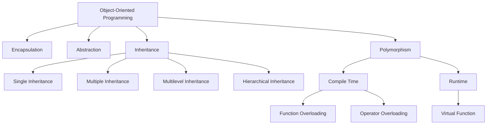

# Without OOP

## Example: Storing a Student

```cpp
#include <iostream>
#include <string>

int main() {
    std::string studentName = "John Doe";
    int studentAge = 20;
    std::string studentMajor = "Computer Science";

    std::cout << "Student Name: " << studentName << std::endl;
    std::cout << "Student Age: " << studentAge << std::endl;
    std::cout << "Student Major: " << studentMajor << std::endl;

    return 0;
}
```

```text
Student Name: John Doe
Student Age: 20
Student Major: Computer Science
```

## Problems

- **Not reusable**: If you need to store information for another student, you must create new variables for each attribute.
- **Poor real-world modeling**: Managing multiple independent variables for related data leads to confusion and errors.

# With OOP

## Example: Storing a Student

```cpp
#include <iostream>
#include <string>

class Student {
public:
    std::string name;
    int age;
    std::string major;

    void displayInfo() {
        std::cout << "Student Name: " << name << std::endl;
        std::cout << "Student Age: " << age << std::endl;
        std::cout << "Student Major: " << major << std::endl;
    }
};

int main() {
    Student student1;
    student1.name = "John Doe";
    student1.age = 20;
    student1.major = "Computer Science";

    student1.displayInfo();

    return 0;
}
```

```text
Student Name: John Doe
Student Age: 20
Student Major: Computer Science
```

## Benefits

- **Reusable**: Create multiple instances of the `Student` class to store information for different students without creating new variables for each attribute.
- **Effective modeling**: The `Student` class encapsulates the attributes and behaviors of a student, making it easier to manage and understand the data.

# Important Concepts in OOP

OOP allows you to create classes that represent real-world entities, making your code more organized, reusable, and easier to maintain. It promotes key principles:

- **Encapsulation**: Bundle data and methods together
- **Inheritance**: Build new classes from existing ones
- **Polymorphism**: Use objects in flexible ways

These principles are fundamental to creating robust and scalable software applications.

## Key Language Features Covered in This Document

Beyond the four pillars, this document covers the C++ language features that make OOP work in practice:

| Concept                    | Section                                           |
| ------------------------- | ------------------------------------------------- |
| Classes & Objects         | Declaration of a Class and Object                  |
| Access Modifiers          | Access Modifiers                                   |
| Constructors & Destructors | Constructors, Destructor                            |
| RAII                      | RAII — Resource Acquisition Is Initialization       |
| Copy & Move Semantics     | Rule of Three, Five, and Zero                     |
| Copy Elision              | Copy Elision and Return Value Optimization (RVO)  |
| Smart Pointers            | Smart Pointers                                     |
| Virtual Functions          | Polymorphism                                       |
| Object Slicing            | Object Slicing                                     |
| `const` Correctness        | `const` Keyword                                    |
| Type Deduction            | `auto` and `decltype`                             |
| Compile-Time Computation   | `constexpr`                                        |
| Exceptions & RAII         | Exception Handling in OOP                          |
| Templates                 | Class Templates — Generic Programming              |
| Design Patterns           | Object-Oriented Design Patterns                     |
| Coupling & Cohesion        | Coupling and Cohesion                              |
| UML Diagrams              | UML Class Diagrams                                 |
| Common Pitfalls           | Common OOP Mistakes and How to Avoid Them          |

# Declaration of a Class and Object

In OOP, a class is a blueprint for creating objects. It defines the properties (attributes) and behaviors (methods) that the objects created from the class will have. An object is an instance of a class, meaning it is a specific realization of the class with actual values for its attributes.

## Example: Class and Object

```cpp

#include <iostream>
#include <string>

class Student {
public:
    std::string name;
    int age;
    std::string major;

    void displayInfo() {
        std::cout << "Student Name: " << name << std::endl;
        std::cout << "Student Age: " << age << std::endl;
        std::cout << "Student Major: " << major << std::endl;
    }
};

int main() {
    // Creating an object of the Student class
    Student student1;

    // methods and attributes are accessed using the dot operator (.)
    student1.name = "John Doe";
    student1.age = 20;
    student1.major = "Computer Science";

    // Displaying the information of the student
    student1.displayInfo();

    return 0;
}
```

```text
Student Name: John Doe
Student Age: 20
Student Major: Computer Science
```

Class Diagram:

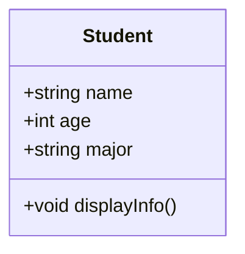

In this example, we define a class `Student` with three attributes: `name`, `age`, and `major`. We also define a method `displayInfo()` that prints the student's information. In the `main()` function, we create an object `student1` of the `Student` class, set its attributes, and call the `displayInfo()` method to display the student's information.

# UML Class Diagrams

UML (Unified Modeling Language) class diagrams are a visual notation for describing the structure of classes — their attributes, methods, and relationships — in a way that is independent of any programming language. In OOP, they serve as a communication tool between developers and a planning tool before writing code.

## The Three-Component Box

A class in UML is drawn as a rectangle divided into three compartments:

```text
┌─────────────────────────────┐
│         ClassName           │  ← Name (bold, centered)
├─────────────────────────────┤
│ -attribute1: int            │  ← Attributes
│ -attribute2: string         │
├─────────────────────────────┤
│ +method1(): void            │  ← Operations
│ +method2(param: int): bool  │
└─────────────────────────────┘
```

In C++, this maps to:

```cpp
class ClassName {
private:
    int attribute1;
    std::string attribute2;

public:
    void method1();
    bool method2(int param);
};
```

## Visibility Modifiers in UML

| Symbol | Visibility    | UML Name      | C++ Equivalent |
| ------ | ------------- | ------------- | -------------- |
| `+`    | Public        | **Public**    | `public:`      |
| `-`    | Private       | **Private**   | `private:`     |
| `#`    | Protected     | **Protected** | `protected:`   |
| `~`    | Package       | **Internal**  | (C++: default in `struct`/`namespace`) |

Static members are underlined. Abstract classes and methods are written in *italics*.

## Relationships Between Classes

UML diagrams express how classes relate to each other through named lines:

| Relationship      | UML Line              | Meaning                           | C++ Example             |
| ---------------- | --------------------- | --------------------------------- | ---------------------- |
| **Inheritance**   | `——▷` (hollow arrow) | "is-a" — subclass inherits        | `class Dog : public Animal` |
| **Realization**   | `····▷` (dashed, hollow) | Class implements interface    | `class Circle : public Shape` |
| **Association**   | `——>` (arrow)         | "uses" — one class knows the other | `class Order { Customer* c; }` |
| **Aggregation**   | `——◇` (hollow diamond) | "has-a" — parts exist without whole | `class Team { Employee*[]; }` |
| **Composition**   | `——◆` (filled diamond) | "owns" — parts die with the whole | `class House { Room[]; }` |
| **Dependency**   | `····>` (dashed arrow) | One class temporarily uses another | `void process(Order& o)` |

### Inheritance Example

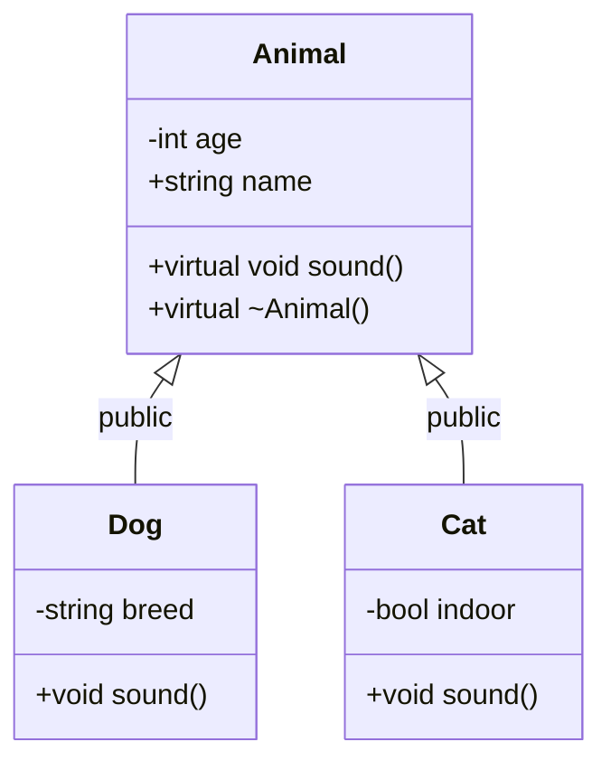

This corresponds to:

```cpp
class Animal {
private:
    int age;
protected:
    std::string name;
public:
    virtual void sound() = 0;
    virtual ~Animal() {}
};

class Dog : public Animal {
private:
    std::string breed;
public:
    void sound() override { /* ... */ }
};

class Cat : public Animal {
private:
    bool indoor;
public:
    void sound() override { /* ... */ }
};
```

## Multiplicity (Cardinality)

Multiplicity indicates how many objects participate in a relationship:

| Multiplicity | Meaning                        |
| ------------ | ------------------------------ |
| `1`          | Exactly one                    |
| `0..1`       | Zero or one                    |
| `*`          | Many (unlimited)              |
| `1..*`       | One or more                   |
| `2..5`       | Between 2 and 5               |

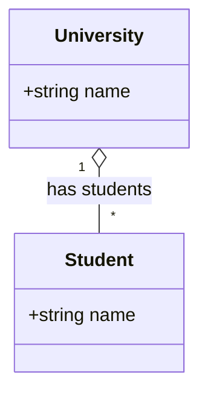

Corresponds to: One University has many Students.

## Abstract Classes and Interfaces

An abstract class (with at least one pure virtual function) is shown in UML with *italics* for the name:

```text
┌──────────────────────────┐
│    <<abstract>>          │
│      Shape              │
├──────────────────────────┤
│ # x: double             │
│ # y: double             │
├──────────────────────────┤
│ +area(): double = 0     │
│ +perimeter(): double = 0│
└──────────────────────────┘
```

In C++:

```cpp
class Shape {
protected:
    double x, y;
public:
    virtual double area() const = 0;      // Pure virtual
    virtual double perimeter() const = 0; // Pure virtual
    virtual ~Shape() {}
};
```

The `<<abstract>>` stereotype marks it as abstract; the `= 0` in the UML maps to `= 0` in C++.

## Why UML Diagrams Matter in OOP

- **Before coding** — designing classes and relationships in UML forces you to think about responsibilities before committing to code.
- **Communication** — UML is language-agnostic, so diagrams communicate design across teams using different languages.
- **Documentation** — a class diagram serves as a map of the codebase that new developers can read to understand the system quickly.
- **Refactoring** — before changing a class hierarchy, drawing the current state in UML makes the impact of changes more visible.

# Access Modifiers

Access modifiers are keywords used in OOP to set the accessibility of classes, methods, and other members. They control how the members of a class can be accessed from outside the class. The most common access modifiers are:

- **Public**: Members declared as public can be accessed from anywhere in the program. They are accessible to all other classes and functions.
- **Private**: Members declared as private can only be accessed within the class itself. They are not accessible from outside the class, including derived classes.
- **Protected**: Members declared as protected can be accessed within the class and by derived classes, but not from outside the class.
- **Default (Package-Private)**: If no access modifier is specified, the member is accessible only within its own package (in languages like Java). In C++, the default access level for class members is private.

## Example: Access Modifiers

```cpp

#include <iostream>
#include <string>

class Student {
private:
    std::string name;
    int age;
    std::string major;

public:
    void setInfo(std::string n, int a, std::string m) {
        name = n;
        age = a;
        major = m;
    }

    void displayInfo() {
        std::cout << "Student Name: " << name << std::endl;
        std::cout << "Student Age: " << age << std::endl;
        std::cout << "Student Major: " << major << std::endl;
    }
};

int main() {
    Student student1;
    student1.setInfo("John Doe", 20, "Computer Science");
    student1.displayInfo();

    return 0;
}
```

```text
Student Name: John Doe
Student Age: 20
Student Major: Computer Science
```

Class Diagram:

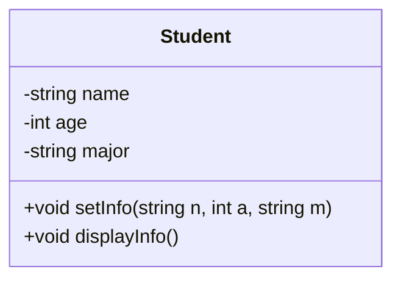

In this example, the attributes `name`, `age`, and `major` are declared as private, meaning they cannot be accessed directly from outside the class. Instead, we provide a public method `setInfo()` to set the values of these attributes and a public method `displayInfo()` to display them. This encapsulation helps to protect the integrity of the data and allows for better control over how the data is accessed and modified.

Why we need setters and getters?

setters ensure that the data is being set in a valid way. For example, if we want to set the age of a student, we can add a check in the setter method to ensure that the age is a positive number. This helps to prevent invalid data from being assigned to the attributes of the class.

getters allow us to retrieve the values of private attributes from outside the class. This is important because it allows us to access the data while still maintaining encapsulation and protecting the integrity of the data.

# Size of an Object

The size of an object in OOP depends on the attributes and methods defined in the class. The size of an object is determined by the amount of memory allocated for its attributes and the overhead of the class structure itself.

## Example 1

```cpp
#include <iostream>
#include <string>

class className {
public:
    int a;
};

int main()
{
    className obj;
    std::cout << "Size of object: " << sizeof(obj) << " bytes" << std::endl;
    // output: 4 bytes (size of int)
    return 0;
}
```

```text
Size of object: 4 bytes
```

## Example 2

```cpp
#include <iostream>

class className{}

int main()
{
    className obj;
    std::cout << "Size of object: " << sizeof(obj) << " bytes" << std::endl;
    // output: 1 byte (empty class)
    return 0;
}
```

```text
Size of object: 1 byte
```

## Example 3

```cpp

#include <iostream>

class className {
public:
    char b ;
    int a;
};
int main()
{
    className obj;
    std::cout << "Size of object: " << sizeof(obj) << " bytes" << std::endl;
    // output: 8 bytes (size of int + size of char + padding)
    return 0;
}
```

```text
Size of object: 8 bytes
```

In the first example, the class `className` has one integer attribute `a`, which typically takes 4 bytes of memory. Therefore, the size of the object `obj` is 4 bytes.

In the second example, the class `className` is empty and does not have any attributes. However, even an empty class has a size of at least 1 byte to ensure that each object has a unique address in memory. Therefore, the size of the object `obj` is 1 byte.

In the third example, the class `className` has two attributes: an integer `a` and a character `b`. The size of an integer is typically 4 bytes, and the size of a character is 1 byte. However, due to padding for memory alignment, the total size of the object `obj` may be 8 bytes instead of 5 bytes (4 bytes for the integer + 1 byte for the character + 3 bytes of padding). The exact size can vary based on the compiler and architecture.

## Padding

- **Padding** is the extra space added by the compiler to ensure that data is aligned in memory according to the architecture's requirements. This can lead to an increase in the size of an object, as seen in the third example where the total size is 8 bytes instead of 5 bytes due to padding.
- The compiler may add padding between attributes to ensure that each attribute is aligned on a memory boundary that is optimal for the architecture, which can improve performance when accessing the attributes.
- The OS reads 32 bits (4 bytes) or 64 bits (8 bytes) at a time, so it adds padding to ensure that data is aligned to these boundaries for efficient access.

In the third example, if the arrangement was sequential without padding:

| 1   | 2   | 3   | 4   | 5   | 6   | 7   | 8   |
| --- | --- | --- | --- | --- | --- | --- | --- |
| b   | a   | a   | a   | a   | x   | x   | x   |

It would take **2 cycles** to read the data stored in variable `a` because it spans across the 4-byte boundary.

But with padding, the arrangement becomes:

| 1   | 2   | 3   | 4   | 5   | 6   | 7   | 8   |
| --- | --- | --- | --- | --- | --- | --- | --- |
| b   | x   | x   | x   | a   | a   | a   | a   |

It takes **1 cycle** to read the data stored in variable `a`, because it is aligned to the memory boundary.

## Example 4

```cpp
#include <iostream>

class className {
public:
    char b;
    char c;
    int a;
};

int main()
{
    className obj;
    std::cout << "Size of object: " << sizeof(obj) << " bytes" << std::endl;
    // output: 8 bytes (size of int + size of char + size of char + padding)
    return 0;
}
```

```text
Size of object: 8 bytes
```

### Memory Arrangement

| 1   | 2   | 3   | 4   | 5   | 6   | 7   | 8   |
| --- | --- | --- | --- | --- | --- | --- | --- |
| b   | c   | x   | x   | a   | a   | a   | a   |

## Example 5

```cpp
#include <iostream>

class className {
public:
    char b;
    int a;
    char c;
};

int main()
{
    className obj;
    std::cout << "Size of object: " << sizeof(obj) << " bytes" << std::endl;
    // output: 12 bytes (char + pad + int + char + pad)
    return 0;
}
```

```text
Size of object: 12 bytes
```

### Memory Arrangement

| 1   | 2   | 3   | 4   | 5   | 6   | 7   | 8   | 9   | 10  | 11  | 12  |
| --- | --- | --- | --- | --- | --- | --- | --- | --- | --- | --- | --- |
| b   | x   | x   | x   | a   | a   | a   | a   | c   | x   | x   | x   |

## Rule for Padding

- The final object size should be divisible by the size of the largest attribute in the class.
- In **Example 4**, the largest attribute is an integer (4 bytes), so the total size of the object is padded to 8 bytes to ensure it is divisible by 4.
- In **Example 5**, the largest attribute is still an integer (4 bytes), but due to the arrangement of attributes, the total size of the object is padded to 12 bytes to ensure it is divisible by 4.

## Greedy Alignment

- Start by declaring the largest attribute first, followed by smaller attributes. This can help to minimize the amount of padding needed and reduce the overall size of the object.

## Example 6

```cpp
#include <iostream>

class className {
public:
    char a;
    int c;
    char b;
    double d;
};

class className2 {
public:
    double d;
    int c;
    char a;
    char b;
};

int main()
{
    className obj1;
    className2 obj2;
    std::cout << "Size of object 1: " << sizeof(obj1) << " bytes"
              << std::endl;
    std::cout << "Size of object 2: " << sizeof(obj2) << " bytes"
              << std::endl;
    // output: Size of object 1: 24 bytes, Size of object 2: 16 bytes
    return 0;
}
```

```text
Size of object 1: 24 bytes
Size of object 2: 16 bytes
```

### Memory Arrangement of `className`

| 1..4               | 5..8          | 9..12              | 13..16             | 17..24        |
| ------------------ | ------------- | ------------------ | ------------------ | ------------- |
| `a`, `x`, `x`, `x` | `c` (4 bytes) | `b`, `x`, `x`, `x` | `x`, `x`, `x`, `x` | `d` (8 bytes) |

### Memory Arrangement of `className2` (Optimized)

| 1..8          | 9..12         | 13..16             |
| ------------- | ------------- | ------------------ |
| `d` (8 bytes) | `c` (4 bytes) | `a`, `b`, `x`, `x` |

# `new` Keyword & Dynamic Memory Allocation

In C++, the `new` keyword is used for dynamic memory allocation. It allows you to allocate memory on the heap for an object or an array of objects at runtime. When you use `new`, it returns a pointer to the allocated memory, which you can then use to access the object.

```cpp
#include <iostream>

class Student {
public:
    std::string name;
    int age;
    std::string major;
};

int main()
{
    // Dynamically allocating memory for a Student object
    Student* studentPtr = new Student;

    // Setting the attributes of the Student object
    // accessed using the arrow operator (->) since studentPtr is a pointer
    studentPtr->name = "John Doe";
    studentPtr->age = 20;
    studentPtr->major = "Computer Science";

    // similarly: (*studentPtr).name = "John Doe";
    // using dereference operator

    // Displaying the information of the student
    std::cout << "Student Name: " << studentPtr->name << std::endl;
    std::cout << "Student Age: " << studentPtr->age << std::endl;
    std::cout << "Student Major: " << studentPtr->major << std::endl;

    // Deallocating the memory for the Student object
    delete studentPtr;

    return 0;
}
```

```text
Student Name: John Doe
Student Age: 20
Student Major: Computer Science
```

In this example, we use the `new` keyword to dynamically allocate memory for a `Student` object. We then set the attributes of the student and display the information. Finally, we use the `delete` keyword to deallocate the memory that was allocated for the `Student` object to prevent memory leaks.

# Constructors

A constructor is a special member function of a class that is automatically called when an object of the class is created. It is used to initialize the attributes of the object and can also perform any setup required for the object. Constructors have the same name as the class and do not have a return type.

```cpp
#include <iostream>
#include <string>
using namespace std;

class Student {
public:
    std::string name;
    int age;
    std::string major;

    // Constructor to initialize the Student class
    Student()
    {
        cout << "Constructor called!" << std::endl;
    }

};

int main()
{
    // Creating a Student object will call the constructor
    Student student1;
    // output: Constructor called!
    return 0;
}
```

```text
Constructor called!
```

```cpp
#include <iostream>
#include <string>

class Student {
public:
    std::string name;
    int age;
    std::string major;

    // Default constructor
    Student() {
        name = "Unknown";
        age = 0;
        major = "Undeclared";
    }

    // Parameterized constructor
    Student(std::string n, int a, std::string m) {
        name = n;
        age = a;
        major = m;
    }
};

int main()
{
    // Using the default constructor
    Student student1;
    std::cout << "Student 1: " << student1.name
              << ", " << student1.age
              << ", " << student1.major
              << std::endl;

    // Using the parameterized constructor
    Student student2("John Doe", 20, "Computer Science");
    std::cout << "Student 2: " << student2.name
              << ", " << student2.age
              << ", " << student2.major
              << std::endl;

    // Output:
    // Student 1: Unknown, 0, Undeclared
    // Student 2: John Doe, 20, Computer Science
    return 0;
}
```

```text
Student 1: Unknown, 0, Undeclared
Student 2: John Doe, 20, Computer Science
```

## Uses

- **Initialization**: Constructors are used to initialize the attributes of an object when it is created. This ensures that the object starts in a valid state.
- **Overloading**: Constructors can be overloaded, meaning you can have multiple constructors with different parameters to allow for different ways of initializing an object.
- **Default Values**: Constructors can provide default values for attributes, making it easier to create objects without needing to specify all attributes every time.

```cpp
#include <iostream>
#include <string>

class Student {
public:
    std::string name;
    int age;
    std::string major;

    // Default constructor
    Student() {
        name = "Unknown";
        age = 0;
        major = "Undeclared";
    }

    // Parameterized constructor
    Student(std::string n, int a, std::string m) {
        name = n;
        age = a;
        major = m;
    }
};

int main()
{
    // Using the default constructor
    Student student1;
    std::cout << "Student 1: " << student1.name
              << ", " << student1.age
              << ", " << student1.major
              << std::endl;

    // Using the parameterized constructor
    Student student2("John Doe", 20, "Computer Science");
    std::cout << "Student 2: " << student2.name
              << ", " << student2.age
              << ", " << student2.major
              << std::endl;

    // output:
    // Student 1: Unknown, 0, Undeclared
    // Student 2: John Doe, 20, Computer Science
    return 0;
}
```

```text
Student 1: Unknown, 0, Undeclared
Student 2: John Doe, 20, Computer Science
```

**Constructor overloading**: In the above example, we have two constructors: a default constructor that initializes the attributes with default values, and a parameterized constructor that allows us to initialize the attributes with specific values when creating an object. This is an example of constructor overloading, where multiple constructors are defined with different parameter lists to provide flexibility in object creation.

## Types of Constructors

- **Default Constructor**: A constructor that takes no parameters and initializes the object with default values.
- **Parameterized Constructor**: A constructor that takes parameters to initialize the object with specific values.
- **Copy Constructor**: A constructor that creates a new object as a copy of an existing one.
- **Move Constructor**: A constructor that transfers resources from a temporary (rvalue) object, avoiding a deep copy.

## `explicit` Keyword

By default, a constructor with a single parameter can be used for **implicit type conversion** — the compiler will automatically convert a value of the parameter's type into your class type when needed. Sometimes this is convenient, but it can also introduce subtle bugs where a conversion happens when you didn't intend it to.

The `explicit` keyword placed before a single-parameter constructor **prevents implicit conversions**, requiring the programmer to write the conversion explicitly (via direct initialization).

### Without `explicit` — Implicit Conversion (Risky)

```cpp
#include <iostream>
#include <string>

class String {
private:
    std::string data;

public:
    // Not explicit — allows implicit conversion
    String(const char* s) {
        data = s;
        std::cout << "Constructor called with: " << s << std::endl;
    }

    void print() {
        std::cout << data << std::endl;
    }
};

void greet(String s) {
    std::cout << "Hello, ";
    s.print();
}

int main() {
    greet("World");  // "World" is implicitly converted to String!
    // This compiles — the compiler creates a temporary String("World")
    return 0;
}
```

```text
Constructor called with: World
Hello, World
```

### With `explicit` — Forces Intentional Conversion

```cpp
#include <iostream>
#include <string>

class String {
private:
    std::string data;

public:
    // explicit prevents implicit conversion
    explicit String(const char* s) {
        data = s;
        std::cout << "Constructor called with: " << s << std::endl;
    }

    void print() {
        std::cout << data << std::endl;
    }
};

void greet(String s) {
    std::cout << "Hello, ";
    s.print();
}

int main() {
    greet(String("World"));  // OK: explicit conversion
    // greet("World");      // Error: cannot convert 'const char*' to 'String'
    return 0;
}
```

```text
Constructor called with: World
Hello, World
```

### When to Use `explicit`

- **Always mark single-parameter constructors `explicit`** unless the conversion is intentional and useful — this is widely considered a best practice in C++.
- Constructors with two or more parameters are never candidates for implicit conversion, so `explicit` is not needed there.
- Copy constructors (single parameter of the same class type) should **not** be `explicit` — that would prevent passing objects by value, which is a fundamental and expected operation.

## `this` Pointer

The `this` pointer is a special pointer available in C++ that points to the current object. It is used within a class's member functions to refer to the object that is invoking the function. The `this` pointer allows you to access the attributes and methods of the current object, especially when there is a naming conflict between member variables and parameters.

```cpp
#include <iostream>
#include <string>

class Student {
public:
    std::string name;
    int age;
    std::string major;

    // Parameterized constructor using this pointer
    // to resolve naming conflict
    Student(std::string name, int age, std::string major) {
        this->name = name;   // this->name = member, name = parameter
        this->age = age;     // this->age = member, age = parameter
        this->major = major; // this->major = member, major = parameter
    }
};

int main()
{
    Student student1("John Doe", 20, "Computer Science");
    std::cout << "Student Name: " << student1.name << std::endl;
    std::cout << "Student Age: " << student1.age << std::endl;
    std::cout << "Student Major: " << student1.major << std::endl;

    return 0;
}
```

```text
Student Name: John Doe
Student Age: 20
Student Major: Computer Science
```

In this example, the constructor takes parameters with the same names as the member variables. To resolve this naming conflict, we use the `this` pointer to refer to the member variables of the class. This allows us to correctly initialize the attributes of the `Student` object with the values passed as parameters.

## Inline Constructors

```cpp
#include <iostream>
#include <string>

class Student {
public:
    std::string name;
    int age;
    std::string major;

    // Inline constructor defined within the class definition
    Student(std::string n, int a, std::string m)
        : name(n), age(a), major(m) {}
};
```

In this example, the constructor is defined inline within the class definition. The member initializer list is used to initialize the attributes of the `Student` class directly with the values passed as parameters. This approach can improve readability and performance by avoiding the need for separate assignment statements within the constructor body.

## Copy Constructor

### Default Copy Constructor

```cpp
#include <iostream>
#include <string>

class Student {
public:
    std::string name;
    int age;
    std::string major;
};

int main()
{
    Student student1;
    student1.name = "John Doe";
    student1.age = 20;
    student1.major = "Computer Science";

    // Using the default copy constructor to create a copy of student1
    Student student2 = student1;

    std::cout << "Student 2 Name: " << student2.name << std::endl;
    std::cout << "Student 2 Age: " << student2.age << std::endl;
    std::cout << "Student 2 Major: " << student2.major << std::endl;

    Student student3(student1);  // alt syntax for default copy constructor

    std::cout << "Student 3 Name: " << student3.name << std::endl;
    std::cout << "Student 3 Age: " << student3.age << std::endl;
    std::cout << "Student 3 Major: " << student3.major << std::endl;

    return 0;
}
```

```text
Student 2 Name: John Doe
Student 2 Age: 20
Student 2 Major: Computer Science
Student 3 Name: John Doe
Student 3 Age: 20
Student 3 Major: Computer Science
```

In this example, we create a `Student` object `student1` and initialize its attributes. We then use the default copy constructor to create a new object `student2` that is a copy of `student1`. The attributes of `student2` are the same as those of `student1`. We also demonstrate another way to use the default copy constructor by creating `student3` using the copy constructor syntax. Both `student2` and `student3` have the same attribute values as `student1`.

### User-Defined Copy Constructor

```cpp
#include <iostream>
#include <string>

class Student {
public:
    std::string name;
    int age;
    std::string major;

    // User-defined copy constructor
    Student(const Student& other) {
        name = other.name;
        age = other.age;
        major = other.major;
    }
};

int main()
{
    Student student1;
    student1.name = "John Doe";
    student1.age = 20;
    student1.major = "Computer Science";

    // Using the user-defined copy constructor to create a copy of student1
    Student student2(student1);

    std::cout << "Student 2 Name: " << student2.name << std::endl;
    std::cout << "Student 2 Age: " << student2.age << std::endl;
    std::cout << "Student 2 Major: " << student2.major << std::endl;

    return 0;
}
```

```text
Student 2 Name: John Doe
Student 2 Age: 20
Student 2 Major: Computer Science
```

In a user-defined copy constructor, the parameter is taken as a reference (using &) to another Student object. This allows direct access to the attributes of the existing object without creating an additional copy. If the object were passed by value instead, it would trigger the copy constructor again, leading to infinite recursion.

# Destructor

A destructor is a special member function of a class that is automatically called when an object of the class goes out of scope or is explicitly deleted. It is used to perform any necessary cleanup, such as releasing resources or memory that the object may have acquired during its lifetime. Destructors have the same name as the class but are preceded by a tilde (~) and do not have a return type.

```cpp
#include <iostream>
#include <string>

class Student {
public:
    std::string name;
    int age;
    std::string major;

    Student(std::string n, int a, std::string m) : name(n), age(a), major(m) {
        std::cout << "Constructor called for " << name << std::endl;
    }

    ~Student() {
        std::cout << "Destructor called for " << name << std::endl;
    }
};

int main()
{
    Student student1("John Doe", 20, "Computer Science");
    std::cout << "Student Name: " << student1.name << std::endl;
    std::cout << "Student Age: " << student1.age << std::endl;
    std::cout << "Student Major: " << student1.major << std::endl;

    return 0;

    // output:
    // Constructor called for John Doe
    // Destructor called for John Doe
}
```

```text
Constructor called for John Doe
Student Name: John Doe
Student Age: 20
Student Major: Computer Science
Destructor called for John Doe
```

## Properties of Destructors

- A class can have only one destructor.
- Destructors cannot be overloaded, meaning you cannot have multiple destructors with different parameters.
- Destructors do not take any parameters and do not return any value.
- The destructor is automatically called when an object goes out of scope or is explicitly deleted using the `delete` keyword.
- Destructors are typically used to release resources such as memory, file handles, or network connections that the object may have acquired during its lifetime.

> `Note`: constructors & destructors must be public.

## Order of Constructor and Destructor Calls

```cpp
#include <iostream>

class className{
    int a ;
public:

    className(int a)
    {
        this -> a = a ;
        std::cout << a << std::endl;
    }

    ~className()
    {
        std::cout << a << std::endl;
    }
};

int main()
{
    className obj1(1) , obj2(2) , obj3(3);
    // output:
    // 1
    // 2
    // 3
    // 3
    // 2
    // 1
    return 0;
}
```

```text
1
2
3
3
2
1
```

- The constructors are called in the order of object creation (obj1, obj2, obj3), while the destructors are called in the reverse order of object creation (obj3, obj2, obj1) because when an object goes out of scope, its destructor is called to clean up resources. Since obj3 is the last object created, it is the first one to go out of scope and thus its destructor is called first.
- This is due of dependency between objects. If obj3 depends on obj2 and obj1, then obj3 must be destroyed before obj2 and obj1 to ensure that the resources used by obj3 are released properly before obj2 and obj1 are destroyed.

# RAII — Resource Acquisition Is Initialization

**RAII** (Resource Acquisition Is Initialization) is one of C++'s most powerful idioms. The core idea is simple: **a resource (memory, file handle, lock, network connection) is acquired in a constructor and released in the destructor**. Because destructors run automatically when an object goes out of scope, resources are guaranteed to be released — even if an exception is thrown.

## The Problem Without RAII

```cpp
#include <iostream>
#include <fstream>

void writeToFile(const char* filename) {
    std::ofstream file;
    file.open(filename);

    file << "Important data\n";  // If this throws, file is never closed!

    file.close();  // Must be called explicitly
}
```

If the write fails, `file.close()` never executes, and the file handle leaks. In a more complex function with multiple return paths, the problem compounds — every early return needs a cleanup call.

## The Solution with RAII

```cpp
#include <iostream>
#include <fstream>

class FileWriter {
private:
    std::ofstream file;

public:
    // Acquire resource in constructor
    FileWriter(const char* filename) {
        file.open(filename);
        if (!file.is_open()) {
            throw std::runtime_error("Could not open file");
        }
        std::cout << "File opened." << std::endl;
    }

    void write(const char* data) {
        file << data << std::endl;
    }

    // Release resource in destructor — runs automatically
    ~FileWriter() {
        if (file.is_open()) {
            file.close();
            std::cout << "File closed automatically." << std::endl;
        }
    }
};

int main() {
    FileWriter writer("output.txt");
    writer.write("Hello, World!");

    return 0;  // Destructor called automatically — file is safely closed
}
```

```text
File opened.
File closed automatically.
```

No matter how the function exits — whether through a normal return, an exception, or an early exit — the destructor runs, and the resource is released.

> **RAII applies to any scarce resource:** dynamic memory (`std::unique_ptr`), file handles (`std::fstream`), mutex locks (`std::lock_guard`), database connections, and more. The pattern is the same: acquire in the constructor, release in the destructor.

## The Scope Guard Pattern

RAII also provides **exception safety** — if an exception propagates, stack-allocated RAII objects still run their destructors, preventing resource leaks. This is called the **Scope Guard pattern** and is the foundation of C++'s zero-cost exception safety guarantees.

# Rule of Three, Five, and Zero

When a class manages a resource (memory, file handle, etc.) through a raw pointer or handle, the default copy semantics provided by the compiler are almost always wrong. The **Rule of Three** identifies the three special member functions that, if you define one, you almost certainly need to define all three. C++11 extended this to the **Rule of Five**, adding move constructor and move assignment.

## The Problem — Shallow Copy

By default, the compiler generates a **shallow copy** — it copies the pointer itself, not the data it points to:

```cpp
#include <iostream>
#include <string>

class Student {
public:
    std::string* name;  // Raw pointer — manages heap memory

    Student(const std::string& n) {
        name = new std::string(n);
        std::cout << "Constructed: " << *name << std::endl;
    }

    void display() const {
        std::cout << "Name: " << *name << std::endl;
    }

    ~Student() {
        std::cout << "Destroyed: " << *name << std::endl;
        delete name;
    }
};

int main() {
    Student s1("Alice");
    Student s2 = s1;  // Default copy: shallow copy of the pointer!

    std::cout << "After copy:\n";
    s1.display();
    s2.display();

    return 0;  // BOTH s1 and s2 call delete on the same pointer!
}
```

```text
Constructed: Alice
After copy:
Name: Alice
Name: Alice
Destroyed: Alice
Destroyed: Alice  // CRASH: double delete of same memory!
```

Both `s1` and `s2` hold a pointer to the **same** heap memory. When both destructors run, they both `delete` the same address — a double-free, undefined behavior.

## Rule of Three — Define All Three

If you define **any one** of these three, you almost certainly need all three:

| Special Member Function | Purpose                                    |
| ---------------------- | ------------------------------------------ |
| **Destructor**         | Releases the resource                      |
| **Copy Constructor**   | Creates a new object as a copy of another  |
| **Copy Assignment Operator** | Assigns a copy to an existing object   |

```cpp
#include <iostream>
#include <string>

class Student {
public:
    std::string* name;

    Student(const std::string& n) {
        name = new std::string(n);
        std::cout << "Constructed: " << *name << std::endl;
    }

    // Copy constructor — deep copy
    Student(const Student& other) {
        name = new std::string(*other.name);
        std::cout << "Copy constructed: " << *name << std::endl;
    }

    // Copy assignment operator — deep copy + clean up existing
    Student& operator=(const Student& other) {
        if (this != &other) {  // Guard against self-assignment
            delete name;
            name = new std::string(*other.name);
            std::cout << "Copy assigned: " << *name << std::endl;
        }
        return *this;
    }

    void display() const {
        std::cout << "Name: " << *name << std::endl;
    }

    ~Student() {
        std::cout << "Destroyed: " << *name << std::endl;
        delete name;
    }
};

int main() {
    Student s1("Alice");
    Student s2 = s1;  // Copy constructor
    Student s3("Bob");
    s3 = s1;           // Copy assignment

    return 0;
}
```

```text
Constructed: Alice
Copy constructed: Alice
Constructed: Bob
Copy assigned: Alice
Destroyed: Alice
Destroyed: Alice
Destroyed: Alice
```

Now each object owns its own separate heap memory. No double-free.

## Rule of Five — Add Move Semantics

C++11 adds two more special member functions to handle the case of **transferring** ownership instead of copying:

| Special Member Function  | Purpose                                           |
| ----------------------- | ------------------------------------------------- |
| **Move Constructor**    | Transfers ownership from a temporary (rvalue)      |
| **Move Assignment Operator** | Transfers ownership to an existing object      |

```cpp
#include <iostream>
#include <string>

class Student {
public:
    std::string* name;

    Student(const std::string& n) {
        name = new std::string(n);
        std::cout << "Constructed: " << *name << std::endl;
    }

    // Copy constructor
    Student(const Student& other) : name(new std::string(*other.name)) {
        std::cout << "Copy constructed: " << *name << std::endl;
    }

    // Move constructor — steals the pointer, leaves source empty
    Student(Student&& other) noexcept : name(other.name) {
        other.name = nullptr;  // Source no longer owns the memory
        std::cout << "Move constructed" << std::endl;
    }

    // Copy assignment
    Student& operator=(const Student& other) {
        if (this != &other) {
            delete name;
            name = new std::string(*other.name);
        }
        return *this;
    }

    // Move assignment
    Student& operator=(Student&& other) noexcept {
        if (this != &other) {
            delete name;
            name = other.name;
            other.name = nullptr;
            std::cout << "Move assigned" << std::endl;
        }
        return *this;
    }

    bool isValid() const { return name != nullptr; }

    ~Student() {
        if (name) {
            std::cout << "Destroyed: " << *name << std::endl;
            delete name;
        } else {
            std::cout << "Destroyed (moved-from object)" << std::endl;
        }
    }
};

Student createStudent() {
    return Student("Temporary");  // Return value — will be moved, not copied
}

int main() {
    Student s1 = createStudent();  // Move constructor (no copy)
    Student s2("Alice");
    s2 = createStudent();           // Move assignment (no copy)
    return 0;
}
```

```text
Constructed: Temporary
Move constructed
Constructed: Alice
Constructed: Temporary
Move assigned
Destroyed: Temporary
Destroyed: Temporary
Destroyed (moved-from object)
```

Notice: `Student("Temporary")` was **moved** twice — once when returned from the function, once when assigned. No deep copies were made. The moved-from object is left in a valid (but unspecified) state — in our case, it holds `nullptr`.

## Rule of Zero — Prefer Not Defining Any

The best rule of all is **Rule of Zero**: instead of manually defining any of these five special member functions, use RAII types (like `std::string`, `std::vector`, or smart pointers) that manage their own resources. The compiler-generated defaults work correctly:

```cpp
#include <iostream>
#include <string>

// Rule of Zero: no manual resource management needed
class Student {
public:
    std::string name;  // std::string handles its own memory
    int age;

    Student(const std::string& n, int a) : name(n), age(a) {}
};

int main() {
    Student s1("Alice", 20);
    Student s2 = s1;  // std::string handles deep copy automatically

    std::cout << s1.name << " and " << s2.name << std::endl;
    return 0;
}
```

```text
Alice and Alice
```

> **Prefer Rule of Zero.** Use `std::string`, `std::vector`, and smart pointers instead of raw pointers. Only if you manage a resource that has no RAII wrapper do you need to apply the Rule of Five.

# Copy Elision and Return Value Optimization (RVO)

**Copy elision** is a compiler optimization that removes unnecessary copy or move operations. The most common form is **Return Value Optimization (RVO)**, in which a function returning a class object constructs that object directly in the caller's memory, completely bypassing the copy (or move) constructor.

```cpp
#include <iostream>

class Student {
public:
    std::string name;

    Student(const std::string& n) : name(n) {
        std::cout << "Constructor called for " << name << std::endl;
    }

    // Copy constructor
    Student(const Student& other) : name(other.name) {
        std::cout << "Copy constructor called for " << name << std::endl;
    }

    // Move constructor
    Student(Student&& other) noexcept : name(std::move(other.name)) {
        std::cout << "Move constructor called" << std::endl;
    }
};

Student createStudent() {
    return Student("Alice");  // Named return value optimization
}

// Named Return Value Optimization (NRVO)
Student createByName(const std::string& name) {
    Student s(name);          // Named local object
    return s;               // No copy/move — compiler elides it
}

int main() {
    std::cout << "--- Direct return ---\n";
    Student s1 = createStudent();  // No copy or move!

    std::cout << "\n--- Named return ---\n";
    Student s2 = createByName("Bob");  // No copy or move!

    return 0;
}
```

```text
--- Direct return ---
Constructor called for Alice

--- Named return ---
Constructor called for Bob
```

Notice: **only one constructor is called** — the compiler elides the copy/move entirely, even though the code looks like it should copy the returned object. Both C++11 and C++17 guarantee this elision in certain cases.

## When Copy Elision Happens

| Form                          | Description                                                      |
| ----------------------------- | ---------------------------------------------------------------- |
| **RVO** (Return Value Opt.)   | Return a temporary directly in the caller's memory                 |
| **NRVO** (Named RVO)          | Return a named local variable directly in the caller's memory       |
| **`std::move` in return**      | If you write `return std::move(s)`, the move is elided too         |

> **Implication:** In most cases, you don't need to write `return std::move(x)` — the compiler already does the right thing. In fact, `return x` for a local variable in a function that returns by value is the recommended idiom.

## Mandatory Copy Elision (C++17)

C++17 introduced **mandatory copy elision**: returning a prvalue (temporary) of the same type as the function's return type no longer requires a move or copy, even if the copy/move constructor is deleted or private. This is called **guaranteed copy elision**:

```cpp
#include <iostream>

struct NoCopy {
    NoCopy() { std::cout << "Default constructed\n"; }
    NoCopy(const NoCopy&) = delete;  // No copy
    NoCopy(NoCopy&&) = delete;      // No move
};

NoCopy create() {
    return NoCopy();  // C++17: guaranteed elision — no copy/move needed!
}

int main() {
    NoCopy n = create();  // Works in C++17
    return 0;
}
```

```text
Default constructed
```

# Smart Pointers

Raw pointers (`T*`) in C++ place the burden of memory management entirely on the programmer — you must `new` what you `delete`, handle every path of control flow, and never forget. **Smart pointers** are RAII wrappers around raw pointers that automate memory management. They are defined in `<memory>` and come in three varieties.

## `std::unique_ptr<T>` — Exclusive Ownership

A `unique_ptr` owns a resource exclusively — only one `unique_ptr` can point to a given object at any time. When the `unique_ptr` is destroyed (goes out of scope), it automatically `delete`s the managed object. You **cannot copy** a `unique_ptr` — ownership transfer is done via `std::move`.

```cpp
#include <iostream>
#include <memory>

class Student {
public:
    std::string name;
    Student(const std::string& n) : name(n) {
        std::cout << "Student created: " << name << std::endl;
    }
    ~Student() {
        std::cout << "Student destroyed: " << name << std::endl;
    }
};

int main() {
    // Create a unique_ptr with a Student on the heap
    std::unique_ptr<Student> s1 = std::make_unique<Student>("Alice");

    // Cannot copy a unique_ptr (deleted copy constructor)
    // std::unique_ptr<Student> s2 = s1;  // ERROR

    // Transfer ownership with std::move
    std::unique_ptr<Student> s2 = std::move(s1);

    // s1 is now nullptr — s2 owns the object
    if (!s1) std::cout << "s1 is now empty\n";

    // When s2 goes out of scope, the Student is automatically deleted
    return 0;
}
```

```text
Student created: Alice
s1 is now empty
Student destroyed: Alice
```

`make_unique<T>(...)` is the preferred way to create a `unique_ptr` — it constructs the object in place and avoids the pitfall of forgetting to pair `new` with the smart pointer.

## `std::shared_ptr<T>` — Shared Ownership

Sometimes multiple parts of the program need to share ownership of an object. `shared_ptr` uses **reference counting** — a counter tracks how many `shared_ptr` instances own the object. When the last `shared_ptr` is destroyed, the object is deleted.

```cpp
#include <iostream>
#include <memory>

class Student {
public:
    std::string name;
    Student(const std::string& n) : name(n) {
        std::cout << "Created: " << name << std::endl;
    }
    ~Student() {
        std::cout << "Destroyed: " << name << std::endl;
    }
};

int main() {
    std::shared_ptr<Student> s1 = std::make_shared<Student>("Alice");

    {
        std::shared_ptr<Student> s2 = s1;  // Copy — reference count becomes 2
        std::cout << "s1 and s2 sharing, count: "
                  << s1.use_count() << std::endl;
    }  // s2 destroyed — count goes back to 1

    std::cout << "Only s1 remaining, count: " << s1.use_count() << std::endl;

    return 0;  // s1 destroyed — count reaches 0, Student deleted
}
```

```text
Created: Alice
s1 and s2 sharing, count: 2
Only s1 remaining, count: 1
Destroyed: Alice
```

> **When to use `shared_ptr`:** When multiple owners genuinely share the same resource and the ownership graph is unambiguous. Watch out for circular references (A holds shared_ptr to B, B holds shared_ptr to A) — those cause leaks. Break cycles with `weak_ptr`.

## `std::weak_ptr<T>` — Non-Owning Reference

A `weak_ptr` is a non-owning reference to a `shared_ptr`-managed object. It is used to observe an object without preventing its destruction. Use it to break reference cycles or to safely check if an object still exists.

```cpp
#include <iostream>
#include <memory>

int main() {
    std::shared_ptr<int> s1 = std::make_shared<int>(42);
    std::weak_ptr<int> w1 = s1;  // w1 observes s1

    std::cout << "Shared count: " << s1.use_count() << std::endl;
    std::cout << "Expired: " << std::boolalpha << w1.expired() << std::endl;

    if (auto locked = w1.lock()) {  // lock() returns shared_ptr if alive
        std::cout << "Value via weak_ptr: " << *locked << std::endl;
    }

    s1.reset();  // Destroy the object

    std::cout << "After reset, expired: " << w1.expired() << std::endl;
    return 0;
}
```

```text
Shared count: 1
Expired: false
Value via weak_ptr: 42
After reset, expired: true
```

## Which Smart Pointer to Use?

| Pointer          | Ownership      | Copyable | When to Use                                           |
| --------------- | -------------- | -------- | ------------------------------------------------------ |
| `unique_ptr<T>` | Exclusive      | No       | **Default choice** — one owner, clear lifetime         |
| `shared_ptr<T>` | Shared (refcount) | Yes    | Multiple owners, uncertain lifetimes                    |
| `weak_ptr<T>`   | None (observes) | N/A     | Breaking cycles, caching, observer patterns             |

> **Rule of thumb:** Start with `unique_ptr`. Upgrade to `shared_ptr` only when ownership genuinely needs to be shared. Never use a raw `new`/`delete` when a smart pointer will do — they express intent, prevent leaks, and cost nothing at runtime.

# `static` Keyword

**Problem**: If we want to keep track of the total number of students created, we would need to use a global variable to count the number of student objects. This can lead to issues with encapsulation and can make the code less modular.

**Solution**: We can use a static member variable in the `Student` class to keep track of the total number of students created. A static member variable is shared among all instances of the class, meaning that it retains its value across all objects of the class.

## Static Member Variables

```cpp
#include <iostream>
#include <string>

class Student {
public:
    std::string name;
    int age;
    std::string major;

    // Static member variable to keep track of the total number of students
    static int studentCount;

    // Constructor increments the student count
    Student(std::string n, int a, std::string m)
        : name(n), age(a), major(m) {
        studentCount++;
    }
};

// Initialize the static member variable
int Student::studentCount = 0;

int main()
{
    Student student1("John Doe", 20, "Computer Science");
    Student student2("Jane Smith", 22, "Mathematics");

    // Way 1
    std::cout << "Total number of students: "
              << Student::studentCount << std::endl;

    // Way 2
    std::cout << "Total number of students: "
              << student1.studentCount << std::endl;

    return 0;
}
```

```text
Total number of students: 2
Total number of students: 2
```

The static member varibles is declared inside the class definition and is a shared variable among all instances of the class. It is initialized outside the class definition using the scope resolution operator `::`.

In this example, the static member variable `studentCount` is incremented each time a new `Student` object is created, allowing us to keep track of the total number of students without needing a global variable.

```cpp
#include <iostream>
#include <string>

class Student {
public:
    std::string name;
    int age;
    std::string major;

    // Static member variable to keep track of the total number of students
    static int studentCount;

    // Constructor increments the student count
    Student(std::string n, int a, std::string m)
        : name(n), age(a), major(m) {
        studentCount++;
    }
};


// int Student::studentCount = 0;
// without initialization: error: undefined reference to
// `Student::studentCount'

int main()
{
    Student student1("John Doe", 20, "Computer Science");
    Student student2("Jane Smith", 22, "Mathematics");
    return 0;
}
```

## Static Member Functions

```cpp
#include <iostream>
#include <string>

class Student {
private:
    std::string name;
    int age;
    std::string major;

    static int studentCount;

public:
    Student(std::string n, int a, std::string m) : name(n), age(a), major(m) {
        studentCount++;
    }

    ~Student() {
        studentCount--;
    }

    static int getStudentCount() {
        return studentCount;
    }
};

int Student::studentCount = 0;
// only directly accessible once during initialization

int main()
{
    Student student1("John Doe", 20, "Computer Science");
    Student student2("Jane Smith", 22, "Mathematics");

    std::cout << "Total number of students: "
              << Student::getStudentCount() << std::endl;
    // Student::studentCount = 150; // Error: studentCount is private
    std::cout << "Total number of students: "
              << Student::getStudentCount() << std::endl;

    return 0;
}
```

```text
Total number of students: 2
Total number of students: 2
```

## Properties of Static Varibles

- **If public**: can be accessed and modify directly without needing an object of the class
- **if private**: can only be accessed once during the initialization of the static member variable, and then it can only be accessed through static member functions (getters and setters) to ensure encapsulation and control over how the static member variable is accessed and modified.

## Properties of Static Functions

- can only access static member variables and other static member functions of the class. They cannot access non-static member variables or non-static member functions because they do not have access to the `this` pointer, which is used to refer to the current object instance. Static member functions are associated with the class itself rather than any particular object, so they can only operate on static members that are shared among all instances of the class.

# `const` Keyword

The `const` keyword in C++ is used to declare variables, pointers, member functions, and objects as constant, meaning their value cannot be changed after initialization. It is a way to enforce immutability and protect data from unintended modifications.

## `const` Variables

When a variable is declared as `const`, its value cannot be modified after it is initialized.

```cpp
#include <iostream>

int main() {
    const int maxStudents = 50;
    // maxStudents = 60; // Error: assignment of read-only variable
    std::cout << "Max students: " << maxStudents << std::endl;
    return 0;
}
```

```text
Max students: 50
```

## `const` Pointers

Pointers can be combined with `const` in different ways:

1. **Pointer to a `const` variable**: The data pointed to cannot be changed, but the pointer itself can point to another address. `const int* ptr;` or `int const* ptr;`
2. **`const` Pointer**: The pointer cannot change the address it points to, but the data at that address can be modified. `int* const ptr = &var;`
3. **`const` Pointer to a `const` variable**: Neither the pointer's address nor the data it points to can be changed. `const int* const ptr = &var;`
4. **Pointer to variable**: (simplest setting) Both the pointer's address and the data it points to can be changed. `int* ptr;`

## `const` Member Variables

A `const` member variable in a class must be initialized using a **member initializer list** in the constructor, because `const` variables cannot be assigned a value after they are created.

```cpp
#include <iostream>
#include <string>

class Student {
public:
    const int studentId;
    std::string name;

    // Initialization list must be used for const member variables
    Student(int id, std::string n) : studentId(id), name(n) {
        // studentId = id; // Error: cannot assign inside constructor body
    }
};

int main() {
    Student s1(101, "John Doe");
    std::cout << "Student ID: " << s1.studentId << std::endl;
    // s1.studentId = 102; // Error: studentId is const
    return 0;
}
```

```text
Student ID: 101
```

## `const` Member Functions

A `const` member function guarantees that it will not modify any member variables of the object (except those marked as `mutable`). It is declared by placing the `const` keyword at the end of the function signature.

```cpp
#include <iostream>
#include <string>

class Student {
private:
    std::string name;
    int age;

public:
    Student(std::string n, int a) : name(n), age(a) {}

    // const member function
    void displayInfo() const {
        std::cout << "Student Name: " << name << std::endl;
        std::cout << "Student Age: " << age << std::endl;
        // age = age + 1; // Error: cannot modify members in const function
    }
};

int main() {
    Student s1("John Doe", 20);
    s1.displayInfo();
    return 0;
}
```

```text
Student Name: John Doe
Student Age: 20
```

## `const` Objects

When an object is declared as `const`, it cannot be modified after initialization. A `const` object can **only** call `const` member functions. Calling a non-`const` member function on a `const` object will result in a compilation error.

```cpp
#include <iostream>
#include <string>

class Student {
private:
    std::string name;

public:
    Student(std::string n) : name(n) {}

    void setName(std::string n) {
        name = n;
    }

    std::string getName() const {
        return name;
    }
};

int main() {
    const Student s1("John Doe");

    std::cout << s1.getName() << std::endl; // getName() is const
    // s1.setName("Jane Doe"); // Error: non-const called on const object

    return 0;
}
```

```text
John Doe
```

# `constexpr` — Compile-Time Computation

In C++, expressions can be evaluated at two different times: **runtime** (when the program runs) or **compile time** (when the program is being compiled). The `constexpr` keyword tells the compiler to compute a value at compile time whenever possible, which eliminates runtime cost entirely.

## `constexpr` Variables

A `constexpr` variable is guaranteed to be initialized with a value known at compile time:

```cpp
#include <iostream>

constexpr int MAX_STUDENTS = 100;          // Computed at compile time
constexpr int DOUBLED = MAX_STUDENTS * 2; // Also compile time

int main() {
    std::cout << "Max: " << MAX_STUDENTS << std::endl;
    std::cout << "Doubled: " << DOUBLED << std::endl;
    return 0;
}
```

```text
Max: 100
Doubled: 200
```

The compiler substitutes the computed values directly — no runtime cost for storing or loading these values.

## `constexpr` Functions

A `constexpr` function can be evaluated at compile time if its arguments are compile-time constants. If called with runtime arguments, it falls back to runtime evaluation:

```cpp
#include <iostream>

// Computes the factorial at compile time if given a constant expression
constexpr int factorial(int n) {
    return (n <= 1) ? 1 : n * factorial(n - 1);
}

int main() {
    // Computed entirely at compile time — no runtime cost
    constexpr int f5 = factorial(5);

    // Computed at runtime — n is a runtime variable
    int runtime_n = 6;
    int f6 = factorial(runtime_n);

    std::cout << "factorial(5) = " << f5 << std::endl;
    std::cout << "factorial(6) = " << f6 << std::endl;
    return 0;
}
```

```text
factorial(5) = 120
factorial(6) = 720
```

## `constexpr` in Classes

C++11 allows `constexpr` constructors, making entire objects usable at compile time. This is the foundation of compile-time computation in classes:

```cpp
#include <iostream>

class Point {
public:
    int x, y;

    // constexpr constructor — Point objects can be created at compile time
    constexpr Point(int x_, int y_) : x(x_), y(y_) {}

    constexpr int manhattanDistance(const Point& other) const {
        return (x > other.x ? x - other.x : other.x - x) +
               (y > other.y ? y - other.y : other.y - y);
    }
};

int main() {
    // Fully computed at compile time
    constexpr Point origin(0, 0);
    constexpr Point p(3, 4);
    constexpr int dist = origin.manhattanDistance(p);

    std::cout << "Manhattan distance: " << dist << std::endl;
    return 0;
}
```

```text
Manhattan distance: 7
```

## `inline` Functions

Before `constexpr`, the `inline` keyword served a similar purpose for functions. It requests that the compiler insert the function's body at each call site instead of performing a function call. In practice, compilers apply this optimization automatically for small functions.

```cpp
#include <iostream>

// Modern compilers inline this automatically even without the keyword
inline int square(int x) {
    return x * x;
}

int main() {
    std::cout << square(5) << std::endl;
    return 0;
}
```

```text
25
```

> **`inline` vs `constexpr`:** Both allow evaluation at compile time, but `constexpr` is more explicit about this intent and is the preferred approach in modern C++. Use `constexpr` for values and functions that should be computable at compile time; use `inline` only when specifically needed (e.g., for functions that cannot be `constexpr` due to restrictions).

# `std::initializer_list` — Uniform Initialization

C++11 introduced **uniform initialization** — a consistent syntax using braces `{}` for initializing objects of any type. When a constructor accepts a `std::initializer_list<T>`, brace-enclosed lists are passed as initializer lists:

```cpp
#include <iostream>
#include <vector>
#include <string>
#include <initializer_list>

class IntVector {
private:
    std::vector<int> data;

public:
    // Accepts a list of integers in braces: {1, 2, 3}
    IntVector(std::initializer_list<int> values) {
        for (int v : values) {
            data.push_back(v);
        }
        std::cout << "Initialized with " << data.size()
                  << " elements" << std::endl;
    }

    void print() const {
        for (int v : data) std::cout << v << " ";
        std::cout << std::endl;
    }
};

int main() {
    // Brace initialization — works for any type that supports it
    std::vector<int> v = {1, 2, 3, 4, 5};
    std::string s = {"Hello, World!"};
    int arr[] = {10, 20, 30};

    std::cout << "Vector: ";
    for (int x : v) std::cout << x << " ";
    std::cout << std::endl;

    // Custom class with initializer_list constructor
    IntVector iv = {100, 200, 300};
    iv.print();

    return 0;
}
```

```text
Vector: 1 2 3 4 5
Initialized with 3 elements
100 200 300
```

## Narrowing Prevention

A key advantage of brace initialization is that it **prevents narrowing conversions** — implicit type conversions that lose precision:

```cpp
int main() {
    int x = 3.14;  // OK: but x is truncated to 3
    // int y{3.14}; // ERROR: narrowing conversion from double to int

    int z{42};      // OK: 42 fits in int
    // int w{3.14};  // ERROR: double to int is narrowing

    return 0;
}
```

> **Use brace initialization by default** for class members and simple variables. The narrowing prevention is a valuable safety feature that catches bugs at compile time rather than letting them slip through as silently truncated values.

# Exception Handling in OOP

Exceptions provide a structured way to handle runtime errors in C++. In OOP, exceptions are particularly powerful because they allow errors to propagate up the call stack until they reach code that knows how to handle them — without every intermediate function needing to know about every possible error.

## The Problem: Error Codes

Without exceptions, functions indicate errors via return codes, which must be checked at every call site:

```cpp
#include <iostream>
#include <fstream>
#include <string>

int processFile(const char* filename) {
    std::ifstream file;
    file.open(filename);
    if (!file.is_open()) {
        return -1;  // Error code — caller must check
    }

    if (/* some condition fails */) {
        return -2;  // Another error code
    }

    file.close();
    return 0;  // Success
}

int main() {
    int result = processFile("data.txt");
    if (result == -1) {
        std::cout << "File not found" << std::endl;
    } else if (result == -2) {
        std::cout << "Processing failed" << std::endl;
    } else {
        std::cout << "Success" << std::endl;
    }
    return 0;
}
```

```text
File not found
```

This approach gets unwieldy as call chains deepen, and it's easy to forget a check.

## The Solution: Exceptions

```cpp
#include <iostream>
#include <fstream>
#include <stdexcept>

class FileProcessor {
private:
    std::string filename;

public:
    FileProcessor(const std::string& f) : filename(f) {}

    void process() {
        std::ifstream file(filename);

        // Throw an exception if the file can't be opened
        if (!file.is_open()) {
            throw std::runtime_error("Cannot open file: " + filename);
        }

        // Process the file...
        std::cout << "File processed successfully." << std::endl;
    }
};

int main() {
    try {
        FileProcessor fp("data.txt");
        fp.process();
    } catch (const std::runtime_error& e) {
        // This catch block handles all runtime errors from process()
        std::cout << "Error: " << e.what() << std::endl;
    } catch (const std::exception& e) {
        // Catches any std::exception-derived type
        std::cout << "Unexpected error: " << e.what() << std::endl;
    }

    std::cout << "Program continues normally." << std::endl;
    return 0;
}
```

```text
Error: Cannot open file: data.txt
Program continues normally.
```

## Exception Safety and RAII

The combination of exceptions and RAII is what makes C++ exception handling practical. Because destructors run when stack-allocated objects go out of scope, RAII-wrapped resources are always cleaned up — even when exceptions are thrown:

```cpp
#include <iostream>
#include <fstream>
#include <stdexcept>

class SafeFile {
private:
    std::fstream file;
    std::string name;

public:
    SafeFile(const std::string& n) : name(n) {
        file.open(name);
        if (!file.is_open()) {
            throw std::runtime_error("Cannot open: " + name);
        }
        std::cout << "File opened: " << name << std::endl;
    }

    // Destructor runs automatically even if an exception is thrown
    ~SafeFile() {
        if (file.is_open()) {
            file.close();
            std::cout << "File closed: " << name << std::endl;
        }
    }
};

void step2() {
    throw std::runtime_error("Step 2 failed!");
}

void doWork() {
    SafeFile f("log.txt");  // Opened here
    step2();                // Exception thrown here — ~SafeFile still runs!
}

int main() {
    try {
        doWork();
    } catch (const std::exception& e) {
        std::cout << "Caught: " << e.what() << std::endl;
    }
    return 0;
}
```

```text
File opened: log.txt
File closed: log.txt
Caught: Step 2 failed!
```

Even though `step2()` threw an exception, `SafeFile`'s destructor still ran, and the file was closed safely. This is the RAII-exception safety guarantee at work.

## Custom Exception Classes

For larger systems, define custom exception classes that carry rich error information:

```cpp
#include <iostream>
#include <string>
#include <stdexcept>

// Inherit from std::exception to integrate with the standard system
class StudentException : public std::runtime_error {
public:
    StudentException(const std::string& msg) : std::runtime_error(msg) {}
};

class InvalidAgeException : public StudentException {
public:
    int age;
    InvalidAgeException(int a)
        : StudentException("Invalid age: " + std::to_string(a)),
          age(a) {}
};

class Student {
private:
    std::string name;
    int age;

public:
    void setAge(int a) {
        if (a < 0 || a > 150) {
            throw InvalidAgeException(a);
        }
        age = a;
    }

    int getAge() const { return age; }
};

int main() {
    Student s;
    try {
        s.setAge(-5);
    } catch (const InvalidAgeException& e) {
        std::cout << "Invalid age: " << e.age << std::endl;
    } catch (const StudentException& e) {
        std::cout << "Student error: " << e.what() << std::endl;
    }
    return 0;
}
```

```text
Invalid age: -5
```

# Encapsulation

Encapsulation is one of the fundamental principles of Object-Oriented Programming (OOP) that refers to the bundling of data (attributes) and methods (functions) that operate on that data into a single unit, called a class. It also involves restricting direct access to some of the object's components, which is typically achieved through access modifiers (like `private`, `protected`, and `public`).

**Data hiding**: Encapsulation allows us to hide the internal state of an object and only expose a controlled interface to the outside world. This means that the internal representation of an object can be changed without affecting the code that uses the object, as long as the interface remains consistent.

```cpp
#include <iostream>
#include <string>

class Student {
private:
    std::string name;
    int age;
    std::string major;

public:
    void setInfo(std::string n, int a, std::string m) {

        if(a < 0) {
            std::cout << "Age cannot be negative." << std::endl;
            return;
        }

        if(m != "Computer Science" && m != "Mathematics" && m != "Physics") {
            std::cout << "Invalid major." << std::endl;
            return;
        }

        if(n.empty()) {
            std::cout << "Name cannot be empty." << std::endl;
            return;
        }

        name = n;
        age = a;
        major = m;
    }

    void displayInfo() {
        std::cout << "Student Name: " << name << std::endl;
        std::cout << "Student Age: " << age << std::endl;
        std::cout << "Student Major: " << major << std::endl;
    }
};

int main() {
    Student student1;
    student1.setInfo("John Doe", 20, "Computer Science");
    student1.displayInfo();

    // Attempting to set invalid information
    student1.setInfo("", -5, "History"); // Will trigger validation checks

    return 0;
}
```

```text
Student Name: John Doe
Student Age: 20
Student Major: Computer Science
Age cannot be negative.
```

# `nullptr`

In C++, a **null pointer** represents a pointer that points to nothing. Historically, `NULL` was used — a macro that typically expands to `0`. This causes a problem: `0` is an integer, so calling a function that overloads both an integer and a pointer with `NULL` will match the integer version, not the pointer.

`nullptr` is a C++11 keyword that solves this problem. It is a prvalue of type `std::nullptr_t` that **can only convert to pointer types and pointer-to-member types**, not to integers. Using `nullptr` eliminates ambiguity in overload resolution and makes the code's intent unambiguous.

## `NULL` vs `nullptr`

```cpp
#include <iostream>

void print(int x) {
    std::cout << "int: " << x << std::endl;
}

void print(int* ptr) {
    if (ptr) {
        std::cout << "pointer: " << ptr << std::endl;
    } else {
        std::cout << "null pointer" << std::endl;
    }
}

int main() {
    // NULL resolves to int(0) — calls print(int), not print(int*)
    print(NULL);  // int: 0 (probably not what you wanted!)

    // nullptr is of type nullptr_t, converts only to pointer types
    print(nullptr);  // null pointer (correct!)

    return 0;
}
```

```text
int: 0
null pointer
```

> **Best practice:** Always use `nullptr` instead of `NULL` or `0` when initializing pointers. Reserve `0` for actual integer contexts.

# `namespace`

A **namespace** is a declarative region in C++ that groups related identifiers (classes, functions, variables, other namespaces) under a unique name. Namespaces solve the problem of **name collisions** — when two independent pieces of code happen to define something with the same name.

## The Problem: Name Collision

```cpp
// In your project
int maxStudents = 100;

// A third-party library also defines maxStudents
int maxStudents = 200;

// Conflict! The compiler doesn't know which one you mean.
```

## The Solution: Namespaces

```cpp
#include <iostream>

namespace University {
    int maxStudents = 100;

    class Student {
    public:
        std::string name;
        int getMax() { return maxStudents; }
        // Refers to University::maxStudents
    };
}

namespace Library {
    int maxStudents = 200;

    class Student {
    public:
        std::string title;
        int getMax() { return maxStudents; }
        // Refers to Library::maxStudents
    };
}

int main() {
    University::Student uStudent;
    uStudent.name = "John Doe";

    Library::Student lStudent;
    lStudent.title = "The Art of Programming";

    std::cout << "University max: " << University::maxStudents << std::endl;
    std::cout << "Library max: " << Library::maxStudents << std::endl;

    return 0;
}
```

```text
University max: 100
Library max: 200
```

## `using` Directive — Bringing a Namespace into Scope

Typing the full `Namespace::identifier` every time can become verbose. The `using` directive brings a namespace's identifiers into the current scope:

```cpp
#include <iostream>

namespace Math {
    int add(int a, int b) { return a + b; }
    int multiply(int a, int b) { return a * b; }
}

// Without using: need the prefix
int a = Math::add(3, 4);

// With using: names are visible without prefix
using namespace Math;
int b = add(5, 6);  // Calls Math::add
```

> **Caution:** `using namespace std;` in a header is widely considered bad practice — it pollutes the global namespace and can cause hard-to-diagnose conflicts. Prefer `std::` prefixes or targeted `using` declarations (e.g., `using std::cout;`).

## Anonymous (Unnamed) Namespaces

An unnamed namespace is local to the current translation unit (.cpp file) and provides a way to define identifiers that cannot be referenced from other files:

```cpp
namespace {
    // This function can only be used in this file
    void helper() {
        std::cout << "Internal helper" << std::endl;
    }
}

int main() {
    helper();
    return 0;
}
```

```text
Internal helper
```

This is the C++ equivalent of the C `static` keyword for functions — a way to limit visibility.

# Type Aliases — `typedef` and `using`

Long, complex type names clutter code and make it harder to read. C++ provides two ways to create **type aliases** — alternative names for existing types.

## `typedef` (C-style, Retained in C++)

`typedef` was inherited from C. It declares a new name for an existing type. The syntax reads as: "this new name, is actually this type."

```cpp
#include <iostream>
#include <vector>
#include <string>

// Alias: StudentList is now an alias for std::vector<std::string>
typedef std::vector<std::string> StudentList;

int main() {
    StudentList names;
    names.push_back("Alice");
    names.push_back("Bob");

    for (const auto& n : names) {
        std::cout << n << std::endl;
    }
    return 0;
}
```

```text
Alice
Bob
```

The `typedef StudentList` style is functional but a bit hard to parse visually — the new name is buried in the middle of the declaration.

## `using` (Modern C++, Preferred)

C++11 introduced the `using` declaration for type aliases, with a much cleaner syntax that reads left-to-right: "this alias, names this type."

```cpp
#include <vector>
#include <string>

using StudentList = std::vector<std::string>;
using String = std::string;  // Alias for std::string

// Function pointer alias — much cleaner with using
using CompareFn = bool(*)(int, int);

bool ascending(int a, int b) { return a < b; }
bool descending(int a, int b) { return a > b; }

int main() {
    StudentList names = {"Alice", "Bob", "Charlie"};
    CompareFn cmp = ascending;
    return 0;
}
```

> **Prefer `using` over `typedef`** in modern C++ code. The `using` syntax is consistent with other C++11 aliasing features (like `using` declarations in classes), it works for template aliases (where `typedef` does not), and it is easier to read.

## Template Aliases — `using` Only

`using` enables a feature that `typedef` cannot: **template aliases** — aliases that take template parameters.

```cpp
#include <map>
#include <string>

// A map from any key type to std::string
template <typename K>
using StringMap = std::map<K, std::string>;

int main() {
    StringMap<int> ages = {{1, "one"}, {2, "two"}};
    StringMap<std::string> names = {{"a", "Alice"}, {"b", "Bob"}};
    return 0;
}
```

There is no equivalent way to write this with `typedef`.

# `auto` and `decltype` — Type Inference

Modern C++ lets the compiler **deduce** the type of a variable from its initializer, removing the need to spell out long type names. This is one of the most impactful changes C++11 brought to everyday code.

## `auto`

`auto` tells the compiler to infer the type from the variable's initializer.

```cpp
#include <iostream>
#include <vector>
#include <string>
#include <map>

int main() {
    // Without auto: long, error-prone type names
    std::vector<std::pair<std::string, int>>::iterator it1 = ...;  // verbose

    // With auto: clean and obvious
    auto it2 = ...;  // compiler deduces the same type

    auto x = 42;              // int
    auto pi = 3.14159;        // double
    auto name = "Alice";      // const char*
    auto list = std::vector<int>{1, 2, 3};

    // Iteration with auto is dramatically simpler
    std::map<std::string, int> ages = {{"Alice", 30}, {"Bob", 25}};
    for (const auto& pair : ages) {
        std::cout << pair.first << ": " << pair.second << std::endl;
    }
    return 0;
}
```

```text
Alice: 30
Bob: 25
```

### When to Use `auto`

- **Always use `auto` in range-based for loops** — `for (const auto& x : container)` is the standard idiom.
- **Use it for long iterator types** — `auto it = container.begin();` instead of spelling out the iterator type.
- **Use it for lambdas** — `auto cmp = [](int a, int b) { return a < b; };`
- **Be careful in function signatures** — `auto` in a parameter list (since C++20) creates a generic lambda, not a type alias.

### When to Avoid `auto`

- **When the type is not obvious from the context** — `auto x = compute();` may hide a surprising type. Use explicit types where readability suffers.
- **For narrow numeric types** — `auto` drops qualifiers like `const` and references unless you write them explicitly. Be deliberate.

## `decltype`

`decltype` queries the compiler for the type of an expression. Unlike `auto`, it does not consume the expression — it only inspects it.

```cpp
#include <iostream>
#include <vector>

int main() {
    int x = 42;
    const int& ref = x;

    // decltype(x) is int
    // decltype(ref) is const int& (preserves qualifiers and references)
    decltype(x) a = 10;        // int
    decltype(ref) b = a;       // const int& — refers to a
    decltype(x + 1) c = 5;     // int — type of the expression x + 1

    // Common use: trailing return type in templates
    auto add = [](int a, int b) -> decltype(a + b) {
        return a + b;
    };

    std::cout << add(3, 4) << std::endl;
    return 0;
}
```

```text
7
```

> **`auto` vs `decltype`:** `auto` declares a variable and deduces its type from an initializer. `decltype` extracts the type from an expression without creating a variable. They are often used together — `auto` for the variable, `decltype` for the type — especially in template metaprogramming.

# `std::function` and Lambdas

In C++, functions and callable objects are first-class citizens — they can be stored, passed as arguments, and returned from other functions. Two modern C++ features make this particularly powerful: `std::function` (a type-erased wrapper for any callable) and **lambdas** (anonymous inline function objects).

## `std::function`

`std::function<R(Args...)>` is a polymorphic wrapper that can store **any callable** — a function pointer, a functor (class with `operator()`), a lambda, or a bound member function — as a single type:

```cpp
#include <iostream>
#include <functional>

// Takes any callable that returns int and takes two ints
int apply(std::function<int(int, int)> op, int a, int b) {
    return op(a, b);
}

int main() {
    auto add      = [](int a, int b) { return a + b; };
    auto multiply = [](int a, int b) { return a * b; };

    std::cout << "3 + 4 = "  << apply(add, 3, 4)      << std::endl;
    std::cout << "3 * 4 = "  << apply(multiply, 3, 4) << std::endl;

    // Can also store a plain function pointer
    int (*subtract)(int, int) = [](int a, int b) { return a - b; };
    std::cout << "10 - 4 = " << apply(subtract, 10, 4) << std::endl;
    return 0;
}
```

```text
3 + 4 = 7
3 * 4 = 12
10 - 4 = 6
```

`std::function` enables **callbacks** — passing behavior as data — without needing templates everywhere.

## Lambdas

A lambda is an anonymous function that can be defined inline at the point of use. Its syntax is:

```text
[capture-list](parameters) -> return_type { body }
```

```cpp
#include <iostream>
#include <vector>
#include <algorithm>

int main() {
    std::vector<int> numbers = {5, 2, 8, 1, 9};

    // Lambda: capture nothing, takes int, returns bool
    auto isEven = [](int x) { return x % 2 == 0; };

    long long count = std::count_if(numbers.begin(), numbers.end(), isEven);
    std::cout << "Even numbers: " << count << std::endl;

    // Inline lambda — no need for a separate variable
    std::sort(numbers.begin(), numbers.end(), [](int a, int b) {
        return a > b;  // Sort descending
    });

    std::cout << "Sorted: ";
    for (int x : numbers) std::cout << x << " ";
    std::cout << std::endl;
    return 0;
}
```

```text
Even numbers: 2
Sorted: 9 8 5 2 1
```

## Capture Lists

Lambdas can **capture** variables from the surrounding scope. The capture list (`[...]`) controls what is accessible inside the lambda:

```cpp
#include <iostream>
#include <vector>

int main() {
    int threshold = 10;
    std::vector<int> nums = {5, 15, 3, 20, 12};

    // Capture 'threshold' by VALUE (copy)
    auto above1 = [threshold](int x) { return x > threshold; };

    // Capture 'threshold' by REFERENCE (reflects changes to threshold)
    auto above2 = [&threshold](int x) { return x > threshold; };

    threshold = 15;  // Change the threshold

    for (int n : nums) {
        std::cout << n << ": "
                  << (above1(n) ? "above (captured at 10)" : "not above")
                  << " | "
                  << (above2(n) ? "above (captured at 15)" : "not above")
                  << std::endl;
    }
    return 0;
}
```

```text
5: not above | not above
15: above (captured at 10) | above (captured at 15)
3: not above | not above
20: above (captured at 10) | above (captured at 15)
12: above (captured at 10) | not above
```

Common capture modes:

| Capture      | Meaning                                          |
| ----------- | ------------------------------------------------ |
| `[]`        | Capture nothing                                  |
| `[x]`       | Capture `x` by value (copy)                     |
| `[&x]`      | Capture `x` by reference                        |
| `[=]`       | Capture all used variables by value              |
| `[&]`       | Capture all used variables by reference           |
| `[=, &x]`   | Capture all by value, but `x` by reference      |
| `[*this]`   | Capture enclosing object by value (C++17)         |

## Lambdas and OOP

Lambdas complement classes rather than replacing them. They are best used for:

- **Short callbacks** that don't need state (like `std::sort`, `std::count_if`)
- **One-off predicates** that would otherwise require a helper class
- **In-place event handlers** where the lambda captures surrounding context

When behavior needs **state**, **multiple methods**, or **complex initialization**, a class (or struct with `operator()`) is still the right tool.

# Abstraction

Abstraction is the process of hiding the implementation details of an object and showing only the essential features of the object. It allows us to focus on what an object does rather than how it does it. In C++, abstraction can be achieved through the use of classes and member functions.

```cpp
#include <iostream>
#include <string>

class Customer{
private:
    std::string name;
    std::string email;
    std::string password;

public:
    void setInfo(std::string n, std::string e, std::string p)
    {
        name = n;
        email = e;
        password = p;
    }


    bool login(std::string e, std::string p)
    {
        if(email == e && password == p)
        {
            return true;
        }
        else
        {
            return false;
        }

        // sending notification
        // other implementation details

        // USER DO NOT NEED TO KNOW ABOUT THIS
    }
};

int main()
{
    Customer customer1;
    customer1.setInfo("John Doe", "john.doe@example.com", "password123");

    if(customer1.login("john.doe@example.com", "password123"))
    {
        std::cout << "Login successful!" << std::endl;
    }
    else
    {
        std::cout << "Login failed!" << std::endl;
    }
}
```

```text
Login successful!
```

# Class Templates — Generic Programming

While OOP focuses on organizing code around objects and their relationships, **templates** enable **generic programming** — writing code that works with any type. C++ templates let you write classes and functions that are parameterized by types, deferring the actual type to the point of use.

## A Simple Template Class

```cpp
#include <iostream>
#include <string>

// T is a type parameter — determined at compile time
template <typename T>
class Box {
private:
    T value;

public:
    Box(T v) : value(v) {}

    T get() const { return value; }

    void set(T v) { value = v; }
};

int main() {
    // Box<int> — T is int
    Box<int> intBox(42);
    std::cout << "Int: " << intBox.get() << std::endl;

    // Box<string> — T is string
    Box<std::string> strBox("Hello");
    std::cout << "String: " << strBox.get() << std::endl;

    // Box<double>
    Box<double> dblBox(3.14);
    std::cout << "Double: " << dblBox.get() << std::endl;
    return 0;
}
```

```text
Int: 42
String: Hello
Double: 3.14
```

The compiler generates a specialized version of `Box` for each distinct type used — this is called **template instantiation**.

## Template Functions

Functions can also be templated, independent of any class:

```cpp
#include <iostream>

// T is inferred from the arguments — no need to specify it explicitly
template <typename T>
T maximum(T a, T b) {
    return (a > b) ? a : b;
}

int main() {
    std::cout << maximum(3, 7) << std::endl;       // 7 (int)
    std::cout << maximum(3.14, 2.71) << std::endl; // 3.14 (double)
    std::cout << maximum("apple", "banana") << std::endl;  // banana (string)
    return 0;
}
```

```text
7
3.14
banana
```

## Templates and OOP

Templates and OOP solve different problems and are complementary:

| Aspect             | OOP                            | Templates (GP)                       |
| ----------------- | ------------------------------ | ----------------------------------- |
| **Mechanism**      | Subtype polymorphism            | Parametric polymorphism               |
| **Flexibility**    | Runtime (via virtual dispatch) | Compile time (code generation)        |
| **Trade-off**     | Dynamic dispatch overhead       | Code bloat (one instantiation per type) |
| **Best for**       | Objects with shared interfaces | Algorithms and containers that work on any type |

```cpp
// OOP: runtime polymorphic behavior
class Shape { public: virtual double area() const = 0; };

// Template: compile-time generic algorithm
template <typename T>
T sum(const std::vector<T>& v) {
    T total = T();
    for (const auto& x : v) total += x;
    return total;
}
```

> **Templates and polymorphism are not opposed — they complement each other.** Use OOP when you need runtime flexibility and a shared interface. Use templates when you need compile-time efficiency and type-generic algorithms.

# Coupling and Cohesion

Two of the most important concepts in OOP design are **coupling** and **cohesion**. They describe how well your classes interact with each other and how focused their internal responsibilities are. Well-designed systems aim for **low coupling** and **high cohesion**.

## Cohesion

**Cohesion** measures how closely the responsibilities of a single class are related. High cohesion is good — a class should have a focused, well-defined purpose.

### Low Cohesion — a Class Doing Too Much

```cpp
#include <iostream>
#include <string>
#include <vector>

class UserManager {
public:
    std::string name;
    std::string email;
    std::vector<std::string> loginHistory;
    int sessionCount;

    // Authentication responsibility
    bool authenticate(std::string password) {
        return true;
    }

    // Email responsibility
    void sendEmail(const std::string& message) {
        // ... send email logic
    }

    // Database responsibility
    void saveToDatabase() {
        // ... database logic
    }

    // Logging responsibility
    void logActivity(const std::string& activity) {
        // ... logging logic
    }

    // Reporting responsibility
    void generateReport() {
        // ... reporting logic
    }
};
```

This class does too many things. Each responsibility should live in its own class.

### High Cohesion — Focused Classes

```cpp
class User {
public:
    std::string name;
    std::string email;
};

class AuthService {
public:
    bool authenticate(const User& user, const std::string& password) {
        return true;
    }
};

class EmailService {
public:
    void sendEmail(const User& user, const std::string& message) {
        // ...
    }
};

class UserRepository {
public:
    void save(const User& user) {
        // ...
    }
};
```

Each class now has a single, focused purpose. When you need to change how authentication works, you change only `AuthService` — no other class is affected.

## Coupling

**Coupling** measures how much one class knows about or depends on another. Low coupling is good — classes should interact through small, stable interfaces, not detailed internal knowledge.

### Tight Coupling — Classes Know Too Much About Each Other

```cpp
class MySQLDatabase {
public:
    void connect(const std::string& host, int port) { /* ... */ }
    std::string executeQuery(const std::string& sql) { /* ... */ }
};

class UserService {
    // Knows the EXACT type of MySQLDatabase
    MySQLDatabase* db;

public:
    UserService() : db(new MySQLDatabase()) {}

    User getUser(int id) {
        db->connect("localhost", 3306);
        std::string result = db->executeQuery(
            "SELECT * FROM users WHERE id=" + std::to_string(id));
        // ... process result
        return User();
    }
};
```

`UserService` is tightly coupled to `MySQLDatabase`. Switching to PostgreSQL or MongoDB requires rewriting `UserService`.

### Loose Coupling — Depend on Abstractions

```cpp
// An abstract interface
class Database {
public:
    virtual void connect() = 0;
    virtual std::string query(const std::string& sql) = 0;
    virtual ~Database() = default;
};

// MySQL implementation
class MySQLDatabase : public Database {
public:
    void connect() override { /* MySQL connection */ }
    std::string query(const std::string& sql) override { /* MySQL query */ }
};

// PostgreSQL implementation
class PostgresDatabase : public Database {
public:
    void connect() override { /* Postgres connection */ }
    std::string query(const std::string& sql) override {
        /* Postgres query */
    }
};

// UserService now depends on the abstract Database,
// not any specific implementation
class UserService {
    Database* db;
public:
    UserService(Database* database) : db(database) {}

    User getUser(int id) {
        db->connect();
        std::string result = db->query(
            "SELECT * FROM users WHERE id=" + std::to_string(id));
        // ...
        return User();
    }
};
```

Now `UserService` works with any `Database` — MySQL, PostgreSQL, MongoDB, or a mock for testing. This is the **Dependency Inversion Principle** in action.

## The Goal: Low Coupling, High Cohesion

| Quality    | Goal    | Sign of Good Design                                            |
| ---------- | ------- | -------------------------------------------------------------- |
| Cohesion   | **High** | Each class has a single, focused purpose                       |
| Coupling   | **Low**  | Classes depend on small, stable interfaces, not concrete details |

When a system has high cohesion and low coupling:
- Changes are localized — modifying one class doesn't ripple through the codebase
- Testing is easier — classes can be tested in isolation
- Reusability improves — focused classes are easier to repurpose
- Code is easier to understand — each class does one thing and is small

# Inheritance

Inheritance is a fundamental principle of Object-Oriented Programming (OOP) that allows a new class (called a derived class or child class) to inherit properties and behaviors (attributes and methods) from an existing class (called a base class or parent class). This promotes code reusability and establishes a natural hierarchical relationship between classes.

## Without Inheritance

```cpp
#include <iostream>
#include <string>

class Human{
public:
    std::string name;
    int age;

    void eat() {
        std::cout << name << " is eating." << std::endl;
    }
};

class Student {
public:
    std::string name;
    int age;
    std::string major;

    void eat() {
        std::cout << name << " is eating." << std::endl;
    }

    void study() {
        std::cout << name << " is studying " << major << "." << std::endl;
    }
};

class Teacher {
public:
    std::string name;
    int age;
    std::string subject;

    void eat() {
        std::cout << name << " is eating." << std::endl;
    }

    void teach() {
        std::cout << name << " is teaching " << subject << "." << std::endl;
    }
};

int main()
{
    Student student1;
    student1.name = "John Doe";
    student1.age = 20;
    student1.major = "Computer Science";

    Teacher teacher1;
    teacher1.name = "Jane Smith";
    teacher1.age = 40;
    teacher1.subject = "Mathematics";

    student1.eat();
    student1.study();

    teacher1.eat();
    teacher1.teach();

    return 0;
}
```

```text
John Doe is eating.
John Doe is studying Computer Science.
Jane Smith is eating.
Jane Smith is teaching Mathematics.
```

**Issue**: In the above example, both the `Student` and `Teacher` classes have duplicate attributes (`name` and `age`) and a duplicate method (`eat()`). This leads to code redundancy and makes the code less maintainable. If we want to change the implementation of the `eat()` method, we would need to change it in both classes, which can lead to errors and inconsistencies.

## With Inheritance

```cpp
#include <iostream>
#include <string>

class Human {
public:
    std::string name;
    int age;

    void eat() {
        std::cout << name << " is eating." << std::endl;
    }

};

class Student : public Human {
public:
    std::string major;

    void study() {
        std::cout << name << " is studying " << major << "." << std::endl;
    }
};

class Teacher : public Human {
public:
    std::string subject;

    void teach() {
        std::cout << name << " is teaching " << subject << "." << std::endl;
    }
};

int main()
{
    Student student1;
    student1.name = "John Doe";
    student1.age = 20;
    student1.major = "Computer Science";

    Teacher teacher1;
    teacher1.name = "Jane Smith";
    teacher1.age = 40;
    teacher1.subject = "Mathematics";

    student1.eat();
    student1.study();

    teacher1.eat();
    teacher1.teach();

    return 0;
}
```

```text
John Doe is eating.
John Doe is studying Computer Science.
Jane Smith is eating.
Jane Smith is teaching Mathematics.
```

> Syntax: `class DerivedClass : accessSpecifier BaseClass { ... }`

In this example, we have a base class `Human` that contains the common attributes (`name` and `age`) and the common method (`eat()`). The `Student` and `Teacher` classes inherit from the `Human` class using the `public` access specifier, which means they can access the public members of the `Human` class. This eliminates code redundancy and promotes code reusability. If we want to change the implementation of the `eat()` method, we only need to change it in the `Human` class, and both `Student` and `Teacher` will automatically use the updated implementation.

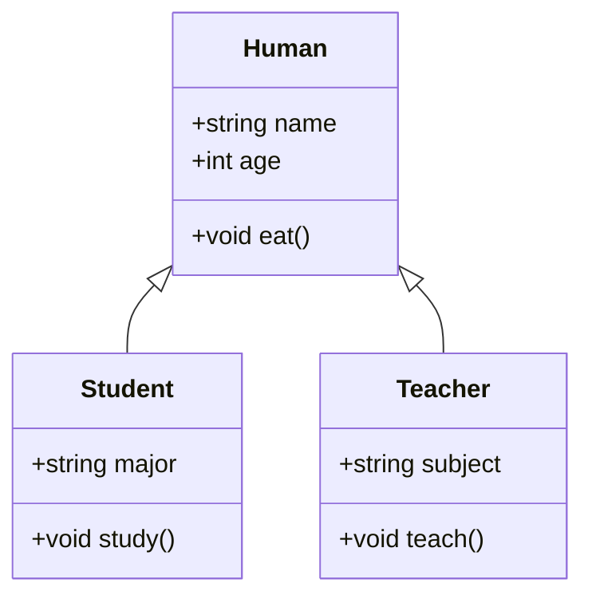

## Access Modifiers vs Access Table

| Access Modifier | External Code | Within Class | Derived Class |
| --------------- | ------------- | ------------ | ------------- |
| `public`        | Yes           | Yes          | Yes           |
| `protected`     | No            | Yes          | Yes           |
| `private`       | No            | Yes          | No            |

## Access Specifiers

| Base Class Access Specifier | Derived Class Access Level | Inherited Members Access Level |
| --------------------------- | -------------------------- | ------------------------------ |
| `public`                    | `public`                   | `public`                       |
| `public`                    | `protected`                | `protected`                    |
| `public`                    | `private`                  | `private`                      |
| `protected`                 | `public`                   | `protected`                    |
| `protected`                 | `protected`                | `protected`                    |
| `protected`                 | `private`                  | `private`                      |
| `private`                   | `public`                   | Not Inherited                  |
| `private`                   | `protected`                | Not Inherited                  |
| `private`                   | `private`                  | Not Inherited                  |

## Visual

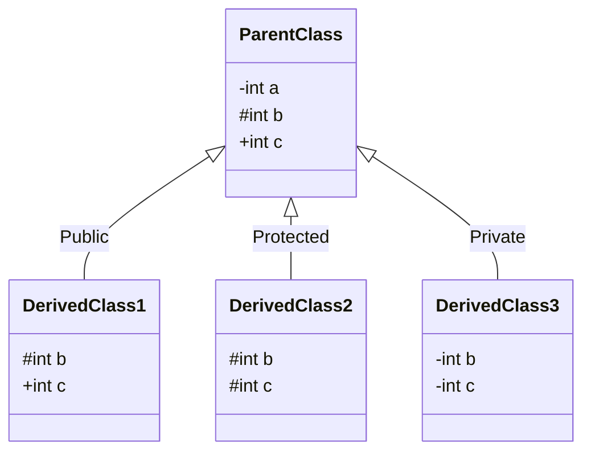

### Note

- `-` means private, `#` means protected, and `+` means public.
- `b` and `c` are not copy as shown in the mermaid diagram, but it is used for demonstration purposes to show the access level of the inherited members in the derived classes.

## Types of Inheritance

### Single Inheritance

```cpp
#include <iostream>
#include <string>

class Animal {
private:
    int a; // need to be initialized in the constructor to avoid garbage value
public:
    void eat() {
        std::cout << "Animal is eating." << std::endl;
    }

    void commonFunction() {
        std::cout << "This is a common function made by Animal." << std::endl;
    }

    Animal(int a) {
        this->a = a;
        std::cout << "Animal constructor called." << std::endl;
    }

    ~Animal() {
        std::cout << "Animal destructor called." << std::endl;
    }
};

class Dog : public Animal {
private:
    int b; // must be initialized in constructor to avoid garbage
public:
    void bark() {
        std::cout << "Dog is barking." << std::endl;
    }

    void commonFunction() {
        std::cout << "This is a common function made by Dog." << std::endl;
    }

    Dog(int a, int b) : Animal(a) {
        this->b = b;
        std::cout << "Dog constructor called." << std::endl;
    }

    ~Dog() {
        std::cout << "Dog destructor called." << std::endl;
    }
};

int main() {
    Dog dog1(10, 20);
    dog1.eat();
    dog1.bark();
    dog1.commonFunction();
    // calls Dog::commonFunction (overridden)

    // output:
    // Animal constructor called. (value of a will be set to 10)
    // Dog constructor called. (value of b will be set to 20)
    // Animal is eating.
    // Dog is barking.
    // This is a common function made by Dog.
    // Dog destructor called.
    // Animal destructor called.

    return 0;
}
```

```text
Animal constructor called.
Dog constructor called.
Animal is eating.
Dog is barking.
This is a common function made by Dog.
Dog destructor called.
Animal destructor called.
```

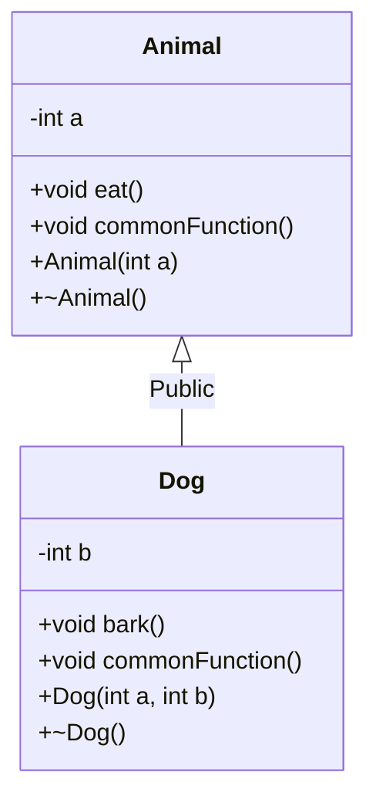

### Multilevel Inheritance

```cpp
#include <iostream>
#include <string>

class Animal {
private:
    int a ;
public:
    void eat() {
        std::cout << "Animal is eating." << std::endl;
    }

    Animal(int a){
        this->a = a;
        std::cout << "Animal constructor called." << std::endl;
    }

    ~Animal() {
        std::cout << "Animal destructor called." << std::endl;
    }

};

class Dog : public Animal {
private:
    int b ;
public:
    void bark() {
        std::cout << "Dog is barking." << std::endl;
    }

    Dog(int a, int b) : Animal(a) {
        this->b = b;
        std::cout << "Dog constructor called." << std::endl;
    }

    ~Dog() {
        std::cout << "Dog destructor called." << std::endl;
    }
};

class Puppy : public Dog {
private:
    int c ;
public:
    void weep() {
        std::cout << "Puppy is weeping." << std::endl;
    }

    Puppy(int a, int b, int c) : Dog(a, b) {
        this->c = c;
        std::cout << "Puppy constructor called." << std::endl;
    }

    ~Puppy() {
        std::cout << "Puppy destructor called." << std::endl;
    }
};

int main(){
    Puppy puppy1(10, 20, 30);
    puppy1.eat();  // Inherited from Animal class
    puppy1.bark(); // Inherited from Dog class
    puppy1.weep(); // Defined in Puppy class

    // output:
    // Animal constructor called. (value of a will be set to 10)
    // Dog constructor called. (value of b will be set to 20)
    // Puppy constructor called. (value of c will be set to 30)
    // Animal is eating.
    // Dog is barking.
    // Puppy is weeping.
    // Puppy destructor called.
    // Dog destructor called.
    // Animal destructor called.

    return 0;
}
```

```text
Animal constructor called.
Dog constructor called.
Puppy constructor called.
Animal is eating.
Dog is barking.
Puppy is weeping.
Puppy destructor called.
Dog destructor called.
Animal destructor called.
```

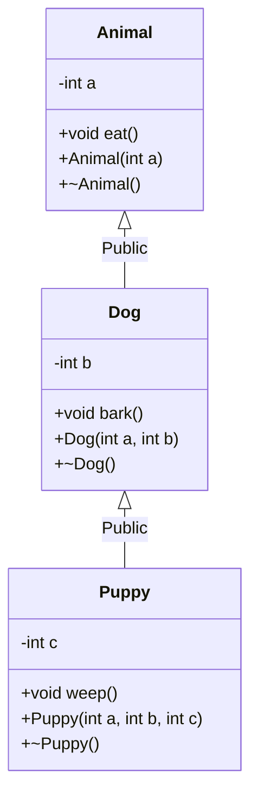

### Multiple Inheritance

```cpp
#include <iostream>
#include <string>

class Animal {
private:
    int a;
public:
    void eat() {
        std::cout << "Animal is eating." << std::endl;
    }

    Animal(int a) {
        this->a = a;
        std::cout << "Animal constructor called." << std::endl;
    }

    ~Animal() {
        std::cout << "Animal destructor called." << std::endl;
    }
};

class Pet {
private:
    int b;
public:
    void play() {
        std::cout << "Pet is playing." << std::endl;
    }

    Pet(int b) {
        this->b = b;
        std::cout << "Pet constructor called." << std::endl;
    }

    ~Pet() {
        std::cout << "Pet destructor called." << std::endl;
    }
};

class Dog : public Animal, public Pet {
private:
    int c;
public:
    void bark() {
        std::cout << "Dog is barking." << std::endl;
    }

    Dog(int a, int b, int c) : Animal(a), Pet(b) {
        this->c = c;
        std::cout << "Dog constructor called." << std::endl;
    }

    ~Dog() {
        std::cout << "Dog destructor called." << std::endl;
    }
};

int main() {
    Dog dog1(10, 20, 30);
    dog1.eat();  // Inherited from Animal class
    dog1.play(); // Inherited from Pet class
    dog1.bark(); // Defined in Dog class

    // output:
    // Animal constructor called.
    // Pet constructor called.
    // Dog constructor called.
    // Animal is eating.
    // Pet is playing.
    // Dog is barking.
    // Dog destructor called.
    // Pet destructor called.
    // Animal destructor called.

    return 0;
}
```

```text
Animal constructor called.
Pet constructor called.
Dog constructor called.
Animal is eating.
Pet is playing.
Dog is barking.
Dog destructor called.
Pet destructor called.
Animal destructor called.
```

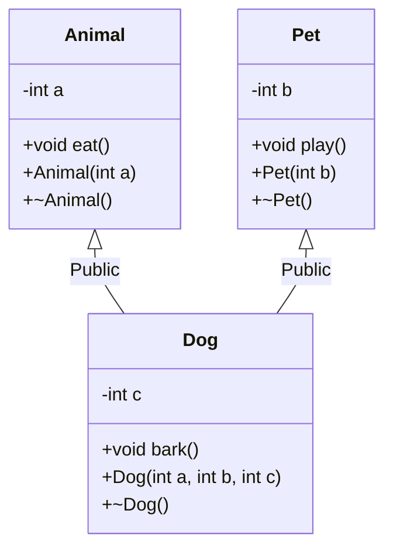

#### Note
When a class inherits from multiple base classes:

```cpp
class DerivedClass : public ParentClass1,
                     public ParentClass2, ...,
                     public ParentClassN
```

Constructors are called in the **order of inheritance declaration**:

1. `ParentClass1` constructor
2. `ParentClass2` constructor
3. ...
4. `ParentClassN` constructor
5. `DerivedClass` constructor

Destructors are called in the **reverse order**:

1. `DerivedClass` destructor
2. `ParentClassN` destructor
3. ...
4. `ParentClass2` destructor
5. `ParentClass1` destructor

### Hierarchical Inheritance

```cpp
#include <iostream>
#include <string>

class Animal {
private:
    int a;
public:
    void eat() {
        std::cout << "Animal is eating." << std::endl;
    }

    Animal(int a) {
        this->a = a;
        std::cout << "Animal constructor called." << std::endl;
    }

    ~Animal() {
        std::cout << "Animal destructor called." << std::endl;
    }
};

class Dog : public Animal {
private:
    int b;
public:
    void bark() {
        std::cout << "Dog is barking." << std::endl;
    }

    Dog(int a, int b) : Animal(a) {
        this->b = b;
        std::cout << "Dog constructor called." << std::endl;
    }

    ~Dog() {
        std::cout << "Dog destructor called." << std::endl;
    }
};

class Cat : public Animal {
private:
    int c;
public:
    void meow() {
        std::cout << "Cat is meowing." << std::endl;
    }

    Cat(int a, int c) : Animal(a) {
        this->c = c;
        std::cout << "Cat constructor called." << std::endl;
    }

    ~Cat() {
        std::cout << "Cat destructor called." << std::endl;
    }
};

int main() {
    Dog dog1(10, 20);
    dog1.eat();  // Inherited from Animal class
    dog1.bark(); // Defined in Dog class

    Cat cat1(30, 40);
    cat1.eat();  // Inherited from Animal class
    cat1.meow(); // Defined in Cat class

    // output:
    // Animal constructor called. (value of a will be set to 10)
    // Dog constructor called. (value of b will be set to 20)
    // Animal is eating.
    // Dog is barking.
    // Animal constructor called. (value of a will be set to 30)
    // Cat constructor called. (value of c will be set to 40)
    // Animal is eating.
    // Cat is meowing.
    // Cat destructor called.
    // Animal destructor called.
    // Dog destructor called.
    // Animal destructor called.

    return 0;
}
```

```text
Animal constructor called.
Dog constructor called.
Animal is eating.
Dog is barking.
Animal constructor called.
Cat constructor called.
Animal is eating.
Cat is meowing.
Cat destructor called.
Animal destructor called.
Dog destructor called.
Animal destructor called.
```

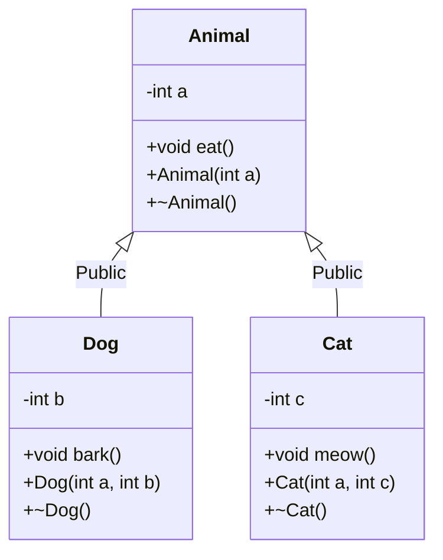

### Hybrid Inheritance

```cpp
#include <iostream>
#include <string>

class Animal {
private:
    int a;
public:
    void eat() {
        std::cout << "Animal is eating." << std::endl;
    }

    Animal(int a) {
        this->a = a;
        std::cout << "Animal constructor called." << std::endl;
    }

    ~Animal() {
        std::cout << "Animal destructor called." << std::endl;
    }
};

class Pet {
private:
    int b;
public:
    void play() {
        std::cout << "Pet is playing." << std::endl;
    }

    Pet(int b) {
        this->b = b;
        std::cout << "Pet constructor called." << std::endl;
    }

    ~Pet() {
        std::cout << "Pet destructor called." << std::endl;
    }
};

class Dog : public Animal, public Pet {
private:
    int c;
public:
    void bark() {
        std::cout << "Dog is barking." << std::endl;
    }

    Dog(int a, int b, int c) : Animal(a), Pet(b) {
        this->c = c;
        std::cout << "Dog constructor called." << std::endl;
    }

    ~Dog() {
        std::cout << "Dog destructor called." << std::endl;
    }
};

class Puppy : public Dog {
private:
    int d;
public:
    void weep() {
        std::cout << "Puppy is weeping." << std::endl;
    }

    Puppy(int a, int b, int c, int d) : Dog(a, b, c) {
        this->d = d;
        std::cout << "Puppy constructor called." << std::endl;
    }

    ~Puppy() {
        std::cout << "Puppy destructor called." << std::endl;
    }
};

int main() {
    Puppy puppy1(10, 20, 30, 40);
    puppy1.eat();  // Inherited from Animal class via Dog
    puppy1.play(); // Inherited from Pet class via Dog
    puppy1.bark(); // Inherited from Dog class
    puppy1.weep(); // Defined in Puppy class

    // output:
    // Animal constructor called.
    // Pet constructor called.
    // Dog constructor called.
    // Puppy constructor called.
    // Animal is eating.
    // Pet is playing.
    // Dog is barking.
    // Puppy is weeping.
    // Puppy destructor called.
    // Dog destructor called.
    // Pet destructor called.
    // Animal destructor called.

    return 0;
}
```

```text
Animal constructor called.
Pet constructor called.
Dog constructor called.
Puppy constructor called.
Animal is eating.
Pet is playing.
Dog is barking.
Puppy is weeping.
Puppy destructor called.
Dog destructor called.
Pet destructor called.
Animal destructor called.
```

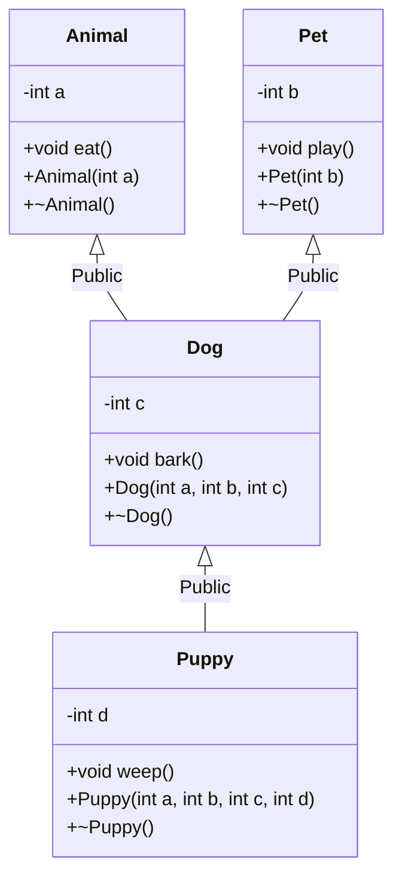

### Multipath Inheritance (Diamond Problem)

Multipath inheritance occurs when a class is derived from two or more classes which, in turn, are derived from the same common base class. This creates a diamond-shaped hierarchy and leads to the **Diamond Problem**, where the derived class ends up with multiple copies of the common base class's attributes and methods. This creates ambiguity when trying to access those inherited members.

```cpp
#include <iostream>

class Animal {
public:
    int age;
};

class Mammal : public Animal {};

class Pet : public Animal {};

class Dog : public Mammal, public Pet {};

int main() {
    Dog d;
    // d.age = 5; // ERROR: Ambiguity! Is it d.Mammal::age or d.Pet::age?
    return 0;
}
```

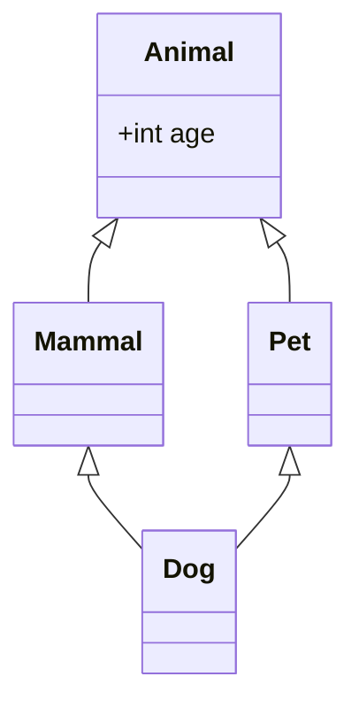

When `Dog` tries to access an attribute from `Animal` (like `age`), the compiler doesn't know whether to use the copy inherited through `Mammal` or the copy inherited through `Pet`.

#### Solution 1: Resolving via Scope Resolution Operator `::`

We can resolve the ambiguity explicitly by specifying which path to take using the scope resolution operator (`::`).

```cpp
#include <iostream>

class Animal {
public:
    int age;
};

class Mammal : public Animal {};

class Pet : public Animal {};

class Dog : public Mammal, public Pet {};

int main() {
    Dog d;

    // Explicitly defining the path
    d.Mammal::age = 5;
    d.Pet::age = 10;

    std::cout << "Age via Mammal: " << d.Mammal::age << std::endl;
    std::cout << "Age via Pet: " << d.Pet::age << std::endl;

    // Note: still leaves two separate copies of 'Animal' in memory.
    return 0;
}
```

```text
Age via Mammal: 5
Age via Pet: 10
```

#### Solution 2: Virtual Inheritance (`virtual` Keyword)

The most common and efficient solution is to use **virtual inheritance**. By adding the `virtual` keyword when inheriting from the common base class, we ensure that only **one single instance** (one shared copy) of the base class is inherited by the deepest derived class, fixing both the memory overhead and the access ambiguity.

```cpp
#include <iostream>

class Animal {
public:
    int age;
};

// Use "virtual" keyword to prevent duplicate base class copies
class Mammal : virtual public Animal {};

class Pet : virtual public Animal {};

class Dog : public Mammal, public Pet {};

int main() {
    Dog d;

    // Works perfectly without ambiguity!
    d.age = 5;

    std::cout << "Dog's age is: " << d.age << std::endl; // Output: 5

    return 0;
}
```

```text
Dog's age is: 5
```

# Polymorphism

Polymorphism is a fundamental principle of Object-Oriented Programming (OOP) that allows objects of different classes to be treated as objects of a common base class. The word comes from Greek — "many forms" — and that's exactly what it delivers: one interface, multiple behaviors depending on the context. In C++, polymorphism is achieved through function overloading, operator overloading, and most powerfully, through **virtual functions** and **inheritance**.

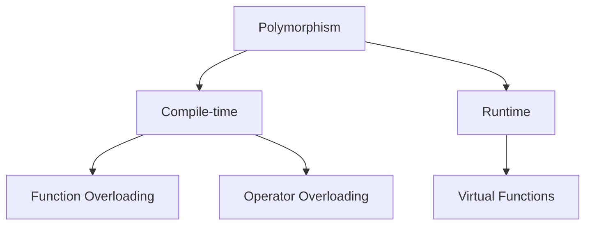

> **Compile-time polymorphism** is resolved by the compiler before the program runs. **Runtime polymorphism** is resolved while the program is executing, using the actual type of the object.


## Function Overloading

Function overloading lets you define multiple functions with the **same name** but **different parameter lists** — different in number, type, or both. The compiler picks the right version at compile time based on the arguments you pass.

```cpp
#include <iostream>

void print(int i) {
    std::cout << "Integer: " << i << std::endl;
}

void print(double d) {
    std::cout << "Double: " << d << std::endl;
}

void print(std::string s) {
    std::cout << "String: " << s << std::endl;
}

int main() {
    print(42);        // Calls print(int)
    print(3.14);      // Calls print(double)
    print("Hello");   // Calls print(std::string)

    return 0;
}
```

```text
Integer: 42
Double: 3.14
String: Hello
```

> **How the compiler decides:** It looks at the type of each argument and selects the best-matching overload. If no exact method exists, it attempts implicit conversions. If it finds zero or more than one match after conversions, it raises a compile error.

## Operator Overloading

Operator overloading lets you redefine the behavior of built-in operators (`+`, `-`, `*`, `==`, etc.) for your own classes. This makes user-defined types feel as natural to work with as primitives.

**Built-in example** — the `+` operator already behaves differently depending on type:

```cpp
#include <iostream>

int main() {
    int a = 5, b = 10;
    std::cout << a + b << std::endl;  // Output: 15  (integer addition)

    std::string x = "Dev ";
    std::string y = "Trivedi";
    std::cout << x + y << std::endl;  // string concatenation
}
```

```text
15
Dev Trivedi
```

**User-defined example** — overloading `+` for a `Complex` number class:

```cpp
#include <iostream>

class Complex {
private:
    double real;
    double imag;

public:
    Complex(double real, double imag) : real(real), imag(imag) {}

    // Overload + to add two Complex numbers
    Complex operator+(const Complex& other) const {
        return Complex(real + other.real, imag + other.imag);
    }

    void display() const {
        std::cout << real << " + " << imag << "i" << std::endl;
    }
};

int main() {
    Complex c1(1.0, 2.0);
    Complex c2(3.0, 4.0);

    Complex c3 = c1 + c2;  // Calls our overloaded operator+

    std::cout << "Result: ";
    c3.display();  // Output: 4 + 6i

    return 0;
}
```

```text
Result: 4 + 6i
```

> **Why `private` members are accessible:** `operator+` is a member function of `Complex`, so it has direct access to the private members of _any_ `Complex` object — not just `this`, but also `other`.

### Operators That Cannot Be Overloaded

| Operator                                                        | Name                |
| --------------------------------------------------------------- | ------------------- |
| `::`                                                            | Scope resolution    |
| `.`                                                             | Member access       |
| `.*`                                                            | Pointer-to-member   |
| `?:`                                                            | Ternary conditional |
| `sizeof`                                                        | Size of type        |
| `typeid`                                                        | Runtime type info   |
| `alignof`                                                       | Alignment query     |
| `noexcept`                                                      | Exception check     |
| `static_cast`, `dynamic_cast`, `const_cast`, `reinterpret_cast` | Cast operators      |

### Stream Operators — `<<` and `>>`

The most commonly overloaded operators in practice are `<<` (insertion) and `>>` (extraction) for use with C++ streams (`std::cout`, `std::cin`, files). They are typically overloaded as **friend functions** because the left-hand operand is a stream, not your class:

```cpp
#include <iostream>
#include <string>

class Student {
private:
    std::string name;
    int age;

public:
    Student(const std::string& n, int a) : name(n), age(a) {}

    // Friend declaration allows the operator to access private members
    friend std::ostream& operator<<(std::ostream& os, const Student& s);
    friend std::istream& operator>>(std::istream& is, Student& s);
};

// Overload << for printing
std::ostream& operator<<(std::ostream& os, const Student& s) {
    os << "Student{Name: " << s.name << ", Age: " << s.age << "}";
    return os;  // Returning the stream enables chaining: cout << s1 << s2;
}

// Overload >> for reading
std::istream& operator>>(std::istream& is, Student& s) {
    is >> s.name >> s.age;
    return is;
}

int main() {
    Student s("Alice", 20);
    std::cout << s << std::endl;     // Student{Name: Alice, Age: 20}

    Student t("", 0);
    std::cin >> t;                    // Read name and age from input
    std::cout << t << std::endl;
    return 0;
}
```

```text
Student{Name: Alice, Age: 20}
```

### Subscript Operator — `operator[]`

Overloading `[]` lets your objects behave like built-in arrays or maps:

```cpp
#include <iostream>
#include <vector>

class IntArray {
private:
    std::vector<int> data;
    size_t size;

public:
    IntArray(size_t n) : data(n, 0), size(n) {}

    // Non-const version — allows modification
    int& operator[](size_t index) {
        return data[index];
    }

    // Const version — read-only access on const objects
    const int& operator[](size_t index) const {
        return data[index];
    }
};

int main() {
    IntArray arr(5);

    arr[0] = 10;  // Uses non-const operator[]
    arr[1] = 20;

    std::cout << "arr[0] = " << arr[0] << std::endl;

    const IntArray constArr(3);
    // constArr[0] = 5;  // ERROR: would use const operator[]
    std::cout << "constArr[0] = " << constArr[0] << std::endl;
    return 0;
}
```

```text
arr[0] = 10
constArr[0] = 0
```

### Function Call Operator — `operator()`

Overloading `()` makes objects callable like functions. This is the foundation of **functors** and is heavily used in STL algorithms:

```cpp
#include <iostream>
#include <vector>
#include <algorithm>

class GreaterThan {
private:
    int threshold;

public:
    GreaterThan(int t) : threshold(t) {}

    // The function call operator
    bool operator()(int x) const {
        return x > threshold;
    }
};

int main() {
    std::vector<int> numbers = {1, 5, 10, 15, 20, 25};

    // Use the functor with std::count_if
    auto count = std::count_if(
        numbers.begin(), numbers.end(), GreaterThan(10));
    std::cout << "Numbers greater than 10: " << count << std::endl;
    return 0;
}
```

```text
Numbers greater than 10: 3
```

### Increment and Decrement — `++` and `--`

Distinguishing prefix from postfix is done with a dummy `int` parameter for the postfix version:

```cpp
#include <iostream>

class Counter {
private:
    int count;

public:
    Counter(int c = 0) : count(c) {}

    // Prefix: ++c
    Counter& operator++() {
        ++count;
        return *this;
    }

    // Postfix: c++ (int parameter is just a marker)
    Counter operator++(int) {
        Counter temp = *this;  // Save the current state
        ++count;
        return temp;           // Return the old state
    }

    int get() const { return count; }
};

int main() {
    Counter c(5);
    Counter a = ++c;             // Prefix: a = 6, c = 6
    std::cout << "After ++c: a=" << a.get() << ", c=" << c.get() << std::endl;

    Counter b = c++;             // Postfix: b = 6, c = 7
    std::cout << "After c++: b=" << b.get() << ", c=" << c.get() << std::endl;
    return 0;
}
```

```text
After ++c: a=6, c=6
After c++: b=6, c=7
```

### Best Practices for Operator Overloading

- **Preserve the semantics of the operator.** `+` should add, not multiply. `==` should compare, not assign. Operators that don't behave intuitively are worse than no operator overloading.
- **Provide matching operators.** If you overload `==`, also overload `!=`. If you overload `<`, consider `<=`, `>`, `>=`.
- **Prefer free functions over member functions** for symmetric operators like `+`, `-`, `*`, where both operands should be treated equally. This also enables implicit conversions on the left operand.
- **Don't overload operators you don't need.** The presence of an overloaded operator is an implicit promise to the user about its behavior — overload sparingly.

### The Spaceship Operator `<=>` (C++20)

C++20 introduced the **three-way comparison operator** `<=>` (informally called the "spaceship operator"). A single definition of `<=>` automatically generates `==`, `!=`, `<`, `<=`, `>`, `>=`:

```cpp
#include <iostream>
#include <compare>
#include <string>

class Student {
public:
    std::string name;
    int age;

    Student(const std::string& n, int a) : name(n), age(a) {}

    // One definition generates all six comparison operators
    auto operator<=>(const Student& other) const = default;
};

int main() {
    Student a("Alice", 20);
    Student b("Bob", 22);

    std::cout << std::boolalpha;
    std::cout << "a < b:  " << (a < b)  << std::endl;
    std::cout << "a > b:  " << (a > b)  << std::endl;
    std::cout << "a == b: " << (a == b) << std::endl;
    std::cout << "a != b: " << (a != b) << std::endl;
    return 0;
}
```

```text
a < b:  true
a > b:  false
a == b: false
a != b: true
```

The compiler compares each member in declaration order, lexicographically. Custom comparison logic is also possible by writing your own implementation.

---

## Method Overriding and Virtual Functions

Method overriding occurs when a derived class provides its own implementation of a method already defined in the base class — same name, same return type, same parameters. The key question in C++ is: _which version gets called when you go through a pointer or reference?_ The answer depends entirely on whether the method is `virtual`.

### Without `virtual` (Static Dispatch)

Without `virtual`, C++ resolves the call at **compile time** based on the **declared type of the pointer** — not the actual object it points to. This is called static dispatch.

```cpp
#include <iostream>

class Animal {
public:
    void sound() {
        std::cout << "Animal makes a sound." << std::endl;
    }
};

class Dog : public Animal {
public:
    void sound() {
        std::cout << "Dog barks." << std::endl;
    }
};

int main() {
    Animal* ptr = new Dog();  // ptr is declared as Animal*
    ptr->sound();             // Compiler sees Animal* → calls Animal::sound()

    delete ptr;
    return 0;
}

// Output:
// Animal makes a sound.
```

```text
Animal makes a sound.
```

Even though `ptr` actually points to a `Dog`, the compiler only looks at the declared type `Animal*` and binds `sound()` to `Animal::sound()` at compile time. The `Dog` version is never called.

### With `virtual` (Dynamic Dispatch)

Marking a method `virtual` tells C++ to defer the decision to **runtime**. It looks at the actual type of the object in memory and calls the appropriate version. This is called dynamic dispatch, and it's the foundation of runtime polymorphism.

```cpp
#include <iostream>

class Animal {
public:
    virtual void sound() {    // virtual enables runtime dispatch
        std::cout << "Animal makes a sound." << std::endl;
    }

    virtual ~Animal() {}  // Always use a virtual destructor in base classes
};

class Dog : public Animal {
public:
    void sound() override {  // override catches typos at compile time
        std::cout << "Dog barks." << std::endl;
    }
};

int main() {
    Animal* ptr = new Dog();
    ptr->sound();  // Runtime: sees Dog object → calls Dog::sound()

    delete ptr;
    return 0;
}

// Output:
// Dog barks.
```

```text
Dog barks.
```

> **How it works under the hood:** Each class with virtual functions gets a hidden **vtable** (virtual function table) — an array of function pointers. Each object carries a hidden **vptr** that points to its class's vtable. When you call a virtual function, C++ follows the vptr to the vtable and calls the right function for the actual object type.

### Polymorphism in Action — Heterogeneous Collections

The real power of virtual functions shines when you store different derived types through a common base pointer:

```cpp
#include <iostream>
#include <vector>
using namespace std;

class Animal {
public:
    virtual void sound() {
        cout << "Animal makes a sound." << endl;
    }
    virtual ~Animal() {}
};

class Dog : public Animal {
public:
    void sound() override {
        cout << "Dog barks." << endl;
    }
};

class Cat : public Animal {
public:
    void sound() override {
        cout << "Cat meows." << endl;
    }
};

int main() {
    vector<Animal*> animals;
    animals.push_back(new Dog());
    animals.push_back(new Cat());
    animals.push_back(new Animal());

    for (auto& animal : animals) {
        animal->sound();  // Calls the correct version for each object
    }

    for (auto& animal : animals) {
        delete animal;
    }

    return 0;
}

// Output:
// Dog barks.
// Cat meows.
// Animal makes a sound.
```

```text
Dog barks.
Cat meows.
Animal makes a sound.
```

This is the core benefit: you can write generic code that operates on `Animal*` and it automatically does the right thing for every derived type — even ones you haven't written yet.

### Rules for Virtual Functions

- They **cannot be static** — virtual dispatch requires an object instance (a vptr), which static functions don't have.
- They are dispatched through **object pointers or references** — calling through a value type (e.g., `Animal a = Dog()`) slices the object and loses polymorphism.
- They **can be a friend** of another class — friendship and virtual dispatch are orthogonal features.
- They should be **defined in the base class** and optionally overridden in derived classes (an unoverridden virtual simply uses the base class version).
- Always declare a **virtual destructor** in any class with virtual functions. Without it, deleting a derived object through a base pointer is undefined behavior — the derived destructor won't be called and resources will leak.

### Pure Virtual Functions and Abstract Classes

A **pure virtual function** is a virtual function with no implementation in the base class. It acts as a contract — any concrete derived class _must_ provide its own implementation, or it too becomes abstract and cannot be instantiated.

Syntax: append `= 0` to the function declaration.

```cpp
class Shape {
public:
    virtual double area() = 0;  // Pure virtual — no body here
    virtual ~Shape() {}
};
```

A class that contains at least one pure virtual function is called an **abstract class**. You cannot create objects of an abstract class directly — it exists solely to define an interface for its subclasses.

```cpp
#include <iostream>
#include <cmath>
using namespace std;

class Shape {
public:
    virtual double area() = 0;       // Pure virtual
    virtual void describe() = 0;     // Pure virtual

    virtual ~Shape() {}
};

class Circle : public Shape {
private:
    double radius;
public:
    Circle(double r) : radius(r) {}

    double area() override {
        return M_PI * radius * radius;
    }

    void describe() override {
        cout << "Circle with radius " << radius
             << ", area = " << area() << endl;
    }
};

class Rectangle : public Shape {
private:
    double width, height;
public:
    Rectangle(double w, double h) : width(w), height(h) {}

    double area() override {
        return width * height;
    }

    void describe() override {
        cout << "Rectangle " << width << "x" << height
             << ", area = " << area() << endl;
    }
};

int main() {
    // Shape s;  // Error: cannot instantiate an abstract class

    Shape* shapes[] = { new Circle(5.0), new Rectangle(4.0, 6.0) };

    for (auto& s : shapes) {
        s->describe();
        delete s;
    }

    return 0;
}

// Output:
// Circle with radius 5, area = 78.5398
// Rectangle 4x6, area = 24
```

```text
Circle with radius 5, area = 78.5398
Rectangle 4x6, area = 24
```

> **Abstract class vs interface:** C++ has no dedicated `interface` keyword. An abstract class where _all_ methods are pure virtual and there is no data effectively acts as an interface — a pure capability contract with zero implementation.

### Key Rules for Pure Virtual Functions and Abstract Classes

| Rule                   | Detail                                                                                                                                                  |
| ---------------------- | ------------------------------------------------------------------------------------------------------------------------------------------------------- |
| Instantiation          | Abstract classes cannot be instantiated directly                                                                                                        |
| Derived obligation     | A derived class must override **all** pure virtual functions, or it also becomes abstract                                                               |
| Partial implementation | A base class _can_ provide a body for a pure virtual function — derived classes can call it explicitly via `Base::method()`, but must still override it |
| Destructor             | Always declare a `virtual ~Shape() {}` in the base — even in abstract classes — to ensure correct cleanup through base pointers                         |

# Object Slicing

**Object slicing** is a subtle C++ pitfall that occurs when a derived class object is assigned (or passed by value) to a base class object. The derived-class-specific data and behavior are "sliced off," leaving only the base-class portion.

## The Problem

```cpp
#include <iostream>
#include <string>

class Animal {
public:
    std::string name;
    virtual void sound() const {
        std::cout << name << " makes a sound." << std::endl;
    }
    virtual ~Animal() = default;
};

class Dog : public Animal {
public:
    std::string breed;  // Dog-specific data

    void sound() const override {
        std::cout << name << " the " << breed << " barks." << std::endl;
    }
};

int main() {
    Dog d;
    d.name = "Rex";
    d.breed = "Labrador";

    // SLICING: the Dog is copied into a base-class Animal
    // The 'breed' data and the Dog::sound() override are lost!
    Animal a = d;

    a.sound();  // Calls Animal::sound() — Dog's override is sliced off
    // a.breed;  // ERROR: 'breed' is not a member of Animal
    return 0;
}
```

```text
Rex makes a sound.
```

Note that `a.sound()` calls `Animal::sound()` even though `sound` is `virtual` — because the object is now a plain `Animal`, not a `Dog`. The polymorphism that virtual functions provide requires an actual derived object, and slicing destroys it.

## Where Slicing Happens

Slicing occurs whenever a derived object is **copied into a base**:

```cpp
// 1. Assignment
Animal a = d;

// 2. Pass by value
void processAnimal(Animal a) { /* sliced when called with a Dog */ }
processAnimal(d);

// 3. Return by value
Animal makeAnimal() { Dog d; return d; /* sliced */ }
```

## How to Prevent Slicing

### 1. Pass by Reference or Pointer

```cpp
void processAnimal(const Animal& a) {  // Reference — no copy, no slicing
    a.sound();
}

int main() {
    Dog d;
    d.name = "Rex";
    d.breed = "Labrador";
    processAnimal(d);  // No slicing — virtual dispatch works correctly
    return 0;
}
```

```text
Rex the Labrador barks.
```

### 2. Use Smart Pointers

```cpp
#include <memory>

void processAnimal(std::shared_ptr<Animal> a) {
    a->sound();  // Calls Dog::sound()
}

int main() {
    auto d = std::make_shared<Dog>();
    d->name = "Rex";
    d->breed = "Labrador";
    processAnimal(d);
    return 0;
}
```

### 3. Make Base Classes Abstract

If a class is not meant to be instantiated directly, declare it abstract by giving it at least one pure virtual function. The compiler will then reject any attempt to create or pass a base by value:

```cpp
class Animal {
public:
    virtual void sound() const = 0;  // Pure virtual
    virtual ~Animal() = default;
};

// Now this is a compile error:
// Animal a;  // ERROR: cannot instantiate abstract class
```

> **Rule of thumb:** Whenever a class is designed to be a polymorphic base, give it a pure virtual function and pass instances by reference or pointer, never by value. This eliminates slicing as a possibility.

# `override` and `final` Keywords

When a derived class overrides a virtual function from a base class, two C++11 keywords help make that intent explicit and catch mistakes at compile time: `override` and `final`.

## `override`

`override` is placed after the function signature in a derived class to **declare that the function is intended to override a virtual function from a base class**. The compiler will then verify that such a virtual function actually exists in the base — if it doesn't, you get a compile error instead of a silent bug.

### Without `override` — Silent Failure

```cpp
#include <iostream>

class Animal {
public:
    virtual void sound() {
        std::cout << "Animal makes a sound." << std::endl;
    }
    virtual ~Animal() {}
};

class Dog : public Animal {
public:
    // Typo: "sond" instead of "sound"
    // This defines a NEW function — does NOT override Animal::sound
    void sond() {
        std::cout << "Dog barks." << std::endl;
    }
};

int main() {
    Animal* ptr = new Dog();
    ptr->sound();  // Calls Animal::sound() — Dog's version is ignored!
    delete ptr;
    return 0;
}
```

```text
Animal makes a sound.
```

The typo `sond` accidentally created a brand-new function, and polymorphism silently broke. Without reading the code carefully, this bug would be very hard to spot.

### With `override` — Compile-Time Safety

```cpp
#include <iostream>

class Animal {
public:
    virtual void sound() {
        std::cout << "Animal makes a sound." << std::endl;
    }
    virtual ~Animal() {}
};

class Dog : public Animal {
public:
    // The compiler checks that sound() exists in Animal
    void sond() override {  // ERROR: no 'sond' to override
        std::cout << "Dog barks." << std::endl;
    }
};

int main() {
    Animal* ptr = new Dog();
    ptr->sound();
    delete ptr;
    return 0;
}
```

```text
error: 'void Dog::sond()' marked 'override', but does not override
```

The compiler catches the typo immediately — fixing it to `sound()` makes the code correct.

> **Best practice:** Always use `override` on any function in a derived class that is intended to override a virtual function from a base class. It costs nothing at runtime and prevents a whole class of bugs.

## `final`

`final` serves two purposes depending on where it appears:

1. **On a virtual function:** prevents any further derived class from overriding that function.
2. **On a class:** prevents any class from inheriting from it at all.

```cpp
#include <iostream>

class Animal {
public:
    virtual void sound() {
        std::cout << "Animal makes a sound." << std::endl;
    }
    virtual ~Animal() {}
};

class Dog : public Animal {
public:
    // No further class can override sound() beyond this point
    void sound() override final {
        std::cout << "Dog barks." << std::endl;
    }
};

// ERROR: cannot override final function
class Puppy : public Dog {
public:
    void sound() override {  // Compiler error here
        std::cout << "Puppy whimpers." << std::endl;
    }
};

int main() {
    return 0;
}
```

```text
error: virtual function 'virtual void Puppy::sound()' overriding
final function
```

### `final` on a Class — Preventing Inheritance Entirely

```cpp
class Animal {
public:
    virtual void sound() {
        std::cout << "Animal makes a sound." << std::endl;
    }
    virtual ~Animal() {}
};

// No class can inherit from Dog
class Dog final : public Animal {
public:
    void sound() override {
        std::cout << "Dog barks." << std::endl;
    }
};

// ERROR: cannot inherit from a final class
class Puppy : public Dog {  // Compiler error here
};
```

```text
error: cannot derive from 'final' base 'Dog'
```

> **When to use `final`:** Use it to lock down a piece of design that should not be extended — typically for performance, security, or to enforce invariants. Like `override`, it has zero runtime cost.

# `mutable` Keyword

The `mutable` keyword allows a member of a class to be **modified even from within a `const` member function** or even on a `const` object. It is most commonly used for internal bookkeeping that does not represent the object's logical state — things like caches, lazy-evaluation flags, or mutexes.

```cpp
#include <iostream>
#include <string>

class Student {
private:
    std::string name;
    int age;
    mutable int accessCount;  // Not part of the student's logical state

public:
    Student(std::string n, int a) : name(n), age(a), accessCount(0) {}

    // Even though this is a const function, accessCount can be modified
    void displayInfo() const {
        accessCount++;  // OK because accessCount is mutable
        std::cout << "Student Name: " << name << std::endl;
        std::cout << "Student Age: " << age << std::endl;
        std::cout << "Access count: " << accessCount << std::endl;
    }

    int getAccessCount() const {
        return accessCount;
    }
};

int main() {
    const Student s1("John Doe", 20);
    s1.displayInfo();
    s1.displayInfo();
    std::cout << "Total accesses: " << s1.getAccessCount() << std::endl;
    return 0;
}
```

```text
Student Name: John Doe
Student Age: 20
Access count: 1
Student Name: John Doe
Student Age: 20
Access count: 2
Total accesses: 2
```

> **When to use `mutable`:** Sparingly, and only for state that genuinely doesn't represent the object's visible behavior — caches, statistics, lazy initialization flags, mutexes. Misusing `mutable` to escape `const` for legitimate state changes breaks the contract that `const` promises.

# Friend Functions and Classes

In C++, encapsulation ensures that private and protected members of a class cannot be accessed from outside. However, sometimes it is necessary to allow a specific external function or another class to access these private members. This is achieved using the `friend` keyword.

## Friend Function

A friend function is a function that is not a member of a class but is granted access to its private and protected members. It is declared inside the class using the `friend` keyword, but its definition is placed outside the class without the scope resolution operator (`::`).

```cpp
#include <iostream>

class Box {
private:
    double width;

public:
    Box() : width(0) {}

    void setWidth(double w) {
        width = w;
    }

    // Declaration of the friend function
    friend void printWidth(Box box);
};

// Definition of the friend function
// Note: It is not a member function, so no "Box::" is used
void printWidth(Box box) {
    // printWidth is a friend of Box, can access private 'width'
    std::cout << "Width of box: " << box.width << std::endl;
}

int main() {
    Box b;
    b.setWidth(10.5);

    // Calling the friend function
    printWidth(b);

    return 0;
}
// Output: Width of box: 10.5
```

```text
Width of box: 10.5
```

## Friend Class

You can also declare an entire class as a friend of another class. When class `B` is a friend of class `A`, all member functions of class `B` are granted access to the private and protected members of class `A`.

```cpp
#include <iostream>

class Engine {
private:
    int horsepower;

public:
    Engine(int hp) : horsepower(hp) {}

    // Declare class Car as a friend
    friend class Car;
};

class Car {
public:
    void printEnginePower(Engine& e) {
        // Can access private member 'horsepower' of Engine
        std::cout << "The car's engine has "
                  << e.horsepower << " horsepower." << std::endl;
    }
};

int main() {
    Engine v8(450);
    Car myCar;

    myCar.printEnginePower(v8);

    return 0;
}
// Output: The car's engine has 450 horsepower.
```

```text
The car's engine has 450 horsepower.
```

## Important Rules Regarding Friendship

- **Friendship is not mutual:** If class `A` is a friend of class `B`, it does not mean class `B` is a friend of class `A` unless explicitly declared.
- **Friendship is not inherited:** The derived classes of a friend class do not automatically become friends with the class granting friendship.
- **Breaks encapsulation:** Because friends bypass access specifiers, they should be used sparingly. They are most commonly used in operator overloading (like `<<` and `>>`) where an external operator function needs access to internal class data to function correctly.

# Type Casting

C-style casts like `(T)expr` are dangerous because they perform **any** required conversion silently — including dangerous pointer reinterpretations. C++ provides four named cast operators, each with a specific purpose, that the compiler can check for safety and that make the intent of the conversion explicit in the source code.

| Cast               | Purpose                                      | Safety Check |
| ------------------ | -------------------------------------------- | ------------ |
| `static_cast<T>`   | Compile-time known conversions                | Yes (compile) |
| `dynamic_cast<T>`  | Downcasting in a polymorphic hierarchy         | Yes (runtime) |
| `const_cast<T>`    | Add or remove `const` / `volatile` qualifiers | Yes (compile) |
| `reinterpret_cast<T>` | Bit-level reinterpretation (raw memory)     | None         |

## `static_cast`

`static_cast` performs conversions the compiler can verify at compile time: numeric conversions, pointer upcasts (derived to base), explicit constructor calls, and conversion between related pointer types.

```cpp
#include <iostream>

class Base {
public:
    virtual void hello() { std::cout << "Base" << std::endl; }
};

class Derived : public Base {
public:
    void hello() override { std::cout << "Derived" << std::endl; }
    void specific() { std::cout << "Derived-specific" << std::endl; }
};

int main() {
    // Numeric conversion
    double d = 3.14;
    int i = static_cast<int>(d);
    std::cout << "double to int: " << i << std::endl;

    // Pointer upcast (always safe)
    Derived derived;
    Base* basePtr = static_cast<Base*>(&derived);
    basePtr->hello();

    // Pointer downcast (UNSAFE without runtime check —
    // use dynamic_cast instead)
    // Derived* derivedPtr = static_cast<Derived*>(basePtr);  // Risky!
    return 0;
}
```

```text
double to int: 3
Derived
```

## `dynamic_cast`

`dynamic_cast` is used to perform **runtime-checked downcasts** in a polymorphic hierarchy (where the base class has at least one `virtual` function). It returns `nullptr` (for pointers) or throws `std::bad_cast` (for references) if the cast is not valid.

```cpp
#include <iostream>
#include <typeinfo>

class Base {
public:
    virtual void hello() { std::cout << "Base" << std::endl; }
};

class Derived : public Base {
public:
    void hello() override { std::cout << "Derived" << std::endl; }
};

int main() {
    Base* basePtr = new Derived();  // Actually a Derived

    // Safe downcast — checks at runtime
    Derived* derivedPtr = dynamic_cast<Derived*>(basePtr);
    if (derivedPtr) {
        derivedPtr->hello();  // Works!
    } else {
        std::cout << "Cast failed" << std::endl;
    }

    Base* reallyBase = new Base();
    Derived* failed = dynamic_cast<Derived*>(reallyBase);
    if (failed == nullptr) {
        std::cout << "Downcast from Base to Derived is invalid" << std::endl;
    }

    delete basePtr;
    delete reallyBase;
    return 0;
}
```

```text
Derived
Downcast from Base to Derived is invalid
```

> **Why `dynamic_cast` requires a virtual function:** It uses the vtable to look up the actual runtime type of the object. Without `virtual`, the class has no vtable, and `dynamic_cast` won't compile.

## `const_cast`

`const_cast` is the **only** cast that can add or remove the `const` (or `volatile`) qualifier. It does not perform any other type conversion.

```cpp
#include <iostream>

void printLength(char* str) {
    std::cout << "Length: " << strlen(str) << std::endl;
}

int main() {
    const char* literal = "Hello";

    // Old C-style API: takes non-const char*, but we know it won't modify it
    // const_cast is the only way to bridge this gap safely
    printLength(const_cast<char*>(literal));

    return 0;
}
```

```text
Length: 5
```

> **Warning:** Removing `const` from an object that was actually declared `const` and then modifying it is **undefined behavior**. Use `const_cast` only when you are certain the underlying object is not actually const (e.g., legacy C APIs).

## `reinterpret_cast`

`reinterpret_cast` is the most dangerous cast — it tells the compiler to treat the bits of one type as bits of another. It is used for low-level pointer arithmetic, communicating with C libraries, and other situations where you know the memory layout.

```cpp
#include <iostream>

int main() {
    int value = 42;

    // Treat an int pointer as a char pointer (raw memory access)
    char* bytes = reinterpret_cast<char*>(&value);

    std::cout << "Bytes of int 42: ";
    for (size_t i = 0; i < sizeof(int); ++i) {
        std::cout << static_cast<int>(bytes[i]) << " ";
    }
    std::cout << std::endl;

    // Convert any pointer to a void pointer (common pattern)
    void* voidPtr = reinterpret_cast<void*>(&value);
    std::cout << "void*: " << voidPtr << std::endl;

    return 0;
}
```

```text
Bytes of int 42: 42 0 0 0
void*: 0x7ffd5e0a0...
```

> **Use `reinterpret_cast` sparingly and only when you fully understand the memory layout.** Modern C++ code rarely needs it — prefer type-safe abstractions when possible.

## Which Cast Should I Use?

| Situation                                     | Use                  |
| --------------------------------------------- | -------------------- |
| Numeric conversion (`double` to `int`, etc.)  | `static_cast`        |
| Pointer upcast (derived → base)                | `static_cast`        |
| Pointer downcast (base → derived) when safe   | `dynamic_cast`        |
| Removing `const` for legacy C API              | `const_cast`          |
| Raw memory reinterpretation                    | `reinterpret_cast`    |

**Never use C-style casts in modern C++ code.** They are equivalent to one of the four named casts chosen by the compiler, and they make the intent ambiguous — the reader can't tell if a cast is safe, runtime-checked, or a raw memory reinterpretation.

# Special Member Functions — `= default` and `= delete`

C++11 provides two syntaxes for explicitly controlling the compiler's generation of special member functions.

## `= delete` — Prohibiting Operations

The `= delete` syntax after a function declaration **disables** that function entirely. Unlike `private`, which merely hides a function, `delete` makes it a compile error to call the function at all — and the compiler's error message is clear about why.

```cpp
#include <iostream>

class NonCopyable {
private:
    std::string name;

public:
    NonCopyable(const std::string& n) : name(n) {}

    // Explicitly delete the copy constructor and copy assignment
    NonCopyable(const NonCopyable&) = delete;
    NonCopyable& operator=(const NonCopyable&) = delete;

    // Delete the move operations too (optional but explicit)
    NonCopyable(NonCopyable&&) = delete;
    NonCopyable& operator=(NonCopyable&&) = delete;

    void display() const {
        std::cout << name << std::endl;
    }
};

int main() {
    NonCopyable a("Alice");
    a.display();

    // NonCopyable b = a;           // ERROR: use of deleted function
    // a = a;                       // ERROR: use of deleted function
    return 0;
}
```

```text
Alice
```

`= delete` can be applied to **any function**, not just special member functions. It is commonly used to disable specific overloads:

```cpp
void process(int x) { std::cout << "int: " << x << std::endl; }
void process(double x) = delete;  // Prevent floating-point calls

int main() {
    process(42);   // OK
    // process(3.14);  // ERROR: use of deleted function
}
```

```text
int: 42
```

## `= default` — Requesting Compiler Generation

If you want the compiler to generate the default implementation of a special member function, you can write `= default` instead of providing a body. This is especially useful for destructors in polymorphic base classes — marking them `virtual` and `= default` gives you the correct behavior with minimal code:

```cpp
#include <iostream>

class Base {
public:
    // virtual + default = correct polymorphic cleanup
    virtual ~Base() = default;
};

class Derived : public Base {
public:
    ~Derived() {
        std::cout << "Derived destroyed" << std::endl;
    }
};

int main() {
    Base* ptr = new Derived();
    delete ptr;  // Virtual destructor calls ~Derived() then ~Base()
    return 0;
}
```

```text
Derived destroyed
```

> **`= delete` vs `private`:** Use `= delete` for functions you want to be completely unavailable (with clearer error messages). Use `private` for functions you want to hide from external users but may still call from within the class or friends. Prefer `= delete` for clarity in modern C++.

# `volatile`

The `volatile` keyword tells the compiler that a variable's value may change at any time without any action being taken by the code the compiler finds. This prevents the compiler from caching the value in a register or performing aggressive optimizations that would produce stale reads.

```cpp
#include <iostream>

volatile int* sensorRegister = (volatile int*)0x40021000;
    // Hardware register

int main() {
    // The compiler cannot optimize this away —
    // the value may change externally
    while (*sensorRegister == 0) {
        // Wait for hardware signal
    }
    std::cout << "Signal detected at " << sensorRegister << std::endl;
    return 0;
}
```

```text
Signal detected at 0x40021000
```

In modern C++, `volatile` is primarily relevant in:

- **Embedded/memory-mapped I/O** — hardware registers that change outside the program's control
- **Signal handlers** — variables modified by async signal handlers
- **Interrupts** — variables shared between ISR and main code

> **In most application-level C++ code, `volatile` is not needed.** For multithreading, use `std::atomic` (for individual variables) or proper synchronization primitives (`std::mutex`, etc.) instead. `volatile` does not provide any thread-safety guarantees.

# Object-Oriented Design Patterns

The four pillars of OOP — encapsulation, abstraction, inheritance, and polymorphism — are the foundation. **Design patterns** are reusable solutions to problems that occur repeatedly in object-oriented design. They aren't libraries or frameworks; they are templates for *how to structure your classes* to solve a particular problem elegantly.

The classic catalog, *Design Patterns: Elements of Reusable Object-Oriented Software* (1994) by Gamma, Helm, Johnson, and Vlissides (the "Gang of Four"), organized 23 patterns into three categories.

## Creational Patterns

These patterns deal with object creation mechanisms, trying to create objects in a manner appropriate to the situation. They hide the construction logic and make the system independent of how its objects are created, composed, and represented.

| Pattern         | Intent                                                              |
| --------------- | ------------------------------------------------------------------- |
| **Factory**     | Create objects without specifying the exact class of object to create |
| **Abstract Factory** | Create families of related objects without specifying their concrete classes |
| **Builder**     | Construct a complex object step by step, separating representation from construction |
| **Prototype**   | Create new objects by cloning an existing instance                   |
| **Singleton**   | Ensure a class has only one instance, and provide a global point of access |

## Structural Patterns

These patterns deal with object composition — how classes and objects are combined to form larger structures.

| Pattern      | Intent                                                              |
| ------------ | ------------------------------------------------------------------- |
| **Adapter**  | Convert the interface of a class into another interface clients expect |
| **Bridge**   | Decouple an abstraction from its implementation so both can vary independently |
| **Composite**| Compose objects into tree structures to represent part-whole hierarchies |
| **Decorator**| Attach additional responsibilities to an object dynamically          |
| **Facade**   | Provide a unified interface to a set of interfaces in a subsystem   |
| **Flyweight**| Use sharing to support large numbers of fine-grained objects efficiently |
| **Proxy**    | Provide a surrogate or placeholder for another object to control access |

## Behavioral Patterns

These patterns deal with algorithms and the assignment of responsibilities between objects — *who does what*.

| Pattern         | Intent                                                              |
| --------------- | ------------------------------------------------------------------- |
| **Chain of Responsibility** | Pass a request along a chain of handlers until one handles it   |
| **Command**     | Encapsulate a request as an object, thereby parameterizing clients with different requests |
| **Iterator**    | Provide a way to access elements of an aggregate without exposing its underlying representation |
| **Mediator**    | Define an object that encapsulates how a set of objects interact    |
| **Memento**     | Capture and externalize an object's internal state without violating encapsulation |
| **Observer**    | Define a one-to-many dependency between objects so that when one changes, all its dependents are notified |
| **State**       | Allow an object to alter its behavior when its internal state changes |
| **Strategy**    | Define a family of algorithms, encapsulate each one, and make them interchangeable |
| **Template Method** | Define the skeleton of an algorithm, deferring some steps to subclasses |
| **Visitor**     | Represent an operation to be performed on elements of an object structure without changing the classes |

## Common Patterns in C++

Two patterns in particular map almost directly onto features already shown in this document:

**Singleton** — A class with exactly one instance, accessible globally. Often implemented with a static member function returning a static local variable.

```cpp
#include <iostream>

class Database {
private:
    Database() { std::cout << "Database created\n"; }
    Database(const Database&) = delete;             // No copy
    Database& operator=(const Database&) = delete;  // No assign

public:
    static Database& getInstance() {
        static Database instance;  // Created once, thread-safe in C++11+
        return instance;
    }

    void query(const std::string& sql) {
        std::cout << "Running: " << sql << std::endl;
    }
};

int main() {
    Database::getInstance().query("SELECT * FROM students");
    Database::getInstance().query("SELECT * FROM teachers");
    // Both calls return the same single instance.
    return 0;
}
```

```text
Database created
Running: SELECT * FROM students
Running: SELECT * FROM teachers
```

The note "Created" appears only once — confirming the database was constructed exactly once. The `delete`d copy and assignment operators prevent any external code from creating a second instance.

**Observer** — When a subject's state changes, all registered observers are notified. Often implemented with `std::vector` of listener pointers inside the subject, and a virtual `update()` method on the observer interface.

```cpp
#include <iostream>
#include <vector>
#include <string>

class Observer {
public:
    virtual void update(const std::string& message) = 0;
    virtual ~Observer() = default;
};

class Subject {
private:
    std::vector<Observer*> observers;

public:
    void attach(Observer* o) { observers.push_back(o); }
    void detach(Observer* o) {
        observers.erase(
            std::remove(observers.begin(), observers.end(), o),
            observers.end());
    }

    void notify(const std::string& message) {
        for (auto* o : observers) o->update(message);
    }
};

class Logger : public Observer {
public:
    void update(const std::string& message) override {
        std::cout << "[LOG] " << message << std::endl;
    }
};

class Alerter : public Observer {
public:
    void update(const std::string& message) override {
        std::cout << "[ALERT] " << message << std::endl;
    }
};

int main() {
    Subject publisher;
    Logger logger;
    Alerter alerter;

    publisher.attach(&logger);
    publisher.attach(&alerter);
    publisher.notify("System started");

    publisher.detach(&alerter);
    publisher.notify("System shutting down");
    return 0;
}
```

```text
[LOG] System started
[ALERT] System started
[LOG] System shutting down
```

> **Patterns are tools, not goals.** Reach for a pattern when the underlying problem genuinely matches the pattern's intent. Using a Singleton or Observer when a plain function or polling loop would do just adds indirection without benefit.

# Summary

This document has covered the foundations of Object-Oriented Programming in C++:

- **The four pillars:** encapsulation, abstraction, inheritance, polymorphism
- **Language mechanics:** classes, objects, access modifiers, constructors, destructors, copy and move semantics
- **Polymorphism in depth:** overloading, overriding, virtual functions, abstract classes, and runtime dispatch via the vtable
- **Resource management:** RAII, the Rule of Three/Five/Zero, and smart pointers (`unique_ptr`, `shared_ptr`, `weak_ptr`)
- **Key keywords:** `const`, `static`, `explicit`, `override`, `final`, `mutable`, `virtual`, `nullptr`, and the four named casts
- **Design principles:** SOLID, common design patterns, and knowing when to apply them

Each of these topics connects to the others: virtual functions enable polymorphic behavior, smart pointers implement RAII, RAII solves the resource-management problem that the Rule of Five addresses, and patterns like Strategy and Template Method are direct applications of polymorphism. Together, they form a coherent toolkit for designing systems that are clear, maintainable, and extensible.
